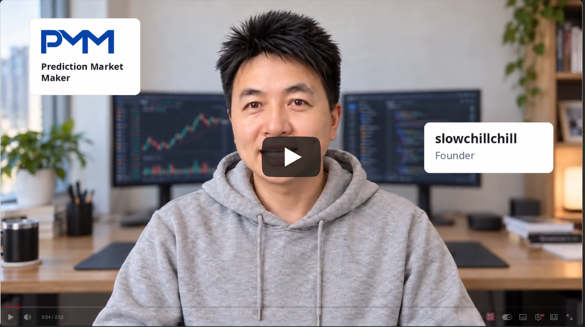
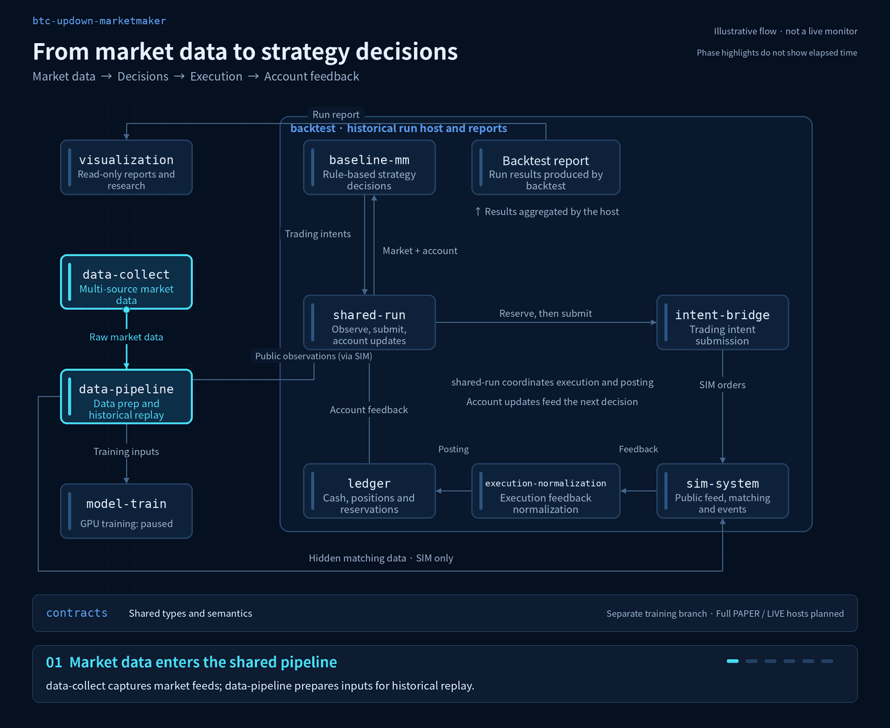

**English** | [简体中文](README.zh-CN.md)

# btc-updown-marketmaker

**Financial AI and trading infrastructure for prediction markets**

An engineering project built around Polymarket’s five-minute BTC Up/Down markets, spanning market data, human-designed strategies, historical backtesting, GPU reinforcement learning and local model inference. It explores how models interpret markets and make trading decisions—and how real data and account outcomes can test those decisions.

[▶ Watch the project introduction on YouTube](https://youtu.be/a9qzkJ_NjKA)

The video shows an earlier two-hour demo; it is a different backtest from the seven-hour results below.

[Strategy research](baseline-mm/) · [Model training](model-train/) · [Contact](https://github.com/slowchillchill)

## Project goals

Turn financial strategy research into reproducible engineering: preserve market event order, compare strategies under simulated execution and account constraints, track training, and verify model behavior across runtimes.

Here, **edge AI means local model inference on a trading node**. The B model route reuses the shared data, backtesting, execution and accounting components used by human-designed strategies. It implements a real model consumer and a grouped learning interface under [#181](https://github.com/slowchillchill/btc-updown-marketmaker/issues/181). [Model interfaces and evidence limits (in Chinese)](model-train/README.md)

## Engineering results

| Capability | Evidence |
| --- | --- |
| Financial data engineering | Completed a source-health study covering **18 days, approximately 762 million raw rows and 2,864 input files**. Per-file aggregation limits intermediate data volume. [Study (in Chinese)](baseline-mm/docs/research/complementary-pair-source-health-18d-20260909-20260926.md) |

The B route implements a GRU actor–critic consumer, grouped PPO/TBPTT learning, finite-horizon economic targets and transactional learning checkpoints. The [original engineering delivery (in Chinese)](model-train/LEARNING.md) records limited synthetic validation. Subsequent, separately authorized studies completed a [minimal real-data chain](https://github.com/slowchillchill/btc-updown-marketmaker/issues/181#issuecomment-6305408177) and a [bounded two-arm mechanism study](https://github.com/slowchillchill/btc-updown-marketmaker/issues/181#issuecomment-6339458665). These results do not establish complete PPO correctness, independent holdout performance, full-day capacity or profitability. The model and experimental reward mechanism have not been adopted.

## Rule-based strategy backtest

A continuous historical replay compared **7 parameter variants of the complementary-pair strategy**. Each started independently with **2,000 pUSD**, using market data from **2026-09-12, 00:00–07:00 UTC**. Results were extracted on 2026-10-14.

| Variant | Ending NAV (pUSD) | NAV change vs. initial capital | Confirmed net P&L (pUSD) | Maximum NAV drawdown |
| --- | ---: | ---: | ---: | ---: |
| Reference `center` | 1,950.54 | -2.47% | -36.01 | 15.15% |
| Innovation term disabled `no-innovation` | 2,321.12 | +16.06% | +323.12 | 5.66% |
| Smaller orders `small-size` | 2,060.89 | +3.04% | +61.61 | 2.98% |
| Inventory skew disabled `no-inventory` | 1,688.54 | -15.57% | -292.22 | 23.84% |
| Active leg repair disabled `passive-repair` | 1,848.86 | -7.56% | -130.90 | 15.74% |
| Stricter health threshold `health2` | 1,972.36 | -1.38% | -3.27 | 11.95% |
| Looser health threshold `health8` | 2,201.74 | +10.09% | +226.11 | 13.66% |

NAV change compares ending net asset value with initial capital. NAV uses conservative position valuation at the cutoff, so its change differs from confirmed net P&L; rebates not yet due are excluded. Drawdown is the cumulative maximum from the start through hour seven.

These results come from the historical version before the shared funds-policy repair in [#301](https://github.com/slowchillchill/btc-updown-marketmaker/issues/301). They do not evaluate the repaired policy. These are the first seven hours completed by every variant. The planned twelve-hour run stopped during hour eight after a funds-reservation failure, with unsettled positions and open orders remaining. Simulated latency depends on request identifiers, so differences cannot be attributed entirely to parameters. This single historical simulation does not establish live returns or consistent profitability. [Source figures and methodology](baseline-mm/docs/research/complementary-pair-seven-hour-results-20261014.json)

## Modules and decision flow

The animation shows the historical backtest loop for human-designed strategies. `backtest` assembles the run; `shared-run` coordinates observations, decisions, submission and account updates. The B model consumer and learner reuse this public chain; their interfaces are documented separately in [model-train (in Chinese)](model-train/README.md).

[Static diagram](assets/readme/architecture-static-en.png) · [Interactive HTML (download and open locally)](assets/readme/architecture-en.html)

Collection and preparation turn market data into public observations. The strategy combines these with account state to produce trading intents. Funds are reserved before submission to simulated execution. Fills and economic feedback pass through normalization and the ledger, updating the account for the next decision. Hidden matching inputs go only to the simulator; the results viewer is read-only. Animation highlights show sequence, not actual duration or live status.

Module responsibilities

| Area | Modules | Responsibility |
| --- | --- | --- |
| Market data | `data-collect`, `data-pipeline` | Collection, preparation and historical replay |
| Strategies and models | `baseline-mm`, `model-train` | Human-designed strategies, model development and training |
| Simulation and backtesting | `sim-system`, `backtest` | Matching simulation, historical validation and results |
| Execution and accounts | `intent-bridge`, `execution-normalization`, `ledger`, `shared-run` | Submission adapters, execution feedback, funds and settlement |
| Research visualization | `visualization` | Explore markets, accounts and run evidence |

`contracts` defines shared types and interfaces. Complete PAPER and LIVE application entry points, and independent holdout evaluation, remain planned.

## Technology stack

| Area | Technologies | Purpose |
| --- | --- | --- |
| Systems and execution | Rust · Tokio · Polymarket Rust SDK | Async market data, trading interfaces and shared runtime components |
| Data engineering | Arrow · Parquet · Rayon · DuckDB | Columnar storage, parallel processing and research queries |
| Model training and inference | Rust · Python · PyTorch · GRU · PPO/TBPTT | Model consumer, grouped learning and checkpoint interfaces; [current implementation (in Chinese)](model-train/README.md) |
| Research visualization | Rust · React · TypeScript · ECharts | Read and explore research evidence |

## Status and collaboration

The project is in strategy research. The B route has implemented model inference, grouped learning and explicit rule-loading and recovery interfaces on the shared implementation, and completed the bounded real-data studies linked above. Formal training, independent holdout evaluation, full-day capacity validation and complete live deployment remain separate work requiring their applicable authorization and budgets. Each result is bounded by the version, sample and validation scope in its linked evidence; completed runs do not authorize new work. [Rule-loading and recovery interfaces (in Chinese)](model-train/RULES.md)

Open to technical roles and collaboration in financial AI, GPU training pipelines, Rust trading infrastructure and local model inference. [GitHub · slowchillchill](https://github.com/slowchillchill)
