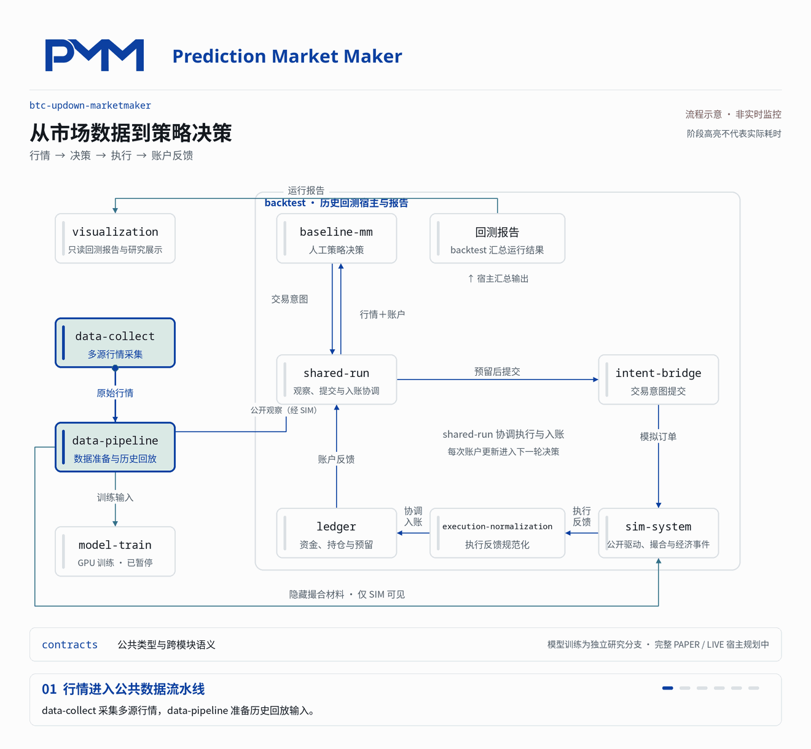

[English](README.md) | **简体中文**

# btc-updown-marketmaker

**面向预测市场的金融 AI 与交易系统**

以 Polymarket 的 BTC 五分钟涨跌市场为研究场景，建设多源行情、人工策略、历史回测、GPU 强化学习与本地模型推理能力。项目关注模型如何理解市场、作出交易决策，以及如何用真实数据和账户结果检验这些决策。

[▶ 前往 YouTube 观看项目介绍](https://youtu.be/a9qzkJ_NjKA)

视频展示早期两小时演示，与下方七小时成绩属于不同回测。

[策略研究](baseline-mm/) · [模型训练](model-train/) · [交流与合作](https://github.com/slowchillchill)

## 项目目标

将金融策略研究推进到可复现的工程实践：保留市场数据的时间顺序，在模拟执行与账户约束下比较策略，记录训练过程，并验证模型交付后的行为一致性。

端侧 AI 在本项目中指**交易节点上的本地模型推理**。训练使用 GPU 算力，推理方向采用 ONNX Runtime 与 Rust，减少模型服务对外部推理接口的依赖。人工策略与学习策略复用公共数据、回测和账户能力，让研究结果具有可比较的基础。

## 工程成果

| 能力 | 已有证据 |
| --- | --- |
| 金融数据工程 | 完成 **18 天、约 7.62 亿行原始数据**的来源健康研究，覆盖 2,864 个输入文件；通过按文件汇总控制中间数据规模。[研究记录](baseline-mm/docs/research/complementary-pair-source-health-18d-20260909-20260926.md) |
| GPU 训练流水线 | 已搭建训练环境，并完成 PPO 更新、MLflow 实验记录与检查点恢复的有限验证。历史训练方案采用 **100 ms 决策周期**；该路线已暂停，待基于 A/公共实现重设计。[训练进展](https://github.com/slowchillchill/btc-updown-marketmaker/issues/181) |
| 跨语言模型交付 | 历史版本已验证 **PyTorch → ONNX Runtime → Rust** 的数值与交易意图一致性，为交易节点本地推理提供工程证据。[验证报告](model-train/validation/issue-176/report.md) |

100 ms 表示历史训练方案的决策周期，不是实测执行延迟。历史版本的推理验证与有限训练验证分别记录，尚不代表新版训练到部署的完整链路已完成。

## 人工策略回测

以同一互补配对策略的 **7 组候选配置**比较连续历史回放表现。行情范围为 **2026-09-12 UTC 00:00—07:00**，每组独立初始资金 **2,000 pUSD**；本次结果于 2026-10-14 提取。

| 候选配置 | 期末净值 NAV（pUSD） | 净值变化率 | 确认净损益（pUSD） | 最大净值回撤 |
| --- | ---: | ---: | ---: | ---: |
| 参考配置 `center` | 1,950.54 | -2.47% | -36.01 | 15.15% |
| 关闭创新项 `no-innovation` | 2,321.12 | +16.06% | +323.12 | 5.66% |
| 小订单 `small-size` | 2,060.89 | +3.04% | +61.61 | 2.98% |
| 关闭库存偏移 `no-inventory` | 1,688.54 | -15.57% | -292.22 | 23.84% |
| 关闭主动补腿 `passive-repair` | 1,848.86 | -7.56% | -130.90 | 15.74% |
| 严格健康阈值 `health2` | 1,972.36 | -1.38% | -3.27 | 11.95% |
| 宽松健康阈值 `health8` | 2,201.74 | +10.09% | +226.11 | 13.66% |

净值变化率为期末 NAV 相对初始资金的变化。NAV 采用截止时点的保守持仓估值，因此净值变化与确认净损益不同；未成熟返佣未计入。回撤为起点至七小时截止的累计最大值。

这些成绩来自 [#301 公共资金政策修复](https://github.com/slowchillchill/btc-updown-marketmaker/issues/301)之前的历史版本，不用于评价修复后的资金政策。本表取自各组共同完成的前七小时快照；原定十二小时作业在第八小时因资金预留失败中断，截止时仍有未决持仓和开放订单。模拟延迟受请求标识影响，组间差异不能全部归因于参数。以上为单次历史模拟结果，不代表实盘收益或稳定盈利。[原始数值摘录与口径](baseline-mm/docs/research/complementary-pair-seven-hour-results-20261014.json)

## 模块关系与决策流

下图展示人工策略的历史回测闭环。`backtest` 组织整个运行，`shared-run` 协调观察、决策、提交与账户更新；模型训练属于独立研究分支，目前已暂停。

[查看静态图](assets/readme/architecture-static.png) · [交互版 HTML（下载后本地打开）](assets/readme/architecture.html)

行情经采集和数据准备形成公开观察；策略结合账户状态生成交易意图，经资金预留后提交模拟执行。成交与经济反馈经过规范化和账本更新，再进入下一轮决策。隐藏撮合材料仅交给模拟器，结果浏览器只读展示报告。动画高亮表示流程顺序，不表示实际耗时或实时运行状态。

查看模块职责

| 功能区 | 模块 | 职责 |
| --- | --- | --- |
| 市场数据 | `data-collect`、`data-pipeline` | 多源采集、数据准备与历史回放 |
| 策略与模型 | `baseline-mm`、`model-train` | 人工策略研究、模型开发与训练 |
| 仿真与回测 | `sim-system`、`backtest` | 模拟撮合、历史验证与结果汇总 |
| 执行与账户 | `intent-bridge`、`execution-normalization`、`ledger`、`shared-run` | 交易提交适配、执行反馈、资金与结算 |
| 研究可视化 | `visualization` | 浏览市场、账户与运行证据 |

`contracts` 定义跨模块公共类型与接口。完整的 PAPER、LIVE 上层入口及独立留出评价仍属于规划范围。

## 技术栈

| 方向 | 技术 | 用途 |
| --- | --- | --- |
| 系统与执行 | Rust · Tokio · Polymarket Rust SDK | 异步行情、交易接口与公共运行能力 |
| 数据工程 | Arrow · Parquet · Rayon · DuckDB | 列式存储、并行处理与研究查询 |
| 模型与训练 | Python · PyTorch · CUDA · PPO · MLflow | 强化学习、GPU 训练与实验追踪 |
| 推理与展示 | ONNX Runtime · Rust · React · TypeScript · ECharts | 本地模型推理与研究可视化 |

## 当前阶段与合作

项目处于策略研究阶段。历史模型训练路线已暂停，待基于 A/公共实现重设计。正式长跑训练、新版模型推理接线及完整实盘部署尚未完成；各项成果以链接中的版本、样本和验证范围为准。

关注金融场景 AI、GPU 训练流水线、Rust 交易基础设施与本地模型推理。欢迎相关技术岗位与项目合作交流：[GitHub · slowchillchill](https://github.com/slowchillchill)。
