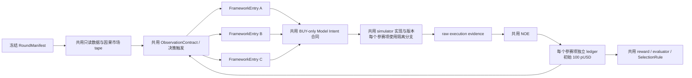

# 模型框架竞赛核心重构需求

事项编号：`rebuild-core-model-framework-competition`。

状态：核心需求已于 `2026-07-11` 经用户批准落盘。本文件只授权需求定义，不授权创建或执行实现计划、训练框架、数据处理、模型训练、paper、live 或资金操作。

后续配套文档使用同一事项编号，当前均尚未创建、尚未授权：

- 计划：`plan/rebuild-core-model-framework-competition-plan.md`
- 框架：`plan/rebuild-core-model-framework-competition-framework.md`
- Changelog：`changelog/rebuild-core-model-framework-competition-changelog.md`

本文件的本地证据基线包括：

- `demand/rebuild-core-demand.md`
- `demand/rebuild-core-new-data-only-demand.md`
- `plan/rebuild-core-new-data-only-plan.md`
- `plan/rebuild-core-new-data-only-training-framework.md`
- `changelog/rebuild-core-new-data-only-changelog.md`
- `mistake-log/2026-07-03-重构前错误汇总与优先级.md`
- `AGENTS.md` 中的“模型框架竞赛研究来源”

## 1. 文档权威与事项边界

1. 本事项建立新的模型框架竞赛文档族，不在旧 `rebuild-core-new-data-only` 文档中继续修补 ESAR-v1。
2. 本事项取代旧文档中的以下模型选择权威：
   - ESAR-v1 作为固定共享模型框架；
   - 固定的“监督表示学习 → 反事实候选 → grouped ranker”训练主线；
   - 对 Transformer、TLOB、SSM、Neural CDE、RL 等框架的预先排除或后置结论。
3. 旧文档中的新数据唯一来源、事件驱动、BUY-only、NOE、ledger、reward、模拟平台和部署边界，不自动复制；只有被新 `RoundManifest` 显式引用版本与 hash 后才成为该轮权威。
4. 旧 `mistake-log/online-feedback/gates/p0_gate_specs.json` 中的 `TrainingFeedbackGate` 和旧 `mistake-log/online-feedback/schemas/execution_feedback_labels.schema.json` 对本竞赛整体不再具有规范权威。新竞赛必须建立 BUY-only 的标签与 gate 合同，只选择性继承仍然适用的字段。
5. 旧决策继续保留为可审计历史，不擦除、不伪装成从未发生。
6. 当前只授权本需求落盘与审查。方案、框架和 changelog 的创建、编写或修改均须取得用户后续明确授权；本文件本身不构成该授权。

## 2. 总目标

建立一套共用、冻结、可复现、可审计的竞赛环境，让不同完整模型框架在相同条件下竞争，筛选最适合 Polymarket BTC 5 分钟 Up/Down 市场的策略框架。

竞赛选择的是完整 `FrameworkEntry`，包括模型结构、状态机制、训练方法、特征视图、策略输出及运行产物，而不仅是某个神经网络 backbone。若未来需要证明“架构 A 优于架构 B”，必须另做冻结其他变量的受控实验，不能从本竞赛结果直接推断。

竞赛必须允许最终结论为“没有合格参赛项”“没有盈利证据”或“没有唯一胜者”，不得预设必须选出冠军。

外部论文中的分类准确率、F1、AUC、预测能力、通用股票回测或模拟收益不能直接作为本项目盈利证据。任何框架都必须在本文件定义的固定数据、固定合同、固定模拟平台、真实账本和统一评估中重新证明其能力。

## 3. 共用系统与竞赛变量



“共用”表示同一代码、合同、版本和 hash，不表示多个参赛模型共享可变运行实例。不同参赛项不得共享 mutable cache、RNG、账户、订单、market buffer、模型状态或 ledger。

### 3.1 共用核心

共用核心是唯一业务解释器，独占：

- immutable typed raw 与 canonical event tape；
- 时间排序、事件身份、市场隔离和因果回放；
- `ObservationContract`、市场规则、费用和动作合同；
- simulator、Intent Bridge、raw evidence、NOE；
- ledger、资金状态、reward、统计评估；
- trial/artifact registry、bundle gate 和竞赛报告。

validator、adapter、模型框架和报告程序只能校验、转换或展示已经冻结的业务语义，不得重新解释订单生命周期、合法性、ledger、reward 或平台规则。

### 3.2 竞赛变量

模型框架可以竞争：

- 因果表示、状态与记忆机制；
- DRQN、DQN、GRU、TCN、Transformer、LOB 模型、SSM、Neural CDE、树模型或其他架构；
- 训练目标、训练算法、optimizer、policy/scorer；
- 合法的模型内部表示学习、ensemble 或 distillation；
- 超参数、容量和资源—收益取舍。

共享合同必须保持语言和后端中立。PyTorch、JAX、TensorFlow、树模型或原生 C/C++/Rust 实现均不得因库名被预先接受或排除。

### 3.3 已批准纳入候选范围的论文启发模型

用户于 `2026-07-12` 批准将 DRQN 和 DQN 纳入后续竞赛计划的 `FrameworkEntry` 预注册候选范围。来源论文为 Pankaj Kumar 的 *Deep Reinforcement Learning for High-Frequency Market Making*：

- 论文 URL：<https://proceedings.mlr.press/v189/kumar23a/kumar23a.pdf>

对二者的批准边界固定为：“纳入按本项目合同重新定义、独立实现的论文启发版本；论文模型、模拟器、reward 和盈利结论都不能原样参赛。”

DRQN 和 DQN 只有在使用本项目共用的 Observation、BUY-only Model Intent、simulator、NOE、ledger、reward、100 pUSD、评估与 runtime gate，并形成完整、可审计的 `FrameworkEntry` 和 `PolicyBundle` 后，才可按统一准入规则参加竞赛。本次批准只确认候选研究范围，不构成 `eligible`、晋级、盈利或冠军结论。

## 4. 策略与动作边界

1. 策略族冻结为 `buy_only_dual_mechanism_v1`。
2. 本策略是一个同时包含配对获取和临近结算方向性 BUY 的复合 BUY-only 策略族。旧 `TrainingFeedbackGate` 中“paired/maker 与 directional 进入同一 leaderboard 即 fail-closed”以及要求 merge/redeem baseline 的规则，被本需求明确取代。
3. 本方主动订单严格为 BUY-only；`BUY` 是系统常量，不是模型输出维度。
4. 合法动作包括：
   - `hold_existing_buys`；
   - BUY UP；
   - BUY DOWN；
   - 联合 BUY UP + DOWN；
   - 取消指定 BUY；
   - cancel-all-buys。
5. 禁止自有 SELL、replace、split、merge、redeem、模型 pause、第二套 risk intent 或 runtime 影子策略。
6. 外部盘口 bid/ask、ask depth 和 trade side 必须完整保留，它们是市场事实，不是本方 SELL 能力。
7. 单腿 BUY 始终合法，因为它可能处于异步配对、库存调整或方向性持有过程中；共用程序不得推断模型的主观动作类别。
8. 若使用统一的 late-market phase 定义，该定义必须在正式竞赛前冻结；是否存在足够方向性 edge、买哪一侧、价格、数量和时机必须由参赛模型决定，enumerator/runtime 不得建立第二套“证据充分”策略门。

### 4.1 两种合法收益机制

同一竞赛同时允许：

1. confirmed 双腿异步成交的实际 all-in 成本低于完整集终局价值；
2. 临近结算时的方向性单腿 BUY。

两种机制共用同一动作、ledger、NAV、reward 和排行榜，不分榜、不添加配对奖励、方向性惩罚或类别 bonus。

双腿实际 all-in 成本只按 confirmed 持仓增量计算，即实际成交价加实际 fee，再减去已入账且可归因的 rebate。静态盘口、下单意图、provisional/failed fill 或显示价格和小于 1 均不等于已经盈利。

互补 BUY 只在方向暴露意义上近似卖出另一侧；它会继续消耗 pUSD、增加 gross inventory、改变 paired quantity 和最终 payoff distribution，不能描述为 SELL、减仓或释放资金。

配对与方向性归因只能作为 order-invariant、baseline-relative 的事后审计分解，允许存在 interaction/residual bridge；分解必须与总 ledger/NAV 对账，不能进入奖励或排名。

## 5. 固定数据与 Observation 边界

1. 正式竞赛继续只使用经用户批准的新数据。
2. 旧数据、旧 bundle、旧 normalizer、旧 checkpoint、外部预训练权重、外部合成样本或 holdout 派生先验不得混入同一轮。
3. 当前正式 cohort 日期和持续天数仍未冻结，不能把旧 14 天或历史讨论中的其他天数写成当前事实。
4. 每轮所有参赛项必须消费相同：
   - immutable dataset manifest；
   - split 与 eligible episode 集；
   - causal cutoff；
   - T-30 与 market 生命周期；
   - 业务事件与决策触发点；
   - label 和 maturity/censoring 合同。
5. 决策必须由真实业务事件触发，禁止退化为固定 tick。
6. 共同冻结的是 `ObservationContractHash`，不是每个实例的 observation 值。模型行为不同后，各自账户、持仓和挂单状态可以合法分化。
7. 每条 observation 必须能追溯到公共 tape hash、本参赛项 account-state digest 和 causal cutoff。
8. `AccountRunState` 在同一评估轨迹内跨 market carry；`MarketContextState` 必须按 market_id 隔离。T-30 重叠市场各有独立 context，market switch 必须完成 cancel/audit/reset/warmup 并输出 reset receipt/state digest。
9. 薄 adapter 可以进行字段选择、布局、窗口、padding、mask、dtype、collation 和 cache 转换；不得读取未来、label、其他参赛项账户，或重排事件、重建另一套 book/ledger/label/action。
10. 模型内部可以学习 representation；normalizer、PCA、tokenizer 或其他可学习统计只能在对应 train fold 内拟合并记录 hash。
11. 若候选需要额外数据源、额外历史、不同 causal cutoff 或新的 Observation 字段，必须进入新轮次，不能与原轮混榜。
12. exact/approximate event identity、episode eligibility 与 promotion capability 必须成为该轮合同的一部分。若数据能力只能支持 `representation_only/non-promotable`，所有参赛项统一受此限制，任何框架不得自行升级能力声明。

### 5.1 SplitContract

每轮必须冻结 `SplitContractHash`，并满足：

1. 在完整 eligible cohort 上先执行全局 strict time-forward 分区，再生成文件、shard 或 loader view；禁止逐文件局部切分后拼接。
2. 同一 market 的全部事件与标签、相互重叠的 observation/label 窗口及其依赖组不得跨 partition。
3. partition 间的 purge/embargo 必须覆盖该轮最大 observation lookback、label maturity/settlement horizon 和重叠 market 依赖；不能只覆盖模型输入窗口。
4. normalizer、PCA、tokenizer、feature selection 或其他可学习统计只能在对应 train fold 拟合，再以冻结 hash 应用于后续 partition。
5. train、development、calibration 与 final holdout 的时间边界、分组、purge/embargo 和用途必须在访问后续 partition 前冻结；test/final 不得参与训练、调参、candidate selection 或 rerank。

### 5.2 BUY-only 训练反馈最低合同

旧 SELL/merge/redeem schema 被废止后，不得只留下一个未定义的 `label` hash。每轮必须冻结新的 `BuyOnlyExecutionFeedbackContract` 和 `CompetitionTrainingFeedbackGate`，最低要求：

- `BUY` 是唯一主动下单方向，并记录 decision、account、market、FrameworkEntry、PolicyBundle、适用的 training/evaluation seed 和 scenario 身份；
- 每条样本绑定 intent、causal cutoff、公共 tape/event identity、book digest 和本分支 account-state digest；
- 反馈绑定 NOE outcome、partial/full fill、reject、unknown、cancel、fee、实际入账 rebate/reward、端到端 latency 和标为 proxy/assumed 的 queue evidence；
- no-submit opportunity、执行失败、unknown、未成交、成交后负收益、resolution/settlement 和 censor reason 使用可区分状态，禁止压成同一个负标签；
- label maturity、authority source、settlement source、生成时间和 provenance 可审计；未成熟或 censored 样本不能伪装成成熟收益标签；
- gate 必须覆盖因果性、来源、成熟度、trial/selection 防偏和 BUY-only action-surface；旧 strategy-family 分榜、SELL、merge/redeem 字段不得恢复。

配对和方向性字段只允许用于同一复合策略的事后归因与诊断，不得创建分榜、路径奖励或第二套策略权威。

### 5.3 规则与真相面证据

每轮必须冻结 `AuthorityAndRuleEvidenceManifest`，至少记录规则来源 URL/版本/有效时间、官方 Polymarket Rust SDK 版本、market metadata、费用与 rebate 假设、采集时间、适用市场和证据 hash。若历史证据另有协议版本，也只能作为规则 provenance 记录，不构成使用 raw client、manual signing 或 shadow SDK 的授权。

该 manifest 必须区分 dataset-derived、simulator-derived、ledger-derived、platform-derived 和 reconciled evidence 的用途与优先级；这些真相面不得互相覆盖或互相冒充。离线竞赛冻结适用于数据历史区间的规则证据，不能把以后查询到的当前规则倒灌到历史；paper/live 的当前规则刷新属于后续独立授权事项。

## 6. 每个模型的 100 pUSD 资金合同

竞赛术语必须分离：

- `FrameworkEntry`：预注册的完整框架方案；
- `PolicyBundleCandidateSlot`：registration 关闭前预注册的有限候选身份与预算槽位，允许按冻结搜索协议在轮内物化产物；
- `PolicyBundle`：某个训练 seed/trial 产生的模型产物；
- `FrameworkSubmission`：某个 FrameworkEntry 在 final 前冻结的唯一参赛 PolicyBundle；
- `IntentCandidate`：某个决策点的动作候选。

正式评估账户键为：

```text
round_id
× evaluation_split_id
× policy_bundle_id
× evaluation_seed
× simulator_scenario_id
```

每个账户键只在启动时注入一次 `100 pUSD`，并满足：

1. 初始状态只有 `100 pUSD` free cash，positions、orders、reservations、pending、claims 和 suspense 全部为零。
2. 同一评估 split 内跨连续 market carry 账户状态，不按每个 5 分钟市场重置。
3. development、calibration 和 final holdout 之间不得 carry 资金或持仓；每个独立评估轨迹重新从相同 100 pUSD fixture 开始。
4. 反事实 `IntentCandidate` 分支只能克隆同一决策点的账户快照，不能重新获得 100 pUSD。
5. 除首次注资外，不允许充值、补款、模型间转账或亏损后重启。
6. 平台结算回款、实际费用、实际入账返利或奖励属于交易内部经济流，不属于补款。
7. 100 pUSD 是起始 free cash，不代表可以无条件一次性投入。
8. 所有参赛项共享同一 `CapitalBudgetContract`，负责现金守恒、平台合法 admission、互斥 reservation/commit/position-cost 桶、batch reservation 和异步第二腿 headroom。任何最低 reserve、单 market 最大投入或其他额外硬约束必须经用户批准并对同轮所有参赛项一致，且不得成为 runtime 影子策略。

### 6.1 最低经济会计不变量

完整 `AccountRunTrajectory` 是该账户的唯一经济权威。无论后续 ledger 的内部实现如何，均须满足：

1. 初始 `100 pUSD` 只是 opening fixture，不是交易收益，也不产生 reward。
2. 评估期间禁止首次注资以外的 external cash flow；账户主要经济量固定为 `G_account = terminal settled NAV - 100 pUSD`。
3. collateral 使用/成本基础状态必须互斥：同一 pUSD 金额不得同时计入 free cash、order reservation、provisional commitment 和已离开 cash 的 unsettled position cost basis；状态转移必须幂等且不可双计。position cost 只是历史成本基础，不是固定面值资产。
4. outcome token、provisional asset 和 winning claim 是与上述成本基础分开的资产状态；其 conservative mark、终局 payout 和 NAV 可以随市场事实变化，不能用“名义 pUSD 桶守恒”抹掉盈亏。
5. `unmatched_settlement_credit_suspense` 是非负 contra，不是与 cash 互斥的资产桶；它可以和平台已确认 cash 同时存在，但只在 NAV 中扣减一次，不进入 external cash flow 或 capital-at-work。
6. credit-before-claim 时，先按平台证据增加 cash 和等额 suspense；匹配 claim 后到时，原子注销 claim 与对应 suspense，不再次增加 cash。partial/aggregate credit 的 matched amount 不得超过 outstanding claim，未归因部分继续保留 suspense。
7. fee、平台实际入账 rebate/reward 和 settlement 各只进入 ledger 一次。平台 settlement credit 是 claim 到 cash 的内部资产转换，不是外部收入，也不得再次计入交易 reward。
8. winning claim、losing token、late fill、重复或乱序 evidence 均须通过稳定身份和 reconciliation 闭合，不得因证据迟到重复 apply。
9. 事后归因、dashboard 和统计视图只能与该轨迹对账，不能成为第二本经济账。

### 6.2 资金耗尽状态

资金状态必须区分：

- `submit_blocked_insufficient_free_cash`：暂时没有合法 BUY 能力，可能通过取消、成交或结算恢复；
- `capital_exhausted_pending_closure`：没有当前 BUY 能力，但仍有订单、持仓、claim、suspense、residual 或回款等待闭合；
- `terminal_capital_depleted`：所有经济状态均已闭合，且剩余资金低于根据冻结的 min-size、合法价格下界和 fee envelope 事前定义、适用于所有剩余 eligible market 的 `GlobalMinimumLegalBuyCost`；该下界不能按当前盘口或未来 tape 临时决定。

只要仍有待闭合经济状态，或资金只是在当前盘口下不足但未低于上述全局下界，就必须保持暂时 blocked 并继续消费共同 future tape。终局耗尽后不得补钱、重启或从统计样本中删除；剩余竞赛区间按 no-action terminal 状态保留，避免幸存者偏差。

## 7. 每轮冻结合同

正式 trial 前必须冻结顶层 `RoundManifest`。它只引用各子合同及其版本/hash，不重复嵌入所有合同全文。

`RoundManifest` 至少引用：

- dataset、`SplitContractHash`、eligible episode、exact/approximate capability；
- Observation、label、causal cutoff；
- `BuyOnlyExecutionFeedbackContract` 与 `CompetitionTrainingFeedbackGate`；
- `AuthorityAndRuleEvidenceManifest`；
- market rules、费用、late-market phase；
- BUY-only action 与 CapitalBudget；
- simulator capability、calibration、market-impact、scenario；
- `NormalizedExecutionEventContract`、ledger、settlement、reward、risk；
- `CompetitionGateVerdictContract`；
- 100 pUSD fixture 与资本耗尽状态机；
- maturity tail、censor 和 residual bounds；
- training/search budget、硬件、环境和 `TrainingRunManifest` schema；
- `BaselineRegistryHash`；
- `FrameworkEntryRegistryHash`；
- `PolicyBundleCandidateSlotRegistryHash`；
- final 前冻结的 `PolicyBundleRosterHash`；
- `FrameworkSubmissionContract`；
- `SelectionRuleContract`；
- runtime、延迟、内存和 parity gate；
- pristine final-holdout 状态。

一轮在首次 development/search trial 前关闭 registration。此时必须同时冻结：

- `FrameworkEntryRegistry`；
- 每个 entry 的训练/搜索协议、搜索空间、seed、候选 slot、预算向量、调度、停止规则和 development/calibration 选择规则；
- `FrameworkEntry → PolicyBundle candidate slot` 映射；
- `FrameworkEntry → final submission` 的形成或聚合规则。

PolicyBundle 的字节产物可以在 registration 关闭后，严格按上述预注册协议 materialize；这不视为新增参赛项。任何未预注册的框架、candidate slot、seed、搜索路径、重训/修改产物或手工选择都属于新增 FrameworkEntry/PolicyBundle，必须进入下一轮。所有已注册 slot 无论成功、失败、pruned、OOM 或未被选中，均进入 trial ledger、资源核算和多重试验总体。

`FrameworkSubmissionContract` 冻结“一 FrameworkEntry 一 final submission”：每个 entry 只能提交一个按预注册 development/calibration 规则选出的 PolicyBundle，或一个在 registration 时已声明组成规则的 ensemble 并物化为单一可部署 PolicyBundle。训练 seed 可以用于形成或检验 submission，但不得在 final 后挑选表现最好的 seed/bundle；正式胜负归属于 FrameworkEntry，不把同一 entry 的多个 bundle 当作冠军彩票。

`PolicyBundleRosterHash` 必须在 final/frozen evaluation 前冻结，并绑定 `FrameworkEntry → final PolicyBundle` 的一对一映射、bundle/adapter/normalizer/export hash 和形成证据。roster 之外的 bundle 不得进入同轮 winner 选择；final 结果不得反向修改 bundle、adapter、threshold、risk weight、ensemble 组成或选择另一个 seed 产物。

影响结果语义的数据、合同、代码、threshold、risk weight 或 simulator 变化必须生成新 `round_id`。注释和展示字段等非语义变化不应使竞赛失效。

final holdout 只能正式访问一次；观察后任何影响结果的修改都需要新 round 和新的未来 holdout。

## 8. 模拟公平性与执行现实

1. 所有参赛项共享同一外生 future tape，但各自拥有隔离的 own-order、fill、account 和 market-impact overlay。
2. common random numbers 不能只依赖相同 seed 或函数调用顺序；必须采用稳定语义键或经过验证的等价耦合，保证不同分支仍具有正确边际分布。
3. 同一 decision state 的 candidate-level 共同反事实必须共享起点 snapshot、decision/cutoff、causal future tape、scenario/RNG 语义、共同 continuation policy 和 branch-differential economic terminal；不得用不同 horizon、不同 maturity tail 或只闭合有利分支来生成标签。
4. submission-level 完整策略配对评估必须共享初始 100 pUSD fixture、外生 tape、scenario/RNG 语义、评估时间范围以及 maturity/closure/censor 规则；每个 FrameworkSubmission 必须运行自身冻结 policy，不能强制共享 continuation policy 或抹掉策略差异。
5. simulator 必须统一覆盖：
   - partial/asymmetric fill；
   - 双腿 batch 逐项 accepted/rejected/unknown；
   - queue proxy、latency、cancel race；
   - fee、rebate、cash reservation；
   - resolution、claim、credit 和 settlement；
   - 预注册的 small-agent market-impact 能力。
6. queue 只能标为 proxy；不可识别或未校准参数只能标为 `assumed/stress`。
7. 超出已验证 participation/depth 能力的结果只能进入 impact stress，不能成为可晋级盈利证据。
8. 必须在同一目标硬件条件下实测并注入端到端 `event observable → adapter/preprocess → framework bridge/queue/state transfer → model → decode → intent available` 延迟分布，包括必要的序列化与排队；该延迟必须进入 action available time 和 stale-intent 判断，不能把昂贵工作移到“模型推理”计时之外。
9. simulator lifecycle closure、订单 closure 和账户 economic closure 必须分开记录。
10. 固定 simulator 的胜者只能称为“在该冻结模拟合同下胜出”；没有真实本账户执行校准时仍为 conditional/non-promotable。

### 8.1 NormalizedExecutionEvent 最低状态机

每轮必须冻结 `NormalizedExecutionEventContract`，至少包含稳定 intent/client/order/correlation identity、evidence source、accepted classifier、lifecycle state、ledger effect、runtime gate policy、dedup/idempotency key 和 reconciliation state。

- accepted 只能由冻结的正向证据规则产生；空 order id、error-only 或 transport success 不得自动成为 accepted。
- unknown 必须保留保守 reservation 和待核对状态，不得当作 fill、reject 或终态，也不得在缺少幂等证明时重复 submit。
- partial、accepted、rejected、unknown、cancel、late fill、resolution、claim 和 credit 的后续 evidence 只能由共用业务解释器做一次性裁决；validator、adapter 或框架不得另建裁决器。
- 每个 ledger effect 必须能回溯原始 evidence 与 NOE 身份，并证明 exactly-once apply；reconciliation 只能补充或纠正受控状态，不能无痕覆盖历史。

### 8.2 CompetitionGateVerdictContract

每轮必须冻结统一且有限的 `CompetitionGateVerdictContract`，把每个 gate 的 verdict、severity 和机器后果一一映射，禁止自由文本决定控制流。

离线资格 verdict 至少固定为：

- `eligible`；
- `eligible_with_warning`；
- `research_only_non_promotable`；
- `ineligible`；
- `evidence_failure`。

只有前两类可以按冻结规则进入正式经济排名；`research_only_non_promotable` 可以单独报告但不能产生 `WINNER_SELECTED`，后两类不得进入排名。warning 不得被临时升级为 hard stop，安全或证据失败也不得降级成 warning。

模拟运行时动作至少固定为 `allow`、`no_new_buy`、`cancel_only` 和 `fail_closed`。这些是所有参赛项共用的安全/证据后果，不是模型策略维度；任何动作都不得删除亏损轨迹、重置账户或重新注入 100 pUSD，且 settlement/reconciliation 必须继续到冻结的闭合边界。

gate report 必须记录合同版本/hash、gate 名称、输入证据 hash、checked/missing rules、verdict、severity、唯一机器动作和理由。verdict 只能由共用业务解释器按冻结映射产生；validator 只能校验，不能自行升级、降级或发明新的业务语义。

具体 RNG key、simulator 内部结构和性能实现由后续框架与计划定义；需求层只冻结上述公平性和可验证结果。

## 9. 参赛准入与计算公平

1. 不预选任何模型框架或冠军。
2. `FrameworkEntry` 必须登记代码、权重、数据 provenance、commit、hash、许可证、传递依赖、安全公告、维护状态、训练方法、搜索空间、adapter、export 和 runtime 能力。
3. 许可证未知或不兼容的代码只能作为只读研究证据，不得执行、复制或晋级；任何外部代码执行前必须冻结 source commit/package/weight hash、lockfile 与 SBOM、许可证与漏洞裁决，并生成 install/run gate report。
4. 外部候选只能在无钱包、无交易密钥、无生产凭据、无资金能力的隔离 sandbox 中安装和运行；网络出站默认阻断，确需访问时必须预注册目标、原因和审计日志。
5. market-only 数据不能冒充行为克隆、offline RL 或 Decision Transformer 的真实 action/reward 数据。
6. simulator-interactive RL 可以在 Execution Reality Gate 通过后注册，但必须接受 simulator exploitation、scenario sensitivity 和 reality-gap 检查。
7. 不能部署或无法通过运行时 parity 的候选可以保留为 `research_only`，但不能成为 deployable winner。
8. 每轮必须为每个 FrameworkEntry 冻结相同或具有预注册换算依据的 `ResourceBudgetVector`、调度和停止规则；不要求模型参数量相等，也不得给某框架隐藏的额外手工调参或 best-of-N 额度。
9. 预算向量至少覆盖 candidate/trial 数、CPU/GPU 时间、data pass/bytes、simulator events、HPO、model-specific preprocessing、feature fitting、teacher、distillation、ensemble 和必要硬上限。failed、OOM、timeout、pruned、rejected 和人工终止均消耗所属 entry 的相应预算。
10. 公共 canonical tape 构建成本不得向每个框架重复收费。
11. 训练、数据加载和回放必须 bounded、streaming、sharded，禁止把全部事件一次性 materialize 到 RAM/GPU。
12. 资源比较必须在相同 host class、相同 warmup 和隔离进程/cgroup 中进行；并发 CPU/I/O 竞争不得影响模型排名。
13. 每个 run 必须产出符合冻结 schema 的 `TrainingRunManifest`，最低记录 host class、repo/data/run root、interpreter、commit 与 dirty state、完整 argv、环境/driver/framework 版本、loader/shard/parallelism、thread/ulimit、预算归属、阶段耗时、周期 resource samples，以及 stdout/stderr hash。不得把旧项目或旧服务器路径写成本项目默认事实。
14. 所有 attempted、failed、pruned、timeout、OOM、censored、rejected 和人工终止 trial 都必须保留完整超参数、seed/scenario、预算消耗和 selection history；多重试验控制必须覆盖全部尝试，而不是只覆盖最终上榜配置。

### 9.1 最低共同基线

`BaselineRegistryHash` 必须在正式竞赛前冻结，最低覆盖：

- hold/no-action control；
- 简单 paired-BUY 规则；
- 简单 late-directional BUY 规则；
- 固定双机制复合规则；
- 低容量统计、树模型或简单神经网络。

winner 必须按预注册规则与最强 eligible baseline 或预注册 baseline 聚合结果比较，不能临时挑选对某一参赛项最有利的弱基线。

所有 baseline 必须使用同一 100 pUSD fixture、外生 tape、scenario、simulator、NOE/ledger、closure gate 和评估规则；需要拟合或搜索的 baseline 同样进入预注册资源预算和全量 trial ledger。

XGBoost、MLP 等简单模型只要形成完整 PolicyBundle 并通过全部 gate，就有资格获胜，不能为了选择复杂模型而人为降级。

## 10. 排名与胜者规则

所有参赛项必须先通过：

1. data integrity 与 causality；
2. adapter purity；
3. action-surface 与 output-consumer；
4. `raw output → Model Intent → simulator command → NOE → ledger delta` 全链；
5. execution reality；
6. ledger/reward/settlement closure；
7. reproducibility；
8. bundle、export、runtime parity；
9. latency、memory 和目标硬件门。

任一输出维度未被消费、被 runtime 硬编码覆盖、所有 decoded intent 无分化，或 required artifact 不完整时，参赛项没有排名资格。gate failure 不能伪装成低 PnL。

### 10.1 SelectionRuleContract

每轮必须预注册 `SelectionRuleContract`，冻结：

- 以每条完整 `AccountRunTrajectory` 的 `G_account = terminal settled NAV - 100 pUSD` 为基础的主要经济指标及统计量；
- `FrameworkEntry → 单一 final submission` 的归属与 entry-level 统计规则；
- 风险和工程硬门；
- baseline 比较规则；
- equivalence band、tie 和 no-winner 条件；
- 统计单位、配对方法和多重试验控制；
- 搜索停止规则。

正式 leaderboard 和竞赛终态的胜负单位是 FrameworkEntry；PolicyBundle 是其冻结 submission 的运行产物，不是独立冠军单位。多重试验控制必须覆盖全部尝试过的 FrameworkEntry、PolicyBundle candidate slot、trial、seed 和超参数选择历史，不能只覆盖进入 leaderboard 的最终配置。

完整 `AccountRunTrajectory` 是经济独立单位。同一轨迹内因跨 market carry 而互相依赖的 market、UTC 日和连续 block，只能用于配对归因或保留依赖关系的 cluster/block resampling，不能各自冒充 IID 独立样本。evaluation seed/scenario 是同一真实市场路径下的条件模拟副本，也不得冒充新增独立市场、日期或 regime 证据。样本不足时必须明确限制，不得伪造显著性、稳定性或跨 regime 结论。

### 10.2 共同报告指标

共同报告至少包括：

- final settled NAV 与净收益率；
- confirmed paired all-in edge；
- directional 与 interaction/residual attribution；
- unpaired exposure time、gross inventory；
- capital usage、cash exhaustion；
- terminal capital depletion 概率与时间；
- drawdown、downside/expected shortfall；
- fill/cancel/reject、settlement closure；
- latency、memory、训练与模拟资源。

未闭合、未回款或未归因 trajectory 不得伪造 final settled NAV。只有在执行前即可判定、由外生数据造成、且对所有参赛项对称的 censor 才能按预注册规则排除。由策略行为、own-order、持仓、资金状态或 branch-differential closure 造成的未闭合轨迹必须保留在分母中，使用预注册 conservative bound/utility，并报告原因与 coverage；若 bounds 不能证明正收益或唯一胜者，不得产生 `WINNER_SELECTED`。

### 10.3 竞赛终态

竞赛终态必须区分：

- `NO_ELIGIBLE_ENTRY`：没有参赛项通过全部准入和硬门；
- `NO_PROFITABLE_EVIDENCE`：存在合格参赛项，但没有达到预注册的正净收益证据要求；
- `EQUIVALENT_NO_UNIQUE_WINNER`：多个合格参赛项落在预注册经济等价带内；
- `WINNER_SELECTED`：某个合格参赛项按冻结规则形成唯一胜者。

任何单一 AUC、F1、PnL、bundle 存在、命令 exit 0、dashboard 或漂亮曲线都不能单独产生胜者。

## 11. Artifact 与审计证据

证据链必须为：

```text
raw/typed event evidence
→ dataset/split manifests
→ FrameworkEntry + 全量 trial ledger
→ training/resource manifest
→ PolicyBundle + adapter hashes
→ action-surface/consumer report
→ execution-reality replay
→ frozen-holdout + complete selection history
→ 后续独立 paper/accounting evidence
→ promotion decision
```

所有产物必须：

- create-new、no-overwrite；
- 先写 tmp/running，再 atomic rename；
- discovery 只读取 finalized artifact；
- schema/writer 失败时仍尽力写 gate report 和 fail trace；
- required artifact 缺失时直接使 trial ineligible；
- 每一级引用上一级 hash。

训练结果、bundle 或内存状态成功但 writer、trial ledger、stdout/stderr、gate report 或 hash 链不完整时，只能标记为 evidence failure。

## 12. mistake-log 已知失败闭环

新竞赛至少必须显式阻断以下历史失败：

- 固定 tick 替代业务事件触发；
- 只看短片段、market switch 清空或污染状态；
- validator、adapter 或框架形成第二业务解释器；
- action surface 塌缩、输出未消费或被 runtime 覆盖；
- 静态盘口和小于 1、分类指标或 pair bonus 冒充利润；
- partial fill、batch mixed result、cancel race、latency、fee/rebate 和 settlement 未进入模拟；
- order lifecycle closure 被误当成 accounting/economic closure；
- per-row/random 或逐文件局部 split、purge/embargo 不足、holdout 重看、trial/leaderboard 选择偏差；
- gate verdict 自由扩张、warning 与 hard stop 互相误用或 validator 改写业务裁决；
- 本地 ledger、平台 snapshot、Data API 与 reconciliation 互相替代；
- artifact partial write、schema 缩水、覆盖旧证据或缺少 fail trace；
- DataLoader、Python、sync root、硬件角色和资源指标漂移；
- 全量数据 materialization、错误 page-cache/loadavg 判断或弱服务器承担训练/编译；
- 外部仓库、依赖或模型绕过许可证、供应链和 secret 隔离；
- 自有 SELL、sellable maturity、递减重试或其他旧动作路径重新进入新核心。

`mistake-log/online-feedback` 的全部 8 个 live gate 不应原样搬入离线竞赛。离线竞赛只能从其中与数据、模型 bundle、市场边界、资源、供应链和训练反馈有关的证据，重建新的 BUY-only 合同；旧 gate/schema 及其 strategy-family 分榜、SELL、merge/redeem 字段始终不恢复规范权威。wallet、真实 submit 和 live sellable 等内容继续留在后续独立授权范围。

## 13. 验收标准

本需求落地后的后续方案、框架和实现必须满足：

- [ ] 没有预选 ESAR-v1、GRU、Transformer、SSM、RL 或任何冠军框架。
- [ ] DRQN 和 DQN 只以按本项目合同重新定义、独立实现的论文启发版本纳入，论文 URL 与 provenance 已记录，且论文模型、模拟器、reward 和盈利结论均未被原样继承。
- [ ] 共用核心是唯一业务解释器，每个参赛项使用隔离可变状态。
- [ ] `FrameworkEntry`、`PolicyBundleCandidateSlot`、`PolicyBundle`、`FrameworkSubmission` 和 `IntentCandidate` 术语无混用。
- [ ] 两种盈利机制属于同一 `buy_only_dual_mechanism_v1`，统一 ledger/NAV/reward/榜单且无路径 bonus。
- [ ] 自有动作严格 BUY-only，互补 BUY 未被错误描述为 SELL、减仓或释放资金。
- [ ] `SplitContract` 使用全局 strict time-forward、完整依赖分组和覆盖 lookback/maturity/settlement 的 purge/embargo，final 不参与 rerank。
- [ ] 每个正式评估账户键只注入一次 100 pUSD，同一 split 跨 market carry，亏损后不补款、不重启。
- [ ] 100 pUSD opening fixture、互斥 collateral/cost-basis 状态、token/claim 资产、cash+suspense contra、internal settlement、fee/rebate exactly-once 和 `G_account` 会计不变量闭合。
- [ ] 暂时现金不足、待闭合耗尽和终局资本耗尽被分别建模。
- [ ] 每轮数据、split、Observation、BUY-only feedback、规则证据、动作、NOE、simulator、ledger、reward、预算、baseline、candidate slots、submission、roster、选择规则和 runtime gate 均有冻结版本/hash。
- [ ] registration 关闭后只能 materialize 预注册 candidate slot；新增框架、slot、seed、搜索路径或修改产物进入下一轮。
- [ ] 每个 FrameworkEntry 只有一个 final submission，正式排名不会把多个 PolicyBundle 当作 best-of-N 冠军彩票。
- [ ] final holdout 只正式访问一次，不能根据 final 结果重选 bundle 或调参。
- [ ] 所有参赛项共享同一外生 tape 与公平随机耦合，同时保留隔离的 own-order/account/impact 状态。
- [ ] candidate-level 共同反事实共享 snapshot、cutoff、future tape、scenario/RNG、continuation policy 和经济闭合终点。
- [ ] submission-level 比较共享环境和闭合规则，但每个 FrameworkSubmission 运行自身冻结 policy。
- [ ] adapter/preprocess 至 intent available 的端到端延迟进入 action availability，慢模型没有离线零延迟特权。
- [ ] NOE 对 accepted/unknown/reconciliation/reservation 和 ledger effect 具有稳定身份、保守状态与幂等闭合。
- [ ] gate verdict、severity、离线资格与模拟运行时动作是有限枚举且映射固定，validator 不能改变业务裁决。
- [ ] 外部代码、权重、数据、许可证、依赖、SBOM、安全、sandbox、egress 和 secret 隔离均通过准入门。
- [ ] 每个 run 的环境、路径、命令、dirty state、loader、资源和 stdout/stderr 证据进入 `TrainingRunManifest`。
- [ ] 所有成功和失败 trial、预算、seed、scenario 与 selection history 完整保留。
- [ ] 简单统计、树模型或小神经网络具有正式获胜资格。
- [ ] action/consumer、execution、ledger/reward closure 和 runtime gate 先于经济排名。
- [ ] primary economic metric、hard gates、baseline、tie/equivalence、multiple-testing 和 no-winner 规则在开轮前冻结。
- [ ] 只有外生、事前可判定且对称的 censor 可以排除；策略造成的未闭合轨迹保留在分母并使用保守 bounds。
- [ ] 完整 AccountRunTrajectory 是经济独立单位，跨 market carry、seed 和 scenario 未被伪造成新增 IID/regime 证据。
- [ ] artifact create-new、atomic publish、no-overwrite、finalized-only discovery 和 hash 链通过。
- [ ] `NO_ELIGIBLE_ENTRY`、`NO_PROFITABLE_EVIDENCE`、`EQUIVALENT_NO_UNIQUE_WINNER`、`WINNER_SELECTED` 四种终态可区分。
- [ ] 固定 simulator 的胜者没有被宣称为已证明真实盈利或自动获得 paper/live 资格。

## 14. 最终产物与明确非范围

本事项未来的终点是：

- 一套共用竞赛程序的需求、方案和框架；
- 多个可审计 FrameworkEntry/PolicyBundle；
- 一份冻结条件下的排名、失败历史与竞赛终态；
- 至多一个 `training/evaluation candidate`。

本事项不自动授权：

- 修改 data-collect 或处理未经批准的数据；
- 创建、执行或扩展真实资金路径；
- 在模型框架中直连 Polymarket、绕过官方 Polymarket Rust SDK 或引入 shadow client；
- 把 simulator、Qlib、FinRL、hftbacktest、ABIDES、JAX-LOB、Hummingbot 或其他外部框架直接当作本项目业务真相；
- 在 AWS live-trade 服务器构建或训练；
- paper、small-live、正式 live、模型部署或资金操作。

即使选出胜者，也不自动证明真实盈利、paper-ready 或 live-ready。paper、small-live、正式 live 和资金操作必须另建需求、计划、证据与用户授权。
