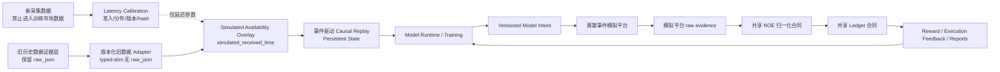

# 旧数据唯一训练源核心重构需求

事项编号：`rebuild-core-old-data-only`

状态：`待用户审查；不授权代码开发、数据转换、训练、paper、live、部署或资金操作`

对应计划文档：`/home/chillchill/btc-updown-marketmaker/plan/rebuild-core-old-data-only-plan.md`

旧数据处理专项计划：`/home/chillchill/btc-updown-marketmaker/plan/rebuild-core-old-data-only-dataset-processing-plan.md`

对应 changelog：`/home/chillchill/btc-updown-marketmaker/changelog/rebuild-core-old-data-only-changelog.md`

历史参考文档：`/home/chillchill/btc-updown-marketmaker/demand/rebuild-core-demand.md`

## 1. 文档权威与目标

1. 本文是“只使用旧数据集训练”决策下的新核心需求文档，不在原核心需求文档上继续修改。原核心需求文档保留为历史参考，不作为本文后续计划和模块实施的权威来源。
2. 本文的训练市场数据仅允许来自 5090 训练服务器 `/root/autodl-tmp/` 中已存在的历史日期归档和 `data-v1` 至 `data-v5` 历史数据族。精确文件、大小、hash、日期、schema、平台规则时期和准入状态必须由版本化 dataset-boundary manifest 冻结，不能仅靠目录名推断。
3. `/home/chillchill/new-datasets` 及数据采集服务器后续产生的新数据不得作为训练、验证、冻结 holdout、feature normalization、market trajectory、market label、reward、模型选择或排行榜输入。新数据唯一允许的训练相关用途是生成网络到达延迟参考 artifact，再为旧数据中缺失 received time 的事件生成可审计的模拟接收时间。
4. 核心目标是建立一条可验证、可回放、严格事件触发的训练和执行语义链：旧市场事实经过版本化、通过批准语义等价 gate 的适配和模拟可见时间构造后驱动模型；不宣称 typed-slim 可恢复 wire-level exact bytes；模型意图进入离散事件模拟平台，模拟证据经过共享的 NormalizedOrderEvent 和 ledger 合同形成训练反馈。
5. 本文只定义需求、不变量和验收标准。具体工具、模型候选、命令、阶段顺序和测试实现写入对应计划，不得把本文扩写成第二份实施计划。
6. 历史错误覆盖基线仍为 `/home/chillchill/btc-updown-marketmaker/mistake-log/2026-07-03-重构前错误汇总与优先级.md` 及其引用的 V2、online-feedback、sdk-live-trade、poly-tx 和资源复盘；平台规则必须以实施时复核的当前官方资料为准，不能用旧规则台账覆盖当前事实。
7. `demand/data-collect-demand.md` 继续作为采集模块的独立需求，但其新数据产出不自动获得训练资格，也不能改变本文的旧数据唯一训练源边界。

## 2. 不可变边界

1. **旧数据唯一训练源。** 新数据中的任何市场价格、盘口、成交、标签或市场轨迹不得混入正式训练数据。
2. **新数据只校准延迟。** 新数据只允许输出冻结、带 hash 和适用范围的 latency-calibration artifact；训练管线不得直接读取新数据目录。
3. **采集器记录时间与模拟时间分离。** `observed_received_time_ms` 不是历史原字段，本文不再把它写成旧数据事实。旧数据只有 source-native `recv_time_utc` 且语义验证通过时，才能映射为可空的 `collector_recorded_time_ms`；Polymarket 历史盘口和回填 Binance aggTrades 均没有逐事件采集器接收时间，只能另行生成 `simulated_received_time_ms`。
4. **原始历史归档必须冻结为不可变证据层。** 当前文件存在不等于已经 immutable。所有转换必须写入新的派生根目录；在文件 hash、schema、row count、row locator、写保护或版本化备份 gate 通过前，不得原地修改、重打包、删列或删除 5090 上的旧归档和 `data-v1` 至 `data-v5`。
5. **训练框架和模拟平台合同先于全量迁移。** 在事件、状态、输入、动作、reward、trajectory、模拟平台和 runtime consumer 合同冻结前，只允许盘点和小样本非破坏性试转换。
6. **模型严格事件触发。** 训练、paper 和 live 的策略决策不得由固定频率、固定周期、周期性 polling 或固定 decision tick 触发。
7. **模拟平台是一等模块。** 训练和 paper 使用模拟平台；live 只使用真实平台。两者不得共享私有状态，只共享版本化 Model Intent、raw evidence、NOE 和 ledger 合同。
8. **模型是策略与风控意图的唯一来源。** live bridge、execution adapter、ledger、validator 和硬边界 gate 不得生成或改写模型交易策略；本地权限、钱包、路径和 schema verdict 只进入 audit/operator 记录。
9. **平台能力与本地硬边界分离。** 真实或模拟平台返回的 post-only、cancel-only、reject、fill、settlement 等业务事实可以通过 NOE 成为模型可见反馈；本地权限和安全校验 verdict 不得伪装成执行反馈或训练标签。
10. **SDK-first。** Polymarket submit、cancel、balance、allowance、market/user channel 和查询必须优先使用当前生产代官方 Polymarket Rust SDK。SDK 有缺口时必须先报告并获得用户批准，不得自行建立 raw REST、manual signing、自建 SDK 或其他旁路。

## 3. 高层数据与训练架构

该图只表达权威流向。新数据到训练的唯一箭头是 latency-calibration artifact，不存在新市场事件直接或间接进入 feature、label、trajectory 或 holdout 的路径。

## 4. 历史数据边界与能力分级

1. dataset-boundary manifest 必须逐文件记录至少：原始路径、sha256、大小、日期范围、source kind、schema/version、row count、时间覆盖、平台规则时期、完整性状态和训练能力等级。
2. 历史数据必须按来源和版本分别适配，不得假设 `data-v1` 至 `data-v5`、日期归档和不同日期的 schema 完全相同。
3. 历史数据跨越 Polymarket 平台规则和 CLOB 版本变化时，必须记录 `event_time_platform_regime_version`。未知时期不得按当前平台规则冒充已知历史事实。
4. 旧数据只按其真实能力进入训练：
   - 市场事件、盘口、Binance 和 Chainlink 可用于 market representation、alpha、方向/价格结果标签和模拟平台的市场驱动；
   - 缺少真实订单、Model Intent、NOE、ledger、action、reward 或 settlement 的数据不得伪装成行为克隆或真实 offline-RL transition；
   - simulator 生成的订单、NOE、ledger 和 reward 必须标记为 simulation authority，不能标记为 live/observed execution feedback。
5. 旧数据缺失 T-30、received time、source sequence、某一路 source 或其他字段时，必须保留缺失状态、coverage 和 capability tier；不得生成虚假市场事件补齐覆盖。
6. 训练数据状态至少区分：`unassigned`、`train`、`validation`、`frozen_holdout`、`diagnostic_only`、`excluded`。canonical-ready 不自动等于 training-boundary-approved。
7. 每个 episode 必须记录 `context_start_available_ts`、`prestart_coverage_seconds`、prestart missing mask 和 task eligibility。future paper/live runtime 必须提供完整 T-30 实时上下文；旧历史训练只能使用实际存在的 prestart coverage，并通过 coverage/missing mask 训练可变 warmup。缺少 T-30 的历史样本不得被描述为“已完成 T-30 训练”，相关状态与动作分布差异必须在 paper/shadow promotion gate 中验证。
8. 旧 Parquet 中的 `raw_json` 属于历史证据层，不属于训练模型输入。允许新建不含 `raw_json` 的 typed-slim 派生训练层，但不得从唯一证据副本中原地删除该列。
9. typed-slim 删除 `raw_json` 前必须按 dataset version、source kind、schema 和 event type 完成 typed/extra 与证据层的语义等价 gate；现有只检查文件集合和 row count 的 coverage validator 不足以授权删列。
10. 语义等价 gate 必须覆盖字段存在性、absent/null/empty、类型归一化、精确数值、嵌套对象、数组顺序与长度、未知字段、事件顺序、malformed/quarantine 和下游 consumer parity。无法解释的 mismatch 必须阻断对应 schema family。
11. 当前 Python data pipeline、Rust replay 和 recording/export 仍依赖 `raw_json` 时，typed-slim 不得替换 active 正式输入。全量转换前，所有正式 consumer 的 typed-only 实现必须先在跨版本纵向切片上通过等价验证，但 active pointer 继续指向 legacy；全量 candidate 完成后，还必须通过实际 consumer 的全量 event-envelope 对账与风险分层的 label/feature/replay 深层验证，才能协调原子切换 dataset pointer 和 consumer config。
12. typed-slim 必须保留全部已批准 typed 字段和仍承载业务信息的 `extra_json`，并记录 `source_archive_id`、相对文件路径、文件 sha256、`source_row_ordinal`、schema/version 和 output hash。不得默认写每行 hex sha256 抵消主要空间收益。
13. 旧采集阶段已经遗漏的事件或 frame identity，例如被旧采集器过滤的事件，不得通过 typed 转换或 `raw_json` 重建来伪造补齐。
14. 正式 L1 发布默认要求 `required_shard_quarantine_count = 0`。任何 quarantine 若改变正式训练市场集合、日期边界、platform regime、source coverage、split 或 frozen holdout，必须阻断发布、输出影响报告、重新冻结受影响边界并取得用户批准；遇到新 schema/event family 必须回到 schema 和 consumer 合同，不得永久 quarantine 后静默发布缩减语料。

## 5. received time 与延迟校准合同

### 5.1 字段和权威语义

每条可进入事件回放的旧事件至少具有以下逻辑字段；物理表可以按 source 分表，但语义必须一致：

- `canonical_event_id`
- `source_kind`
- `source_event_type`
- `source_event_time_ms`
- `collector_recorded_time_ms`：仅由旧数据中经验证的 source-native `recv_time_utc` 映射；否则为 null
- `collector_recorded_time_status`：至少区分 `recorded`、`missing_not_collected`、`unusable_clock`、`missing_source_timestamp`
- `collector_recorded_topology_version`：旧采集器 host、region、clock 与 measurement boundary 的版本化引用；无法证明时为 null
- `simulated_received_time_ms`：仅在需要模拟到达语义时生成
- `event_available_time_provenance`：`collector_recorded`、`simulated` 或 `unavailable`
- `event_available_time_ms`：训练因果回放实际采用的可见时间
- `latency_calibration_version`
- `latency_calibration_sha256`
- `latency_scenario_id`
- `latency_sample_seed`
- `latency_condition_key`
- `latency_reference_topology_version`
- `target_replay_topology_version`
- `cross_source_topology_compatibility_status`：`compatible`、`provisional`、`incompatible` 或 `unknown`
- `calibration_transfer_mode`：`same_regime` 或 `cross_regime_assumption`
- `latency_calibration_quality`：`approved`、`provisional` 或 `quarantined`
- `event_time_platform_regime_version`
- `source_archive_id`
- `source_relative_path`
- `source_file_sha256`
- `source_row_ordinal_or_sequence_id`

规则：

1. `RecordedTimeValidityGate` 用于判断旧 `recv_time_utc` 是否是可信的旧采集边界事实。通过时必须保留 `collector_recorded_time_ms`，且 historical-as-recorded replay 的 `event_available_time_ms = collector_recorded_time_ms`；不得用新数据采样值覆盖，也不得因目标拓扑未知而抹掉该事实。
2. Polymarket 历史盘口和回填 Binance aggTrades 的 `collector_recorded_time_ms` 必须为 null；LatencyCalibrationGate 通过时，`event_available_time_ms = simulated_received_time_ms`。
3. `TargetTopologyComparabilityGate` 与 recorded-time 有效性分离。旧 collector host、region、clock evidence 或 measurement boundary 无法证明与目标回放拓扑兼容时，historical-as-recorded 或 mixed-boundary replay 仍可使用可信 recorded fact，但必须标记 `mixed_topology_uncertainty` 和 `provisional/non-promotable`，不得描述为同一 target runtime 的真实 causal order。只有明确要求 target-topology counterfactual causal fidelity 的任务才必须等待 compatible 证据或 approved topology-transfer artifact；不得因 comparability unknown 就把 recorded fact 改成 null。
4. 旧数据同时缺少可解释 source event time 时，不得凭空生成 received time；该事件必须标记 unavailable、降级为不依赖 arrival semantics 的能力层或被排除。
5. 新数据 source-specific Parquet 的物理字段名是 `timestamp_received`。旧数据兼容输出若使用该字段名，必须同时携带 provenance；逻辑合同仍分开保存 collector-recorded、simulated 和 effective available time，禁止由裸 `timestamp_received` 推断其为历史观测事实。
6. `canonical_event_id` 必须由稳定原始身份、文件 hash/路径、row offset 或 source sequence 确定性生成；不得使用每次运行变化的随机 UUID。
7. `canonical_event_id`、market lineage 和 train/validation/holdout split 不得依赖模拟 received time；更换 latency scenario 或 seed 不能改变基础事件身份或 split。

### 5.2 新数据的校准准入

1. 本事项允许生成模拟接收时间的延迟参考源只限 `polymarket_market` 和 `binance_aggtrade`。RTDS、Binance depth、REST snapshot、metadata 和其他新数据不得进入这两个 source 的默认延迟分布。
2. 新数据不因“文件可读”就自动获得校准资格。每个 calibration segment 必须通过 finalized、schema、source timestamp 语义、receive timestamp、clock/uncertainty、source gap、source task、writer health 和异常值检查；segment `Complete` 不能单独证明运行时健康。
3. 当前或未来已知的 source/writer 静默死亡、4-byte running artifact、source gap、重连异常、控制帧误解析、早期 schema 漂移和时钟不可解释区间必须排除或单独作为 stress evidence，不得进入默认分布。
4. 平台 event timestamp 与本机 receive timestamp 的差值默认称为 `source_to_collector_visibility_delay_ms`。它可能包含平台内部处理、排队、网络、SDK decode、runtime scheduling 和时钟误差；只有能证明时钟同步、timestamp 语义和 measurement boundary 时，才允许称为纯 `network_latency_ms`。
5. calibration artifact 必须冻结数据范围、源文件 hash、筛选规则、样本量、时钟不确定性、生成代码版本和适用 source/event type。训练运行期间不得随着新采集数据持续漂移。
6. Polymarket 和 Binance aggTrade 必须分别建模；没有证据时不得互借分布。Polymarket 一个 transport event 只能贡献一个 latency observation，typed child rows 必须共享 transport identity 和 receive time；缺少可靠 transport identity 时只能标记 approximate/provisional。
7. 回填旧 Binance aggTrades 的 `timestamp_ms` 来自 Binance `T` trade time；当前新 typed `binance_aggtrade_v2.event_time` 来自 `E` event time。两者 measurement boundary 不一致。正式 48 小时计时前必须逐事件持久化可校准的 `T`；`E-T` 只能作为诊断统计，不能代替 `T`、不能成为 approved transfer 路径，也不得把 `timestamp_received-E` 分布套到旧 `T`。
8. 48 小时不得按首末时间 wall span 计算。所有 eligible intervals 使用半开区间 `[start_ms, end_ms)`；`polymarket_market`、`binance_aggtrade` 各自合并去重后的 interval duration sum 必须至少 `172800000ms`，且两源 interval union 的交集 duration sum 也必须至少 `172800000ms`。毫秒 duration 是唯一 gate 计数权威；完整 UTC hour/full-hour count 只是由 eligible intervals 派生的审计视图。事故、重连 warmup、clock 缺证据和 schema/measurement 变化区间均不计入；partial hour 只有 exact start/end、clock 和 runtime-health evidence 完整时才可按实际毫秒计入，不能整小时猜测补齐。
9. CalibrationCoverageManifest 必须同时记录 wall span、每源 cumulative eligible duration/full hours、最长连续 eligible duration、eligible/excluded intervals、joint eligible duration/full hours、最长 joint 连续时长、排除原因、clock/health/transport/timestamp verdict 和 measurement contract hash。
10. 48 小时计时只能从两源 measurement contract、连续 clock evidence、source/writer supervision、Polymarket transport identity 和 Binance `T` 边界全部生效后开始；修复前后或 schema 不兼容区间不得拼接为 approved 48 小时。
11. calibration artifact 必须记录采集 host/region/网络路径形成的 reference topology，以及训练回放假设的 target topology。数据采集服务器上的到达差值不得被直接描述为 paper/live 服务器的真实端到端延迟。
12. 当前新数据在上述 gate 未通过时，质量统一标记为 `provisional`；该状态可以支持诊断和显式保守场景，不得支持“已还原历史真实 received time”或“已证明 live 延迟”的结论。
13. 延迟校准读取新数据时只允许使用时间戳、source/event type、host/region/endpoint、connection/reconnect/health、payload-size/burst bucket 和 provenance。价格、数量、盘口、市场结果、resolution 和其他业务内容不得进入延迟模型参数，防止新数据通过 calibration artifact 间接成为模型特征。
14. `provisional` 只能支持 exploratory/diagnostic/non-promotable 训练和纵向切片；经用户单独授权后，也可以支持为解除不确定性而运行的 non-promotable paper 或 no-submit shadow。它不得支持 promotion 或 live 授权。promotion 必须使用 `approved` calibration；任何例外都必须由用户明确批准适用 source、scenario、期限和风险，不能由训练程序自行放宽。

### 5.3 分布和采样

1. 默认模拟延迟必须来自合格 transport event 样本的经验分布、连续分位插值或经验证的条件分布；不得按 Polymarket typed child row 重复计权，也不得只在 p50、p85、p90、p95、pMAX 五个离散点上抽签。
2. p50、p85、p90、p95、p99 用于报告、校验和 scenario 定义；pMAX 只作为诊断或尾部 stress 上界，不得作为默认随机分布中的普通概率质量。
3. 每次采样必须由 `latency_calibration_version + scenario_id + stable event identity + seed` 可重现。
4. 不得静默裁剪负值或异常尾部。负值、时钟漂移和不可解释异常必须有排除原因；保留的尾部必须进入显式 tail/stress scenario。
5. 至少提供 baseline、high-latency、tail-stress 三类场景，并报告模型对延迟假设的敏感性。任何收益结论必须注明使用的 scenario，不能把模拟延迟结果描述为历史真实收益。
6. 如果合格样本显示明显的延迟 burst、自相关或 reconnect regime，默认 sampler 必须使用条件 block bootstrap、regime model 或等价方法保留相关性；只有验证证明独立采样不会实质改变决策结果时，才允许逐事件 IID 抽样。
7. 每条事件的随机键必须由 calibration hash、scenario、dataset base seed、stable event ID 和 simulation replica 确定性派生；worker 数、shard 顺序和 resume 点不得改变采样结果。
8. `simulated_received_time_ms` 不得早于 `source_event_time_ms`。负延迟不得静默 clamp；必须判定为时钟、timestamp 语义或校准异常。
9. 同一已知连接内的 source 顺序不得因独立采样反转。必要时使用连续 block、顺序约束采样或拒绝不合法样本，不得采样后静默排序并声称分布未改变。
10. 模拟延迟把事件推到 market end 之后时必须保留 late-arrival 语义，不得为了塞回训练窗口而向前 clamp。

## 6. 事件驱动、时间线与持续状态

1. 数据管线必须先完成 source 内顺序、去重、market 隔离和 causal availability 判定，再构建模型可见事件。
2. 每个版本化 `model_visible_event` 必须触发一次逻辑模型评估；raw transport 控制帧、重复帧和无业务语义噪声不得直接成为模型触发事件。
3. 一个 authoritative source frame 内的批量变化可以由 DecisionTriggerContract 归一化为一个语义事件；除此之外不得用固定时间窗静默合并事件。任何 causal microbatch 必须由事件启动并记录包含的全部 event IDs。
4. 没有新模型可见事件时不得生成策略决策。固定间隔 tick 只能用于统计、诊断、兼容分析或回放索引。
5. 模型必须维护跨事件的持续因果状态，而不是只输入当前孤立事件。market state 在明确 market boundary/reset contract 下切换；账户 ledger、未结订单和旧市场 late execution/settlement 状态不得因切换而丢失或污染新市场特征。
6. 每次模型调用至少记录 `trigger_event_id`、`trigger_event_type`、`event_available_time_ms`、`causal_cutoff_ts`、`decision_start_ts`、`decision_end_ts`、`state_version` 和被合并事件清单。
7. 训练、paper、live 共享逻辑状态和事件语义，但允许离线 ragged/columnar、训练 padded batch 和 runtime persistent state 使用不同物理表示；所有表示必须可映射回同一版本化逻辑合同。
8. 多源事件具有相同 availability millisecond 且真实先后不可知时，必须标记为同一 causal availability bucket，并使用版本化、不宣称真实先后的 tie-break；不得用文件枚举顺序制造跨源先后事实。

## 7. 训练框架和模型合同

1. 全量旧数据转换前必须冻结：DecisionTriggerContract、state/reset contract、logical input contract、action contract、reward/label contract、transition/trajectory contract、simulator interface、runtime consumer 和 promotion contract。
2. 本文不预先指定最终网络 backbone、层数、hidden size、学习率或多卡策略；这些属于基准实验和计划决策，但不得改变已冻结的数据与因果语义。
3. 训练技术路线至少分开验证：
   - market representation / alpha / outcome prediction；
   - simulator execution outcome / fill-risk prediction；
   - action ranking 或 policy；
   - risk intent。
   这些可以由一个多头模型或多个模型实现，但不得用单一 leaderboard 分数证明全链路正确。
4. 由于历史市场数据通常没有真实 action/NOE/ledger，禁止将其直接宣称为 behavior-cloning dataset 或真实 offline-RL dataset。只有发现并验证了真实 action trajectory 的历史子集时，才允许单独提升 capability tier。
5. policy 训练必须通过模拟平台生成动作结果和 reward。模拟结果必须与 market outcome label、真实历史事实和 run-level accounting 分开命名。
6. action-surface audit 必须先于 replay leaderboard 和候选排名。若不同候选 raw output 或 decoded action 实质相同，排名结果不得用于 promotion。
7. 所有 train/validation/holdout 切分必须严格时间前推并按 market 分组，禁止随机跨时间切分、同 market 跨 split、test rerank 或将新数据 calibration rows 混入任何 split。
8. split 必须在模拟 received time 和 simulation replica 生成前按稳定 market lineage 冻结；同一 market 的所有 scenario/seed 副本必须位于同一 split，不能因模拟时间跨 UTC 日而改变 split。

## 8. Model Intent、模拟平台与执行语义

1. Model Intent 至少能完整表达：submit/cancel/no-submit/pause、side、price/offset、size、order type、post-only、time-in-force、TTL/expiration、worst-price/slippage bound、目标 market/token 和适用状态版本。
2. TTL 必须由模型 intent 或模型 bundle 中的预授权 contingent intent 明确声明；否则 TTL due 只能生成模型可见事件，由模型决定是否 cancel。runtime 不得自行发明策略性 TTL。
3. 模拟平台必须使用离散事件队列。平台接收、accepted/rejected/unknown、fill/partial-fill、user-channel visibility、cancel response、matched-cancel、late fill 和 settlement 必须按未来事件调度，不得使用固定频率 tick 代替事件时间。
4. 模拟平台至少覆盖：平台能力模式、submit/reject/unknown、queue/fill hazard、full/partial fill、cancel race、post-only/cancel-only、tick/min size、fee/rebate、sellable maturity、trade settlement、market resolution/redeem 和可配置尾部延迟。
5. partial fill 必须由 `cumulative_fill_size < accepted_size` 定义；fill segment 数只表示碎片化，不得用“1 段等于 full、2 至 5 段等于 partial”定义。
6. partial-fill rate、segment、dust、TTL、fill latency 和 cancel latency 不得以无证据固定常数作为平台真值。所有参数必须来自版本化 artifact、官方规则或显式 stress scenario，并记录适用范围和不确定性。
7. 新数据延迟校准只用于外部市场事件的模拟 arrival visibility；不得自动替代订单 submit、matching、user-channel、cancel 或 settlement 延迟模型。不同延迟阶段必须分开校准和命名。
8. 模拟平台必须先产生模拟 raw evidence，再经过与 live 共享的 NOE 合同进入 ledger。训练和模型不得直接消费模拟平台私有真值或绕过 NOE 写 reward。
9. 模拟平台必须使用版本化 `SimulatorRuleCalibrationManifest`，逐类记录 submit、accept/reject/unknown、queue/fill、cancel、user-channel、fee/rebate、sellable、settlement 和 resolution 参数的允许来源、artifact hash、证据时期、平台 regime、适用范围、置信等级、observed/assumed/stress provenance、calibration quality 和 promotion capability。
10. simulator 执行参数只允许来自当前官方规则、经用户批准并验证的历史执行 artifact 或显式 stress assumption。stress assumption 和未批准/低置信 calibration 只能支持 exploratory/non-promotable 结果；没有 approved 执行校准时不得形成正式 policy candidate。
11. 历史盘口和市场事件只能驱动当时可见的市场状态，不能被解释为不可观察的真实 queue position、历史订单已提交或历史真实成交事实。queue/fill outcome 必须由明确标记的 simulator model 产生。

## 9. NOE、ledger 与结算合同

1. submit/cancel response、user-channel、fill、timeout、query/reconciliation 和模拟平台证据必须先进入版本化 NormalizedOrderEvent；validator 只能验证合同一致性，不能成为第二业务解释器。
2. UnknownSubmitOutcome 必须有正式状态机、order-local recovery、重试禁区、关闭条件和审计证据。未知结果关闭前不得盲目重复同一风险意图。
3. 平台查询不得直接覆盖 ledger；允许通过官方 SDK 做有界 reconciliation，并把结果归一化为 observation/NOE，再由 append-only ledger correction event 消费。
4. 必须分离 `OrderLifecycleState`、`TradeSettlementState` 和 `LedgerEconomicEffectState`。MATCHED 只能产生 provisional economic effect；CONFIRMED 才表示成功 finality；FAILED 必须通过补偿事件纠正 provisional effect。
5. “第一个权威 terminal 获胜”只适用于同一状态轴和同一事实竞争；不得用一个订单 terminal 吞掉后续 trade settlement 或 ledger correction。
6. ledger 是账户、CASH、NAV、持仓、sellable、open orders 和 pending cancels 的本地热路径权威，但必须有 bootstrap、durable checkpoint、append-only replay 和 reconciliation correction 合同。
7. 累计 PnL 是由 NAV、启动 baseline 和外部资金流调整派生的 run-level accounting/evaluation，不是逐决策权威标签。
8. market lifecycle 至少区分 tradable active、trading closed pending resolution、resolved、redeemable、settled 和 archived；runtime current/next、market lifecycle 和 ModelRegistry 状态必须使用不同命名空间。

## 10. 标签、reward 与报告边界

1. 标签必须分为：`market_outcome_label`、`simulation_execution_label`、`policy_reward` 和 `accounting_truth`。
2. `market_outcome_label` 只能来自旧数据中可验证的 Chainlink/resolution 或等价历史事实。
3. `simulation_execution_label`、模拟 NOE、模拟 ledger 和 policy reward 必须标记 simulator/version/scenario/seed，不得标记为 observed/live execution feedback。
4. reward 必须声明 horizon、maturity、censoring、settlement backfill 和 authority source。未成熟、右删失或证据缺失样本不得静默按零或失败处理。
5. 训练报告必须分开报告市场预测质量、action surface、模拟执行表现、延迟场景敏感性、风险、资源和 run-level accounting；不得用一个总 PnL 掩盖 action collapse 或 simulator 假设。
6. 排行榜只用于同一数据边界、同一 simulator contract 和同一评价口径下的候选比较；不能单独授权 candidate/shadow/paper/live。

## 11. 核心 gate 与状态语义

至少需要以下互不替代的 gate：

1. `OldDataBoundaryGate`：旧数据清单、hash、schema、平台时期、capability tier 和 split 是否冻结。
2. `LatencyCalibrationGate`：新数据准入、时钟/时间戳语义、条件分布、样本量、异常处理、版本和 hash 是否可追溯。
3. `CausalReplayGate`：event identity、collector-recorded/simulated provenance、topology compatibility、availability time、排序、去重、market 隔离和 trigger 映射是否正确。
4. `SimulatorContractGate`：规则、延迟阶段、NOE、ledger、settlement、scenario 和 determinism 是否闭合。
5. `ModelContractGate`：输入、persistent state、action decoder、Model Intent、bundle 和 runtime consumer 是否一致。
6. `TrainingPromotionGate`：strict time split、frozen holdout、action-surface audit、执行现实、资源和 artifact 是否满足 promotion 条件。

gate 必须分别输出 assessment、affected scope 和 capabilities。离线数据/训练使用 eligible、quarantine、excluded、non-promotable 等状态；NO_SUBMIT/CANCEL_ONLY 只用于真实交易权限，不得作为数据或训练 verdict。

`LatencyCalibrationGate` 和 `SimulatorContractGate` 必须分别输出 calibration quality 与 promotion capability。任一关键 source latency 或执行规则仍为 provisional/assumed/quarantined 时，训练产物只能标记为 exploratory/non-promotable；经用户单独授权后可以进入 non-promotable paper 或 no-submit shadow 以收集解除不确定性的证据，但不得 promotion 或进入 live。任何 promotion 例外都必须由用户批准明确、限时、可审计的适用范围。

## 12. 资源、artifact 与实施边界

1. 全量转换、训练、验证和 replay 必须使用 bounded/sharded/streaming 处理；禁止把完整历史数据或全局 row-key 状态一次性 materialize 到内存。
2. run manifest 必须记录 interpreter、commit、dirty state、数据边界 hash、calibration version、simulator version、split hash、batch/worker/shard、峰值 RSS/cgroup/PSI、GPU/CPU/IO、throughput、stdout/stderr 和产物 hash。
3. artifact integrity、coverage quality、runtime health 和 consumer eligibility 必须分别记录，不得压缩成一个含义不明的 Complete。
4. artifact 发布至少保证消费者看不到 partial artifact；若宣称 power-loss durability，还必须有 file fsync、rename、directory fsync 和 crash-recovery 证据。
5. live release binary 必须在本地 `/home/chillchill/btc-updown-marketmaker` 构建，再复制到 `/home/ubuntu/live-trade`。live 服务器不得编译；模型文件不得通过 Git 同步。
6. 本文及配套计划不自动授权读取钱包、真实下单、撤单、资金操作、paper、live 或远端训练。每类外部状态变更必须按计划和用户授权单独执行。
7. 旧证据归档与 typed-slim 训练产物必须物理和 manifest 分层；训练 loader 不得读取 `raw_json`，审计回源不得依赖训练产物反向重建 exact bytes。
8. 全量转换启动前必须按纵向切片实测压缩率，逐 filesystem/mount 核算 L1/L2、归档解包或流式缓存、source staging、临时/失败/quarantine shard、checkpoint、并发增长、atomic publish 双版本窗口和恢复余量；任务启动及每个新 shard 开始前重新检查。空闲空间低于预冻结峰值需求或运行中保留水位时必须 fail closed，不得通过提前删除 L0 证据腾空间。
9. L0 不可变控制最低同时包括：文件 hash manifest、active copy 只读或 immutable、至少一个独立可恢复的 versioned copy/只读快照/对象存储副本，以及实际恢复演练。仅对单副本执行 `chmod` 或清除写位不能通过 L0 证据门。

## 13. 非范围

本文不要求或授权：

- 修复或停止当前 data-collect 服务；
- 把新数据加入训练、验证或 holdout；
- 原地修改旧数据归档；
- 从唯一旧数据证据副本删除 `raw_json`，或在 hash/row locator/备份 gate 前宣称归档 immutable；
- 在正式 consumer 仍读取 `raw_json` 时用 typed-slim 路径替换它；
- 未解决 Binance `E`/`T` measurement boundary 就启动正式 48 小时计时；
- 现在确定最终模型 backbone 或超参数；
- 直接开始全量迁移或训练；
- 使用无真实 action 的旧行情数据直接做 behavior cloning 或真实 offline RL；
- 用模拟 received time 冒充历史观测 received time；
- 用模拟平台替代 live 真实平台；
- 使用 raw REST、manual signing 或影子 SDK；
- 未经批准执行 paper、small-live、正式 live 或资金操作。

## 14. 分阶段验收与能力升级标准

以下条件按能力阶段分别生效，不构成一个要求后续 paper/shadow 证据先于训练产生的循环 gate。

### 14.1 进入全量旧数据转换及随后启动可扩展 exploratory 训练前

#### 14.1.1 启动全量转换前

1. 新旧核心需求文档独立存在，原 `rebuild-core-demand.md` 未被本事项修改；新事项的 demand、plan、changelog 使用同一 slug 并互相引用。
2. 训练 dataset-boundary manifest 只包含旧历史数据；training、validation 和 frozen holdout 不存在任何新数据 market row、feature、label 或 trajectory。
3. 新数据只产生冻结 latency-calibration artifact；训练数据消费者没有直接读取 `/home/chillchill/new-datasets` 或数据采集服务器市场文件的路径。
4. 所有旧事件的 collector-recorded/simulated available-time provenance 明确；Polymarket 历史盘口与回填 Binance aggTrades 的 collector-recorded 时间为 null，模拟值只写入 `simulated_received_time_ms`，相同版本和 seed 可确定性重现。
5. baseline/high-latency/tail-stress 场景完成分布、异常、clock uncertainty 和可重现性验证，pMAX 未被当作默认普通样本点；gate 明确输出 approved 或 provisional 等质量，而不是把 provisional 伪装成已批准。
6. DecisionTriggerContract 证明每次模型调用都由模型可见事件触发，不存在固定频率或无 trigger event 的策略决策。
7. 小样本纵向切片已贯通旧 raw、normalized event、simulated availability、persistent state、Model Intent、模拟平台 raw evidence、NOE、ledger、reward 和报告，且每层可追溯。
8. partial fill、cancel race、UnknownSubmitOutcome、MATCHED→CONFIRMED/FAILED、ledger compensation、market resolution/redeem 等正反例全部通过；SimulatorRuleCalibrationManifest 同时输出参数质量和 promotion capability。
9. strict time-forward split、market 隔离、platform-regime 隔离、frozen holdout 和 no-test-rerank 合同通过；canonical-ready 与 training-approved 状态可区分。
10. bounded/sharded/checkpoint/resume 设计和纵向切片资源证据证明全量方案不会再次采用历史 80GiB 级 materialization 或串行 replay 路径。
11. 原证据归档具有文件级 sha256、schema、row count、row locator、active 只读控制、独立可恢复副本和恢复演练；typed-slim 纵向切片是不含 `raw_json` 的新版本派生产物，全部正式 consumer 的 typed-only 实现已在该切片上通过等价验证，但 active pointer 尚未切换。
12. LatencyCalibration48hGate 证明两源各自和 joint eligible healthy duration 均不少于 48 小时，Binance `T` 边界、Polymarket transport identity、连续 clock evidence 和 source/writer health 均通过；wall span 不得替代该 gate。
13. `RecordedTimeValidityGate` 与 `TargetTopologyComparabilityGate` 分别可审计；可信 recorded fact 不因目标拓扑 unknown 而丢失，但 unknown/incompatible 的混合时间线不得宣称为同一 runtime 的真实跨源 causal order，也不能产生 promotion-capable 训练产物。

#### 14.1.2 全量 L1 成为 active 正式训练输入前

1. 每个 required shard 的 typed/extra 全量逐行 semantic parity 为零 mismatch；`required_shard_quarantine_count = 0`。任何改变正式训练 boundary 或 split 的排除都已重新冻结并获得用户批准。
2. 实际 Python、Rust replay 和 recording/export typed consumer 已对全部 shard/source/schema/event family 生成 ordered canonical-event digest 并与 legacy 审计 reader 对账；风险分层的 label/feature/replay 深层比较通过，`ConsumerCompatibilityManifest(scope=full_dataset)` 为 PASS。
3. 全量 candidate 在 inactive version root 发布并完成恢复验证；dataset pointer 与 consumer config 协调原子切换，失败可回滚到旧 active pointer，消费者不会看到 partial 或 schema/config 不匹配状态。
4. 逐 filesystem 峰值容量、运行中保留水位和每 shard 重检均通过；没有通过删除 L0 或未批准训练数据腾空间。

通过 14.1.2 后，允许使用冻结但 provisional 的 calibration 执行 exploratory/non-promotable 训练；不得把其结果标记为 promotion-eligible。

### 14.2 发布 paper/shadow 评估候选前

1. 全量处理实际证明 bounded/sharded、可恢复，资源、吞吐、lineage 和 artifact hash 证据完整。
2. action-surface audit 在 leaderboard 前执行；候选动作未分化时不得发布评估候选。
3. 同一 transport message 的 typed child rows 共享 identity/availability；同连接 source order 不反转；late event 不前移；worker、shard 和 resume 顺序不改变同 seed 产物。
4. simulator、training、paper 和 future live 共享 Model Intent/NOE/ledger 逻辑合同，同时保持 simulation authority 与 real-platform authority 严格分离。
5. 候选报告必须分别记录 latency calibration、simulator-rule calibration、数据 coverage 和各 gate 的质量及 capability，不得把 exploratory、paper-evaluation 和 promotion-eligible 合并成一个 `candidate` 状态。
6. 独立审查通过，并由用户另行授权 paper/no-submit shadow 后，评估候选才可进入相应运行；provisional/assumed 候选只能用于 non-promotable paper/no-submit shadow，不得进入 live。

### 14.3 允许 promotion 或申请 live 授权前

1. 每个 episode 的 prestart coverage、missing mask 和 task eligibility 可审计；paper/shadow 在完整 T-30 runtime context 下完成 truncated-history 与 full-T-30 的状态、动作和风险差异验证，未通过时不得 promotion。
2. promotion 使用的市场到达延迟和 simulator 执行规则均为 approved，或存在用户明确批准、限时且可审计的适用范围例外；provisional/assumed 结果仍为 non-promotable。
3. frozen holdout、延迟/模拟器场景敏感性、rolling worst、action surface、风险、资源和 accounting 证据全部满足预冻结 promotion 阈值。
4. 独立审查确认不存在事实错误、内部矛盾、影子决策路径、数据边界绕过或模拟事实冒充观测事实。
5. promotion 结论只表示模型具备申请下一 gate 的资格，不自动授权 small-live、正式 live、部署或资金操作；live 仍需用户单独明确授权。
