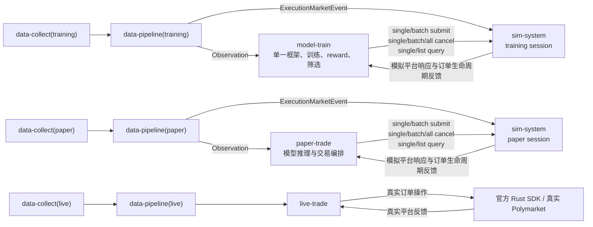

# sim-system 独立需求文档

事项编号：`SIM-SYSTEM-20260731`。

生命周期：`DRAFT_AWAITING_USER_REVIEW`。

当前执行 authority：`none`。

对应计划：用户审核并明确批准本需求后，才允许创建
`plan/sim-system-plan.md`。

对应 changelog：用户审核并明确批准本需求后，随获批计划创建
`changelog/sim-system-changelog.md`。

本文只定义独立 `sim-system` 模块的需求、边界和验收标准，不授权编写实现、
创建计划、部署、启停服务、修改远端状态或执行任何真实资金操作。

同一路径下的前一版草稿把盘口写成不接收任何外部市场状态的静态冻结场景。用户在
2026-07-31 审核中明确纠正：训练和 paper 的模拟撮合必须由与模型 Observation
同源、同因果边界的 orderbook 事件驱动；首版还必须覆盖 batch、全撤、
`ListOpenOrders` 和 `ListTrades`。前一版草稿没有执行 authority，本版按这些最新
决定整体替代其冲突内容。

## 1. 用户冻结的模块定义

用户已经明确以下架构语义，后续计划和实现不得改变：

1. `sim-system` 是独立的平台订单处理模拟模块。
2. 它只接受 `model-train` 或 `paper-trade` 发来的订单业务请求，首版请求面为：
   `SubmitOrder`、`SubmitOrders`、`CancelOrder`、`CancelOrders`、
   `CancelAllOrders`、`QueryOrder`、`ListOpenOrders` 和 `ListTrades`。
3. `data-pipeline` 从同一 canonical market event tape 分别输出模型可见
   `Observation` 和独立的 `ExecutionMarketEvent`。前者只进入模型消费者，后者通过
   与订单业务面分离的只读 market-state 数据面进入 `sim-system`。
4. `sim-system` 根据 `ExecutionMarketEvent` 在 session 内部维护可演进的 shadow
   orderbook、模拟订单 overlay、平衡型 L2 queue estimate、账户和时间状态；调用方
   不能随订单注入、改写或查看这些内部状态。
5. 它返回即时请求响应、分页查询响应，以及与目标订单关联的后续成交生命周期反馈。
6. 首版没有改单操作。当前官方 Polymarket 文档和本仓库 pinned 官方 Rust SDK
   未提供原生 amend/modify/replace order 接口；改变价格、数量、到期时间或其他
   订单参数只能由调用方先发出独立撤单请求，再发出一笔全新的提交请求。
7. `data-pipeline` 独占 source evidence 到 canonical market event 的排序、去重、
   gap/availability、causal cutoff 和模式一致性处理；`sim-system` 不重复解析 typed
   raw、Parquet 或 realtime handoff，也不建立第二套 canonicalization。
8. 每个 5 分钟市场只允许形成有界热状态。完整 canonical tape 由 `data-pipeline`
   拥有，`sim-system` 不复制保存整段 tape；市场结束和 resolution terminal 后按
   本文规定分两级释放热状态，只保留查询、幂等和审计所需的紧凑订单/成交记录。
9. `model-train` 独占训练方法、奖惩方法和训练结果筛选。当前只使用一个训练框架，
   不开展框架竞赛。
10. future 更换模型框架时，只替换 `model-train` 内部实现；只要统一模型数据合同、
   模型产物/推理合同和本模块订单请求/反馈合同不变，其他模块无需随框架修改。
11. `live-trade` 只调用官方 Polymarket Rust SDK 和真实平台，不得调用
   `sim-system` 生成或覆盖真实平台事实。

现有文档的适用关系为：

- `demand/rebuild-core-demand.md` 仍是审核中草案。其中把
  `offline-evaluation` 增加为 simulator caller、把市场数据处理或 NOE/Ledger
  绑定到 simulator 的旧内容，不进入本文合同。
- `data-collect/docs/CURRENT.md` 继续拥有 `data-collect` 当前事实。其较早写下的
  “下一模块为 model-train”跨模块排序已经由用户最新顺序替代，但 paper/live
  真实 adapter 仍属于 future `data-collect` 独立事项；本文不修改其合同或代码。

若本文、用户最新决定、获批后的计划、当前代码、官方平台规则或真实平台 artifact
不能同时成立，必须停止受影响工作，列出精确位置、语义、影响和现实选项，由用户
决定；不得自行调和或选择一处覆盖另一处。

## 2. 系统数据流和唯一职责



### 2.1 模块唯一职责

| 模块 | 唯一职责 |
| --- | --- |
| `data-collect(training)` | 采集离线训练所需的外部原始数据，生成 typed raw、coverage 和 manifest |
| `data-collect(paper/live)` | 分别采集 paper/live 在线外部数据并提供 realtime handoff |
| `data-pipeline` | 将离线或在线 source evidence 规范为唯一 canonical market event tape，同源输出 `Observation` 和独立 `ExecutionMarketEvent` |
| `model-train` | 使用当前单一框架训练，定义奖惩方法并筛选训练结果 |
| `sim-system` | 消费 `ExecutionMarketEvent` 维护有界 shadow CLOB，并将提交、撤单和查询请求按冻结平台规则/潜规则映射为模拟平台反馈 |
| `paper-trade` | 使用实时统一模型输入和模型产物进行 paper 交易编排，调用 `sim-system` |
| `live-trade` | 使用实时统一模型输入和模型产物，通过官方 SDK 调用真实平台 |

### 2.2 禁止存在的数据流

以下路径在当前及 future 架构中都不成立：

```text
data-collect -> sim-system
typed raw / Parquet / realtime handoff -> sim-system
raw/decoded Polymarket / Binance / RTDS source event -> sim-system
Observation / feature / label / reward -> sim-system
sim-system -> data-pipeline
sim-system -> live-trade
sim-system -> reward / 模型筛选 / 框架竞赛
```

`data-pipeline -> sim-system` 只允许版本化 `ExecutionMarketEvent` 数据面，不允许
`Observation`、模型 feature 或 raw transport frame。调用方把行情、feature、模型
状态或账本状态包装进订单请求，也不能绕过上述边界。

## 3. 开发顺序

用户确认的模块主线为：

```text
1. data-collect(training)                 [已完成]
2. sim-system
3. data-pipeline(training)
4. model-train
5. data-collect(paper/live)
6. data-pipeline(paper/live)
7. paper-trade
8. live-trade
```

该顺序与本架构一致：

- `sim-system` 先冻结订单业务合同、`ExecutionMarketEvent` 消费合同、平台规则和撮合
  引擎，并用符合该合同的合成/golden L2 tape 独立开发和验收；
- `data-pipeline(training)` 随后实现同源 `Observation` 与
  `ExecutionMarketEvent` producer，完成真实历史数据的端到端接入；
- `model-train` 通过稳定订单合同调用已经独立完成的 `sim-system`；
- paper/live 的真实数据接入和在线处理随后分别建设；
- paper 使用模拟平台，live 使用真实平台。

`data-pipeline` 的实现不是 `sim-system` 核心撮合引擎的开发前置条件，但真实训练
tape 和 paper 实时流的集成必须等待相应 `data-pipeline` producer。不得把 NOE、
Ledger、模型框架竞赛、offline-evaluation 或 Promotion Controller 插到
`sim-system` 前面作为当前完成门。

## 4. 已采集样本的适用边界

当前已经采集的数据样本为：

```text
/home/chillchill/new-datasets/2026-07-30/typed_raw/utc_day=2026-07-30
```

已只读核实：

- `manifest.json` schema 为 `data_collect_daily_manifest_v3`；
- state 为 `closed`，closure reason 为 `utc_day_barrier`；
- manifest 记录 121 个 finalized Parquet 文件；
- `polymarket_market` 共 41,355,216 行，其中包括 1,101,419 条 `book`、
  38,332,349 条 `price_change`、523,969 条 `last_trade_price` 和 288 条
  `market_resolved`；
- 整个 UTC 日约 2.5 GiB，其中 `polymarket_market` 文件约 2.47 GB；
- manifest SHA-256 为
  `4b2cd62cea8740bf4cdb29971941118e70d869835496aece714458d12ea96557`。

该样本是 future `data-pipeline(training)` 的输入证据。它可以由 future
`data-pipeline` 生成与模型 Observation 同源的 `ExecutionMarketEvent` 历史 replay
artifact，但 typed raw、Parquet 和 realtime handoff 仍不得被 `sim-system` 直接
读取。本文不要求也不授权在 `sim-system` 内开发 raw converter 或第二套
canonicalizer。

样本不包含本账户真实的 submit response、cancel response、order query、user-channel、
fill、trade settlement 或账户状态证据。因此它不能单独证明或校准真实平台的
acceptance、rejection、queue、fill、cancel race、latency、fee 或 settlement 行为。
公开 L2 orderbook 和 trade 事件可以驱动 shadow book 与队列估计，但不能恢复真实
逐订单 queue rank；当前 typed rows 也没有证明每个 `price_change` 与
`last_trade_price` 的一对一因果归属，不能仅按到达先后防止双算。future
`data-pipeline` 必须按版本化规则输出归因和质量，无法归因时显式保留未知。上述数据量
还证明 `sim-system` 必须流式消费并按市场释放热状态，不能为每个 session 复制或永久
保存完整 5 分钟 market tape。

只读样本还实际包含两种相邻顺序：同一 market/asset 的
`polymarket_market_01.parquet` 中，0-based row 1469/1470 的 admission sequence
`37047813/37047814` 为 `last_trade_price -> book`；row 6021/6023 的 sequence
`37052365/37052367` 为 `book -> last_trade_price`。两组 event 的 source/receive
时间都非常接近，但没有共同的权威 causal ID；该事实只证明不能让 sim 依赖某一种
到达顺序，不证明这些相邻行必然属于同一成交。

## 5. 模块目标

1. `SIM-G-001`：为 `model-train` 和 `paper-trade` 提供同一套稳定、版本化、
   与模型框架无关的订单操作接口。
2. `SIM-G-002`：根据冻结的平台公开规则、SDK 合同、有证据的平台潜规则、明确标记的
   项目假设和 `ExecutionMarketEvent`，模拟每笔提交、撤单和查询请求的处理反馈。
3. `SIM-G-003`：盘口由同源 `ExecutionMarketEvent` 驱动；可变 shadow book、模拟
   order overlay、平衡型 L2 queue estimate、账户、订单、时间和结算状态全部由
   `sim-system` 的 session-local runtime 拥有。
4. `SIM-G-004`：输出既覆盖即时请求响应，也覆盖与订单关联的后续 open、partial
   fill、full fill、cancel、expiry、delay 和 trade settlement 生命周期反馈。
5. `SIM-G-005`：相同请求序列、`ExecutionMarketEvent` stream、初始场景、规则版本、
   queue profile、逻辑时间和 seed 必须产生相同反馈序列和最终模拟平台状态。
6. `SIM-G-006`：在真实 `data-collect`、`data-pipeline` producer、模型框架、paper
   runtime、网络、wallet 和真实平台均不存在时，仍可用合成请求和合成/golden
   `ExecutionMarketEvent` fixture 独立完成核心引擎验收。
7. `SIM-G-007`：future 更换 `model-train` 框架时，只要外部合同兼容，
   `sim-system` 不需要修改或增加框架分支。
8. `SIM-G-008`：5 分钟市场按 preload、active、resolution-pending、terminal/evicted
   生命周期滚动处理；热内存、事件队列和本地 artifact 均必须有硬边界。

## 6. 首版范围和非目标

### 6.1 首版范围

首版业务范围冻结为：

- Polymarket Global CLOB 的 `btc-updown-5m` market family；
- pUSD 和两个 outcome token；
- 本系统主动订单面为 `BUY-only`；
- 单笔 `SubmitOrder`；
- 1 至 15 笔的 `SubmitOrders`；
- 按一个或一组模拟 platform order ID 的 `CancelOrder` / `CancelOrders`；
- 当前模拟 account/session 的 `CancelAllOrders`；
- 按一个模拟 platform order ID 的 `QueryOrder`；
- 分页 `ListOpenOrders` 和 `ListTrades`；
- GTC、GTD、FOK、FAK 和适用的 post-only；
- immediate submit/cancel/query response；
- 与订单关联的 open、delay、partial/full fill、cancel、expiry 和 trade settlement
  生命周期反馈；
- training 历史 replay 与 paper 实时流共用的 `ExecutionMarketEvent` 合同；
- 5 分钟 market 的 preload、active、resolution-pending、terminal/evicted 生命周期；
- 动态 shadow orderbook、单一平衡型 L2 queue model、balance、allowance、
  open-order encumbrance、费用、latency 和 feedback visibility；
- market 级热状态释放、紧凑订单/成交索引、分页查询和有界 run/session artifact。

### 6.2 当前明确不做

1. 不接受 SELL intent。外部市场事实中的 BUY/SELL、bid/ask、maker/taker 不等于
   本系统具有自有 SELL 操作面。
2. 不提供 `AmendOrder`、`ModifyOrder`、`ReplaceOrder` 或等价隐藏入口。
3. 不支持 cancel-by-market/token、balance query、market-data query、builder trade
   list 或 notification query；这些能力必须另立需求后才能进入。
4. 不采集或订阅外部市场，不直接解码 typed raw、Parquet、realtime handoff 或 raw
   transport frame，不重复实现 `data-pipeline` 已拥有的 canonicalization、排序、
   去重、gap/availability 和 causal-cutoff 处理。
5. 不处理 feature、normalization、label、split、Observation 或统一模型输入。
6. 不运行模型推理，不产生交易决定，不计算 reward，不训练、排名、晋级或淘汰模型。
7. 不建设多框架 plugin、adapter registry、框架竞赛、HPO 或 Promotion Controller。
8. 不拥有调用方 Ledger、cash、position、PnL、NAV、risk、pause 或 next-action
   决策。
9. 不连接真实 Polymarket，不签名，不持有 wallet、private key、API credential，
   不提交真实订单，也不是官方 SDK 的 shadow client。
10. 不向 live 环境提供模拟 fallback，不把模拟反馈描述成真实平台事实。
11. 不声称 L2 replay 恢复了真实逐订单 queue position，也不模拟自身订单对外部市场
    后续事件产生的真实 market impact。
12. 不把完整 `ExecutionMarketEvent` tape 复制进每个 session 或 sim artifact；
    `data-pipeline` 是 tape owner，sim artifact 只保留必要 lineage、cursor、订单、
    成交和验证证据。

## 7. 外部请求合同

### 7.1 唯一业务请求联合类型

1. `SIM-I-001`：公开业务请求必须是封闭联合类型：

   ```text
   SimRequest =
       SubmitOrder
     | SubmitOrders
     | CancelOrder
     | CancelOrders
     | CancelAllOrders
     | QueryOrder
     | ListOpenOrders
     | ListTrades
   ```

   任何新增 variant 都必须先修改并重新批准需求。
2. `SIM-I-002`：`ExecutionMarketEvent` ingress、规则发布、session 创建、市场状态
   bootstrap 和内部时钟调度属于独立配置/市场状态数据面，不得伪装成调用方业务
   请求。
3. `SIM-I-003`：每个请求 envelope 必须包含：
   - contract version；
   - caller role，且只能是 `model-train` 或 `paper-trade`；
   - caller instance/run ID；
   - simulation session ID；
   - 模拟 account identity；
   - 全局唯一 request ID；
   - mutation 请求必需的幂等键；query/list 不要求业务幂等键；
   - caller correlation/local intent ID；
   - 单调 caller sequence；
   - 请求发出逻辑时间；
   - 产生该请求的 model-visible causal cutoff / canonical cursor reference。
4. `SIM-I-004`：请求不得包含模型 tensor、框架对象、feature、Observation、reward、
   label、typed raw、行情事件、order book、trade tape、调用方 Ledger 或 secret。
5. `SIM-I-005`：`live-trade`、未知 caller、跨 session/account ID、错误 contract
   version、重复 request ID 冲突、非单调 sequence 或引用 sim 尚未达到的未来 causal
   cursor 必须 fail closed。

### 7.2 `SubmitOrder` 与 `SubmitOrders`

1. `SIM-I-006`：每个提交 item 至少包含：
   - market/condition/token/outcome identity；
   - `side=BUY`；
   - order type；
   - limit/worst price；
   - 与 order type 匹配的 shares 或 pUSD quantity basis；
   - GTD expiration（适用时）；
   - post-only（适用时）；
   - caller local order reference。
2. `SIM-I-007`：GTC/GTD limit BUY 使用明确的 price 和 shares；FOK/FAK market BUY
   使用明确的 spending amount 和 worst-price bound。两种 quantity basis 不得通过
   一个含义不明的裸 `size` 字段混用。
3. `SIM-I-008`：`SubmitOrder` 精确包含一个 item；`SubmitOrders` 精确包含 1 至 15
   个有稳定 item index 和唯一 local order reference 的 item。空 batch、超过当前
   规则上限、重复 local reference 或 item contract 非法必须产生明确结果。
4. `SIM-I-009`：batch submit 是一个 request envelope，但每个 item 独立校验和处理，
   可以出现 accepted、rejected 或 unknown 混合结果；不得把整个 batch 虚构成
   all-or-nothing 原子事务，也不得因一项失败回滚已经接受的其他 item。
5. `SIM-I-010`：batch request 幂等重试必须返回原 item-to-result 映射，不得重复创建
   任一订单；相同幂等键搭配不同 item 数量、顺序或 payload 必须 fail closed。
6. `SIM-I-011`：提交合同必须是 secret-free、模型框架无关的领域合同。真实签名、
   L2 credential 和 HTTP header 不进入 simulator；需要测试 signature/auth failure
   时，由冻结规则/场景注入对应平台结果。
7. `SIM-I-012`：一次提交成功创建的模拟 platform order ID 必须只属于一个
   session/account，且不能与 caller local reference 混为同一 authority。

### 7.3 `CancelOrder`、`CancelOrders` 与 `CancelAllOrders`

1. `SIM-I-013`：`CancelOrder` 只接受同一 session/account 内一个模拟 platform
   order ID；`CancelOrders` 接受一个非空、有版本化 hard cap 的 order ID 列表。
   当前官方页面与其他 API reference 对 batch cancel 上限存在冲突，因此首版数值
   必须在获批计划实现前重新核验并冻结到 rule artifact，不能在需求中猜定。
2. `SIM-I-014`：按当前官方规则，batch cancel 的重复 order ID 在首个相同 ID 后被
   忽略，不得重复执行或生成互相冲突的结果。响应以唯一 target ID 关联
   canceled/not-canceled/unknown；无论整体 HTTP-like response 是否成功，都不得把
   部分成功写成全成或全败。该语义与其他规则一样进入版本化 rule artifact。
3. `SIM-I-015`：`CancelAllOrders` 不携带 caller 任意指定的订单集合，作用域固定为
   请求平台处理 cutpoint 时该 simulation session/account 中全部可撤 open
   remainder；不得跨 session/account，也不等于首版未纳入的
   cancel-by-market/token。
4. `SIM-I-016`：撤单只作用于平台处理时仍未成交的 remainder；已经成交的数量不得
   被追溯取消。
5. `SIM-I-017`：目标不存在、属于其他 session/caller、已经 terminal、处于规则明确
   不允许撤单的状态或与成交事件发生竞态时，必须按冻结规则产生明确反馈，不得
   静默成功。
6. `SIM-I-018`：simulator 不得替调用方按订单年龄、market switch 或内部策略自行
   生成 caller cancel request。平台自身的 FAK remainder kill、GTD expiry、market
   close 等 terminal 行为属于内部生命周期事件，不冒充调用方撤单或全撤。

### 7.4 `QueryOrder`、`ListOpenOrders` 与 `ListTrades`

1. `SIM-I-019`：`QueryOrder` 只接受同一 session/account 内的一个模拟 platform
   order ID。结果必须是请求在模拟平台处理时刻可见的当前快照，至少包含 order
   identity、status、original quantity、matched quantity、remaining quantity、
   price、order type、created/expiration time 和关联 trade references。
2. `SIM-I-020`：`ListOpenOrders` 返回同一 session/account 在请求处理 cutpoint
   仍有 open remainder 的 client-visible 订单。首版支持可选 order ID、
   condition/market 和 token/asset filter；terminal order 不得混入。
3. `SIM-I-021`：`ListTrades` 返回同一 session/account 已经 client-visible 的模拟
   trade。首版有意只提供不改变固定 session/account identity 的过滤子集：可选
   trade ID、condition/market、token/asset 和 before/after time；不额外发明平台
   当前未提供的按 order ID 查询参数，也不暴露 maker/taker address filter。官方
   文档的 `maker_address` 与 pinned SDK 的 `maker`/`taker` 参数面存在差异，且本
   simulator 每个请求已固定 account identity；这些地址过滤器必须另立需求后才能
   加入。每项至少包含 trade/order identity、market/token、price、quantity、
   maker/taker role、fee、status、match/update time 和可用的 transaction reference。
   `after` 缺省表示从该 query epoch/session 起点开始，`before` 缺省表示当前查询
   cutpoint。若请求区间有任何部分早于已删除历史的 lower retention watermark，
   整个请求返回 `OUT_OF_RETENTION_RANGE` 和 watermark，不得把剩余部分伪装成完整
   结果；调用方可用不早于 watermark 的 `after` 发起新请求。精确 trade ID 若仍在
   retained index 中可以直接返回；若未找到且相关历史已经截断，则返回
   `OUT_OF_RETENTION_RANGE`，不能误报为空。
4. `SIM-I-022`：两个 list 请求都必须分页，使用 opaque cursor、版本化 page-size
   hard cap 和稳定 item identity；第一页冻结 query cutpoint/watermark，后续 cursor
   必须绑定该 watermark 和完整 filter，避免新状态插入导致重复或漏项。cursor 不得被
   调用方解释成内部数组下标，也不得跨 query kind、filter、session/account 或
   contract version 复用。
5. `SIM-I-023`：query/list 不得暴露尚未到达 client-visible 时间的内部真相、场景
   seed、隐藏 queue estimate、其他 session 数据或 simulator 私有状态。
6. `SIM-I-024`：查询目标不存在、不可见或不属于 caller/session 时，必须返回明确的
   not-found/forbidden/unknown 语义；合法 list 无匹配项可以返回空 page，但不能把
   contract error 伪装为空结果。
7. `SIM-I-025`：query/list 是只读平台操作。处理前可以先结算在查询平台到达时刻之前
   已经到期的市场/订单事件，但请求自身不得产生成交、撤单、余额变化或其他业务状态
   转换。
8. `SIM-I-026`：qualified resolution terminal market 的热状态被安全释放后，
   `QueryOrder` 和 `ListTrades` 必须在 session/run 查询合同仍有效期间从紧凑
   durable order/trade index 返回相同的 terminal 可见结果；不得为了支持查询重新
   加载完整 market tape，且按该 market 过滤的 `ListOpenOrders` 必须为空。若
   market 因证据缺失进入 `EXHAUSTED_QUARANTINED`，受影响 query/list 必须返回持久化的
   `UNKNOWN_INCOMPLETE_HORIZON` 或等价 fail-visible 结果，不能伪装成 terminal
   snapshot、not-found 或合法空 page。

### 7.5 明确不存在改单

1. `SIM-I-027`：任何 amend/modify/replace request kind 或改变既有订单参数的请求
   必须以 `UNSUPPORTED_OPERATION` 拒绝，不能偷偷转换成撤单或新订单。
2. `SIM-I-028`：调用方若要改变订单，必须先提交 `CancelOrder`，再使用新的 request
   ID、幂等键和 local reference 提交新的 `SubmitOrder`；新提交被接受后，由
   simulator 生成全新的 platform order ID。
3. `SIM-I-029`：撤单与新提交是两个独立、非原子的操作。撤单失败、迟到成交或反馈
   未知时，simulator 不得回滚、覆盖或合并成虚构的原子 replace。
4. `SIM-I-030`：平台 user-channel 中因部分成交产生的 order `UPDATE` 是服务端
   生命周期反馈，不是调用方改单，也不得通过它改变原始订单参数。

## 8. 冻结场景、市场状态数据面和动态 shadow CLOB

1. `SIM-S-001`：每个 simulation session 必须在接收首个业务请求前绑定不可变的
   `PlatformScenario` identity、version 和 digest，以及一个
   `ExecutionMarketEventContract` version。
2. `SIM-S-002`：冻结的是规则、市场窗口 identity、preload/terminal policy、
   `ExecutionMarketEvent` tape/stream lineage、queue model version、初始模拟账户、
   latency/visibility profile 和 seed；orderbook 数值及订单状态必须按事件和请求
   继续演进，不能被误写成整场静态不变。
3. `SIM-S-003`：`data-pipeline` 是唯一 `ExecutionMarketEvent` producer。training
   使用不可变历史 replay artifact，paper 使用持续实时 stream；两者必须使用同一
   versioned payload、total-order key、causal-availability、gap 和 lifecycle 语义。
4. `SIM-S-004`：`ExecutionMarketEvent` 至少能够表达：
   - market/condition/token identity、market window 和 lifecycle transition；
   - 完整 L2 bootstrap snapshot 及其 source epoch/cursor/digest；
   - price-level size change、best bid/ask 和 tick-size change；
   - 具有 price、size、side 和可用时间的 trade evidence；
   - 原子 `LevelExecutionTransition` 或等价语义，包含 causal group ID、
     market/asset/side/price、pre/post size、已归因成交数量、
     residual non-trade decrease、关联 source event IDs、归因依据、
     causal-available time 和 `EXACT | DETERMINISTIC_INFERRED | UNATTRIBUTED`
     quality；没有证据时必须显式 `UNATTRIBUTED`，不能靠到达先后冒充精确归因；
   - canonical event ID、source/admission/available time、total-order key；
   - coverage/gap/stale/resync 状态和 end/terminal watermark；
   - `market_resolved` 或有界 resolution exhausted/quarantined terminal。
5. `SIM-S-005`：session 必须先取得合格 bootstrap snapshot，再按严格单调
   total order 应用 canonical liquidity/trade transition。缺 snapshot、cursor hole、
   无法解释的 epoch 切换、stale 超界、重复冲突、out-of-order event，或相关
   trade/depth 无法在合同内安全归因时，受影响 market 不得继续给出确定 maker fill；
   必须 pause/quarantine 并输出 `UNKNOWN_MARKET_STATE` 或等价 fail-visible 结果。
   causal group 在归因证据未齐前不得 finalized 或 apply；
   `group_available_at` 必须不早于所有 constituent event 的最大 available time 和
   实际 finalization time。paper 使用有界、版本化 correlation window，超时即
   `UNATTRIBUTED`；training 离线可读取未来 bytes，但不能把事后归因结果回填到更早
   causal cutpoint。
6. `SIM-S-006`：调用方只能引用 session、market 和已观察 causal cursor，不能随单
   注入或改写 book、queue、balance、allowance、liquidity、latency、winner 或
   settlement 结果。`ExecutionMarketEvent` 也不能混入业务请求 payload。
7. `SIM-S-007`：`sim-system` 只消费 canonical event，不直接读取 `data-collect`
   runtime、typed raw、Parquet 或 realtime handoff，也不重复实现 transport decode、
   source semantic canonicalization、跨源 total order、去重、gap、causal cutoff
   或 trade/depth causal attribution。`data-pipeline` 的 deterministic inference
   只能按版本化、可回放的规则产生并保留证据；不能归因时必须输出
   `UNATTRIBUTED`。
8. `SIM-S-008`：每个 session 从同一只读 tape/stream 创建隔离的 mutable shadow
   book、模拟 account、order overlay 和 queue estimate。不可变 historical tape
   可以跨 training session 只读共享；任何 mutable overlay、consumed-liquidity
   accounting、RNG、cursor 和反馈状态不得共享。
9. `SIM-S-009`：模型 Observation 与 simulator execution state 必须可追溯到同一
   canonical event lineage 和 finalized causal cutoff。`data-pipeline` 不得在
   Observation 中提前暴露尚未 finalized 的 transition，同时在 sim 数据面将其延后
   或反之。请求引用的 decision causal cursor 之后、模拟 platform arrival cutpoint
   之前的 eligible event 按冻结延迟和排序规则推进；不得让 sim 使用模型决策时
   不可能看见的未来事件决定过去的请求。订单 arrival 落在 causal group 的早期
   evidence 与后到 evidence 之间时，尚未 finalized 的 group 不得影响该订单；后续
   finalization 也不得追溯改写已经输出的结果。
10. `SIM-S-010`：仅凭 L2 event 和订单请求不能唯一推导真实逐订单 queue rank。
    simulator 的 maker fill 必须归因于第 10.2 节冻结的单一平衡型 L2 queue model，
    不得声明为真实 FIFO 复原。
11. `SIM-S-011`：历史/paper replay 不包含模拟订单对真实市场的反事实影响。
    `sim-system` 必须显式标记 no-market-impact 假设，并用 session-local overlay
    防止同一可见流动性在同一 session 内被重复消费。
12. `SIM-S-012`：处理某项请求所需的市场状态、规则或账户状态缺失时，必须返回
    `UNKNOWN_UNMODELED`、`UNKNOWN_MARKET_STATE` 或 `UNSUPPORTED_SCENARIO`，不得
    猜测一个确定平台结果。

## 9. 时间、状态和处理语义

### 9.1 统一逻辑时间和可见性

1. `SIM-T-001`：每个 session 只有一个单调模拟平台时钟。训练 session 使用可复现的
   逻辑时间；paper session 使用 monotonic time 并另记 UTC audit time。
2. `SIM-T-002`：调用方请求携带的是该请求的发送逻辑时间，不是平台内部真相时间；
   平台 arrival、validation、match、cancel-effective、response emit 和 client
   visibility time 由内部规则/场景计算。
3. `SIM-T-003`：`ExecutionMarketEvent`、订单请求到达、内部 delay/expiry/settlement
   和查询 cutpoint 必须进入一个版本化 total-order contract。处理请求前，先处理所有
   排在其 platform arrival 之前的 eligible market/internal event；同一逻辑时刻使用
   稳定 tie-break。
4. `SIM-T-004`：平台内部状态先变化，调用方随后在 feedback 可见时间看到结果。
   response 或 lifecycle update 尚未可见时，query/list 不得泄漏未来状态。
5. `SIM-T-005`：输出可以包含当前请求的直接 response 和已经到达可见时间的订单
   lifecycle feedback；后续到期事件通过同一版本化反馈通道交付。
6. `SIM-T-006`：相同初始条件重跑时，worker、线程和 wall-clock 调度差异不得改变
   逻辑结果。
7. `SIM-T-007`：duplicate、late 或 out-of-order feedback 不得重复成交、重复撤单、
   reopen terminal order 或改变已闭合数量。

### 9.2 五分钟市场预加载、滚动状态和释放

1. `SIM-L-001`：每个 `btc-updown-5m` market 的 runtime 生命周期单向为：

   ```text
   PRELOADING
     -> ACTIVE
     -> POST_END_PENDING_RESOLUTION
     -> RESOLUTION_TERMINAL | EXHAUSTED_QUARANTINED
     -> EVICTED
   ```

   不得从 terminal/evicted 回到 active。
2. `SIM-L-002`：preload 从合格的完整 L2 bootstrap snapshot/epoch 开始，并按
   `ExecutionMarketEvent` total order 推进到 market activation。当前
   `data-collect` 生产验收证据只证明 next market 在 T-30 秒之前已经订阅并取得
   snapshot，不证明 simulator 的 preload 必须恰好从 T-30 开始；`sim-system`
   必须消费输入合同中的显式 `preload_start`、snapshot cursor 和 policy version，
   不能在撮合代码中另写一个隐含时间值。
3. `SIM-L-003`：training 可以提前读取或共享未来 immutable tape page，但 session
   只能应用逻辑 cursor 已到达的 event；paper 只能应用本机已经 available 的 event。
   任一模式都不得因预取产生 future leakage。
4. `SIM-L-004`：hot owner set 只包含有界的 prefetched、active 和 compact
   resolution-pending market；market count 与 owned bytes 必须同时有 hard bound。
   超界时不得静默删除或继续增长，必须停止受影响 market admission 并 fail visible。
5. `SIM-L-005`：`sim-system` 不保存每个 5 分钟市场的完整 canonical tape。hot state
   只保留当前 L2 book、模拟 order overlay、queue estimate、模拟账户、cursor/digest、
   有界去重/恢复窗口和未完成 feedback；immutable tape 继续由 `data-pipeline` 拥有。
6. `SIM-L-006`：market end `E` 到达后，必须停止接受不再符合平台规则的新订单。只有
   在 end watermark 已到达、所有仍需 pre-E book 的在途请求/delay 已按 total order
   处理、book 不再被任何 in-flight 操作引用后，才能释放完整 orderbook、price-level
   history 和大事件 buffer。市场结束时 open order 的 terminal cause 必须由冻结平台
   规则决定，不能为了释放资源而擅自写成 canceled 或 filled。
7. `SIM-L-007`：第一阶段释放后保留的 compact pending state 只包含尚未 terminal 的
   order/trade、encumbrance、resolution dependency、待交付 feedback、query
   projection、幂等 tombstone 和恢复所需最小 lineage，不得继续保留完整 book/tape。
8. `SIM-L-008`：收到 qualified `market_resolved` 还不等于可以立即删除全部状态。
   只有订单/trade 已按规则 terminal、所有应交付 feedback 已 durable 且 client-visible、
   query projection 和幂等记录已持久化、无 in-flight query/reference 后，才能完成
   第二阶段 hot eviction。
9. `SIM-L-009`：若在 versioned resolution horizon 内未取得 qualified resolved，
   必须转为 `EXHAUSTED_QUARANTINED`，持久化原因、right-censored order/trade
   projection 和受影响查询的 unknown/incomplete verdict 后释放 hot state；不得
   伪造 winner、订单终态或合法空列表，也不得为等待永远不会到来的 resolved 无限
   常驻。
10. `SIM-L-010`：hot eviction 不等于 durable query/audit record 删除。终态
    `QueryOrder` 和 `ListTrades` 所需的紧凑索引必须保留到 session/run 的 query、
    idempotency、recovery 和 audit retention 全部到期。明细被删除后，在有界的
    session/retention watermark 仍有效期间，查询返回明确 `OUT_OF_RETENTION`，不得
    伪装成从未存在的 not-found。
11. `SIM-L-011`：persistent order/trade/feedback segment 只能在 finalized、完成
    run/session sealing、无 query/idempotency/recovery 引用且 retention 到期后删除。
    `OUT_OF_RETENTION` 不授权永久保留逐订单 tombstone：外层 session/retention
    watermark 自身也必须有有限保留期和 hard bound；它到期后整个旧 session
    明确变为不可查询，而不是继续积累身份记录。内存、单 market 热状态、单 session
    索引、retention watermark 和单 run artifact bytes 必须分别设 hard quota；整个
    runtime/artifact root 的 retained segment count 与 retained bytes 还必须有独立
    global hard quota。触及 global quota 时必须 fail-visible 停止新 session/segment
    admission，不能删除尚未到期或仍被引用的数据，也不能让多个各自合规的 run
    合计突破全局上限。具体数值由获批计划根据 profiler 冻结。
12. `SIM-L-012`：training episode/run seal 后立即释放该 session mutable hot state；
    长驻 paper runtime 必须使用 bounded checkpoint、分段紧凑索引和 market/session
    rollover，不能让 5 分钟市场数量、ListTrades 历史或 artifact bytes 随运行时间
    无界常驻内存。

## 10. 首版平台规则覆盖

### 10.1 必须模拟的公开规则

首版 `RuleCoverageManifest` 至少覆盖：

1. market/condition/token/outcome identity 和 accepting-orders 状态；
2. BUY-only、GTC、GTD、FOK、FAK 和 post-only 的合法组合；
3. tick size、minimum order size、price/size precision 和 quantity encoding；
4. balance、allowance、existing open-order encumbrance 和 risk validation；
5. GTC/GTD resting、FOK all-or-none、FAK partial-fill-and-kill；
6. post-only 会立即成交时拒绝；
7. marketable BUY、maker/taker role、price improvement 和 fee；
8. 适用 crypto/finance up/down market 的 taker delay、delay 后重新校验，以及
   delay 内部 pending 阶段不可撤单；
9. accepted/rejected 以及 `live`、`matched`、`delayed`、`unmatched`、
   `canceled` order status；
10. partial fill、full fill、remaining quantity、GTD expiry 和平台 terminal cause；
11. trade 的 `MATCHED_NOT_BROADCASTED`、`MATCHED`、`MINED`、`CONFIRMED`、
    `RETRYING`、`FAILED` 状态；
12. 单笔/批量撤单只取消未成交 remainder，并逐 ID 表达部分成功；
13. account-wide cancel-all 的作用域、cutpoint 和逐 ID 结果；
14. 单笔订单查询、开放订单列表和账户成交列表与同一时刻 client-visible platform
    state 一致，并使用有界分页；
15. batch submit 的 1 至 15 个 item、逐 item 独立结果和非原子混合结果；
16. 当前平台没有原生 amend/modify/replace 操作。

截至 2026-07-31 的当前官方证据包括：

- `https://docs.polymarket.com/trading/place-orders`
- `https://docs.polymarket.com/trading/manage-orders`
- `https://docs.polymarket.com/trading/realtime-order-updates`
- `https://docs.polymarket.com/concepts/order-lifecycle`
- `https://docs.polymarket.com/trading/fees`
- `https://github.com/Polymarket/rs-clob-client-v2`
- 本仓库 pinned SDK：
  `third_party/polymarket_client_sdk_v2-0.7.0-p1`

其中当前官方文档明确记录：

- GTC/GTD/FOK/FAK 和 post-only 语义；
- batch submit 当前每次 1 至 15 项，每项可以独立 accepted/rejected，不能把 batch
  当作原子 all-or-nothing；
- batch cancel、cancel-all 的响应包含 canceled 与 not-canceled 明细，允许部分成功；
  batch cancel 的重复 order ID 自动忽略；
- open-order list 与 account-trade list 是分页账户查询，不是 market-data query；
- GTD stated expiration 至少在提交时三分钟后，并在 stated expiration 前一分钟
  有效到期；
- selected crypto/finance up/down market 在 `itode=true` 时使用 250ms taker
  delay，内部 pending 期间不可撤单，并在 hold 结束时重新校验；API 等待该 hold
  后返回最终结果，因此 250ms 内部 pending 本身不产生 client-visible `delayed`
  中间响应；
- client-visible `delayed` 属于 configured seconds-delay 等异步窗口状态，例如
  sports/game delay；该 market family 不在首版范围，首版只保留其 raw status
  兼容性，不生成该路径；
- taker fee 使用逐 market 参数，fee precision 为 5 位小数；
- order status 与 trade status 是不同生命周期轴。

这些数值和枚举必须进入版本化规则 artifact，不能散落硬编码；实现和验收时必须
重新核验当前官方页面、仓库 pinned SDK、local patch 和真实 artifact。
当前 Manage Orders 页面写 batch cancel 最多 3,000 个 ID，但其他 API reference
当前写 1,000，pinned SDK 也没有在类型层冻结该上限；这是已知证据冲突，获批计划必须
在实现前重新核验并由用户确认，本文不选择未经确认的一个数值。

pinned SDK 的 batch-submit method doc comment 仍写成 atomic/一项失败导致整体错误，
但同一 SDK 的实际返回类型/实现和当前官方 API 都是逐 item response，并明确允许
mixed success/failure。这是已知 stale comment 与当前服务端合同冲突；本文采用当前
官方服务端文档和实际 typed vector response 的非原子语义，不允许后续实现仅凭该
comment 改回 all-or-nothing。

当前 account-trades 文档列出 `maker_address`，其中 required/optional 表述不一致；
pinned SDK 则暴露序列化为 `maker`/`taker` 的两个地址参数。首版因 session/account
identity 已固定，只采用第 7.4 节列出的 identity-free filter 子集，不在该冲突面上
猜定字段；future 如需地址过滤必须另立需求并重新核验。

### 10.2 撮合、队列和数量守恒

1. `SIM-R-001`：撮合只消费由 `ExecutionMarketEvent` 推进到当前 platform cutpoint
   的 session-local shadow book、外部 eligible liquidity 和模拟 order overlay；
   不得读取 raw 行情，也不得使用未来 event。
2. `SIM-R-002`：marketable BUY 在模拟 platform arrival 时从最低 eligible ask 开始，
   按价格优先逐档消费至 limit/worst-price bound；actual fill price、price
   improvement、FOK、FAK、GTC/GTD remainder 和 post-only 必须遵守版本化平台规则。
3. `SIM-R-003`：一个外部或模拟 liquidity unit 在同一 session 内只能被消费一次；
   并发订单、batch item 和 replay trade 不得重复使用同一流动性。
4. `SIM-R-004`：首版 maker queue 只允许一个冻结 profile：
   `L2_LINEAR_PRO_RATA_QUEUE_V1`。它属于 `PROJECT_ASSUMPTION`，是对未知 queue
   position 的线性比例期望模型，不是 Polymarket 官方 FIFO，也不是 venue
   pro-rata matching 声明；首版不提供保守/乐观 profile 切换。
5. `SIM-R-005`：resting order 在其 platform acceptance cursor 加入同价位队尾：
   当时可见外部 L2 数量全部作为估计前方量；同 session 更早生效且仍 open 的模拟
   订单按 platform arrival total order 精确位于其前方。同刻按冻结
   logical time、caller sequence 和 batch item index 排序；最后一项只是保证复现的
   `PROJECT_ASSUMPTION`，不是平台公开的 batch 内部撮合顺序事实。
6. `SIM-R-006`：订单生效后的同价外部新增量放在当时队尾，不得跳到已有模拟订单
   前方。模拟订单之间的顺序是确定事实；外部聚合数量位于模拟订单前后的分配只是
   L2 估计。
7. `SIM-R-007`：同价 trade evidence 按 price-time 顺序减少外部前方量并推进模拟
   订单。无论 canonical input 中原始 source evidence 是 book→trade、trade→book
   还是部分交错，同一 causal group 的已归因 trade quantity 与 price-level decrease
   只能形成一次 liquidity transition；不得依赖到达顺序，也不得把同一成交推进两次。
8. `SIM-R-008`：对扣除已识别 trade 后剩余的同价非成交 depth decrease `D`，只能在
   该价位的全部外部数量区段间一次性按各段剩余量比例缩减；对任一模拟订单观察时，
   等价于在其外部前后数量间按线性比例分配：

   ```text
   estimated_front_decrease
   = D * external_front / (external_front + external_back)

   estimated_back_decrease
   = D - estimated_front_decrease
   ```

   分母为零时不得除零或虚构进展。`D` 只能对该价位全局应用一次，不能为每个模拟
   订单重复扣减。该规则使用确定性期望值，不随机抽签；在前后量相同的条件下位于
   “全部发生在后方”的保守极端与“全部发生在前方”的乐观极端之间。
   queue profile 必须冻结无浮点的精确 decimal/rational 计算、quantity scale、
   rounding mode 和 residual assignment；分段舍入余数按稳定 segment identity
   顺序分配并保证各段 decrease 之和精确等于 `D`。
9. `SIM-R-009`：无对应成交证据的取消、改单或价位缩量只能推进 estimated queue，
   不能直接产生 fill。只有方向、价格、数量和因果顺序合格的 trade/marketable
   execution evidence 才能成交 resting 模拟订单。
10. `SIM-R-010`：同价成交量从估计队头向后消费：先消耗 estimated external front，
    再按确定顺序成交模拟订单。严格穿过订单价位的合格成交按价格优先规则处理，但
    仍受版本化 no-market-impact 适用数量上限约束；超过上限返回 unknown/unsupported，
    不得假装精确成交。
11. `SIM-R-011`：以下任一情况使相关 maker fill 进入
    `UNKNOWN_MARKET_STATE`、`OPEN_RIGHT_CENSORED` 或
    `UNKNOWN_INCOMPLETE_HORIZON`，不得输出确定成交：
    - acceptance 前没有完整有效 snapshot；
    - working order 期间存在不可恢复 gap、乱序、epoch 断裂或因果先后不明；
    - 相关 trade 缺 price、size 或 side；
    - trade/depth causal attribution 为 `UNATTRIBUTED`，或 attribution quantity、
      causal group 与 total order 不一致；
    - trade/depth 归因后出现负数、重复消费或不守恒；
    - queue model version/digest 不匹配；
    - tape 在订单仍 open 时结束且没有权威 terminal cause。
12. `SIM-R-012`：每段由该模型产生的 maker fill 必须记录
    `fill_basis=L2_QUEUE_ESTIMATE`、queue model version/digest、对应 event cursor、
    fill 前后 estimated quantity ahead 及 `not_official_fifo=true`。future 校准只能
    发布新版本，不能在 session 内学习或追溯改变旧 run。
13. `SIM-R-013`：每个 accepted order 始终满足：

   ```text
   accepted_quantity
   = filled_quantity
   + canceled_quantity
   + expired_quantity
   + other_terminal_quantity
   + open_quantity
   ```

   每项非负，同一数量不能进入多个 bucket。
14. `SIM-R-014`：rejected order 不进入 accepted quantity domain。
15. `SIM-R-015`：每段 fill 必须记录 actual price、quantity、maker/taker role、
    notional、fee、trade reference 和 fill basis；partial fill 后的 cancel 只能关闭
    remaining quantity。
16. `SIM-R-016`：simulator 只维护规则处理所需的模拟 platform account state。
   调用方的 cash、position、PnL、NAV 和 Ledger apply 语义不属于本模块。

## 11. 平台反馈合同

1. `SIM-O-001`：所有输出必须绑定 request ID、caller correlation、session ID、
   platform order ID（适用时）、contract version、rule version 和 scenario digest。
2. `SIM-O-002`：每个 submit item response 至少表达：
   - accepted/rejected/unknown；
   - platform order ID；
   - order status；
   - making/taking amount；
   - trade references；
   - error/reason；
   - response emit 和 caller-visible time。
   `SubmitOrdersResponse` 还必须保留 batch request identity、稳定 item index 和每项
   独立结果；不能用一个 batch-level success 覆盖混合结果。
3. `SIM-O-003`：single/batch/all cancel response 至少逐 target 表达
   canceled/not-canceled/unknown、target order ID、原因和可见时间；batch/all 请求
   必须同时表达完整 canceled 与 not-canceled 集合。
4. `SIM-O-004`：`QueryOrderResponse` 至少表达 found/not-found/forbidden/unknown/
   out-of-retention，以及第 7.4 节冻结的 client-visible 订单快照。
5. `SIM-O-005`：`ListOpenOrdersResponse` 和 `ListTradesResponse` 至少表达当前 page
   items、next cursor/terminal、query watermark、filter echo 和
   found-empty/unknown/out-of-retention；`ListTradesResponse` 还必须表达 lower
   retention watermark 和 coverage verdict。空 page 不等于请求失败，部分保留区间
   也不得静默返回为完整 page。
6. `SIM-O-006`：`OrderLifecycleFeedback` 至少能够表达 order status change、
   partial/full fill、remaining quantity、expiry、cancel-effective 和关联 trade
   status change。
7. `SIM-O-007`：模拟平台 payload 与 simulator metadata 必须可区分。输出必须明确
   标记为 simulation，并记录规则/场景 lineage；不得伪装成真实平台 artifact。
8. `SIM-O-008`：以下三类结果必须分开：
   - 请求合同本身无效导致的 simulator contract error；
   - 合法请求按场景模拟出的 platform rejection；
   - 证据或场景不足导致的 unknown/unmodeled。
9. `SIM-O-009`：反馈只交付给原 caller/session。`model-train` 与 `paper-trade`
   session 不得交叉读取。
10. `SIM-O-010`：simulator 不直接输出 reward、训练 label、模型排名、Ledger event
   或下一步交易动作。
11. `SIM-O-011`：平台返回的 raw status spelling 必须原样保留，同时必须按
    endpoint/surface-aware 的版本化 alias table 给出 normalized domain status。
    官方已列出的 `live | LIVE | ORDER_STATUS_LIVE`、
    `MATCHED | TRADE_STATUS_MATCHED` 等别名必须归一到相同已知语义；pinned SDK
    将某个已知 prefixed spelling 解析为 `Unknown(raw)`，不等于平台语义未知。只有
    未列入当前 rule artifact 的 raw value 才进入 unknown/unmodeled，且仍不得丢弃或
    猜成已有状态。
12. `SIM-O-012`：submit 成功或 order status 为 `matched` 不等于 trade 已经
    `CONFIRMED`。transaction hash 可以暂时缺失；此时必须保留 trade reference 并由
    后续 trade lifecycle feedback 表达最终结果。

## 12. 平台规则、潜规则和版本

1. `SIM-C-001`：每次 session 只读绑定一个不可变 `RuleCoverageManifest`；
   运行期间不得自行学习、调参或切换规则；manifest 必须同时绑定
   `ExecutionMarketEventContract`、market-window policy、queue model 和 retention
   policy version/digest。
2. `SIM-C-002`：每条规则必须且只能归入一种证据类别：
   - `OFFICIAL_PLATFORM_RULE`：当前平台官方文档明确规定的服务端行为；
   - `OFFICIAL_SDK_CONTRACT`：upstream 官方 Rust SDK 的类型、编码、舍入或 client
     行为；
   - `LOCAL_SDK_PATCH_CONTRACT`：本仓库 pinned local patch 的兼容行为；
   - `OBSERVED_PLATFORM_BEHAVIOR`：真实平台 artifact 稳定支持但官方未完整保证；
   - `PROJECT_ASSUMPTION`：用户明确冻结的项目假设；
   - `UNCERTAINTY_PROFILE`：证据不足，只能作为枚举或概率情景处理的行为。
3. `SIM-C-003`：每条规则至少记录 rule ID、version、证据类别、来源及 digest、
   访问/观测日期、适用 market/endpoint/SDK 范围、参数、预期反馈、限制、测试和
   fail-closed 行为。
4. `SIM-C-004`：“平台潜规则”只能归入
   `OBSERVED_PLATFORM_BEHAVIOR`、`PROJECT_ASSUMPTION` 或
   `UNCERTAINTY_PROFILE`，不得包装成官方事实。
5. `SIM-C-005`：官方服务端规则、SDK client 合同和 local patch 必须分层记录。
   SDK 类型或注释不自动证明真实服务端行为。
6. `SIM-C-006`：真实新证据与冻结规则冲突时，停止受影响的新 session，保留旧 run
   lineage，列出冲突交由用户决定；不得静默改写历史结果。
7. `SIM-C-007`：新规则版本只供后续 session 显式选择，不追溯修改旧 session。
8. `SIM-C-008`：simulator 自己的输出和 paper 模拟结果不能反向证明或校准
   simulator；经验校准只能使用经审查的真实平台反馈。
9. `SIM-C-009`：2026-07-30 typed raw 可以经 `data-pipeline` 生成历史
   `ExecutionMarketEvent`，但它没有本账户订单处理反馈，不能作为 acceptance、
   cancel race、latency、真实 queue rank 或 trade settlement 潜规则的校准真值。
10. `SIM-C-010`：订单字段、类型、quantity encoding、精度和反馈解析必须以仓库
    pinned 官方 Polymarket Rust SDK 作为 client parity 权威，不得另写 raw REST、
    manual signing 或自建 SDK 旁路。若 SDK 覆盖不足或与服务端证据冲突，必须列出
    缺口并取得用户决定后再继续。
11. `SIM-C-011`：当前官方 surface 已同时出现 bare、uppercase 和 prefixed status：
    order 至少包括 `live`、`LIVE`、`ORDER_STATUS_LIVE`，trade 至少包括 `MATCHED`、
    `TRADE_STATUS_MATCHED`；realtime-order-updates 还列出
    `MATCHED_NOT_BROADCASTED`。pinned SDK `0.7.0` 的 typed enum 尚不覆盖部分
    prefixed spelling 和 `MATCHED_NOT_BROADCASTED`，只能由 `Unknown(raw)` 保留。
    这是已知 SDK coverage gap，不得隐去。首版必须在 simulator 领域边界保留 raw 并
    按 endpoint/surface/version alias table 规范化；是否补充 SDK typed coverage
    必须另获用户批准，且不得引入 raw REST 或自建 SDK 旁路。
12. `SIM-C-012`：`L2_LINEAR_PRO_RATA_QUEUE_V1` 必须明确记录为用户批准的
    `PROJECT_ASSUMPTION`。成熟公开参考可以用于解释其概率队列思想，但不能把其他
    市场的模型、参数或表现冒充 Polymarket 事实；首版只实现这一套平衡 profile。
    非平台事实参考：
    `https://hftbacktest.readthedocs.io/en/py-v2.1.0/order_fill.html`。

## 13. model-train 和模型框架边界

1. `SIM-M-001`：训练方法、训练循环、loss、reward/penalty、探索方法、超参数、
   early stopping 和训练结果筛选全部属于 `model-train`。
2. `SIM-M-002`：当前只实现一个训练框架；本文不要求抽象多框架 plugin 或建立框架
   竞赛能力。
3. `SIM-M-003`：`sim-system` 的请求、反馈、规则和场景合同中不得出现 PyTorch、
   JAX、TensorFlow 或其他框架专属 tensor、module、checkpoint 或 runtime 类型。
4. `SIM-M-004`：future 新框架只要：
   - 消费 `data-pipeline` 的同一统一模型数据合同；
   - 产生同一订单请求合同；
   - 消费同一平台反馈合同；
   - 产出 paper/live 可加载的同一模型产物/推理合同；

   就只需要替换 `model-train`，不得要求修改 `sim-system`。
5. `SIM-M-005`：`sim-system` 不比较不同模型，不生成排名，不选择 winner，不判断
   晋级，不持有模型 registry。

## 14. 确定性、隔离、安全和失败语义

1. `SIM-N-001`：相同 `ExecutionMarketEvent` stream、request stream、initial
   scenario、rule/profile、logical time 和 seed 重跑，response、lifecycle feedback
   和 final state digest 必须一致。
2. `SIM-N-002`：submit/cancel mutation 的幂等键重复且 payload 相同，必须返回原
   mutation 结果或等价引用；同一键对应不同 payload 必须 fail closed，不能创建或
   撤销第二组对象。query/list 不使用业务幂等键：相同 request ID 的 transport retry
   返回原 cutpoint snapshot，新 request ID 则在新的平台处理 cutpoint 读取当前状态。
3. `SIM-N-003`：不同 session 的 order ID、request state、clock、RNG、book、account、
   feedback queue 和 artifact 必须隔离。
4. `SIM-N-004`：resident market count/bytes、market event ingress、request queue、
   active order、queue estimate、internal event、feedback queue、hot query cache、
   compact pending、persistent segment、单 run bytes，以及整个 runtime/artifact
   root 的 retained segment count/bytes 必须分别有明确 hard bound；超限不得静默
   丢弃、重排、重复请求、删除未到期证据或无限扩容。
5. `SIM-N-005`：contract/schema/digest mismatch、非法状态转换、数量不守恒、跨
   session reference 或重复 event conflict 必须按受影响 session fail closed。
6. `SIM-N-006`：合法的 no-fill、not-found、out-of-retention、platform rejection、
   feedback delay、right-censored、unknown/unmodeled 不得误报为程序 corruption。
7. `SIM-N-007`：核心 runtime 必须能在网络禁用、无 wallet、无 credential 环境运行；
   binary、日志和 artifact 不得包含真实 secret。
8. `SIM-N-008`：runtime 不得依赖 ML framework、GPU、远端服务或真实 Polymarket
   可用性；核心测试可以替换 `data-pipeline` producer，但不能绕过
   `ExecutionMarketEvent` 合同。
9. `SIM-N-009`：具体吞吐、延迟、内存、队列容量和 checkpoint 策略由获批后的计划
   根据 profiler 冻结；需求验收必须证明资源有界，不能只写“能运行”。
10. `SIM-N-010`：paper crash/restart 必须能从 sim checkpoint、紧凑 journal 和
    `data-pipeline` append-only canonical log 恢复，且不会重复 fill、撤单或反馈；
    当前 paper data source 尚未实现，首版以合同一致的 fake producer 验收该语义。
11. `SIM-N-011`：并行 training session 可以共享 immutable content-addressed tape
    page，但 book、account、order overlay、queue estimate、cursor 和 RNG 必须隔离；
    sim artifact root 不得出现每 session 一份完整 canonical tape 副本。

## 15. 最小 artifact

每个正式 simulation run 至少绑定或生成：

1. 不可变 `RuleCoverageManifest` 及其 version、digest；
2. 不可变 `PlatformScenario` 及其 version、digest；
3. `ExecutionMarketEvent` contract、producer/pipeline identity、input tape/stream
   digest、market/window、preload cursor、terminal watermark 和 gap/coverage lineage；
4. `SimulationRunManifest`，记录：
   - sim-system code/build identity；
   - caller role、run 和 session identity；
   - rule/scenario/queue/retention profile/seed identity；
   - request/feedback contract version；
   - logical time range；
   - market/request/feedback/order/trade count、peak resident bytes 和 final state digest；
   - completion/quarantine/failure verdict；
5. 分段 append-only request/response/lifecycle feedback journal，以及支持
   `QueryOrder`、`ListOpenOrders`、`ListTrades` 的紧凑 order/trade projection；
6. market lifecycle/eviction/retention report，记录两阶段释放、terminal 或 exhausted
   原因、segment finalization、删除资格和实际 resident high-watermark；
7. invariant validation report，至少覆盖幂等、状态转换、数量守恒、queue
   attribution、session 隔离和 first divergence。

这些 artifact 不得包含真实 wallet secret、API credential、模型 tensor、训练
checkpoint、typed raw、调用方 Ledger 或完整 canonical market tape 副本；只能引用
`data-pipeline` tape identity/digest/cursor 和保留恢复所需的有界 checkpoint。

## 16. 验收标准

获批后的计划必须把每项验收标准映射到具体测试和证据：

1. `SIM-AC-001`：静态依赖和运行测试证明 `sim-system` 不直接依赖
   `data-collect`、typed raw、Parquet、realtime handoff、raw market schema 或 ML
   framework；它只消费版本化 `ExecutionMarketEvent` 合同。真实
   `data-pipeline` producer 可以被合同一致的 fake/golden producer 替换。
2. `SIM-AC-002`：只有 `model-train` 和 `paper-trade` caller 可以创建 session 并
   发出业务请求；`live-trade` 和未知 caller fail closed。
3. `SIM-AC-003`：公开业务请求 variant 精确为
   `SubmitOrder | SubmitOrders | CancelOrder | CancelOrders | CancelAllOrders |
   QueryOrder | ListOpenOrders | ListTrades`；amend、cancel-by-market/token、
   balance、market-data 和未知 query 被明确拒绝。
4. `SIM-AC-004`：合法 BUY GTC、GTD、FOK、FAK 和 post-only，以及非法 SELL、
   order-type/quantity-basis/expiration/tick/min-size/precision 组合均有正负例。
5. `SIM-AC-005`：`AmendOrder`、`ModifyOrder`、`ReplaceOrder` 及对既有订单字段的
   就地修改全部被拒绝；cancel 后重新 submit 产生两个请求、两个结果和新的 order ID，
   且不是原子 replace。
6. `SIM-AC-006`：batch submit 覆盖 0、1、15、16 项以及逐 item mixed
   accepted/rejected/unknown；同一 batch 幂等重试不重复创建任何 item，同一键搭配
   不同 item 数量、顺序或 payload fail closed。
7. `SIM-AC-007`：single/batch cancel 和 cancel-all 覆盖未成交、partial-fill、
   fully filled、expired、已撤、不存在、重复 ID 和竞态；batch/all 能产生逐 ID
   部分成功。重复 ID 只处理一次且只产生一个 unique-target 结果。获批计划冻结
   batch cancel 上限后必须测试 boundary±1。
8. `SIM-AC-008`：caller 无法随请求注入 book、queue、liquidity、balance、allowance、
   latency 或 settlement；只有 `data-pipeline` market-state 数据面可以发送
   contract-valid `ExecutionMarketEvent`。
9. `SIM-AC-009`：缺 bootstrap、gap、stale、epoch 断裂、未来 cursor、乱序和重复冲突
   以及 trade/depth `UNATTRIBUTED` 均在产生错误确定 maker fill 前进入
   pause/quarantine/unknown；合法 resync 不回写已输出的历史反馈。
10. `SIM-AC-010`：同一外部/模拟 liquidity 不被多笔订单或 batch item 重复消费；
    每笔 accepted order 始终满足数量守恒。
11. `SIM-AC-011`：marketable BUY 逐档撮合、GTC/GTD resting、FOK all-or-none、
    FAK partial-and-kill、post-only rejection、partial/full fill、price improvement
    和 actual fill price/fee 均有确定性 golden tape。
12. `SIM-AC-012`：`L2_LINEAR_PRO_RATA_QUEUE_V1` golden case 中，acceptance 时前方
    100、随后后方新增 40、未归因成交的 depth decrease 为 28，必须得到前方减少 20、
    后方减少 8、剩余前方 80；随后同价 trade 80 只能推进到队头，再一笔 trade 7
    才产生 quantity=7 的 partial fill。
13. `SIM-AC-013`：同一 causal group 的 trade 10 与 depth decrease 10 在
    trade→book、book→trade、交错和重复 delivery 中都只推进 10；部分归因时仅将
    已归因数量从 `D` 扣除，`UNATTRIBUTED` 不产生确定 maker fill。无 trade 的 level
    decrease 只推进 queue、不产生 fill；同价 batch item 按冻结顺序成交；gap、缺
    trade size、right-censored tape 和 no-market-impact cap 超限产生对应
    unknown/censored 结果。非整除比例用例验证固定 scale、rounding 和 residual
    守恒。订单 arrival 落在早期 book evidence 与后到 trade evidence 之间时，未
    finalized group 不影响该订单，后到 evidence 不能回写既有结果；输出明确标记
    L2 estimate 而非真实 FIFO。
14. `SIM-AC-014`：适用的 250ms taker-delay 场景覆盖内部 pending、结束时重新校验及
    matched/unmatched/rejected 分支；不得产生无证据的 client-visible 中间状态。
    pending 期间的 single/batch/all cancel 均按当前官方规则返回不可撤结果；该规则
    与其他平台规则一样在实现前重新核验并冻结到 rule artifact。
15. `SIM-AC-015`：cancel 与 fill 同刻的两种冻结排序场景可复现，任何数量只处理一次，
    不出现追溯取消、重复成交或 cancel-all 跨 session。
16. `SIM-AC-016`：`QueryOrder` 在 resting、partial fill、full fill、cancel、expiry、
    settlement、hot eviction 后和 retention 到期后分别返回正确的 client-visible
    snapshot、terminal projection 或 `OUT_OF_RETENTION`；外层 session watermark
    到期后整个旧 session 明确不可查询，且没有永久逐订单 tombstone。查询自身不改变
    业务状态。
17. `SIM-AC-017`：`ListOpenOrders` 的 order/market/token filter 与分页不返回
    terminal order；`ListTrades` 的 trade/market/token/time filter 与分页只返回
    已可见 trade。`ListTrades` 的区间完全早于或跨越 lower retention watermark，
    以及未提供 `after` 而 session 早期历史已删除时，均返回
    `OUT_OF_RETENTION_RANGE` 且不返回误导性 partial page；caller 将 `after` 收窄到
    watermark 后可正常查询。首版 maker/taker address filter 被明确拒绝，而不是
    静默忽略；cursor 跨 filter/session/version 复用必须失败。
18. `SIM-AC-018`：同一 qualified resolution terminal market 在 hot eviction 前后
    执行 `QueryOrder` 和 `ListTrades` 得到相同业务结果；`ListOpenOrders` 为空；
    此处三类查询均按该 market 过滤，且不触发完整 tape reload。
    `EXHAUSTED_QUARANTINED` market 返回持久化的
    unknown/incomplete verdict，而不是 terminal snapshot 或合法空 page；retention
    到期与上述结果也可明确区分。
19. `SIM-AC-019`：single/batch submit、single/batch/all cancel、single/list query
    response 和 lifecycle feedback 均能与原 request、batch item、order、trade 和
    session 稳定关联；mixed result 不被 batch-level success 覆盖。
20. `SIM-AC-020`：trade lifecycle 覆盖
    `MATCHED_NOT_BROADCASTED -> MATCHED -> MINED -> CONFIRMED`、retrying 和 failed；
    terminal 不 reopen，transaction hash 暂缺时仍可关联，SDK `Unknown(raw)` 原值
    不丢失。官方已知的 bare/uppercase/prefixed order/trade status spelling 均保留
    raw，并通过 surface-aware alias table 得到相同 normalized status；未知 SDK
    variant 不会自动被误报为未知平台语义。
21. `SIM-AC-021`：response 先到、lifecycle feedback 先到、迟到、重复和在观测窗口
    内缺失的场景不会泄漏未来真相、重复 apply 或破坏最终状态。
22. `SIM-AC-022`：相同 `ExecutionMarketEvent`、request stream、scenario、
    rule/queue/retention profile、logical time 和 seed 至少重跑两次，全部 feedback、
    query page 和 final state digest 精确一致。
23. `SIM-AC-023`：至少三个 model-train/paper session 并行运行，只共享 immutable
    tape page；account、book、order overlay、queue estimate、RNG、cursor、feedback
    和 artifact 无交叉读写。
24. `SIM-AC-024`：每条平台规则、潜规则和 queue/retention 假设都能机械检查其证据
    类别、来源、适用范围、version、digest、限制和测试；raw status 未知值被保留并
    显式报告。status alias table 逐 endpoint/surface 覆盖已知 raw spelling，只有
    artifact 未列值进入 unknown/unmodeled。
25. `SIM-AC-025`：2026-07-30 typed raw 不能被 sim runtime 直接读取；由 future
    `data-pipeline` 从该样本生成的 contract-valid `ExecutionMarketEvent` 可以进入
    training replay。样本不得被冒充为本账户 submit/cancel/latency/queue-rank
    校准真值。
26. `SIM-AC-026`：使用两个内部实现完全不同但外部合同相同的 fake model-train
    caller，`sim-system` 无需修改即可处理全部首版请求，证明不存在框架耦合。
27. `SIM-AC-027`：网络禁用、无 wallet/credential、无真实 data-pipeline producer
    和无模型环境下，使用合成请求与 contract-valid golden
    `ExecutionMarketEvent` 完成核心引擎验收。
28. `SIM-AC-028`：同一 canonical event tape 经 training replay producer 与 paper
    replay test producer 进入 sim 后产生相同 shadow-book transition；真实 paper
    路径只允许使用本机已 available event。
29. `SIM-AC-029`：training 物理预取未来 tape page 不改变当前 logical cursor 前的
    book、queue 或 fill；paper 在 snapshot/epoch/gap-ready 前拒绝新订单或返回
    market-not-ready。
30. `SIM-AC-030`：使用 2026-07-30 manifest 所示每日 288 个 5 分钟市场规模的等价
    压力 workload，并以模拟时间跨过至少两个完整 retention/rollover 周期。获批计划
    必须从该日 41,355,216 条 `polymarket_market` raw rows 经过 future canonical
    projection 的 profiler 结果，冻结合理的 `ExecutionMarketEvent` count/rate/burst
    以及订单、成交和分页查询负载，并解释为何不把 raw row count 直接冒充 sim ingress
    count。resident market count、hot bytes、queue 达到稳定上界；到期 segment 被
    删除，未到期 segment 不被误删；runtime/artifact root 的 retained segment count
    与 retained bytes 始终不超过 global quota，而不是随 market、session 或 run 数
    单调增长。
31. `SIM-AC-031`：market end 后满足 barrier 条件即释放重 orderbook/event buffer；
    resolved 与 exhausted/quarantined 两条路径都在持久化 compact projection 后清理
    pending，且未解析市场不无限常驻、不伪造 winner、订单终态或空查询结果。
32. `SIM-AC-032`：paper crash 从 sim checkpoint、紧凑 journal 和 pipeline
    append-only log 恢复后，不重复 fill/cancel/feedback，分页 query 与恢复前一致。
33. `SIM-AC-033`：artifact 能从 request 到 response、lifecycle、market cursor、
    queue attribution、规则和 final state 完整追溯，且不含 secret、模型状态、
    typed raw、调用方 Ledger 或完整 canonical tape 副本。
34. `SIM-AC-034`：shared request envelope 对 contract version、caller/session/
    account、request ID、correlation/local intent、caller sequence、逻辑时间和
    causal cursor 逐字段进行正负测试；submit/cancel 另测试 mutation 幂等键，
    query/list 测试同 request ID retry 与新 request ID 的不同 cutpoint 语义。非法
    输入在改变业务状态前 fail closed。
35. `SIM-AC-035`：没有显式 `CancelOrder`、`CancelOrders` 或 `CancelAllOrders` 时，
    simulator 不产生 caller cancel。FAK remainder kill、GTD expiry、market close 等
    内部结果只使用经规则确认的 terminal cause，不能为了资源释放伪装成调用方撤单。

## 17. 本需求审核通过的判定

只有用户明确批准本文后，才能：

1. 把生命周期改为已批准状态；
2. 创建一一对应的 `plan/sim-system-plan.md`；
3. 创建 `changelog/sim-system-changelog.md` 并记录需求审核决定；
4. 在计划中选择成熟工具/依赖、冻结技术实现、数值资源预算、测试矩阵和执行顺序；
5. 开始任何 `sim-system` 代码开发。

需求审核通过不等于计划审核通过、代码验收、paper/live 准入、部署授权或真实资金
授权。
