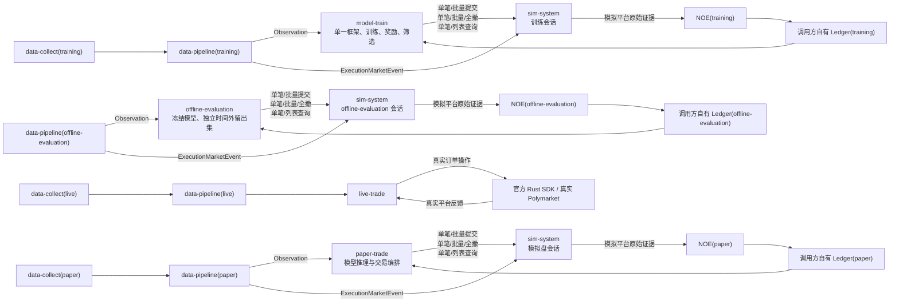

# sim-system 独立需求文档

事项编号：`SIM-SYSTEM-20260731`。

生命周期：`DRAFT_AWAITING_USER_REVIEW`。

当前执行权威（`authority`）：`none`。

对应计划：用户审核并明确批准本需求后，才允许创建
`plan/sim-system-plan.md`。

对应变更日志：用户审核并明确批准本需求后，随获批计划创建
`changelog/sim-system-changelog.md`。

本文只定义独立 `sim-system` 模块的需求、边界和验收标准，不授权编写实现、
创建计划、部署、启停服务、修改远端状态或执行任何真实资金操作。

同一路径下的前一版草稿把盘口写成不接收任何外部市场状态的静态冻结场景。用户在
2026-07-31 审核中明确纠正：训练和模拟盘的模拟撮合必须由与模型 `Observation`
同源、同因果边界的订单簿事件驱动；首版还必须覆盖批量、全撤、
`ListOpenOrders` 和 `ListTrades`。前一版草稿没有执行权威，本版按这些最新
决定整体替代其冲突内容。用户随后进一步冻结：合格 `MarketResolved` 到达时
必须在同一逻辑时点立即完成模拟自动赎回；首版还必须把 `venue_dust` 作为独立
平台终态。用户在 2026-08-01 至 2026-08-02 的审核中进一步纠正：平台小额余量只属于
本模拟交易账户自己的已接受订单，不能作用于外部影子订单簿的价格档位、
前后队列或其他参与者挂单；它只能在模拟平台按冻结盘口和队列规则形成一次或多次本账户
实际已撮合后，按本账户订单的精确未成交余量确定，禁止使用发生率、随机抽样或随机
数量制造。用户同时冻结：有效 `book`/价位净缩量必须在去除同一底层变化的重复证据后，
作为确定性的队头消耗作用于当时仍处于活动状态的 maker 订单；有效新 `book` 既重校准外部
盘口，也成为后续计算的新基准。缺口、重同步或没有真实逐订单 ID 本身不得把既有订单送入
`UNKNOWN_MARKET_STATE`/隔离；模拟结果必须明确标记为项目批准的 L2 队列推定，
不能冒充真实平台逐订单 FIFO 复原。

## 1. 用户冻结的模块定义

用户已经明确以下架构语义，后续计划和实现不得改变：

1. `sim-system` 是独立的平台订单处理模拟模块。
2. 它只接受 `model-train`、`offline-evaluation` 或 `paper-trade` 发来的订单
   业务请求，首版请求面为：
   `SubmitOrder`、`SubmitOrders`、`CancelOrder`、`CancelOrders`、
   `CancelAllOrders`、`QueryOrder`、`ListOpenOrders` 和 `ListTrades`。
3. `data-pipeline` 从同一规范市场事件序列分别输出模型可见
   `Observation` 和独立的 `ExecutionMarketEvent`。前者只进入模型消费者，后者通过
   与订单业务面分离的只读市场状态数据面进入 `sim-system`。
4. `sim-system` 根据 `ExecutionMarketEvent` 在会话内部维护可演进的影子
   订单簿、模拟订单叠加层、基于 `book`/价位净差额的 L2 FIFO 队列估计、
   账户和时间状态；调用方不能随订单注入、改写或查看这些内部状态。
5. 它返回即时请求响应、分页查询响应，以及彼此独立但可关联的订单、成交和结算
   生命周期反馈。
6. 首版没有改单操作。当前官方 Polymarket 文档和本仓库固定版本的官方 Rust SDK
   未提供原生改单/修改/替换订单接口；改变价格、数量、到期时间或其他
   订单参数只能由调用方先发出独立撤单请求，再发出一笔全新的提交请求。
7. `data-collect` 保留传输层/源级覆盖度、健康状态/缺口和
   恢复/重连证据；`data-pipeline` 独占源证据到规范
   市场事件的排序、去重、规范/模型可见缺口、因果
   可用性/截止点和模式一致性处理；`sim-system` 不重复解析类型化原始数据、
   Parquet 或实时交接，也不建立第二套规范化。
8. 每个 5 分钟市场只允许形成有界热状态。完整规范事件序列由 `data-pipeline`
   拥有，`sim-system` 不复制保存整段事件序列；市场结束和市场判定终态后按
   本文规定分两级释放热状态，只保留查询、幂等和审计所需的紧凑订单/成交记录。
9. `model-train` 独占训练方法、奖惩方法和训练结果筛选。当前只使用一个训练框架，
   不开展框架竞赛。
10. 后续更换模型框架时，只替换 `model-train` 内部实现；只要统一模型数据合同、
   模型产物/推理合同和本模块订单请求/反馈合同不变，其他模块无需随框架修改。
11. `live-trade` 只调用官方 Polymarket Rust SDK 和真实平台，不得调用
   `sim-system` 生成或覆盖真实平台事实。
12. 合格 `MarketResolved` 一旦在会话的规范因果时间线可用，
    `sim-system` 必须在同一逻辑时点、按稳定子顺序原子更新模拟平台账户并生成独立
    `AutoRedeemApplied` 反馈；首版不模拟人为等待、失败或重试。
13. `venue_dust` 是本模拟交易账户已接受订单的独立订单数量/生命周期分支：
    模拟平台按第 10.2 节形成合格的显式成交或确定性差额成交推定后，本账户订单已有正的
    已撮合 base 数量，其自身精确未成交余量严格位于 `(0, 0.01 shares)`，对应价格除
    该账户小余量外的队列已由同一冻结规则耗尽，平台据此关闭该账户余量。外部盘口余量无论
    多小都不是平台小额余量；
    平台小额余量不等于成交已最终结算，也不得生成额外成交、份额、费用或现金流。

现有文档的适用关系为：

- `demand/rebuild-core-demand.md` 仍是审核中草案。其中把
  `offline-evaluation` 作为独立样本外评估调用方，以及
  `sim-system -> 模拟平台原始证据 -> NOE -> 调用方自有 Ledger` 的边界，已经用户
  确认纳入本文合同。`NOE` 和 Ledger 仍在 `sim-system` 之外；
  `sim-system` 不直接生成 `NormalizedOrderEvent` 或 Ledger 事件。
- `data-collect/docs/CURRENT.md` 继续拥有 `data-collect` 当前事实，并已同步本文第 3 节
  用户确认的跨模块主线。模拟盘/实盘真实适配器仍属于后续 `data-collect`
  独立事项；必须先完成 `model-train`（模型训练模块，不是
  `data-collect-training-collector`），之后仍只有在用户决定返回时才可另立三件套。

若本文、用户最新决定、获批后的计划、当前代码、官方平台规则或真实平台产物
不能同时成立，必须停止受影响工作，列出精确位置、语义、影响和现实选项，由用户
决定；不得自行调和或选择一处覆盖另一处。

## 2. 系统数据流和唯一职责



### 2.1 模块唯一职责

| 模块 | 唯一职责 |
| --- | --- |
| `data-collect(training)` | 采集离线训练所需的外部原始数据，生成类型化原始数据、覆盖度和清单 |
| `data-collect(paper/live)` | 分别采集模拟盘/实盘在线外部数据并提供实时交接 |
| `data-pipeline` | 将离线或在线源证据规范为唯一规范市场事件序列，同源输出 `Observation` 和独立 `ExecutionMarketEvent` |
| `model-train` | 使用当前单一框架训练，定义奖惩方法并筛选训练结果 |
| `offline-evaluation` | 只读加载冻结候选模型和从未进入训练或自适应决策的时间外留出集，使用隔离模拟器/NOE/Ledger 实例生成独立评估证据 |
| `sim-system` | 消费 `ExecutionMarketEvent` 维护有界影子 CLOB、订单/账户/结算状态，并将提交、撤单和查询请求按冻结平台规则、账户侧平台小额余量规则和潜规则映射为模拟平台原始证据 |
| `NOE / Ledger` | 位于 `sim-system` 之外；NOE 将模拟原始证据归一化，各调用方自有 Ledger 只更新本运行实例的账户投影 |
| `paper-trade` | 使用实时统一模型输入和模型产物进行模拟盘交易编排，调用 `sim-system` |
| `live-trade` | 使用实时统一模型输入和模型产物，通过官方 SDK 调用真实平台 |

### 2.2 禁止存在的数据流

以下路径在当前及后续架构中都不成立：

```text
data-collect -> sim-system
类型化原始数据 / Parquet / 实时交接 -> sim-system
Polymarket / Binance / RTDS 原始/已解码源事件 -> sim-system
Observation / 特征 / 标签 / 奖励 -> sim-system
sim-system -> data-pipeline
sim-system -> live-trade
sim-system -> 奖励 / 模型筛选 / 框架竞赛
```

`data-pipeline -> sim-system` 只允许版本化 `ExecutionMarketEvent` 数据面，不允许
`Observation`、模型特征或原始传输帧。调用方把行情、特征、模型
状态或账本状态包装进订单请求，也不能绕过上述边界。
`sim-system -> NOE -> 调用方自有 Ledger` 是模拟执行证据的唯一正向消费路径；
NOE 与 Ledger 不因此成为 `sim-system` 内部模块。

## 3. 开发顺序

用户确认的当前模块主线为：

```text
1. data-collect(training)                 [已完成]
2. sim-system
3. data-pipeline(training)
4. model-train
```

`model-train` 之后只存在以下条件性后续路径，不是已经无条件批准的当前主线或执行
授权：必须先完成 `model-train`，并由用户届时明确决定返回 `data-collect`，才可从
第 5 项另立三件套继续：

```text
5. data-collect(paper/live)
6. data-pipeline(paper/live)
7. paper-trade
8. live-trade
```

该顺序与本架构一致：

- `sim-system` 先冻结订单业务合同、`ExecutionMarketEvent` 消费合同、平台规则和撮合
  引擎，并用符合该合同的合成/固定预期黄金 L2 事件序列（`golden L2 tape`）独立开发和验收；
- `data-pipeline(training)` 随后实现同源 `Observation` 与
  `ExecutionMarketEvent` 生产器，完成真实历史数据的端到端接入；
- `model-train` 通过稳定订单合同调用已经独立完成的 `sim-system`；
- `offline-evaluation` 在候选模型训练完成后，使用从未进入训练或自适应决策的时间外
  留出集、冻结模型和隔离的模拟器/NOE/Ledger 实例，生成晋级模拟盘前的独立泛化证据；
- 只有用户在 `model-train` 完成后决定返回 `data-collect`，模拟盘/实盘的真实数据接入
  和在线处理才分别建设；模拟盘使用模拟平台，实盘使用真实平台。

`data-pipeline` 的实现不是 `sim-system` 核心撮合引擎的开发前置条件，但真实训练
事件序列和模拟盘实时流的集成必须等待相应 `data-pipeline` 生产器。不得把 NOE、
Ledger、模型框架竞赛、`offline-evaluation` 或 `Promotion Controller` 插到
`sim-system` 前面作为当前完成门。

## 4. 已采集样本的适用边界

当前已经采集的数据样本为：

```text
/home/chillchill/new-datasets/2026-07-30/typed_raw/utc_day=2026-07-30
```

已只读核实：

- `manifest.json` 的 schema 标识为 `data_collect_daily_manifest_v3`；
- 状态为 `closed`，闭合状态原因为 `utc_day_barrier`；
- 清单记录 121 个已最终化的 Parquet 文件；
- `polymarket_market` 共 41,355,216 行，其中包括 38,332,349 条 `price_change`、
  1,397,011 条 `best_bid_ask`、1,101,419 条 `book`、523,969 条
  `last_trade_price`、288 条 `market_resolved` 和 180 条 `tick_size_change`；
- 整个 UTC 日约 2.5 GiB，其中 `polymarket_market` 文件约 2.47 GB；
- 清单 SHA-256 为
  `4b2cd62cea8740bf4cdb29971941118e70d869835496aece714458d12ea96557`。

样本中的 `market_resolved` 行已直接提供 `asset_ids`、`winning_asset_id`、
`winning_outcome` 及相关时间戳，但没有直接提供 `payout_vector` 字段。后续
`data-pipeline` 若为二元市场派生兑付向量，必须依据版本化规则，并把
源事件、获胜结果身份标识和派生规则来源追溯一并写入
`ExecutionMarketEvent`；`sim-system` 不得把派生值冒充原始字段或自行猜测。

该样本是后续 `data-pipeline(training)` 的输入证据。它可以由后续
`data-pipeline` 生成与模型 `Observation` 同源的 `ExecutionMarketEvent` 历史回放
产物，但类型化原始数据、Parquet 和实时交接仍不得被 `sim-system` 直接
读取。本文不要求也不授权在 `sim-system` 内开发原始转换器或第二套
规范化组件。

样本不包含本账户真实的提交响应、撤单响应、订单查询、`user-channel`、
撮合成交、成交结算或账户状态证据。因此它不能单独证明或校准真实平台的
接受、拒绝、队列、撮合成交、撤单竞态、时延、手续费或结算行为。
它同样不能证明本账户订单的平台小额余量终态规则或判定边界。
样本中的 `last_trade_price` 只有市场/资产、价格、数量、方向、手续费和时间字段，
没有账户/订单/成交身份标识、账户侧状态、链上交易或 `user-channel` 关联；
因此它只能作为公开市场成交证据，不能直接实例化为任何模拟调用方的账户成交。
公开 L2 订单簿和成交事件可以驱动影子订单簿与队列估计，但不能恢复真实
逐订单队列排位；当前类型化数据行也没有证明每个 `price_change` 与
`last_trade_price` 的一对一因果归属，不能仅按到达先后防止双算。后续
`data-pipeline` 必须按版本化规则把同一底层变化合并为唯一规范状态转换，并把
尚未被已应用 `price_change`/成交状态转换覆盖的有效 `book` 净差额单独表达；
`sim-system` 按第 10.2 节把该净差额确定性应用一次。无法证明真实原因时保留
`source_attribution_quality=UNATTRIBUTED`，但只要完整 `book`、价位、数量和顺序合同
有效，就不因此禁止项目批准的差额成交推定。上述数据量还证明 `sim-system` 必须流式
消费并按市场释放热状态，不能为每个会话复制或永久保存完整 5 分钟市场事件序列。

其中 `best_bid_ask` 只表达最优价格、不携带该价位数量，不能单独推进数量队列；它只能
校验派生最优价。`price_change` 的绝对变更后数量、`last_trade_price` 的成交信息和
完整 `book` 才能经规范去重后形成第 10.2 节的唯一净价位状态转换。

该日市场元数据的 299 份可解析载荷都带有 `secondsDelay` 键，其值全部为
`null`；这只排除了该样本中已记录的秒级延迟，不能排除官方独立定义的
`itode` 250ms taker 暂缓窗口（`hold`）。当前类型化原始数据没有保存 `itode`；2026-08-02 以本样本
条件 `0x34df9f8c34766d66d72fab055400c4eec5413a6be4c644bb023a4c1a683267de`
查询官方公开 `GET /clob-markets/{condition_id}` 返回 `itode=true`。后续
`data-pipeline` 必须把有来源追溯的适用市场延迟策略放入
`ExecutionMarketEvent`/规则谱系；`sim-system` 不得为所有市场硬编码 250ms。

只读样本还实际包含两种相邻顺序：同一市场/资产的
`polymarket_market_01.parquet` 中，从 0 开始计数的第 1469/1470 行接入序列
`37047813/37047814` 为 `last_trade_price -> book`；行 6021/6023 的序列
`37052365/37052367` 为 `book -> last_trade_price`。两组事件的源/接收
时间都非常接近，但没有共同的权威因果 ID；该事实只证明不能让模拟器依赖某一种
到达顺序，不证明这些相邻行必然属于同一成交。

对代表市场 `btc-updown-5m-1785369600` 的只读复算进一步得到：203,480 行中有
4,536 条 `book`，两个资产各有一条初始 `book`；在每次 `price_change` 按绝对
变更后数量更新、每次 `book` 随后重校准的前提下，后续 4,534 条 `book` 中 4,404 条与
已重建状态完全一致，130 条仍有净差额；356 个差异价位中 353 个为缩量、3 个为增量。
序列 `35061689` 的 `price_change` 已报告 SELL `0.5=112.9`，`35061690` 是该资产
首份初始装载 `book` 且同样为 `112.9`，不能把它再解释成一次缩量；初始装载后，
`35061699` 已更新至 `84`，`35061700` 和 `35061705` 的 `book=84` 也都只能确认。相反，
重建的 BUY `0.39` 为 `56.13` 时，`35062432` 的 `book=51.13` 留下净缩量 `5`，不能
忽略。该样本同时证明：重复应用整个快照会双算，完全忽略有效净差额又会漂移；因此
后续规范合同必须输出去重后的唯一净差额。

## 5. 模块目标

1. `SIM-G-001`：为 `model-train`、`offline-evaluation` 和 `paper-trade` 提供
   同一套稳定、版本化、
   与模型框架无关的订单操作接口。
2. `SIM-G-002`：根据冻结的平台公开规则、SDK 合同、有证据的平台潜规则、明确标记的
   项目假设和 `ExecutionMarketEvent`，模拟每笔提交、撤单和查询请求的处理反馈。
3. `SIM-G-003`：盘口由同源 `ExecutionMarketEvent` 驱动；可变影子订单簿、模拟
   订单叠加层、基于净差额的 L2 FIFO 队列估计、账户、订单、时间和结算状态全部由
   `sim-system` 的会话内运行时拥有。
4. `SIM-G-004`：输出既覆盖即时请求响应，也覆盖独立的订单生命周期反馈、每笔本账户
   撮合成交及其成交记录的生命周期反馈，以及与市场判定关联的独立
   自动赎回结算生命周期反馈；三者只能通过稳定 ID 关联，不能混成一种事件。
5. `SIM-G-005`：相同请求序列、`ExecutionMarketEvent` 流、初始场景、规则版本、
   队列规则、平台小额余量规则、结算配置档（`settlement profile`）、逻辑时间和随机种子必须产生相同反馈
   序列和最终模拟平台状态。
6. `SIM-G-006`：在真实 `data-collect`、`data-pipeline` 生产器、模型框架、模拟盘
   运行时、网络、钱包和真实平台均不存在时，仍可用合成请求和合成/固定预期黄金的
   `ExecutionMarketEvent` 测试数据（`golden ExecutionMarketEvent fixture`）独立完成核心引擎验收。
7. `SIM-G-007`：后续更换 `model-train` 框架时，只要外部合同兼容，
   `sim-system` 不需要修改或增加框架分支。
8. `SIM-G-008`：5 分钟市场按预加载、活跃、待市场判定、终态/已移除
   生命周期滚动处理；热内存、事件队列和本地产物均必须有硬边界。
9. `SIM-G-009`：对合格 `MarketResolved`，模拟兑付、结果代币销毁、
   pUSD/现金和持仓更新与 `AutoRedeemApplied` 必须原子、幂等并发生在同一逻辑
   时点；调用方只能在该反馈可见后结算自己的账本。
10. `SIM-G-010`：平台小额余量必须由第 10.2 节的合格账户成交、账户订单所有权和同价队列
    状态确定；
    平台小额余量数量只能等于本账户订单在该撮合后严格位于 `(0, 0.01 shares)` 的精确
    未成交余量。不得把外部盘口余量归入平台小额余量，不得使用概率或随机数量制造平台小额余量，也
    不得倒扣已冻结的订单已撮合数量或借平台小额余量合成成交。

## 6. 首版范围和非目标

### 6.1 首版范围

首版业务范围冻结为：

- Polymarket Global CLOB 的 `btc-updown-5m` 市场系列；
- pUSD 和两个结果代币；
- 本系统主动订单面为 `BUY-only`；
- 单笔 `SubmitOrder`；
- 1 至 15 笔的 `SubmitOrders`；
- 按一个或一组模拟平台订单 ID 的 `CancelOrder` / `CancelOrders`；
- 当前模拟账户/会话的 `CancelAllOrders`；
- 按一个模拟平台订单 ID 的 `QueryOrder`；
- 分页 `ListOpenOrders` 和 `ListTrades`；
- GTC、GTD、FOK、FAK 和适用的 post-only；
- 即时提交/撤单/查询响应；
- 与订单关联的活动挂单、部分/全部撮合成交、撤单、到期订单生命周期反馈，
  以及与具体本账户成交关联的独立 `TradeLifecycleFeedback`；
- 按证据分类的、版本化平台小额余量终态、已撮合后撤单可见性竞态和独立
  `VenueDustTerminal` 生命周期反馈；
- 合格 `MarketResolved` 到达同一逻辑时点的原子自动赎回，以及独立
  `AutoRedeemApplied` 结算反馈；
- 训练历史回放与模拟盘实时流共用的 `ExecutionMarketEvent` 合同；
- 5 分钟市场的预加载、活跃、待市场判定、终态/已移除生命周期；
- 动态影子订单簿、单一基于 `book`/价位净差额的 L2 FIFO 队列模型、余额、授权额度、
  活动订单资金占用、费用、适用市场的内部 taker 时延、账户侧平台小额余量
  终态规则和反馈
  可见性；
- 市场级热状态释放、紧凑订单/成交索引、分页查询和有界运行/会话产物。

### 6.2 当前明确不做

1. 不接受 SELL 意图。外部市场事实中的 BUY/SELL、买价/卖价、maker/taker 不等于
   本系统具有自有 SELL 操作面。
2. 不提供 `AmendOrder`、`ModifyOrder`、`ReplaceOrder` 或等价隐藏入口。
3. 不支持按市场/代币撤单、余额查询、市场数据查询、构建器成交
   列表或通知查询；这些能力必须另立需求后才能进入。
4. 不采集或订阅外部市场，不直接解码类型化原始数据、Parquet、实时交接或原始
   传输层帧，不重复实现 `data-pipeline` 已拥有的规范化、排序、
   去重、规范/模型可见缺口和因果可用性/截止点处理。
5. 不处理特征、规范化、标签、划分、`Observation` 或统一模型输入。
6. 不运行模型推理，不产生交易决定，不计算奖励，不训练、排名、晋级或淘汰模型。
7. 不建设多框架插件、适配器注册表、框架竞赛、HPO 或 `Promotion Controller`。
8. 不拥有调用方 Ledger、现金、持仓、PnL、NAV、风险、暂停或下一步动作
   决策。
9. 不连接真实 Polymarket，不签名，不持有钱包、私钥、API 凭据，
   不提交真实订单，也不是官方 SDK 的影子客户端。
10. 不向实盘环境提供模拟回退，不把模拟反馈描述成真实平台事实。
11. 不声称 L2 回放恢复了真实逐订单队列位置（排位），也不模拟自身订单对外部市场
    后续事件产生的真实市场影响。
12. 不把完整 `ExecutionMarketEvent` 事件序列复制进每个会话或模拟器产物；
    `data-pipeline` 是事件序列归属方，模拟器产物只保留必要谱系、游标、订单、
    成交和验证证据。

## 7. 外部请求合同

### 7.1 唯一业务请求联合类型

1. `SIM-I-001`：公开业务请求必须是封闭联合类型：

   ```text
   SimRequest =
       SubmitOrder
     | SubmitOrders
     | CancelOrder
     | CancelOrders
     | CancelAllOrders
     | QueryOrder
     | ListOpenOrders
     | ListTrades
   ```

   任何新增变体都必须先修改并重新批准需求。
2. `SIM-I-002`：`ExecutionMarketEvent` 输入、规则发布、会话创建、市场状态
   初始装载和内部时钟调度属于独立配置/市场状态数据面，不得伪装成调用方业务
   请求。
3. `SIM-I-003`：每个请求封装必须包含：
   - 合同版本；
   - 调用方角色，且只能是 `model-train`、`offline-evaluation` 或
     `paper-trade`；
   - 调用方实例/运行 ID；
   - 模拟会话 ID；
   - 模拟账户身份标识；
   - 全局唯一请求 ID；
   - 变更请求必需的幂等键；查询/列表不要求业务幂等键；
   - 调用方关联/本地意图 ID；
   - 单调调用方序列；
   - 请求发出逻辑时间；
   - 产生该请求的模型可见因果截止点 / 规范游标引用。
4. `SIM-I-004`：请求不得包含模型张量、框架对象、特征、`Observation`、奖励、
   标签、类型化原始数据、行情事件、订单簿、成交事件序列、调用方 Ledger 或机密。
5. `SIM-I-005`：`live-trade`、未知调用方、跨会话/账户 ID、错误合同
   版本、重复请求 ID 冲突、非单调序列或引用模拟器尚未达到的未来因果
   游标必须安全拒绝（`fail closed`），且不得改变业务状态。

### 7.2 `SubmitOrder` 与 `SubmitOrders`

1. `SIM-I-006`：每个提交项至少包含：
   - 市场/条件/代币/结果身份标识；
   - `side=BUY`；
   - 订单类型；
   - 限价/最差价格；
   - 与订单类型匹配的份额或 pUSD 数量计量基准；
   - GTD 到期时间（适用时）；
   - post-only（适用时）；
   - 调用方本地订单引用。
2. `SIM-I-007`：GTC/GTD 限价 BUY 使用明确的价格和份额；FOK/FAK 市价 BUY
   使用明确的支出金额和最差价格约束。两种数量计量基准不得通过
   一个含义不明的裸 `size` 字段混用。
3. `SIM-I-008`：`SubmitOrder` 精确包含一个项；`SubmitOrders` 精确包含 1 至 15
   个有稳定项索引和唯一本地订单引用的项。空批量、超过当前
   规则上限、重复本地引用或项合同非法必须产生明确结果。
4. `SIM-I-009`：批量提交是一个请求封装，但每个项独立校验和处理，
   可以出现已接受、已拒绝或未知混合结果；不得把整个批量虚构成
   全成或全不成原子事务，也不得因一项失败回滚已经接受的其他项。
5. `SIM-I-010`：批量请求幂等重试必须返回原项到结果映射，不得重复创建
   任一订单；相同幂等键搭配不同项数量、顺序或载荷必须安全拒绝（`fail closed`）。
6. `SIM-I-011`：提交合同必须是不含机密信息、模型框架无关的领域合同。真实签名、
   L2 凭据和 HTTP 请求头不进入模拟器；需要测试签名/认证失败
   时，由冻结规则/场景注入对应平台结果。
7. `SIM-I-012`：一次提交成功创建的模拟平台订单 ID 必须只属于一个
   会话/账户；调用方本地引用既不是平台订单 ID 的权威来源，也不得与其视为同一身份。用于可复现
   规则决策的稳定逻辑订单身份标识必须绑定会话/账户、变更
   幂等身份标识和稳定批量项身份标识，不得来自会因插入无关订单而漂移的
   全局顺序号。

### 7.3 `CancelOrder`、`CancelOrders` 与 `CancelAllOrders`

1. `SIM-I-013`：`CancelOrder` 只接受同一会话/账户内一个模拟平台
   订单 ID；`CancelOrders` 接受一个非空、有版本化硬上限的订单 ID 列表。
   首版默认上限冻结为 `1,000`：当前 API 引用与 2026-06-15 官方
   变更日志均写为 `1,000`，`Manage Orders` 页面仍写 `3,000`。该冲突必须保留在
   规则证据中；后续只能通过新规则版本变更上限，不能在会话内切换。
2. `SIM-I-014`：按当前官方规则，批量撤单的重复订单 ID 在首个相同 ID 后被
   忽略，不得重复执行或生成互相冲突的结果。响应以唯一目标 ID 关联
   已撤单/未撤单/未知；无论整体类 HTTP 响应是否成功，都不得把
   部分成功写成全成或全败。该语义与其他规则一样进入版本化规则产物。
3. `SIM-I-015`：`CancelAllOrders` 不携带调用方任意指定的订单集合，作用域固定为
   请求平台处理截点时该模拟会话/账户中全部可撤的未成交
   剩余量；不得跨会话/账户，也不等于首版未纳入的
   按市场/代币撤单。
4. `SIM-I-016`：撤单只作用于平台处理时仍未成交的剩余量；已经成交的数量不得
   被追溯取消。
5. `SIM-I-017`：目标不存在、属于其他会话/调用方、已经终态、处于规则明确
   不允许撤单的状态或与成交事件发生竞态时，必须按冻结规则产生明确反馈，不得
   静默成功。
6. `SIM-I-018`：模拟器不得替调用方按订单年龄、市场切换或内部策略自行
   生成调用方撤单请求。平台自身的 FAK 剩余量终止、GTD 到期、市场
   关闭等终态行为属于内部生命周期事件，不冒充调用方撤单或全撤。

### 7.4 `QueryOrder`、`ListOpenOrders` 与 `ListTrades`

1. `SIM-I-019`：`QueryOrder` 只接受同一会话/账户内的一个模拟平台
   订单 ID。结果必须是请求在模拟平台处理时刻可见的当前快照，至少包含订单
   身份标识、状态、原始请求数量计量基准/值、价格、订单类型、
   创建时间/到期时间、终态原因和关联成交引用。所有数量和金额必须
   携带 base/quote 计量基准、小数标度（`scale`）与币种，禁止裸 `quantity` 跨单位解释：
   - 按 base 计量订单表达已接受/订单已撮合/平台小额余量已关闭/已撤单/已到期/
     市场已关闭/其他终态/活动未成交 base 数量；订单已撮合还必须按成交最终性
     分解为最终成功、待处理且经济变化已应用、待处理且经济变化未应用、
     失败补偿待处理（failed-compensation-pending）、终态失败且已补偿（terminal-failed-compensated）和
     终态失败且未应用（terminal-failed-unapplied），不能把订单撮合与链上/平台成交最终性混成同一
     字段；
   - 按 quote 预算计量订单表达已接受 quote 预算、最终成功已消耗、待处理且已应用
     已消耗、待处理且未应用已占用、已释放或未使用和仍由活动订单占用的 quote
     金额，同时单独表达各成交的 base 数量、名义金额、手续费与结算状态；
   - FAK 部分执行后终止或其他终态必须由明确终态原因解释对应 base/quote
     分桶，不能塞入平台小额余量。
   `accepted_base_quantity - order_matched_base_quantity > 0` 不等于仍有活动未成交
   剩余量；
   小额余量终态订单必须明确表达 `venue_dust_closed_base_quantity > 0` 且
   `open_base_quantity = 0`。上述数量都只属于查询目标的本账户订单；同价外部
   影子订单簿数量不得进入该订单快照。
2. `SIM-I-020`：`ListOpenOrders` 返回同一会话/账户在请求处理截点
   仍有活动未成交剩余量的调用方可见订单。首版支持可选订单 ID、
   条件/市场和代币/资产过滤条件；终态订单不得混入，外部影子
   订单永不进入该账户列表。
3. `SIM-I-021`：`ListTrades` 返回同一会话/账户已经调用方可见的模拟
   成交。首版有意只提供不改变固定会话/账户身份标识的过滤子集：可选
   成交 ID、条件/市场、代币/资产和起止时间；不额外发明平台
   当前未提供的按订单 ID 查询参数，也不暴露 maker/taker 地址过滤条件。官方
   文档的 `maker_address` 与固定版本的 SDK 的 `maker`/`taker` 参数面存在差异，且本
   模拟器每个请求已固定账户身份标识；这些地址过滤器必须另立需求后才能
   加入。每项至少包含成交/订单身份标识、市场/代币、价格、已执行 base
   数量及其小数标度（`scale`）、成交名义金额及其币种、maker/taker 角色、手续费金额/
   币种、状态、`fill_economic_delta_identity`、`queue_progress_basis`、
   `queue_result_quality`、经济闭合状态、撮合/更新时间和可用的链上交易
   引用。
   平台小额余量终态和自动赎回都不是成交，不得生成伪成交 ID 或进入
   `ListTrades`。按 `SIM-R-008` 确定性推定并实际增加本账户已撮合数量的撮合成交
   必须作为模拟账户成交返回并携带推定依据；外部市场成交或价位变化若只推进影子
   订单簿/队列而未穿过本账户订单，则不得作为本账户成交返回。
   `after` 缺省表示从该查询 epoch/会话起点开始，`before` 缺省表示当前查询
   截点。若请求区间有任何部分早于已删除历史的保留期下限水位线，
   整个请求返回 `OUT_OF_RETENTION_RANGE` 和水位线，不得把剩余部分伪装成完整
   结果；调用方可用不早于水位线的 `after` 发起新请求。精确成交 ID 若仍在
   已保留索引中可以直接返回；若未找到且相关历史已经截断，则返回
   `OUT_OF_RETENTION_RANGE`，不能误报为空。
4. `SIM-I-022`：两个列表请求都必须分页，使用不透明游标、版本化每页大小
   硬上限和稳定项身份标识；第一页冻结查询截点/水位线，后续游标
   必须绑定该水位线和完整过滤条件，避免新状态插入导致重复或漏项。游标不得被
   调用方解释成内部数组下标，也不得跨查询种类、过滤条件、会话/账户或
   合同版本复用。
5. `SIM-I-023`：查询/列表不得暴露尚未到达调用方可见时间的内部真相、场景
   随机种子、隐藏队列估计、其他会话数据或模拟器私有状态。
6. `SIM-I-024`：查询目标不存在、不可见或不属于调用方/会话时，必须返回明确的
   未找到/禁止/未知语义；合法列表无匹配项可以返回空页，但不能把
   合同错误伪装为空结果。
7. `SIM-I-025`：查询/列表是只读平台操作。处理前可以先结算在查询平台到达时刻之前
   已经到期的市场/订单事件，但请求自身不得产生成交、撤单、余额变化或其他业务状态
   转换。
8. `SIM-I-026`：已取得合格市场判定并进入终态的市场安全释放热状态后，
   `QueryOrder` 和 `ListTrades` 必须在会话/运行查询合同仍有效期间从紧凑
   持久化紧凑订单/成交索引返回相同的终态可见结果；不得为了支持查询重新
   加载完整市场事件序列，且按该市场过滤的 `ListOpenOrders` 必须为空。若
   市场因证据缺失进入 `EXHAUSTED_QUARANTINED`，受影响查询/列表必须返回持久化的
   `UNKNOWN_INCOMPLETE_HORIZON` 或等价的明确暴露失败结果（`fail visible`），不能伪装成终态
   快照、未找到或合法空页。

### 7.5 明确不存在改单

1. `SIM-I-027`：任何改单/修改/替换请求种类或改变既有订单参数的请求
   必须以 `UNSUPPORTED_OPERATION` 拒绝，不能偷偷转换成撤单或新订单。
2. `SIM-I-028`：调用方若要改变订单，必须先提交 `CancelOrder`，再使用新的请求
   ID、幂等键和本地引用提交新的 `SubmitOrder`；新提交被接受后，由
   模拟器生成全新的平台订单 ID。
3. `SIM-I-029`：撤单与新提交是两个独立、非原子的操作。撤单失败、迟到成交或反馈
   未知时，模拟器不得回滚、覆盖或合并成虚构的原子替换。
4. `SIM-I-030`：平台 `user-channel` 中因部分成交产生的订单 `UPDATE` 是服务端
   生命周期反馈，不是调用方改单，也不得通过它改变原始订单参数。

## 8. 冻结场景、市场状态数据面和动态影子 CLOB

1. `SIM-S-001`：每个模拟会话必须在接收首个业务请求前绑定不可变的
   `PlatformScenario` 身份标识、版本和摘要，以及一个
   `ExecutionMarketEventContract` 版本。
2. `SIM-S-002`：冻结的是规则、市场窗口身份标识、预加载/终态策略、
   `ExecutionMarketEvent` 事件序列/流谱系、队列模型版本、初始模拟账户、
   平台小额余量规则/结算策略、时延/可见性配置档（`latency/visibility profile`）和随机种子；订单簿数值及
   订单、账户和结算状态必须按事件和请求继续演进，不能被误写成整场静态不变。
   `sim-system` 提供通用的版本化时延/可见性配置档插槽，不把任一地域样本
   硬编码为模块唯一合法配置档；但当前 `rebuild-core` 范围内的正式训练、
   `offline-evaluation` 与模拟盘运行必须绑定 `demand/rebuild-core-demand.md` 第七节第
   20 至 22 条冻结的同一个爱尔兰双向代理配置档。其他配置档只能用于明确标识的
   模块级固定预期黄金样例/符合性测试（`golden/conformance`）、受控模拟校准或后续新版本，未经新需求和
   版本决策不得替代当前正式运行的配置档。
3. `SIM-S-003`：`data-pipeline` 是唯一 `ExecutionMarketEvent` 生产器。训练
   使用不可变历史回放产物，模拟盘使用持续实时流；两者必须使用同一
   版本化载荷、全序键、因果可用性、缺口和生命周期语义。
4. `SIM-S-004`：`ExecutionMarketEvent` 至少能够表达：
   - 市场/条件/代币身份标识、市场窗口和生命周期状态转换；
   - 适用市场的 `itode`、秒级延迟及其源/版本/摘要；
   - 完整 L2 初始装载快照及其源 epoch/游标/摘要；
   - 价格档位数量变化、最优买价/卖价和最小价格变动单位变化；
   - 具有价格、数量、方向和可用时间的成交证据；
   - 原子 `LevelExecutionTransition` 或等价语义，包含因果组 ID、
     市场/资产/方向/价格、外部影子订单簿的变更前/变更后数量、已归因成交数量、
     已被同一底层变化覆盖的数量、去重后的有效价位/`book` 净增加量与净缩量、供队列
     只应用一次的净队头消耗量、关联源事件 IDs、`TRADE_EVIDENCE |
     LEVEL_DELTA_INFERENCE | BOOK_RESYNC_DELTA_INFERENCE` 依据、因果可用时间
     以及彼此分离的 `source_attribution_quality=EXACT | UNATTRIBUTED` 和
     `queue_result_quality=EXACT | DETERMINISTIC_INFERRED`；没有真实逐订单因果证据时
     必须保留 `source_attribution_quality=UNATTRIBUTED`，不能靠到达先后冒充精确归因，
     但这不否定合同有效的 `book` 净差额按冻结项目假设形成
     `queue_result_quality=DETERMINISTIC_INFERRED` 的队列结果；任何基于 L2 排队模型的
     maker 撮合成交都只能是 `DETERMINISTIC_INFERRED`，`EXACT` 只适用于不依赖未知 maker
     队列排位的外部状态或账户 taker 路径；
   - 规范事件 ID、源/接入/可用时间、全序键；
   - 覆盖度/缺口/陈旧/重同步状态和结束/终态水位线；
   - 合格 `market_resolved`，包括条件、获胜资产/结果、由
     `data-pipeline` 按版本化规则派生且保留来源追溯的兑付向量、规范
     事件 ID、因果 `available_at`、市场判定终态水位线/谱系，或市场判定
     等待窗口已耗尽并进入隔离的终态。该市场事件只提供市场判定事实与
     因果终态证据；模拟账户自身的成交/账户结算屏障仍由
     `sim-system` 按第 10.4 节核验，不能由生产器替其宣称完成。
5. `SIM-S-005`：会话必须先取得合格初始装载快照，再按严格单调的全序
   应用规范流动性/成交状态转换。完整、合同有效的新 `book` 是外部盘口的
   重校准边界：相同状态只确认；存在净差额时，必须先扣除同一底层变化已由
   `price_change`、成交或更早规范状态转换应用的数量，再把剩余净差额按第
   10.2 节只应用一次，并以该 `book` 作为后续新基准。游标缺口、epoch 切换、陈旧、
   乱序或关联超时可以使市场在下一份合格完整 `book` 到达前暂不接受新
   maker 提交，但不得仅凭这些信号关闭、隔离或把既有活动 maker 订单变成未知；
   下一份合格完整 `book` 必须在其规范可用时间对这些订单完成确定性重校准
   和队列/成交推定，不能回写更早已输出的反馈。只有始终缺少初始完整快照、完整
   `book` 自身无效或冲突、规范数量无法去重或不守恒等不能形成唯一净差额的情况，
   才能进入 `UNKNOWN_MARKET_STATE`/明确暴露失败（`fail visible`）。因果组在形成唯一状态转换前
   不得应用；`group_available_at` 必须不早于所有组成事件的最大可用
   时间和实际最终确定时间。模拟盘使用有界、版本化关联窗口；训练
   离线可读取未来字节，但都不能把事后结果回填到更早因果截点。
6. `SIM-S-006`：调用方只能引用会话、市场和已观察因果游标，不能随单
   注入或改写订单簿、队列、余额、授权额度、流动性、时延、获胜结果或
   结算结果。`ExecutionMarketEvent` 也不能混入业务请求载荷。
7. `SIM-S-007`：`sim-system` 只消费规范事件，不直接读取 `data-collect`
   运行时、类型化原始数据、Parquet 或实时交接，也不重复实现传输层解码、
   源语义规范化、跨源全序、去重、缺口、因果截止点
   或成交/深度因果归因。`data-pipeline` 必须按版本化、可回放规则输出唯一
   净状态转换并保留重复消除与 `book` 重校准证据；不能证明真实原因时必须输出
   `source_attribution_quality=UNATTRIBUTED`。`sim-system` 不得据此猜测原始事件关系，但必须按
   冻结配置档（`profile`）使用合同有效的净价位/`book` 差额。
8. `SIM-S-008`：每个会话从同一只读事件序列/流创建隔离的可变外部
   影子订单簿、模拟账户、账户订单叠加层和队列估计。外部订单簿
   只表示其他市场参与者的盘口数量，账户订单叠加层只表示本模拟交易账户的订单；
   两者必须使用不同的数量字段和所有权标识，不得互相写入。聚合价格档位只能是派生视图，
   不能成为账户订单平台小额余量、活动未成交数量或预留资金的所有者。同价位的队列估计
   必须保留外部数量与账户订单的稳定因果相对顺序，不能把全部账户订单
   压成一段或让外部数量越过中途加入的账户订单；具体存储结构属于计划。
   不可变历史事件序列
   可以跨训练会话只读共享；任何可变叠加层、已消耗流动性
   记账状态、RNG、游标和反馈状态不得共享。
9. `SIM-S-009`：模型 `Observation` 与模拟器执行状态必须可追溯到同一
   规范事件谱系和已最终确定的因果截止点。`data-pipeline` 不得在
   `Observation` 中提前暴露尚未最终确定的状态转换，同时在模拟器数据面将其延后
   或反之。请求引用的决策因果游标之后、模拟平台到达截点
   之前的符合条件的事件按冻结延迟和排序规则推进；不得让模拟器使用模型决策时
   不可能看见的未来事件决定过去的请求。订单到达落在因果组的早期
   证据与后到证据之间时，尚未最终确定的组不得影响该订单；后续
   最终确定也不得追溯改写已经输出的结果。
10. `SIM-S-010`：仅凭 L2 事件和订单请求不能唯一推导真实逐订单队列排位。
    模拟器的 maker 撮合成交必须归因于第 10.2 节冻结的单一 `book`/价位净差额 FIFO
    估计模型；该模型是用户批准的确定性平台模拟规则，不得声明为真实 FIFO 复原。
11. `SIM-S-011`：历史/模拟盘回放不包含模拟订单对真实市场的反事实影响。
    `sim-system` 必须显式标记无市场影响假设，并用会话内叠加层
    防止同一可见流动性在同一会话内被重复消费。
12. `SIM-S-012`：处理某项请求所需的市场状态、规则或账户状态缺失，且无法由合同有效
    的完整 `book` 按 `SIM-S-005` 形成唯一新基准时，必须返回 `UNKNOWN_UNMODELED`、
    `UNKNOWN_MARKET_STATE` 或 `UNSUPPORTED_SCENARIO`，不得猜测一个确定平台结果。

## 9. 时间、状态和处理语义

### 9.1 统一逻辑时间和可见性

1. `SIM-T-001`：每个会话只有一个单调模拟平台时钟。训练会话使用可复现的
   逻辑时间；模拟盘会话使用单调时间并另记 UTC 审计时间。
2. `SIM-T-002`：调用方请求携带的是该请求的发送逻辑时间，不是平台内部真相时间；
   平台到达、校验、撮合、撤单生效、响应发出和客户端
   可见性时间由内部规则/场景计算。
3. `SIM-T-003`：`ExecutionMarketEvent`、订单请求到达、内部延迟/到期/结算
   和查询截点必须进入一个版本化全序合同。处理请求前，先处理所有
   排在其平台到达之前的符合条件的市场/内部事件；同一逻辑时刻使用
   稳定的同刻排序裁决规则（`tie-break`）。
4. `SIM-T-004`：平台内部状态先变化，调用方随后在反馈可见时间看到结果。
   响应或生命周期更新尚未可见时，查询/列表不得泄漏未来状态。
5. `SIM-T-005`：输出可以包含当前请求的直接响应和已经到达可见时间的订单/
   成交生命周期反馈；后续订单事件及事件触发结算反馈通过
   同一版本化反馈通道交付。
6. `SIM-T-006`：相同初始条件重跑时，工作单元（`worker`）、线程和实际时钟调度差异不得改变
   逻辑结果。
7. `SIM-T-007`：重复、迟到或乱序反馈不得重复成交、重复撤单、
   重新打开终态订单或改变已闭合数量。
8. `SIM-T-008`：平台小额余量终态必须先由第 10.2 节合格的显式成交或确定性差额
   成交推定、队列推进和本账户订单精确余量在平台内部因果时间线共同确定，再按
   冻结时延/可见性配置档（`profile`）生成订单更新、查询投影或后到撤单
   响应；调用方尚不可见不等于订单在平台仍处于活动状态。撤单响应自身、与目标价位无关的
   外部事件或重复状态转换都不能反向创造平台小额余量或撮合成交。
9. `SIM-T-009`：合格 `MarketResolved` 的 `available_at` 是首版自动赎回的
   逻辑时间；不得使用市场结束、源时间戳、实际时钟或人为延迟替代。
   在该时点必须先按全序应用全部因果上更早已终结成交/账户
   状态转换，并核验市场结束已关闭全部本账户活动订单、释放对应资金占用；
   随后执行内部 `MarketResolvedObserved` 标记 -> 外部 `AutoRedeemApplied`。
   内部变化使用同一逻辑时间和稳定子顺序；自动赎回不得为了等待旧反馈变为
   调用方可见而延后，也不能插入
   `Scheduled`、`Pending`、重试或失败状态。所有改变账户状态的反馈必须
   携带单调 `account_transition_seq`、前驱身份标识和之前/之后摘要；即使可见性
   配置档（`profile`）使旧反馈后到，调用方也能识别序列缺口并避免把后继变化量提前应用。

### 9.2 五分钟市场预加载、滚动状态和释放

1. `SIM-L-001`：每个 `btc-updown-5m` 市场的运行时生命周期单向为：

   ```text
   PRELOADING
     -> ACTIVE
     -> POST_END_PENDING_RESOLUTION
     -> RESOLUTION_TERMINAL | EXHAUSTED_QUARANTINED
     -> EVICTED
   ```

   不得从终态/已移除回到活跃。
2. `SIM-L-002`：预加载从合格的完整 L2 初始装载快照/epoch 开始，并按
   `ExecutionMarketEvent` 全序推进到市场激活。当前
   `data-collect` 生产验收证据只证明下一个市场在 T-30 秒之前已经订阅并取得
   快照，不证明模拟器的预加载必须恰好从 T-30 开始；`sim-system`
   必须消费输入合同中的显式 `preload_start`、快照游标和策略版本，
   不能在撮合代码中另写一个隐含时间值。
3. `SIM-L-003`：训练可以提前读取或共享未来不可变事件序列页，但会话
   只能应用逻辑游标已到达的事件；模拟盘只能应用本机已经可用的事件。
   任一模式都不得因预取产生未来信息泄漏。
4. `SIM-L-004`：热状态持有集合只包含有界的已预取、活跃和紧凑
   待市场判定市场；市场数量与自有字节必须同时有硬上限。
   超界时不得静默删除或继续增长，必须停止受影响市场接入并明确暴露失败（`fail visible`）。
5. `SIM-L-005`：`sim-system` 不保存每个 5 分钟市场的完整规范事件序列。热状态
   只保留当前 L2 订单簿、模拟订单叠加层、队列估计、模拟账户、游标/摘要、
   有界去重/恢复窗口和未完成反馈；不可变事件序列继续由 `data-pipeline` 拥有。
6. `SIM-L-006`：市场结束 `E` 到达后，必须停止接受不再符合平台规则的新订单。只有
   在结束水位线已到达、所有仍需市场结束前（pre-E）订单簿的在途请求/延迟已按全序
   处理、订单簿不再被任何在途操作引用后，才能释放完整订单簿、价格档位
   历史和大事件缓冲区。市场结束前按全序完成全部因果上更早的撮合和
   相应平台小额余量判断；市场结束到达后，本账户仍处于活动状态的订单必须进入明确
   `MARKET_END`/冻结平台终态原因并释放本账户预留资金，不得擅自写成已撤单、
   已成交或平台小额余量。外部盘口余量只随外部影子订单簿热状态释放，不产生本
   账户订单反馈、成交或账户资金变化；市场结束之后不得再用后到成交把已关闭余量改写
   为撮合成交或平台小额余量。
7. `SIM-L-007`：第一阶段释放后保留的紧凑待处理状态只包含尚未终态的
   订单/成交、资金占用、市场判定依赖、待交付反馈、查询
   投影、幂等墓碑记录和恢复所需最小谱系，不得继续保留完整订单簿/事件序列。
8. `SIM-L-008`：收到合格 `market_resolved` 还不等于可以立即删除全部状态。
   模拟器必须先核验市场结束订单终止与资金占用释放已完成，再完成第
   10.4 节的结算屏障和原子自动赎回。只有订单/成交已按规则终态、
   `AutoRedeemApplied` 及所有其他应交付反馈已持久化并可恢复且
   调用方可见、查询投影和幂等记录已持久化、无在途
   查询/引用后，才能完成第二阶段热移除。
9. `SIM-L-009`：若在版本化市场判定等待期限（`horizon`）内未取得合格的市场判定事件，
   必须转为 `EXHAUSTED_QUARANTINED`，持久化原因、已完成的市场结束订单终态、
   右删失成交/结算投影和受影响查询的未知/不完整判定
   后释放热状态；不得伪造获胜结果、赎回、未知成交终态或合法空列表，也不得为
   等待永远不会到来的市场判定事件而无限常驻。
10. `SIM-L-010`：热移除不等于持久查询/审计记录删除。终态
    `QueryOrder` 和 `ListTrades` 所需的紧凑索引必须保留到会话/运行的查询、
    幂等、恢复和审计保留期全部到期。明细被删除后，在有界的
    会话/保留期水位线仍有效期间，查询返回明确 `OUT_OF_RETENTION`，不得
    伪装成从未存在的未找到。
11. `SIM-L-011`：持久化订单/成交/反馈记录只能在记录已最终确定、
    运行/会话封存完成、无查询/幂等/恢复引用且保留期到期后删除。
    `OUT_OF_RETENTION` 不授权永久保留逐订单墓碑记录：外层会话/保留期
    水位线自身也必须有有限保留期和硬上限；它到期后整个旧会话
    明确变为不可查询，而不是继续积累身份记录。内存、单市场热状态、单会话
    索引、保留期水位线和单运行产物字节必须分别设硬配额；整个
    运行时/产物根目录的已保留记录数量与已保留字节还必须有独立
    全局硬配额。触及全局配额时必须明确暴露失败（`fail visible`）并停止新会话/记录
    接入，不能删除尚未到期或仍被引用的数据，也不能让多个各自合规的运行
    合计突破全局上限。具体数值由获批计划根据性能分析器冻结。
12. `SIM-L-012`：训练回合/运行封存后立即释放该会话可变热状态；
    长驻模拟盘运行时必须使用有界恢复状态和市场/会话滚动切换，不能让 5 分钟
    市场数量、`ListTrades` 历史或产物字节随运行时间无界常驻内存。具体持久化与
    索引结构由计划决定。
13. `SIM-L-013`：重复或重放同一合格 `market_resolved` 只能引用第一次原子
    自动赎回结果，不得重复销毁代币、重复增加 pUSD/现金或重复反馈。未取得
    合格市场判定、兑付向量冲突或市场进入 `EXHAUSTED_QUARANTINED` 时
    不得猜获胜结果或执行自动赎回。

## 10. 首版平台规则覆盖

### 10.1 必须覆盖的规则、观察行为和项目合同

首版 `RuleCoverageManifest` 至少覆盖：

1. 市场/条件/代币/结果身份标识和是否接受订单的状态；
2. BUY-only、GTC、GTD、FOK、FAK 和 post-only 的合法组合；
3. 最小价格变动单位、最小订单数量、价格/数量精度和数量编码；
4. 余额、授权额度、现有活动订单资金占用和风险校验；
5. GTC/GTD 挂单中、FOK 全成或全不成、FAK 部分成交后终止；
6. post-only 会立即成交时拒绝；
7. 可立即成交的 BUY、maker/taker 角色、价格改善和手续费；
8. 适用加密资产/金融上涨/下跌市场的 taker 延迟、延迟后重新校验，以及
   延迟内部待处理阶段不可撤单；
9. 已接受/已拒绝以及 `live`、`matched`、`delayed`、`unmatched`、
   `canceled` 订单状态；
10. 部分撮合成交、全部撮合成交、剩余数量、GTD 到期和平台终态原因；
11. 成交的 `MATCHED_NOT_BROADCASTED`、`MATCHED`、`MINED`、`CONFIRMED`、
    `RETRYING`、`FAILED` 状态；
12. 单笔/批量撤单只取消未成交剩余量，并逐 ID 表达部分成功；
13. 账户全局全撤的作用域、截点和逐 ID 结果；
14. 单笔订单查询、活动订单列表和账户成交列表与同一时刻调用方可见平台
    状态一致，并使用有界分页；
15. 批量提交的 1 至 15 个项、逐项独立结果和非原子混合结果；
16. 当前平台没有原生改单/修改/替换操作；
17. 带小数标度（`scale`）的订单已撮合、互斥成交结算子分桶、本账户
    平台小额余量已关闭/活动未成交 base 数量，独立按 quote 预算计量/当前分配金额与
    终态原因，以及小额余量终态后到撤单的处理；
18. 合格市场判定、获胜结果/兑付和同一逻辑时点的模拟自动赎回。

截至 2026-08-01 的当前官方证据包括：

- `https://docs.polymarket.com/trading/place-orders`
- `https://docs.polymarket.com/trading/manage-orders`
- `https://docs.polymarket.com/trading/realtime-order-updates`
- `https://docs.polymarket.com/concepts/order-lifecycle`
- `https://docs.polymarket.com/trading/fees`
- `https://docs.polymarket.com/api-reference/trade/get-single-order-by-id`
- `https://docs.polymarket.com/api-reference/market-data/get-order-books-request-body`
- `https://docs.polymarket.com/concepts/resolution`
- `https://docs.polymarket.com/trading/ctf/redeem`
- `https://github.com/Polymarket/rs-clob-client-v2/tree/222143d321eba97d5711a848265eb9aab3bc7ff4`
- `https://github.com/Polymarket/ctf-exchange-v2/tree/ccc0596074f4dfd62c944fbca4de252893b82b4b`
- `https://github.com/Polymarket/ctf-exchange-v2/blob/ccc0596074f4dfd62c944fbca4de252893b82b4b/src/exchange/libraries/CalculatorHelper.sol`
- 本仓库固定版本的 SDK：
  `third_party/polymarket_client_sdk_v2-0.7.0-p1`

其中当前官方文档明确记录：

- GTC/GTD/FOK/FAK 和 post-only 语义；
- 批量提交当前每次 1 至 15 项，每项可以独立已接受/已拒绝，不能把批量
  当作原子全成或全不成；
- 批量撤单、全撤的响应包含已撤单与未撤单明细，允许部分成功；
  批量撤单的重复订单 ID 自动忽略；
- 活动订单列表与账户成交列表是分页账户查询，不是市场数据查询；
- GTD 声明的到期时间至少在提交时三分钟后，并在声明的到期时间前一分钟
  有效到期；
- 选定加密资产/金融上涨/下跌市场在官方市场元数据 `itode=true` 时
  使用 250ms taker 暂缓窗口（`hold`），内部待处理期间不可撤单，并在暂缓窗口结束时
  重新校验；API 会等待该时段结束后返回最终结果，因此 250ms 内部待处理
  本身不产生调用方可见 `delayed` 中间响应；
- 调用方可见 `delayed` 属于已配置秒级延迟等异步窗口状态，例如
  体育/赛事延迟；该市场系列不在首版范围，首版只保留其原始状态
  兼容性，不生成该路径；
- taker 手续费使用逐市场参数，手续费精度为 5 位小数；
- 订单状态与成交状态是不同生命周期轴；
- 订单查询和 `user-channel` 分别表达订单状态、原始数量和已撮合数量；
- 订单簿/市场元数据分别暴露动态最小订单数量和最小价格变动单位；
- 市场判定后获胜代币可按兑付赎回，未获胜代币价值为零。

截至 2026-08-01，当前官方文档、官方 Rust SDK 和 CTF Exchange V2 合约均没有定义
`venue_dust` 这一公开事件/字段，也没有公布 Global CLOB 统一平台小额余量终态规则。
官方定点数、精度和合约整数除法可以支持确定性舍入规则，但不能据此
推出平台何时把非零小余量吸收为终态。成熟社区实现
NautilusTrader 提交
`4087910e2708886a3a3664f158144bb11df4bd8b` 的
`https://github.com/nautechsystems/nautilus_trader/blob/4087910e2708886a3a3664f158144bb11df4bd8b/docs/integrations/polymarket.md#L614-L646`
以及同一提交中的
`https://github.com/nautechsystems/nautilus_trader/blob/4087910e2708886a3a3664f158144bb11df4bd8b/crates/adapters/polymarket/src/execution/order_fill_tracker.rs#L409-L466`
采用严格 `< 0.01 shares` 的适配器规范化策略，只能作为机制参考；其
挂单中/FOK 终态规范化与 FAK/IOC 剩余量撤单明确分流。该阈值虽与
本项目当前 R5 本地阈值相邻，仍不构成官方规则或闭区间边界。官方
市场判定文档同样只保证市场判定后可以赎回，没有公布“事件到达客户端同一
毫秒自动完成”的 SLA；用户已明确确认即时自动赎回是其真实平台运行观察，因此
首版按第 12 节标为 `USER_CONFIRMED_PLATFORM_BEHAVIOR`，而不是官方公开保证或普通
项目假设。

这些数值和枚举必须进入版本化规则产物，不能散落硬编码；实现和验收时必须
重新核验当前官方页面、仓库固定版本的 SDK、本地补丁和真实产物。
当前 `Manage Orders` 页面写批量撤单最多 3,000 个 ID，但 API 引用
与 2026-06-15 官方变更日志写 1,000，固定版本的 SDK 也没有在类型层冻结该上限。
用户在 2026-08-02 确认首版保守默认为 1,000，同时保留上述证据冲突；
后续核验支持更大上限时只能发布新规则版本。

固定版本的 SDK 的批量提交方法文档注释仍写成原子/一项失败导致整体错误，
但同一 SDK 的实际返回类型/实现和当前官方 API 都是逐项响应，并明确允许
混合成功/失败。这是已知陈旧注释与当前服务端合同冲突；本文采用当前
官方服务端文档和实际类型化向量响应的非原子语义，不允许后续实现仅凭该
注释改回全成或全不成。

当前账户成交文档列出 `maker_address`，其中必需/可选表述不一致；
固定版本的 SDK 则暴露序列化为 `maker`/`taker` 的两个地址参数。首版因会话/账户
身份标识已固定，只采用第 7.4 节列出的、不含身份地址过滤条件的子集，不在该冲突面上
猜定字段；后续如需地址过滤必须另立需求并重新核验。

### 10.2 撮合、队列和数量守恒

本节冻结可观察行为、守恒式和验收不变量；具体队列容器、分段数据结构、重校准
算法步骤及机械测试编排属于对应计划，不在需求中预先指定。

1. `SIM-R-001`：撮合只消费由 `ExecutionMarketEvent` 推进到当前平台截点
   的会话内外部影子订单簿、外部符合条件的流动性和本账户模拟订单
   叠加层；不得读取原始行情，也不得使用未来事件。外部影子订单簿与本账户
   订单叠加层必须分别维护所有权和数量，只有派生的有效盘口可以聚合展示。
2. `SIM-R-002`：可立即成交的 BUY 在模拟平台到达时从最低符合条件的卖价开始，
   按价格优先逐档消费至限价/最差价格约束；实际撮合成交价格、价格
   改善、FOK、FAK、GTC/GTD 剩余量和 post-only 必须遵守版本化平台规则。
3. `SIM-R-003`：一个外部或模拟流动性单位在同一会话内只能被消费一次；
   并发订单、批量项和回放成交不得重复使用同一流动性。同一规范
   队列消耗证据也只能推进队列一次。外部 `book` 重校准和本账户叠加层
   队列投影是同一证据的两个分层结果，不得相加为两次市场变化，也不能把任一
   外部数量转写成本账户订单已撮合、活动未成交数量或平台小额余量。
4. `SIM-R-004`：首版 maker 队列只允许一个冻结配置档（`profile`）：
   `L2_BOOK_DELTA_FIFO_ESTIMATE_V1`。它属于 `PROJECT_ASSUMPTION`：把去重后的有效
   `price_change`/成交/`book` 净缩量视为从估计队头开始的消耗，并据此推定本账户
   maker 订单的成交；它不是 Polymarket 官方逐订单 FIFO 复原。首版不提供保守、
   乐观、比例分摊或随机配置档切换。
5. `SIM-R-005`：挂单中订单在其平台接受游标排在当时所有因果上
   已先存在的同价外部/账户数量之后；后续外部新增和后续账户订单再依
   各自生效的全序排在其后。同刻按冻结
   逻辑时间、调用方序列和批量项索引排序；最后一项只是保证复现的
   `PROJECT_ASSUMPTION`，不是平台公开的批量内部撮合顺序事实。
6. `SIM-R-006`：订单生效后的同价有效净新增量，包括 `price_change` 新增和 `book`
   重校准正差额，都排在当时队尾，不得跳到已有模拟订单前方。随后接受的账户订单必须
   排在该外部新增量后方。模拟订单之间的顺序是确定事实；外部数量相对模拟订单的位置
   只是 L2 估计。本账户订单全部成交后仍存在的任一外部数量必须继续留在外部
   影子订单簿，无论其数值多小
   都不是本账户平台小额余量。
7. `SIM-R-007`：同价显式成交证据和净价位缩量都按价格时间优先顺序推进模拟
   队列。无论规范输入中原始源证据是订单簿→成交、成交→订单簿、
   `price_change`→订单簿、订单簿→`price_change` 还是部分交错，同一底层变化在唯一因果
   组中只能形成一次队列消耗状态转换；已经应用的数量必须从后续 `book`
   重校准差额中扣除，不得依赖到达顺序或推进两次。
8. `SIM-R-008`：对某价位当前已重建的外部数量 `E` 和新规范 `book`/价位变更后
   数量 `S`，先排除同一底层变化已应用的数量，再得到唯一净差额：

   ```text
   R = S - E
   ```

   - `R = 0`：只确认当前状态，不推进队列；相同摘要或重复交付也是无操作；
   - `R > 0`：将净新增量 `R` 放到当时总队尾；
   - `R < 0`：令 `D = -R`，把 `D` 作为确定性的估计队头消耗量，只应用一次。

   `D` 必须按冻结的同一价位价格时间优先/FIFO 估计从队头推进；只覆盖目标订单前方时仅减少
   前方数量，穿过该订单时穿过数量才形成部分/全部 maker 撮合成交。该规则同样适用
   于缺口、epoch 切换或陈旧区间后的第一份合同有效完整 `book`，并作用于重校准前仍
   仍处于活动状态的 maker 订单。完成投影后，外部影子价格档位必须精确锚定到 `S`；
   本账户推定已撮合是独立叠加层结果，不得改写 `S`。无论计划采用何种内部结构或
   重校准算法，都必须保证：外部数量不能跨越仍处于活动状态的账户订单，已剩余外部前方
   不能增加，对齐规范变更后数量不产生第二次撮合成交，且所有权与本节守恒式不变。
9. `SIM-R-009`：缺少显式成交证据不阻止合同有效的净价位/`book` 缩量按
   `SIM-R-008` 形成确定性 maker 撮合成交，并在实际产生正的已撮合数量后进入第 10.3
   节平台小额余量条件判断。单独的撤单响应、`best_bid_ask`、与目标价位无关的事件、
   重复交付或零差额 `book` 不得产生撮合成交、平台小额余量或队列推进。首版没有改单操作。
10. `SIM-R-010`：同价合格队头消耗量必须依因果顺序消费外部数量与账户订单；只有实际
    穿过账户订单的数量才形成该订单已撮合，外部状态层与本账户叠加层始终保持各自
    所有权。严格穿过订单价位的合格消耗按价格优先规则处理，但仍受版本化
    无市场影响适用数量上限约束；超过上限返回未知/不支持，不得假装
    精确成交。具体内部表示和消费步骤由计划决定。
11. `SIM-R-011`：只有以下不能形成唯一、合同有效队列状态转换的情况，才使相关
    maker 撮合成交进入 `UNKNOWN_MARKET_STATE`、`OPEN_RIGHT_CENSORED` 或
    `UNKNOWN_INCOMPLETE_HORIZON`，不得输出确定成交：
    - 接受前始终没有完整有效初始装载快照；
    - 新完整 `book` 本身缺市场/资产/方向/价格/数量，数值非法，或身份标识冲突；
    - 同一底层变化无法去重，规范变更前/变更后数量、因果组或全序
      相互矛盾，继续应用会产生负数、重复消费或不守恒；
    - 队列模型版本/摘要不匹配；
    - 版本化无市场影响上限缺失、口径不匹配或合格队头消耗量超过该上限；
    - 事件序列在订单仍处于活动状态时结束且没有权威终态原因。

    缺口、陈旧、epoch 切换、无法取得真实订单 ID 或成交/深度原因仍为
    `source_attribution_quality=UNATTRIBUTED` 本身都不属于上述阻断条件；只要下一份
    完整 `book` 合同有效，就按 `SIM-R-008` 继续确定性模拟。
12. `SIM-R-012`：每笔由该模型产生的 maker 撮合成交必须记录
    `fill_basis=L2_QUEUE_ESTIMATE`、`queue_progress_basis=TRADE_EVIDENCE |
    LEVEL_DELTA_INFERENCE | BOOK_RESYNC_DELTA_INFERENCE`、队列模型版本/摘要、
    对应事件游标、净差额、撮合成交前后的估计前方数量、是否跨缺口/重同步，
    以及 `not_official_fifo=true`。后续校准只能发布新版本，不能在会话内学习或
    追溯改变旧运行。
13. `SIM-R-013`：本模拟交易账户的按 base 计量已接受订单必须满足 base 份额
    守恒：

   ```text
   accepted_base_quantity
   = order_matched_base_quantity
   + venue_dust_closed_base_quantity
   + canceled_base_quantity
   + expired_base_quantity
   + market_closed_base_quantity
   + other_terminal_base_quantity
   + open_base_quantity
   ```

   该公式只包含本账户订单的数量分桶，外部价格档位/前方/后方数量绝不进入
   其中。订单侧 `order_matched_base_quantity` 与成交结算是不同生命周期轴，
   还必须满足：

   ```text
   order_matched_base_quantity
   = final_success_settled_base_quantity
   + pending_economic_applied_base_quantity
   + pending_economic_unapplied_base_quantity
   + failed_compensation_pending_base_quantity
   + terminal_failed_compensated_base_quantity
   + terminal_failed_unapplied_base_quantity
   ```

   外部影子订单簿和本账户队列叠加层必须分别满足：

   ```text
   external_price_level_pre_quantity
   + external_price_level_addition_quantity
   = external_price_level_decrease_quantity
   + external_price_level_post_quantity

   canonical_queue_head_depletion_quantity
   = external_queue_progress_quantity
   + sum(account_maker_order_matched_delta)

   account_taker_matched_quantity_at_price
   = external_eligible_liquidity_consumed_by_account_taker
   ```

   第一条等式只对账外部规范 `book`；第二条等式只对账同一证据在账户叠加层
   上形成的估计队列推进。两者是无市场影响场景下对同一外部证据的分层投影，
   不得相加，也不得为了本账户已撮合而改写规范外部变更后数量。队列投影
   必须保持相对因果顺序：先消耗目标订单前方数量，穿过目标订单才成交，随后才到其后方
   数量；外部数量不能跨越仍处于活动状态的账户订单，重校准不能产生第二次撮合成交。具体内部结构、
   锚定和校正步骤属于计划。本账户可立即成交的 BUY/FOK/FAK 作为 taker 时，
   同一价格的本账户已撮合数量与被其吃掉的外部符合条件的流动性是成交
   两侧的相等数量，绝不能相加成双倍执行。跨向下一价格档位的剩余队列消耗
   或 taker 执行数量必须在下一档单独守恒，不能静默丢弃。上述公式与账户订单
   公式必须分别成立；任何外部数量都不能通过改写本账户已撮合/平台小额余量/活动未成交
   分桶来让表面总量守恒。初始装载只初始化基准；后续带版本/游标/摘要的
   重同步 `book` 既替换外部状态，也只以其去重后的净差额推进一次既有队列。

   按 quote 预算计量已接受订单必须另行满足当前结算币种分配守恒：

   ```text
   accepted_quote_budget
   = final_success_budget_consumed_quote_amount
   + pending_applied_budget_consumed_quote_amount
   + pending_unapplied_encumbered_quote_amount
   + released_or_unspent_quote_amount
   + open_encumbered_quote_amount
   ```

   按 base 计量 BUY 的初始 quote 分配/资金占用也必须按同一组互斥当前状态
   分桶分解。`budget_consumed` 包含按当前规则实际从该分配扣除的成交
   名义金额与以 quote 计价手续费，并在明细中分别记录；以输出份额收取的手续费
   不得混入 quote 公式。经济变化量在最终性前已应用时进入
   `pending_applied_budget_consumed`，尚未应用而仍冻结时进入
   `pending_unapplied_encumbered`，二者不得同时占用同一金额。成功只迁移到最终分桶；
   已 `FAILED` 但补偿尚未应用的金额继续留在待处理且已应用，并以
   `FAILED_COMPENSATION_PENDING` 明细标记；补偿完成后才迁移到
   已释放/未使用或其他由规则明确的当前状态分桶。未应用经济变化量的撮合成交
   进入 `NOT_APPLIED_FAILED` 时，其待处理且未应用 quote 预留资金必须通过独立
   资金占用释放迁移到已释放/未使用；不能因“撮合成交变化量为零”而永久冻结。
   每项非负，同一数量或金额不能进入多个分桶；base 份额、quote/pUSD 和手续费
   币种绝不能跨单位相加。
14. `SIM-R-014`：已拒绝订单不进入已接受 base 或已接受 quote 领域；若拒单前
    形成过暂时资金占用，必须由同一平台结果明确、幂等地全量释放。
15. `SIM-R-015`：每笔撮合成交必须记录实际价格、已执行 base 数量/小数标度（`scale`）、
    成交名义金额/币种、maker/taker 角色、手续费金额/币种、成交引用和
    撮合成交计量基准；部分撮合成交后的撤单只能关闭适用域内的剩余 base 数量或
    quote 预算，不能把两者互换。
16. `SIM-R-016`：模拟器只维护规则处理所需的模拟平台账户状态。
    实际撮合成交、预留资金/资金占用释放和自动赎回对该模拟平台账户的变化必须
    各自原子且只应用一次。每个会改变可用/冻结余额的反馈必须携带可应用的
    `PlatformAccountDelta`、按会话/账户单调且无重复的 `account_transition_seq`、
    前驱状态转换身份标识/摘要、之前/之后摘要和幂等身份标识；调用方的
    PnL、NAV 和 Ledger 内部实现不属于本模块，但调用方不得被迫从裸份额反推平台
    金额变化，也不得无法识别后到/缺失的前驱变化量。
17. `SIM-R-017`：每个计入订单已成交数量的撮合执行或成交记录引用只有一个稳定
    `fill_economic_delta_identity`。冻结的
    成交结算规则配置档（`profile`）必须为适用市场系列指定唯一经济应用
    截点；`MATCHED_NOT_BROADCASTED`、`MATCHED`、`MINED`、`CONFIRMED` 等后续状态只
    推进生命周期，除被选中的唯一截点外不得再次应用成交经济量。若 `FAILED`
    需要补偿，补偿必须引用原撮合成交/变化量身份标识，且只有原变化量已实际应用时
    才能幂等执行一次；原变化量从未应用时只能记录 `NOT_APPLIED_FAILED`，不得反向改变
    成交经济量，但必须以独立幂等 `encumbrance_release` 释放该撮合成交占用的
    待处理且未应用 quote 预留资金：可用增加、已占用减少、现金总额不变。
    该释放与平台小额余量/活动未成交余量释放使用不同身份标识和互斥金额，不能重复。
    最终性前已应用的撮合成交必须占用待处理且经济变化已应用 base/quote 分桶，
    未应用撮合成交必须占用待处理且经济变化未应用 base/quote 分桶；二者互斥。最终
    投影必须明确区分 `FINAL_SUCCESS_APPLIED`、`PENDING_APPLIED`、
    `PENDING_UNAPPLIED`、`FAILED_COMPENSATION_PENDING`、`NOT_APPLIED_FAILED`、`COMPENSATED` 和
    经济闭合状态身份标识。
    订单撮合/平台小额余量终态不等于成交最终性；市场判定屏障核验所有已撮合成交的
    经济闭合状态，而不能只看订单状态或原始成交状态。

### 10.3 平台小额余量的账户订单边界、确定性终态和数量语义

1. `SIM-D-001`：平台小额余量是本模拟交易账户订单的独立平台终态原因
   （`first-class platform terminal cause`），规范化名称为 `VENUE_DUST_TERMINAL`。它只关闭本账户某一张已接受
   按 base 计量订单自己的合格未成交小余量，不是外部订单簿价格档位、外部订单或
   聚合盘口的属性。它不声明对应成交已 `CONFIRMED` 或最终经济结算成功；与全部
   撮合成交、调用方撤单、FAK 终止、GTD 到期、市场关闭和拒绝分开记录。
2. `SIM-D-002`：模拟器必须分别维护以下数量和所有权：
   - 外部盘口：`external_price_level_quantity`、`estimated_external_front_quantity` 和
     `estimated_external_back_quantity`，只表示其他市场参与者的数量；前方/后方是相对
     某张目标账户订单、按冻结因果顺序划分前后所得的派生视图；
   - 本账户订单：`accepted_base_quantity`、`order_matched_base_quantity`、
     `open_base_quantity` 和各互斥终态分桶；
   - 有效聚合盘口：由外部盘口和仍处于活动状态的账户订单叠加层派生，只供撮合与展示。
   本账户订单进入盘口后仍保留账户所有权；任何外部数量无论多小都不得写入
   本账户的订单已撮合、活动未成交数量、平台小额余量、预留资金或账户经济变化。
3. `SIM-D-003`：在一次撮合和队列推进完全冻结后，本账户订单余量按第 10.2 节数量守恒
   精确计算：

   ```text
   account_order_remainder
   = accepted_base_quantity
   - order_matched_base_quantity
   - venue_dust_closed_base_quantity
   - canceled_base_quantity
   - expired_base_quantity
   - market_closed_base_quantity
   - other_terminal_base_quantity
   ```

   平台小额余量判断前尚未生效的终态分桶按零计算。该公式不得读取或减去任何外部
   价格档位/前方/后方数量；固定精度、小数标度（`scale`）和舍入只能用于精确表达真实
   余量，不能生成或改变余量。
4. `SIM-D-004`：只有同时满足以下条件，当前本账户订单余量才进入平台小额余量终态：
   - 订单已接受、当前仍非终态，`venue_dust_closed_base_quantity = 0`，且
     `open_base_quantity = account_order_remainder`；
   - `order_matched_base_quantity > 0`；
   - 当前合格成交/可立即成交的执行，或按 `SIM-R-008` 形成的确定性净差额成交
     推定及其队列状态转换已完成并冻结，不是临时或重复证据；
   - `account_order_remainder` 可按冻结精度精确表示，并严格满足
     `0 < account_order_remainder < 0.01 shares`；
   - 对应价格除该账户小余量外的外部前方、外部后方和其他模拟订单数量均已
     由同一合格显式成交或确定性差额成交推定耗尽；平台关闭该小余量后，该有效价格档位
     消失；
   - 不存在调用方撤单、FAK 终止、GTD 到期、市场关闭、拒绝或其他更具体
     终态原因；
   - 快照/重校准 `book`、队列、净差额、数量所有权和终态上下文完整且不冲突。
   `MATCHED_NOT_BROADCASTED`、`MATCHED`、`MINED`、`RETRYING`、`CONFIRMED`、
   `FAILED` 和 `COMPENSATED` 属于独立成交结算轴，任一成交状态都不能
   单独触发或覆盖平台小额余量判断。
5. `SIM-D-005`：每次合格显式成交或确定性差额成交推定完成并更新本账户累计实际
   已撮合后，都必须重新执行上述确定性判断；它不限于订单提交时的立即撮合。条件未
   满足时，本账户真实余量继续处于活动未成交状态、对应预留资金继续冻结，并可参与后续排队和成交。
   首版不得使用发生率、随机数、
   随机数量、抽取结果或随机种子决定平台小额余量，也不得为了形成平台小额余量倒扣既有成交、减少原本可
   成交的数量或补造合成撮合成交。订单一旦进入任一终态，后续重复状态转换、
   恢复重放或迟到反馈都不得再次执行平台小额余量判断。
6. `SIM-D-006`：条件满足时必须原子执行：

   ```text
   venue_dust_closed_base_quantity = account_order_remainder
   open_base_quantity = 0
   ```

   平台小额余量数量必须是本账户订单的精确实际余量，不得截断或夹紧（`clamp`）、重算为其他值或从外部
   盘口借量。平台小额余量不消费额外外部影子流动性，不生成 `TradeFill`、成交 ID、
   名义金额或手续费，不增加代币/份额，也不减少交易现金/pUSD。
7. `SIM-D-007`：若本账户订单已经全部撮合，则
   `account_order_remainder = 0` 且 `venue_dust_closed_base_quantity = 0`；同价仍存在的
   外部前方/后方数量必须继续留在外部影子订单簿。若本账户余量严格
   小于 `0.01 shares`，但对应价格仍有任何外部或其他模拟订单数量，或者队列/所有权无法
   确定，本账户余量仍保持活动未成交状态或进入明确未知，不能归类为平台小额余量。
8. `SIM-D-008`：平台小额余量终态只释放一次该本账户实际余量在终态生效前占用的
   `open_encumbered_quote_amount`，并仅将这部分活动订单资金占用归零；待处理且已应用
   已消耗、待处理且未应用资金占用和其他成交结算分桶均不得被
   平台小额余量释放触碰。实际余量、订单价格、结算币种、小数标度（`scale`）和冻结舍入
   规则用于守恒复算；平台账户中实际冻结金额的真值仍是释放金额的权威依据。释放不得
   改变现金总额，只在可用与已占用之间转移对应 pUSD。
9. `SIM-D-009`：订单撮合结果、撮合成交、成交结算与 `VenueDustTerminal` 反馈必须是
   可关联但互不替代的事件语义。平台小额余量反馈至少携带原始请求计量基准/值、
   已接受/订单已撮合、成交结算子分桶、小额余量已关闭/活动未成交 base 数量及
   小数标度（`scale`）、终态原因/时间、触发它的执行/队列状态转换身份标识、内部平台小额余量
   决策证据身份标识/摘要、规则/场景谱系、规则证据类别和
   调用方可见时间；不得在面向调用方反馈中暴露外部前方/后方、其他
   模拟订单数量或队列估计。还必须携带幂等 `encumbrance_release`、统一
   `account_transition_seq`、前驱身份标识/摘要和平台账户之前/之后
   摘要。重复、迟到或恢复重放不能再次产生经济变化。
10. `SIM-D-010`：平台小额余量终态后到达的单笔/批量/全部撤单只能按平台处理时刻已经
    确定的订单终态返回逐目标未撤单/终态结果；撤单响应不能反向
    推断、制造或扩充撮合成交、累计已撮合数量、平台小额余量或账户资金变化。通用
    未找到、已经撤单、已到期和市场已关闭必须保留各自语义。
11. `SIM-D-011`：`QueryOrder` 必须保留订单已撮合、独立成交结算子分桶、
    平台小额余量已关闭、活动未成交数量为 0 和终态原因，且全部使用带小数标度（`scale`）的本账户 base 数量，
    并投影同一 `encumbrance_release`；`ListOpenOrders` 必须排除小额余量终态订单；
    `ListTrades` 只能返回本账户实际模拟撮合成交，包括按 `SIM-R-008` 形成且明确标记
    依据的确定性推定撮合成交；不能包含平台小额余量伪成交。
12. `SIM-D-012`：按 quote 预算计量的 FOK/FAK 市价 BUY，其未花预算是已释放/未使用 quote，
    不是 base 份额平台小额余量。taker 手续费导致的净份额差异、正向超额成交/微小份额
    漂移、余额/授权额度缓存、最小订单数量、可卖出成熟状态、FAK 剩余量、
    调用方撤单、GTD 到期和市场关闭均与平台小额余量正交，必须使用各自字段和
    终态原因，不能为了通过账务对账而统归平台小额余量。
13. `SIM-D-013`：缺少规则版本或精度、始终没有合格初始/重校准 `book`、
    撮合/队列/终态上下文不完整、价格档位是否耗尽或数量所有权无法确定、余量不在
    严格区间，或数量证据冲突时，必须保持真实活动未成交状态/其他已知终态，或返回
    `UNKNOWN_UNMODELED`/明确暴露失败（`fail visible`）；不得猜成平台小额余量。缺口、epoch 切换或真实原因无法归因
    本身不是阻断条件；其后的完整有效 `book` 已按 `SIM-R-008` 形成唯一净差额和合格
    成交时，仍必须正常执行平台小额余量判断。base/quote 跨单位、数量或金额不守恒、重复
    经济应用或负数分桶必须使受影响会话进入安全失败终态（`fail closed`）。
14. `SIM-D-014`：市场结束时，本账户仍处于活动状态的订单按 `MARKET_END` 或冻结平台
    终态规则关闭并释放本账户预留资金，不得改记为平台小额余量。外部影子
    订单簿中任何剩余挂单只随市场热状态释放；它们属于其他市场参与者，不生成本账户
    订单反馈、资金占用释放、现金变化量、份额或自动赎回数量。后续
    市场判定只核验该关闭已完成，不得再次关闭订单或释放预留资金。

### 10.4 `MarketResolved` 与即时自动赎回

1. `SIM-SET-001`：只有通过 `ExecutionMarketEvent` 数据面到达、身份和兑付完整、
   来源追溯/因果截止点合格，且相关模拟账户结算屏障完整的
   `MarketResolved` 才能触发自动赎回。屏障至少证明：全部因果上更早
   成交经济变化量已按唯一截点 `FINAL_SUCCESS_APPLIED`，或已明确 `FAILED` 并处于
   `NOT_APPLIED_FAILED`/`COMPENSATED`；不存在未闭合的
   `MATCHED_NOT_BROADCASTED`、`MATCHED`、`MINED`、`RETRYING` 或证据缺失的更早成交；
   所有更早账户状态转换已幂等落地，市场结束已关闭全部相关本账户活动订单
   并释放对应预留资金，且内部 `account_transition_seq` 到屏障水位线连续
   无缺口。合格性只依据模拟平台内部经济真相，不以旧反馈
   是否已经调用方可见为条件。调用方请求不能注入获胜结果、兑付、屏障判定
   或赎回结果。
2. `SIM-SET-002`：在合格 `MarketResolved.available_at` 同一逻辑时点，稳定子顺序
   必须为：应用全部因果上更早成交/账户变化量/补偿 -> 核验市场结束
   已关闭全部相关本账户活动订单/未成交剩余量且资金占用释放完整 -> 写入仅供
   全序/审计使用的内部 `MarketResolvedObserved` 标记 -> 以模拟平台账户此时
   实际持有的
   结果代币余额和兑付向量计算兑付 -> 销毁结果代币余额 -> 原子
   增加 pUSD/现金、清零对应持仓 -> 生成 `AutoRedeemApplied`。上述内部变化按
   `account_transition_seq` 严格排序；其他反馈可按冻结时延/可见性配置档（`profile`）
   后到，但不得改变内部顺序或让自动赎回延后。已接受 base 数量、quote
   预算、毛额请求、平台小额余量已关闭 base 数量或尚未实际取得的份额均不得作为
   赎回数量。`MarketResolvedObserved` 不属于调用方反馈；首版对外新增的
   结算反馈变体仍只有 `AutoRedeemApplied`。若市场判定到达时仍存在
   未按市场结束规则关闭的本账户订单或未释放预留资金，市场判定不合格并进入
   明确暴露失败（`fail visible`）/隔离；不得在市场判定路径补做另一套订单关闭或重复释放。
3. `SIM-SET-003`：首版必须生成独立
   `SettlementLifecycleFeedback::AutoRedeemApplied`，至少包含市场/条件、获胜结果/
   兑付向量、已赎回代币余额、pUSD 兑付、可应用的平台账户
   变化量、`account_transition_seq`、前驱账户状态转换身份标识/摘要、平台
   账户之前/之后摘要、结算屏障账户水位线/摘要、已知前驱
   反馈 IDs、市场判定事件 ID、已应用/可见时间、规则/场景谱系和幂等
   身份标识；
   `applied_at = emitted_at = visible_at = MarketResolved.available_at`，以稳定子顺序区分。
   即使账户在该市场的兑付为零，也必须生成可关联的零变化终态反馈，
   让调用方完成上一场结算。
4. `SIM-SET-004`：首版不生成 `SyntheticAutoRedeemScheduled`、待处理、人工延迟、
   失败或重试。相同合格市场判定重复、迟到或恢复重放时，只返回第一次
   `AutoRedeemApplied` 的等价引用，不得重复兑付或销毁。屏障缺失或冲突的
   市场判定必须标记 `UNQUALIFIED_RESOLUTION` 并使受影响市场/会话
   明确暴露失败（`fail visible`）/隔离；不得先按不完整余额赎回，也不得伪装为待重试赎回。
   因果上更早反馈因时延后到不影响已经完整的内部屏障，也不改变
   `AutoRedeemApplied` 的即时可见时间；其较小 `account_transition_seq` 必须让调用方
   明确识别缺口，而不能误当作新变化重复应用。
5. `SIM-SET-005`：自动赎回不是订单成交或成交记录，不进入 `ListTrades` 或
   `OrderLifecycleFeedback`。调用方只可在 `AutoRedeemApplied` 调用方可见后更新其
   自有 Ledger/现金，且必须按 `account_transition_seq` 确认不存在未应用前驱；存在缺口
   时应缓冲后继变化量，而不是错误地进入安全失败终态（`fail closed`）或越序应用。模拟器不替调用方执行
   该 Ledger 更新。
6. `SIM-SET-006`：`AutoRedeemApplied` 已持久化并可恢复且调用方可见、结算投影
   已持久化并解除所有引用之前，不得完成该市场的第二阶段热移除。

## 11. 平台反馈合同

1. `SIM-O-001`：所有输出必须绑定会话 ID、合同版本、规则版本和
   场景摘要。请求响应及订单/成交反馈还必须绑定原请求 ID、调用方
   关联和平台订单/成交 ID（适用时）；事件触发结算
   反馈必须绑定源 `MarketResolved` 事件 ID 和结算 ID，不得为其伪造
   调用方请求 ID。
2. `SIM-O-002`：每个提交项响应至少表达以下语义；未标为代码的条目不预设固定枚举或字段拼写：
   - 接受/拒绝/未知的结果；
   - 平台订单 ID；
   - 订单状态；
   - 提供侧资产数量（making amount）/获取侧资产数量（taking amount），并分别标明资产、base/quote 计量基准、小数标度（`scale`）和币种；
   - 成交引用；
   - 错误/原因；
   - 响应发出和调用方可见时间。
   `SubmitOrdersResponse` 还必须保留批量请求身份标识、稳定项索引和每项
   独立结果；不能用一个批量级成功覆盖混合结果。
3. `SIM-O-003`：单笔/批量/全部撤单响应至少逐目标表达
   撤单成功/撤单未成功/未知的结果语义、目标订单 ID、原因和可见时间；批量/全部请求
   必须同时表达完整已撤单与未撤单集合。
4. `SIM-O-004`：`QueryOrderResponse` 至少表达找到/未找到/禁止/未知/
   超出保留期的结果语义，以及第 7.4 节冻结的调用方可见订单快照。
5. `SIM-O-005`：`ListOpenOrdersResponse` 和 `ListTradesResponse` 至少表达当前页
   项、下一页游标或分页结束标记、查询水位线、过滤条件回显和
   找到但为空/未知/超出保留期的结果语义；`ListTradesResponse` 还必须表达
   保留期下限水位线和覆盖度判定。空页不等于请求失败，部分保留区间
   也不得静默返回为完整页。
6. `SIM-O-006`：`OrderLifecycleFeedback` 只拥有订单生命周期语义，至少表达订单
   状态变化、累计订单已撮合/活动未成交/平台小额余量已关闭/其他终态 base
   数量、quote 预算的已占用/已释放投影、终态原因、到期、
   撤单生效，以及关联成交/撮合成交 ID。它不得把某笔撮合成交、成交状态或成交
   经济变化量作为自身事件；订单上的累计已撮合和金额字段只是引用独立成交
   记录得到的查询/状态投影。
   撤单、FAK 终止、到期、市场关闭、平台小额余量或其他路径只要释放
   资金占用，都必须携带同一种结构化 `encumbrance_release`：释放身份标识、
   base 数量、quote 金额/币种、可用/已占用/余额总额变化量、
   舍入谱系、`account_transition_seq`、前驱身份标识/摘要和账户
   之前/之后摘要；不得只给份额让调用方反推金额。
7. `SIM-O-007`：模拟平台载荷与模拟器元数据必须可区分。输出必须明确
   标记为模拟，并记录规则/场景谱系；不得伪装成真实平台产物。
8. `SIM-O-008`：以下三类结果必须分开：
   - 请求合同本身无效导致的模拟器合同错误；
   - 合法请求按场景模拟出的平台拒绝；
   - 证据或场景不足导致的未知/未建模。
9. `SIM-O-009`：反馈只交付给原调用方/会话。`model-train`、`offline-evaluation`
   与 `paper-trade` 会话不得交叉读取。
10. `SIM-O-010`：模拟器不直接输出奖励、训练标签、模型排名、Ledger 事件
   或下一步交易动作。
11. `SIM-O-011`：模拟平台原始证据必须原样保留平台状态拼写；模拟器
    可以依据版本化别名表执行内部规则，但不得直接输出
    `NormalizedOrderEvent`。下游 NOE 独立负责按端点/接口面/版本将
    `live | LIVE | ORDER_STATUS_LIVE`、`MATCHED | TRADE_STATUS_MATCHED` 等已知别名
    归一化。固定版本的 SDK 将已知带前缀拼写解析为 `Unknown(raw)`，不等于平台语义
    未知；未列入规则产物的原始值必须保留为未知/未建模，不得猜成
    已有状态。
12. `SIM-O-012`：提交成功或订单状态为 `matched` 不等于成交已经
    `CONFIRMED`。链上交易哈希可以暂时缺失；此时必须保留成交引用并由
    后续 `TradeLifecycleFeedback` 表达最终结果。每条独立成交反馈必须保留
    `fill_economic_delta_identity`、冻结应用截点、当前经济闭合状态、可应用的
    变化量或补偿身份标识（适用时）、`account_transition_seq`、前驱
    身份标识/摘要及账户之前/之后摘要；状态推进本身不得被调用方误当成
    第二次经济应用。
13. `SIM-O-013`：`SettlementLifecycleFeedback` 是独立封闭联合类型；首版唯一变体
    为 `AutoRedeemApplied`。它必须与对应 `MarketResolved`、市场/会话、模拟
    账户和结算 ID 稳定关联，不得塞进订单响应、订单生命周期或
    成交列表。
14. `SIM-O-014`：模拟平台内部真相与调用方可见反馈必须分层。平台小额余量和
    已撮合后撤单的内部生效时间、发出时间、可见时间、重复/迟到/缺失情景和
    最终投影必须可追溯；任何不可见内部数量都不能通过查询/列表提前泄漏。
    自动赎回是首版例外：其应用、发出和可见时间都等于合格
    `MarketResolved.available_at`，不得等待旧反馈可见。所有账户变化量共用同一
    单调 `account_transition_seq` 和摘要链；可见性配置档（`profile`）可以模拟前驱
    反馈后到，调用方必须能据此识别缺口、缓冲后继和去重。模拟器不得通过
    强行重排成永远顺序可见来掩盖真实账本同步风险。
15. `SIM-O-015`：`TradeLifecycleFeedback` 是独立封闭类型，每个实例只拥有本模拟
    账户一笔成交的生命周期：关联订单 ID、撮合执行 ID、成交记录 ID、实际价格、base 数量、
    名义金额、手续费/币种、maker/taker、撮合成交计量基准/队列质量、原始成交状态、
    链上交易引用、经济变化量/补偿身份标识、账户状态转换链和
    时间。公开行情 `last_trade_price` 只属于 `ExecutionMarketEvent` 市场证据，绝不能
    直接变成本账户 `TradeLifecycleFeedback`；只有队列/撮合规则实际穿过本账户订单并
    形成撮合成交时，才能创建本账户成交。

## 12. 平台规则、潜规则和版本

1. `SIM-C-001`：每次会话只读绑定一个不可变 `RuleCoverageManifest`；
   运行期间不得自行学习、调参或切换规则；清单必须同时绑定
   `ExecutionMarketEventContract`、市场窗口策略、队列模型、
   确定性 `VenueDustRule`、结算/自动赎回策略和保留期策略
   版本/摘要。
2. `SIM-C-002`：每条规则必须且只能归入一种证据类别：
   - `OFFICIAL_PLATFORM_RULE`：当前平台官方文档明确规定的服务端行为；
   - `OFFICIAL_SDK_CONTRACT`：上游官方 Rust SDK 的类型、编码、舍入或客户端
     行为；
   - `LOCAL_SDK_PATCH_CONTRACT`：本仓库固定本地补丁的兼容行为；
   - `OBSERVED_PLATFORM_BEHAVIOR`：真实平台产物稳定支持但官方未完整保证；
   - `USER_CONFIRMED_PLATFORM_BEHAVIOR`：用户明确确认是其真实平台运行观察，但当前
     文档集尚无可独立审计产物或官方保证；
   - `PROJECT_ASSUMPTION`：用户明确冻结的项目假设；
   - `UNCERTAINTY_PROFILE`：证据不足，只能作为枚举或概率情景处理的行为。
3. `SIM-C-003`：每条规则至少记录规则 ID、版本、证据类别、来源及摘要、
   访问/观测日期、适用市场/端点/SDK 范围、参数、预期反馈、限制、测试和
   默认拒绝或进入安全失败终态（`fail closed`）的行为。
4. `SIM-C-004`：“平台潜规则”只能归入
   `OBSERVED_PLATFORM_BEHAVIOR`、`USER_CONFIRMED_PLATFORM_BEHAVIOR`、
   `PROJECT_ASSUMPTION` 或 `UNCERTAINTY_PROFILE`，不得包装成官方事实。
5. `SIM-C-005`：官方服务端规则、SDK 客户端合同和本地补丁必须分层记录。
   SDK 类型或注释不自动证明真实服务端行为。
6. `SIM-C-006`：真实新证据与冻结规则冲突时，停止受影响的新会话，保留旧运行
   谱系，列出冲突交由用户决定；不得静默改写历史结果。
7. `SIM-C-007`：新规则版本只供后续会话显式选择，不追溯修改旧会话。
8. `SIM-C-008`：模拟器自己的输出和模拟盘模拟结果不能反向证明或校准
   模拟器；经验校准只能使用经审查的真实平台反馈。
9. `SIM-C-009`：2026-07-30 类型化原始数据可以经 `data-pipeline` 生成历史
   `ExecutionMarketEvent`，但它没有本账户订单处理反馈，不能作为接受、
   撤单竞态、时延、真实队列排位、平台小额余量或成交结算潜规则的
   校准真值。
10. `SIM-C-010`：订单字段、类型、数量编码、精度和反馈解析必须以仓库
    固定版本的官方 Polymarket Rust SDK 作为客户端一致性权威，不得另写原始 REST、
    手工签名或自建 SDK 旁路。若 SDK 覆盖不足或与服务端证据冲突，必须列出
    缺口并取得用户决定后再继续。
11. `SIM-C-011`：当前官方接口面已同时出现裸形式、大写和带前缀状态：
    订单至少包括 `live`、`LIVE`、`ORDER_STATUS_LIVE`，成交至少包括 `MATCHED`、
    `TRADE_STATUS_MATCHED`；`realtime-order-updates` 还列出
    `MATCHED_NOT_BROADCASTED`。固定版本的 SDK `0.7.0` 的类型化枚举尚不覆盖部分
    带前缀拼写和 `MATCHED_NOT_BROADCASTED`，只能由 `Unknown(raw)` 保留。
    这是已知 SDK 覆盖度缺口，不得隐去。首版模拟器必须保留原始拼写，
    下游 NOE 按端点/接口面/版本别名表规范化；是否补充 SDK 类型
    覆盖度必须另获用户批准，且不得引入原始 REST 或自建 SDK 旁路。
12. `SIM-C-012`：`L2_BOOK_DELTA_FIFO_ESTIMATE_V1` 必须明确记录为用户批准的
    `PROJECT_ASSUMPTION`。它把去重后的有效价位/`book` 净缩量作为队头消耗，依
    平台全序推进，允许穿过目标订单前方数量后推定本账户 maker 撮合成交，
    并把正差额放在当时总队尾；这不是官方
    逐订单 FIFO、真实订单排位或真实撤单/成交原因的声明。首版只实现这一套确定性
    配置档（`profile`）。
13. `SIM-C-013`：Polymarket 官方文档、官方 Rust SDK 和 CTF Exchange V2 中可验证的
    定点数、精度、整数截断，以及订单状态、原始数量和已撮合数量等字段语义属于
    各自官方证据层；“本账户成交后的小余量被平台吸收为终态”和本地 `0.01`
    阈值不属于官方保证，必须与官方规则分开建模和引用。
14. `SIM-C-014`：第 10.3 节的确定性 `VenueDustRule` 来自用户确认的真实平台运行行为，
    证据类别固定为 `USER_CONFIRMED_PLATFORM_BEHAVIOR`。规则必须明确记录：只作用于本
    模拟交易账户订单、严格 `(0, 0.01 shares)` 的账户订单余量边界、合格撮合与同价队列
    耗尽条件、外部盘口余量排除规则、其他终态原因优先级、精度、适用范围、
    版本和摘要；不得加入发生率、随机抽样、随机数量或把外部盘口余量判为平台小额余量的分支。
15. `SIM-C-015`：精确 `matched orders can't be canceled` 只由本项目真实资金产物
    证明曾出现过该撤单原始原因，至多证明该次撤单没有成功；它不证明实际成交数量、
    剩余数量、全部已撮合、平台小额余量或其他订单终态。该响应只能更新撤单
    结果，不能制造撮合成交、成交或任何账户经济变化；通用未找到不等价。
16. `SIM-C-016`：官方文档只保证市场已判定后代币可以赎回，没有公开
    “`MarketResolved` 到达客户端立即自动赎回”的时间 SLA。用户已明确确认同逻辑
    时点自动赎回是其真实平台运行观察，首版据此归类为
    `USER_CONFIRMED_PLATFORM_BEHAVIOR`；该分类不得降格为普通项目假设，也不得升级成
    官方 SLA。后续取得经审查的平台产物后只能发布新规则版本转为
    `OBSERVED_PLATFORM_BEHAVIOR`，不能追溯改写旧运行。

## 13. `model-train` 和模型框架边界

1. `SIM-M-001`：训练方法、训练循环、损失函数、奖励/惩罚、探索方法、超参数、
   提前停止和训练结果筛选全部属于 `model-train`。
2. `SIM-M-002`：当前只实现一个训练框架；本文不要求抽象多框架插件或建立框架
   竞赛能力。
3. `SIM-M-003`：`sim-system` 的请求、反馈、规则和场景合同中不得出现 PyTorch、
   JAX、TensorFlow 或其他框架专属张量、模块、检查点或运行时类型。
4. `SIM-M-004`：后续新框架只要：
   - 消费 `data-pipeline` 的同一统一模型数据合同；
   - 产生同一订单请求合同；
   - 消费同一平台反馈合同；
   - 产出模拟盘/实盘可加载的同一模型产物/推理合同；

   就只需要替换 `model-train`，不得要求修改 `sim-system`。
5. `SIM-M-005`：`sim-system` 不比较不同模型，不生成排名，不选择胜出模型，不判断
   晋级，不持有模型注册表。

## 14. 确定性、隔离、安全和失败语义

1. `SIM-N-001`：相同 `ExecutionMarketEvent` 流、请求流、初始
   场景、规则/配置档（`profile`）、逻辑时间和随机种子重跑，响应、生命周期反馈
   （包括确定性平台小额余量终态和自动赎回）、查询页和最终状态摘要
   必须一致。
2. `SIM-N-002`：提交/撤单变更的幂等键重复且载荷相同，必须返回原
   变更结果或等价引用；同一键对应不同载荷必须安全拒绝（`fail closed`），不能创建或
   撤销第二组对象。查询/列表不使用业务幂等键：相同请求 ID 的传输层重试
   返回原截点快照，新请求 ID 则在新的平台处理截点读取当前状态。
3. `SIM-N-003`：不同会话的订单 ID、请求状态、时钟、RNG、订单簿、账户、
   反馈队列和产物必须隔离。
4. `SIM-N-004`：常驻市场数量/字节、市场事件输入、请求队列、
   活跃订单、队列估计、内部事件、反馈队列、热查询缓存、
   紧凑待处理、持久化记录、单运行字节，以及整个运行时/产物
   根目录的已保留记录数量/字节必须分别有明确硬上限；超限不得静默
   丢弃、重排、重复请求、删除未到期证据或无限扩容。
5. `SIM-N-005`：合同、schema 或摘要不匹配、非法状态转换、数量不守恒、跨
   会话引用或重复事件冲突必须使受影响会话进入安全失败终态（`fail closed`）。
6. `SIM-N-006`：合法的无成交、未找到、超出保留期、平台拒绝、
   反馈延迟、右删失、未知/未建模不得误报为程序损坏。
7. `SIM-N-007`：核心运行时必须能在网络禁用、无钱包、无凭据环境运行；
   可执行文件、日志和产物不得包含真实机密。
8. `SIM-N-008`：运行时不得依赖机器学习框架、GPU、远端服务或真实 Polymarket
   可用性；核心测试可以替换 `data-pipeline` 生产器，但不能绕过
   `ExecutionMarketEvent` 合同。
9. `SIM-N-009`：具体吞吐、延迟、内存、队列容量和检查点策略由获批后的计划
   根据性能分析器冻结；需求验收必须证明资源有界，不能只写“能运行”。
10. `SIM-N-010`：模拟盘崩溃/重启必须能从模拟器检查点、紧凑日志和
    `data-pipeline` 仅追加规范日志恢复，且不会重复撮合成交、撤单或反馈；
    当前模拟盘数据源尚未实现，首版以合同一致的测试替身生产器验收该语义。
11. `SIM-N-011`：并行训练会话可以共享不可变内容寻址事件序列
    页，但订单簿、账户、订单叠加层、队列估计、游标和 RNG 必须隔离；
    模拟器产物根目录不得出现每会话一份完整规范事件序列副本。
12. `SIM-N-012`：平台小额余量必须是第 10.3 节规则对同一执行/队列状态转换、
    本账户订单数量分桶和外部前方/后方变更后状态的确定性结果。新增无关订单、
    改变工作单元（`worker`）数量，或改变不影响目标订单平台全序和队列所有权的
    批量/线程调度，不得改变目标订单的平台小额余量判断或数量；检查点恢复不得重复终止、
    重复释放预留资金或把外部数量写入本账户订单。
13. `SIM-N-013`：实际撮合成交经济变化量、仅在该变化量已应用后才允许的失败
    补偿、平台小额余量终态、资金占用释放和自动赎回必须使用
    独立幂等身份标识。成交生命周期状态在唯一应用截点之外只改变状态，
    不是另一笔经济变化量；任一重复/恢复路径不得把一种变化当成另一种补偿，也不得
    重复应用。所有实际改变账户的变化量无论来自哪个订单或结算，都必须进入
    同一会话/账户 `account_transition_seq` 和前驱摘要链；不能各自
    使用无法全局排序的局部序列。

## 15. 最小产物

每个正式模拟运行至少绑定或生成：

1. 不可变 `RuleCoverageManifest` 及其版本、摘要；
2. 不可变 `PlatformScenario` 及其版本、摘要；
3. `RuleCoverageManifest` 中不可变的确定性 `VenueDustRule`：记录证据
   类别、只作用于本账户订单的所有权边界、严格 `(0, 0.01 shares)` 区间、
   base 份额精度单位/版本、合格执行/队列触发条件、同价队列耗尽条件、
   外部数量排除规则、终态优先级、源引用和摘要；
4. `ExecutionMarketEvent` 合同、生产器/流水线身份标识、输入事件序列/流
   摘要、市场/窗口、预加载游标、终态水位线和缺口/覆盖度谱系；
5. `SimulationRunManifest`，记录：
   - `sim-system` 代码/构建身份标识；
   - 调用方角色、运行和会话身份标识；
   - 规则/场景/队列/结算/时延/可见性/保留期配置档（`profile`）、平台小额余量规则
     和随机种子身份标识；
   - 请求/反馈合同版本；
   - 逻辑时间范围；
   - 市场/请求/反馈/订单/成交数量、峰值常驻字节和最终状态摘要；
   - 完成/隔离/失败判定；
6. 仅追加请求/响应/订单/成交/结算生命周期反馈
   日志，以及支持 `QueryOrder`、`ListOpenOrders`、`ListTrades` 的紧凑
   订单/成交/结算投影；全部 `PlatformAccountDelta` 的
   `account_transition_seq`、前驱/之前/之后摘要链和交付水位线
   必须可审计；平台小额余量日志还必须保留账户/订单身份标识、触发它的实际
   撮合成交和执行/队列状态转换身份标识、已接受/已撮合、终态前本账户
   活动未成交数量、小额余量已关闭数量、终态后活动未成交数量为 0、外部前方/后方及同价
   其他模拟订单的变更后数量、完整队列所有权快照摘要、规则
   版本/摘要、终态/可见时间、资金占用释放身份标识和账户
   之前/之后摘要；
7. 市场生命周期/移除/保留期报告，记录两阶段释放、自动赎回、终态
   或市场判定等待期限耗尽原因、记录最终确定、删除资格和实际常驻高水位线；
8. 不变量校验报告，至少覆盖幂等、状态转换、本账户 base 份额、外部
   价格档位/队列归因与结算币种各自独立守恒、平台小额余量
   不增发/不生成成交、自动赎回原子性、队列归因、会话隔离和首次
   差异。

这些产物不得包含真实钱包机密、API 凭据、模型张量、训练
检查点、类型化原始数据、调用方 Ledger 或完整规范市场事件序列副本；只能引用
`data-pipeline` 事件序列身份标识/摘要/游标和保留恢复所需的有界检查点。

## 16. 验收标准

获批后的计划必须把每项验收标准映射到具体测试和证据：

1. `SIM-AC-001`：静态依赖和运行测试证明 `sim-system` 不直接依赖
   `data-collect`、类型化原始数据、Parquet、实时交接、原始市场 schema 或 ML
   框架；它只消费版本化 `ExecutionMarketEvent` 合同。真实
   `data-pipeline` 生产器可以被合同一致的测试替身/固定预期黄金生产器（`fake/golden producer`）替换。
2. `SIM-AC-002`：只有 `model-train`、`offline-evaluation` 和 `paper-trade` 调用方
   可以创建会话并发出业务请求；`live-trade` 和未知调用方必须被安全拒绝（`fail closed`）。
3. `SIM-AC-003`：公开业务请求变体精确为
   `SubmitOrder | SubmitOrders | CancelOrder | CancelOrders | CancelAllOrders |
   QueryOrder | ListOpenOrders | ListTrades`；改单、按市场/代币撤单、
   余额、市场数据和未知查询被明确拒绝。
4. `SIM-AC-004`：合法 BUY GTC、GTD、FOK、FAK 和 post-only，以及非法 SELL、
   订单类型/数量计量基准/到期时间/最小价格变动单位/最小数量/精度组合均有正负例。
5. `SIM-AC-005`：`AmendOrder`、`ModifyOrder`、`ReplaceOrder` 及对既有订单字段的
   就地修改全部被拒绝；撤单后重新提交产生两个请求、两个结果和新的订单 ID，
   且不是原子替换。
6. `SIM-AC-006`：批量提交覆盖 0、1、15、16 项以及逐项混合
   已接受/已拒绝/未知；同一批量幂等重试不重复创建任何项，同一键搭配
   不同项数量、顺序或载荷必须被安全拒绝（`fail closed`）。
7. `SIM-AC-007`：单笔/批量撤单和全撤覆盖未成交、部分成交、
   全部成交、平台小额余量终态、已到期、已撤、不存在、重复 ID 和竞态；
   批量/全部能产生逐 ID 部分成功。重复 ID 只处理一次且只产生一个唯一目标
   结果。首版上限为 `1,000`，必须测试 999/1,000/1,001；后续上限变更必须先创建
   新规则版本，并证明旧会话结果不变。
8. `SIM-AC-008`：调用方无法随请求注入订单簿、队列、流动性、余额、授权额度、
   时延或结算；只有 `data-pipeline` 市场状态数据面可以发送
   合同有效 `ExecutionMarketEvent`。
9. `SIM-AC-009`：始终缺初始装载、完整 `book` 非法、未来游标、无法去重的重复冲突
   或规范数量不守恒，必须在产生错误确定 maker 撮合成交前进入市场未就绪/
   未知。缺口、陈旧、epoch 断裂、乱序或 `source_attribution_quality=UNATTRIBUTED`
   本身不关闭、不隔离既有
   仍处于活动状态的 maker 订单；下一份合同有效完整 `book` 到达时，以前一已应用外部状态为基准，
   对净差额执行一次 `SIM-R-008` 并恢复处理。该重校准只在新 `book` 可用时间
   生效，不回写已输出的历史反馈。
10. `SIM-AC-010`：同一外部/模拟流动性和同一规范队列消耗证据
    不被多笔订单、批量项或重复事件重复消费；每个合格价格档位状态转换
    都分别通过外部 `pre + addition = decrease + post` 守恒和队列叠加层
    `queue-head depletion = external queue progress + sum(account maker matched)`
    分配守恒。外部/账户数量必须按冻结的稳定全序消费；
    两条等式是同一证据的分层投影，不能相加；账户 maker
    已撮合不能改写规范外部变更后数量。账户 taker 路径单独满足
    `account taker matched = external eligible liquidity consumed`，不得把成交两侧相加；
    初始装载初始化外部基准；后续重同步在显式版本化边界以净差额
    推进一次既有队列并替换外部状态。外部
    `0.0067 shares` 的保留、后续释放或消费都能独立追溯，不能消失、重复消费或串入账户；
    按 base 计量已接受订单始终满足第 10.2 节含显式
    `order_matched_base_quantity` 与 `venue_dust_closed_base_quantity` 的订单侧 base 份额
    守恒，订单已撮合又能在互斥成交结算子分桶中守恒；
    按 quote 预算计量订单独立满足结算币种当前分配守恒，且待处理
    已应用与待处理未应用不重复占用金额。按 base 计量 BUY 的 quote 资金占用也能
    独立对账；任一投影、反馈或产物都不能把份额、pUSD/现金或不同
    手续费币种混算。
11. `SIM-AC-011`：可立即成交的 BUY 逐档撮合、GTC/GTD 挂单中、FOK 全成或全不成、
    FAK 部分执行后终止、post-only 拒绝、部分/全部撮合成交、价格改善
    和实际撮合成交价格/手续费均有确定性固定预期黄金事件序列（`golden tape`）。
12. `SIM-AC-012`：`L2_BOOK_DELTA_FIFO_ESTIMATE_V1` 固定预期黄金用例（`golden case`）至少覆盖：初始外部
    前方 500、接受本账户 maker 订单 5 后，净缩量 195 只把前方推进到 305，不产生成交；
    正差额 40 放到本账户订单后方。另以外部前方 300、本账户订单 5 和足量
    外部后方为初始相对顺序：净队头缩量 302 必须产生账户部分撮合成交 2、活动未成交 3；
    净队头缩量 305 必须产生账户全部撮合成交 5。每个结果都精确锚定对应规范
    外部变更后数量，且外部数量不会进入本账户已撮合或平台小额余量分桶。另以
    外部前方 300、本账户订单 5、外部后方 4.999 和规范外部
    变更后 0 构造净缩量 304.999，必须先推定本账户已撮合 4.999，再按第 10.3 节把本账户
    精确余量 0.001 关闭为平台小额余量；该 0.001 不得来自外部后方。连续重校准用例
    以外部前方 300、本账户订单 5、外部后方 100 开始：第一次净缩量 302、
    规范外部变更后数量 98 后，必须得到已撮合 2、活动未成交 3、外部前方 0、
    外部后方 98；第二次再净缩量 2、规范外部变更后数量 96 时必须继续成交该账户
    订单 2、留下活动未成交 1 和外部后方 96，不能把后方外部量提升到前方后阻止成交。
    多订单交错用例按 `external 100 -> account A 5 -> external 新增 40 -> account B 5`
    建队：净缩量 105 后 A 必须全部撮合、B 已撮合仍为 0，规范外部变更后数量
    35 必须保持在 B 前方；随后合法净缩量 35 只耗尽该外部数量，B 仍为 0。
    此时任何声称再由完整 `book` 形成净缩量 1 的输入都会要求外部变更后数量为负，必须判为
    非法/未知，不能作为合格缩量或成交 B。此后新增外部 10 必须放在 B 后方，
    规范外部状态从 10 降至 9 的合法净缩量 1 才使 B 已撮合 1、外部
    变更后数量 9；禁止把 B 提前到先前新增 40 之前，也禁止在外部数量为零时制造负差额。
13. `SIM-AC-013`：同一底层变化在 `price_change`/成交/`book` 中以成交→订单簿、
    订单簿→成交、交错或重复交付出现时只推进一次：`price_change` 已将 `0.5` 档位
    从 130 更新至 112.9 后，随后 `book=112.9` 的残差必须为零；已经重建为 56.13
    后到达 `book=51.13` 必须只把队头推进 5；重复相同 `book` 不再推进。无显式成交
    但合同有效的净缩量可以形成确定性 maker 撮合成交；只有 `best_bid_ask` 而没有数量
    状态转换时不推进队列。缺口/epoch/陈旧后的有效完整 `book` 对既有活动 maker
    订单使用同一规则，不进入隔离。缺初始完整 `book`、
    `book` 自身非法、无法去重的冲突、右删失事件序列和无市场影响上限超限
    才产生对应未就绪/未知/删失结果。同价批量项按冻结顺序成交；订单
    到达落在尚未最终确定的早期证据与后到证据之间时，未最终确定的
    组不影响该订单，后到证据不能回写既有结果；输出明确标记 L2 估计
    而非真实 FIFO。
14. `SIM-AC-014`：适用的官方 `itode=true` 250ms 内部 taker 暂缓窗口（`hold`）场景覆盖内部
    待处理、结束时重新校验及
    已撮合（`matched`）/未撮合（`unmatched`）/已拒绝（`rejected`）分支；不得产生无证据的调用方可见中间状态。
    待处理期间的单笔/批量/全部撤单均按当前官方规则返回不可撤结果；该规则
    与其他平台规则一样在实现前重新核验并冻结到规则产物。
15. `SIM-AC-015`：撤单与撮合成交同刻的两种冻结排序场景可复现，任何数量只处理一次，
    不出现追溯取消、重复成交或全撤跨会话。
16. `SIM-AC-016`：`QueryOrder` 在挂单中、部分撮合成交、全部撮合成交、平台小额余量
    终态、撤单、到期、结算、热移除后和保留期到期后分别返回
    正确的调用方可见快照、带计量基准/小数标度（`scale`）/币种的订单已撮合、成交最终性
    与 quote 当前状态分桶、
    `other_terminal_base_quantity`/明确终态原因、资金占用释放投影或
    `OUT_OF_RETENTION`；外层会话水位线到期后整个旧会话明确不可查询，
    且没有永久逐订单墓碑记录。查询自身不改变业务状态。
17. `SIM-AC-017`：`ListOpenOrders` 的订单/市场/代币过滤条件与分页不返回
    终态订单；`ListTrades` 的成交/市场/代币/时间过滤条件与分页只返回
    已可见实际成交，平台小额余量和自动赎回均不进入。`ListTrades` 的区间完全
    早于或跨越保留期下限水位线，
    以及未提供 `after` 而会话早期历史已删除时，均返回
    `OUT_OF_RETENTION_RANGE` 且不返回误导性不完整结果页；调用方将 `after` 收窄到
    水位线后可正常查询。首版 maker/taker 地址过滤条件被明确拒绝，而不是
    静默忽略；游标跨过滤条件/会话/版本复用必须失败。
18. `SIM-AC-018`：同一已取得合格市场判定并进入终态的市场在热移除前后
    执行 `QueryOrder` 和 `ListTrades` 得到相同业务结果；`ListOpenOrders` 为空；
    此处三类查询均按该市场过滤，且不触发完整事件序列重新加载。
    合格市场判定路径必须先有已持久化并可恢复且调用方可见的 `AutoRedeemApplied` 才能移除。
    `EXHAUSTED_QUARANTINED` 市场返回持久化的
    未知/不完整判定，而不是终态快照或合法空页；保留期
    到期与上述结果也可明确区分。
19. `SIM-AC-019`：单笔/批量提交、单笔/批量/全部撤单、单笔/列表查询
    响应、订单/成交生命周期反馈和结算反馈均能与原
    请求/事件、批量项、订单、成交、市场和会话稳定关联；混合结果
    不被批量级成功覆盖。
20. `SIM-AC-020`：成交生命周期覆盖
    `MATCHED_NOT_BROADCASTED -> MATCHED -> MINED -> CONFIRMED`、重试中和失败；
    终态不重新打开，链上交易哈希暂缺时仍可关联，SDK `Unknown(raw)` 原值
    不丢失。官方已知的裸形式/大写/带前缀订单/成交状态拼写均保留
    原始，并由下游 NOE 通过按接口面区分的别名表（`surface-aware alias table`）得到相同规范化状态；未知 SDK
    变体不会自动被误报为未知平台语义。对规则配置档（`profile`）选定的唯一经济应用
    截点，分别验证 `MATCHED -> CONFIRMED`、`MATCHED -> FAILED`、重复
    `CONFIRMED/FAILED`：同一 `fill_economic_delta_identity` 最多应用一次；`FAILED` 仅在
    原变化量已应用时用引用该身份标识的补偿撤销一次，未应用时记录
    `NOT_APPLIED_FAILED` 且撮合成交经济变化量为零，但其待处理且未应用 quote
    预留资金必须通过另一释放身份标识恰好释放一次（可用 `+`、已占用 `-`、
    现金总额 `0`）。该释放与平台小额余量/活动未成交余量释放在身份标识和金额上
    均互斥；重复 `FAILED`、反馈或恢复不得再次释放。
21. `SIM-AC-021`：响应先到、生命周期反馈先到、迟到、重复和在观测窗口
    内缺失的场景不会泄漏未来真相、重复应用或破坏最终状态。跨订单的撮合成交、失败
    补偿、平台小额余量/撤单释放与自动赎回至少覆盖先交付账户序列
    `n+1`、后交付 `n`：前驱/摘要能由程序确定性识别缺口，补齐后按序应用得到与模拟
    平台账户状态变更前/后摘要一致的最终账户，重复变化量被幂等忽略；不得因乱序本身
    把合法平台状态误报为永久账本损坏。
22. `SIM-AC-022`：相同 `ExecutionMarketEvent`、请求流、场景、
    规则/队列/结算/时延/可见性/保留期配置档（`profile`）、平台小额余量规则、逻辑
    时间和随机种子至少重跑两次，全部反馈、查询页和最终状态摘要精确一致。
23. `SIM-AC-023`：至少一个 `model-train`、一个 `offline-evaluation` 和一个
    `paper-trade` 会话并行运行，只共享不可变事件序列页；账户、订单簿、订单
    叠加层、队列估计、RNG、游标、反馈和产物无交叉读写。作为当前
    `rebuild-core` 正式验收时，三个调用方的运行清单还必须绑定相同的爱尔兰
    双向代理 `profile_id/version/hash`；使用其他配置档（`profile`）的会话必须明确标为模块级
    符合性测试（`conformance`）、校准或后续版本，不得取得当前正式运行判定。
24. `SIM-AC-024`：每条平台规则、潜规则和队列/平台小额余量/结算/保留期
    假设都能机械检查其证据类别、来源、适用范围、版本、摘要、限制和测试；
    平台小额余量账户余量边界不会被误标为官方规则。原始状态未知值被保留并显式报告。
    下游 NOE 的状态别名表逐端点/接口面覆盖已知原始拼写，只有
    产物未列值进入未知/未建模；模拟器原始证据不冒充 NOE 输出。
25. `SIM-AC-025`：2026-07-30 类型化原始数据不能被模拟器运行时直接读取；由后续
    `data-pipeline` 从该样本生成的合同有效 `ExecutionMarketEvent` 可以进入
    训练回放。样本不得被冒充为本账户提交/撤单/时延/队列排位
    或平台小额余量账户订单终态规则真值。
26. `SIM-AC-026`：使用两个内部实现完全不同但外部合同相同的 `model-train` 测试替身
    调用方，`sim-system` 无需修改即可处理全部首版请求，证明不存在框架耦合。
27. `SIM-AC-027`：网络禁用、无钱包/凭据、无真实 `data-pipeline` 生产器
    和无模型环境下，使用合成请求与合同有效的固定预期黄金
    `ExecutionMarketEvent` 完成核心引擎验收。
28. `SIM-AC-028`：同一规范事件序列经训练回放生产器与模拟盘
    回放测试生产器进入模拟器后产生相同影子订单簿状态转换；真实模拟盘
    路径只允许使用本机已可用事件。
29. `SIM-AC-029`：训练物理预取未来事件序列页不改变当前逻辑游标前的
    订单簿、队列或撮合成交；模拟盘在快照/epoch/缺口就绪前拒绝新订单或返回
    市场未就绪。
30. `SIM-AC-030`：使用 2026-07-30 清单所示每日 288 个 5 分钟市场规模的等价
    压力工作负载，并以模拟时间跨过至少两个完整保留期/滚动切换周期。获批计划
    必须从该日 41,355,216 条 `polymarket_market` 原始行经过后续规范
    投影的性能分析器结果，冻结合理的 `ExecutionMarketEvent` 数量/速率/突发量
    以及订单、成交和分页查询负载，并解释为何不把原始行数量直接冒充模拟器输入
    数量。常驻市场数量、热字节、队列达到稳定上界；到期记录被
    删除，未到期记录不被误删；运行时/产物根目录的已保留记录数量
    与已保留字节始终不超过全局配额，而不是随市场、会话或运行数
    单调增长。
31. `SIM-AC-031`：市场结束后满足屏障条件即释放占用较大的订单簿/事件缓冲区；
    外部盘口余量的释放不生成本账户订单/成交/平台小额余量/账户变化量，本账户活动订单
    则按市场结束终态关闭并只释放自身预留资金；
    已取得合格市场判定的路径在自动赎回和紧凑投影已持久化并可恢复且调用方可见后清理，
    市场判定等待期限已耗尽并进入隔离的路径在持久化市场结束订单终态和未知结算
    投影后清理；未取得合格市场判定的市场不无限常驻、不伪造获胜结果、赎回、未知成交终态或
    空查询结果。
32. `SIM-AC-032`：模拟盘崩溃后从模拟器检查点、紧凑日志和流水线
    仅追加日志恢复后，不重复撮合成交经济变化量/失败补偿/平台小额余量/
    预留资金释放/撤单/自动赎回/反馈，分页查询与恢复前一致。
33. `SIM-AC-033`：产物能从请求到响应、生命周期、市场游标、
    队列归因、确定性平台小额余量决策、结算、规则和最终状态完整
    追溯，且不含机密、模型状态、类型化原始数据、调用方 Ledger 或完整规范事件序列副本。
34. `SIM-AC-034`：共享请求封装对合同版本、调用方/会话/
    账户、请求 ID、关联/本地意图、调用方序列、逻辑时间和
    因果游标逐字段进行正负测试；提交/撤单另测试变更幂等键，
    查询/列表测试同请求 ID 重试与新请求 ID 的不同截点语义。非法
    输入在改变业务状态前必须被安全拒绝（`fail closed`）。
35. `SIM-AC-035`：没有显式 `CancelOrder`、`CancelOrders` 或 `CancelAllOrders` 时，
    模拟器不产生调用方撤单。FAK 剩余量终止、GTD 到期、市场关闭等
    内部结果以及平台小额余量终态只使用经规则确认的各自终态原因，不能
    为了资源释放伪装成调用方撤单。
36. `SIM-AC-036`：给定订单已有权威累计部分撮合成交，随后撤单返回精确原始原因
    `matched orders can't be canceled`，该响应只更新撤单结果；新增撮合成交变化量、
    成交数量、现金变化量和份额变化量必须全部为零，既有累计已撮合不得被原始
    订单数量覆盖。缺少后续权威订单查询、`user-channel` 或成交数量时，未解释余量
    保持待查明/待对账状态，相关预留资金不得猜测释放；重复或迟到相同撤单
    响应仍是经济无操作。该场景不得归入平台小额余量正例。
37. `SIM-AC-037`：账户侧平台小额余量正例使用确定性固定预期黄金场景（`golden scenario`）：本账户已接受 BUY
    `5 shares @ 0.5 pUSD/share`，依次实际成交 `1.315`、`2.335`、`1.349 shares`，累计
    `order_matched_base_quantity=4.999`；最后一次合格撮合后，除本账户 `0.001 shares`
    余量外的同价外部前方、外部后方和其他模拟订单数量都为零。结果必须是
    `venue_dust_closed_base_quantity=0.001`、`open_base_quantity=0`，份额只增加
    `4.999`，不生成 `0.001` 份额的撮合成交、成交记录、名义金额或手续费。在无额外手续费预留资金的测试数据中，
    只释放 `0.001 × 0.5 = 0.0005 pUSD` 的本账户冻结资金，现金总额变化量为零。
38. `SIM-AC-038`：外部小余量隔离反例将本账户订单 `5 shares @ 0.7 pUSD/share` 放在同价
    外部后方 `0.0067 shares` 之前，有效聚合档位为 `5.0067 shares`。合格成交量为
    `5 shares` 时，本账户必须全部撮合、`open=0`、`venue_dust=0`；外部
    `0.0067 shares` 保持在外部影子订单簿，不进入本账户 `QueryOrder`、预留资金、
    成交或账户变化。市场结束时该外部余量只随外部订单簿状态释放，仍不生成任何
    本账户订单/成交/平台小额余量/账户变化量。
39. `SIM-AC-039`：平台小额余量边界矩阵至少覆盖：本账户余量为零是全部撮合成交；最小正
    精度单位和可表示的最大 `<0.01 shares` 余量仅在全部第 10.3 节条件成立时进入
    平台小额余量；恰好 `0.01 shares` 或更大不是平台小额余量；本账户小余量仍有同价外部/其他模拟
    订单时继续处于活动未成交状态。只有队列前移而没有穿过本账户订单、零差额/重复 `book`、尚无
    合格重校准 `book` 或数量所有权不明时不得触发平台小额余量；`SIM-R-008` 的有效净差额已经
    穿过本账户订单并形成正的已撮合数量时，不得仅因缺显式成交或跨过缺口而阻止平台小额余量。
    FAK 终止、调用方单笔/批量/全部撤单、GTD 到期、市场结束、拒绝、仅手续费
    净份额差异、超额成交、余额/授权额度和可卖出成熟状态均使用各自
    终态/字段，不得改记为平台小额余量。
40. `SIM-AC-040`：相同 `ExecutionMarketEvent`、请求、规则版本、队列所有权及初始
    状态必须逐订单复现相同的确定性平台小额余量结果；增加不影响目标订单队列的无关订单、改变
    工作单元（`worker`）或线程调度不得改变结果。检查点恢复不得重复关闭订单、重复释放
    资金占用、改变已经冻结的已撮合数量，或把外部价格档位数量写入
    本账户平台小额余量/活动未成交分桶。
41. `SIM-AC-041`：平台小额余量的平台内部终态先于可见反馈时，调用方可以基于旧的活动订单
    快照发起单笔/批量/全部撤单；平台按撤单到达时的真实终态返回
    未撤单/终态。覆盖订单更新先到、撤单响应先到、同逻辑时刻两种
    稳定子顺序、迟到 `user-channel`、重复终态和通用未找到，均不得制造撮合成交、
    重复释放预留资金或重新打开订单。
42. `SIM-AC-042`：平台小额余量终态前后及热移除后，`QueryOrder` 都正确表达
    原始请求计量基准/值、已接受/订单已撮合/成交结算子分桶/
    小额余量已关闭/活动未成交 base 数量、终态原因和幂等 `encumbrance_release`；
    `ListOpenOrders` 排除该订单，
    `ListTrades` 的数量和条目数只反映实际撮合成交，不含平台小额余量伪成交。
43. `SIM-AC-043`：合格 `MarketResolved` 在 `available_at=T` 到达时，
    全部因果上更早成交经济变化量/补偿先在模拟平台内部闭合，并核验
    市场结束已关闭全部本账户活动订单/未成交剩余量、释放对应预留资金；随后
    内部 `MarketResolvedObserved` 标记与外部 `AutoRedeemApplied` 都使用逻辑
    时间 `T` 和冻结子顺序；标记不进入任何对外反馈联合类型；
    以此时实际结果代币余额和兑付向量计算兑付，再销毁结果代币余额并原子增加模拟
    pUSD/现金，不存在已调度/待处理/延迟/失败/重试中间状态。全部账户变化的
    `account_transition_seq`、前驱和之前/之后摘要形成连续可核验链。
44. `SIM-AC-044`：自动赎回覆盖获胜/未获胜/零持仓和适用的非 1/0 兑付向量；
    taker 手续费、实际净份额和平台小额余量后只赎回模拟平台账户真实持有量。重复
    交付合格市场判定事件、重复反馈、检查点恢复和零兑付均不会重复销毁、增加
    现金或产生成交；调用方在 `AutoRedeemApplied` 可见前不能看到结算后余额。
    同一市场判定截点分别覆盖更早成交已 `CONFIRMED`、已 `FAILED` 且完成回滚、
    仍处于 `MATCHED`、`MINED` 或 `RETRYING` 状态，以及证据缺失；后两类必须不合格/隔离，不能用
    较小余额先赎回，也不能形成稍后重试的结算。另覆盖内部已 `CONFIRMED`
    但撮合成交反馈延迟、`FAILED` 补偿反馈延迟，以及平台小额余量/市场关闭的
    资金占用释放（encumbrance-release）反馈延迟：内部闭合状态完整时仍必须在 `T` 交付
    `AutoRedeemApplied`。`visible_at <= T` 的前驱在同一输出截点按稳定
    顺序先交付；合法 `visible_at > T` 的前驱保留原时延，自动赎回
    携带其状态转换身份标识/水位线，调用方可检测序列缺口、缓冲并在后到时去重。
45. `SIM-AC-045`：已取得合格市场判定的市场只有在自动赎回和结算反馈已持久化并可恢复且
    调用方可见后才完成第二阶段移除；`EXHAUSTED_QUARANTINED`、兑付冲突或
    缺合格市场判定的市场不执行赎回，并在有界判定等待期限（`horizon`）结束后保留可查询的
    未知/不完整投影再释放热状态。

## 17. 本需求审核通过的判定

只有用户明确批准本文后，才能：

1. 把生命周期改为已批准状态；
2. 创建一一对应的 `plan/sim-system-plan.md`；
3. 创建 `changelog/sim-system-changelog.md` 并记录需求审核决定；
4. 在计划中选择成熟工具/依赖、冻结技术实现、数值资源预算、测试矩阵和执行顺序；
5. 开始任何 `sim-system` 代码开发。

需求审核通过不等于计划审核通过、代码验收、模拟盘/实盘准入、部署授权或真实资金
授权。
