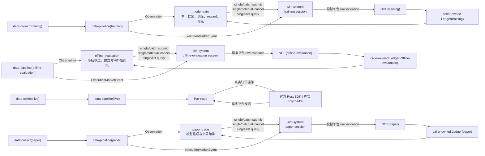

# sim-system 独立需求文档

事项编号：`SIM-SYSTEM-20260731`。

生命周期：`DRAFT_AWAITING_USER_REVIEW`。

当前执行 authority：`none`。

对应计划：用户审核并明确批准本需求后，才允许创建
`plan/sim-system-plan.md`。

对应 changelog：用户审核并明确批准本需求后，随获批计划创建
`changelog/sim-system-changelog.md`。

本文只定义独立 `sim-system` 模块的需求、边界和验收标准，不授权编写实现、
创建计划、部署、启停服务、修改远端状态或执行任何真实资金操作。

同一路径下的前一版草稿把盘口写成不接收任何外部市场状态的静态冻结场景。用户在
2026-07-31 审核中明确纠正：训练和 paper 的模拟撮合必须由与模型 Observation
同源、同因果边界的 orderbook 事件驱动；首版还必须覆盖 batch、全撤、
`ListOpenOrders` 和 `ListTrades`。前一版草稿没有执行 authority，本版按这些最新
决定整体替代其冲突内容。用户随后进一步冻结：qualified `MarketResolved` 到达时
必须在同一逻辑时点立即完成模拟 Auto-Redeem；首版还必须把 `venue_dust` 作为独立
平台终态。用户在 2026-08-01 至 2026-08-02 的审核中进一步纠正：venue dust 只属于
本模拟交易账户自己的 accepted order，不能作用于外部 shadow orderbook 的价格档位、
前后队列或其他参与者挂单；它只能在模拟平台按冻结盘口和队列规则形成一次或多次本账户
实际 matched 后，按本账户订单的精确未成交余量确定，禁止使用发生率、随机抽样或随机
数量制造。用户同时冻结：有效 `book`/价位净缩量必须在去除同一底层变化的重复证据后，
作为确定性的队头消耗作用于当时仍 open 的 maker order；有效新 `book` 既重校准外部
盘口，也成为后续计算的新基准。gap、resync 或没有真实逐订单 ID 本身不得把既有订单送入
`UNKNOWN_MARKET_STATE`/quarantine；模拟结果必须明确标记为项目批准的 L2 队列推定，
不能冒充真实平台逐订单 FIFO 复原。

## 1. 用户冻结的模块定义

用户已经明确以下架构语义，后续计划和实现不得改变：

1. `sim-system` 是独立的平台订单处理模拟模块。
2. 它只接受 `model-train`、`offline-evaluation` 或 `paper-trade` 发来的订单
   业务请求，首版请求面为：
   `SubmitOrder`、`SubmitOrders`、`CancelOrder`、`CancelOrders`、
   `CancelAllOrders`、`QueryOrder`、`ListOpenOrders` 和 `ListTrades`。
3. `data-pipeline` 从同一 canonical market event tape 分别输出模型可见
   `Observation` 和独立的 `ExecutionMarketEvent`。前者只进入模型消费者，后者通过
   与订单业务面分离的只读 market-state 数据面进入 `sim-system`。
4. `sim-system` 根据 `ExecutionMarketEvent` 在 session 内部维护可演进的 shadow
   orderbook、模拟订单 overlay、基于 `book`/价位净差额的 L2 FIFO queue estimate、
   账户和时间状态；调用方不能随订单注入、改写或查看这些内部状态。
5. 它返回即时请求响应、分页查询响应，以及彼此独立但可关联的订单、成交和结算
   生命周期反馈。
6. 首版没有改单操作。当前官方 Polymarket 文档和本仓库 pinned 官方 Rust SDK
   未提供原生 amend/modify/replace order 接口；改变价格、数量、到期时间或其他
   订单参数只能由调用方先发出独立撤单请求，再发出一笔全新的提交请求。
7. `data-collect` 保留 transport/source-level coverage、health/gap 和
   recovery/reconnect evidence；`data-pipeline` 独占 source evidence 到 canonical
   market event 的排序、去重、canonical/model-visible gap、causal
   availability/cutoff 和模式一致性处理；`sim-system` 不重复解析 typed raw、
   Parquet 或 realtime handoff，也不建立第二套 canonicalization。
8. 每个 5 分钟市场只允许形成有界热状态。完整 canonical tape 由 `data-pipeline`
   拥有，`sim-system` 不复制保存整段 tape；市场结束和 resolution terminal 后按
   本文规定分两级释放热状态，只保留查询、幂等和审计所需的紧凑订单/成交记录。
9. `model-train` 独占训练方法、奖惩方法和训练结果筛选。当前只使用一个训练框架，
   不开展框架竞赛。
10. future 更换模型框架时，只替换 `model-train` 内部实现；只要统一模型数据合同、
   模型产物/推理合同和本模块订单请求/反馈合同不变，其他模块无需随框架修改。
11. `live-trade` 只调用官方 Polymarket Rust SDK 和真实平台，不得调用
   `sim-system` 生成或覆盖真实平台事实。
12. qualified `MarketResolved` 一旦在 session 的 canonical causal timeline 可用，
    `sim-system` 必须在同一逻辑时点、按稳定子顺序原子更新模拟平台账户并生成独立
    `AutoRedeemApplied` 反馈；首版不模拟人为等待、失败或重试。
13. `venue_dust` 是本模拟交易账户 accepted order 的独立订单数量/生命周期分支：
    模拟平台按第 10.2 节形成合格的显式成交或确定性差额成交推定后，本账户订单已有正的
    matched base quantity，其自身精确未成交余量严格位于 `(0, 0.01 shares)`，对应价格除
    该账户小余量外的队列已由同一冻结规则耗尽，平台据此关闭该账户余量。外部盘口余量无论
    多小都不是 venue dust；
    dust 不等于 trade 已最终结算，也不得生成额外成交、份额、费用或现金流。

现有文档的适用关系为：

- `demand/rebuild-core-demand.md` 仍是审核中草案。其中把
  `offline-evaluation` 作为独立样本外评估 caller，以及
  `sim-system -> raw evidence -> NOE -> caller-owned Ledger` 的边界，已经用户
  确认纳入本文合同。`NOE` 和 Ledger 仍在 `sim-system` 之外；
  `sim-system` 不直接生成 `NormalizedOrderEvent` 或 Ledger event。
- `data-collect/docs/CURRENT.md` 继续拥有 `data-collect` 当前事实，并已同步本文第 3 节
  用户确认的跨模块主线。paper/live 真实 adapter 仍属于 future `data-collect`
  独立事项；必须先完成 `model-train`（模型训练模块，不是
  `data-collect-training-collector`），之后仍只有在用户决定返回时才可另立三件套。

若本文、用户最新决定、获批后的计划、当前代码、官方平台规则或真实平台 artifact
不能同时成立，必须停止受影响工作，列出精确位置、语义、影响和现实选项，由用户
决定；不得自行调和或选择一处覆盖另一处。

## 2. 系统数据流和唯一职责



### 2.1 模块唯一职责

| 模块 | 唯一职责 |
| --- | --- |
| `data-collect(training)` | 采集离线训练所需的外部原始数据，生成 typed raw、coverage 和 manifest |
| `data-collect(paper/live)` | 分别采集 paper/live 在线外部数据并提供 realtime handoff |
| `data-pipeline` | 将离线或在线 source evidence 规范为唯一 canonical market event tape，同源输出 `Observation` 和独立 `ExecutionMarketEvent` |
| `model-train` | 使用当前单一框架训练，定义奖惩方法并筛选训练结果 |
| `offline-evaluation` | 只读加载冻结候选模型和从未进入训练或自适应决策的时间外留出集，使用隔离 sim/NOE/Ledger 实例生成独立评估证据 |
| `sim-system` | 消费 `ExecutionMarketEvent` 维护有界 shadow CLOB、订单/账户/结算状态，并将提交、撤单和查询请求按冻结平台规则、账户侧 venue-dust 规则和潜规则映射为模拟平台 raw evidence |
| `NOE / Ledger` | 位于 `sim-system` 之外；NOE 将模拟 raw evidence 归一化，各 caller-owned Ledger 只更新本运行实例的账户投影 |
| `paper-trade` | 使用实时统一模型输入和模型产物进行 paper 交易编排，调用 `sim-system` |
| `live-trade` | 使用实时统一模型输入和模型产物，通过官方 SDK 调用真实平台 |

### 2.2 禁止存在的数据流

以下路径在当前及 future 架构中都不成立：

```text
data-collect -> sim-system
typed raw / Parquet / realtime handoff -> sim-system
raw/decoded Polymarket / Binance / RTDS source event -> sim-system
Observation / feature / label / reward -> sim-system
sim-system -> data-pipeline
sim-system -> live-trade
sim-system -> reward / 模型筛选 / 框架竞赛
```

`data-pipeline -> sim-system` 只允许版本化 `ExecutionMarketEvent` 数据面，不允许
`Observation`、模型 feature 或 raw transport frame。调用方把行情、feature、模型
状态或账本状态包装进订单请求，也不能绕过上述边界。
`sim-system -> NOE -> caller-owned Ledger` 是模拟执行证据的唯一正向消费路径；
NOE 与 Ledger 不因此成为 `sim-system` 内部模块。

## 3. 开发顺序

用户确认的当前模块主线为：

```text
1. data-collect(training)                 [已完成]
2. sim-system
3. data-pipeline(training)
4. model-train
```

`model-train` 之后只存在以下条件性 future 路径，不是已经无条件批准的当前主线或执行
authority：必须先完成 `model-train`，并由用户届时明确决定返回 `data-collect`，才可从
第 5 项另立三件套继续：

```text
5. data-collect(paper/live)
6. data-pipeline(paper/live)
7. paper-trade
8. live-trade
```

该顺序与本架构一致：

- `sim-system` 先冻结订单业务合同、`ExecutionMarketEvent` 消费合同、平台规则和撮合
  引擎，并用符合该合同的合成/golden L2 tape 独立开发和验收；
- `data-pipeline(training)` 随后实现同源 `Observation` 与
  `ExecutionMarketEvent` producer，完成真实历史数据的端到端接入；
- `model-train` 通过稳定订单合同调用已经独立完成的 `sim-system`；
- `offline-evaluation` 在候选模型训练完成后，使用从未进入训练或自适应决策的时间外
  留出集、冻结模型和隔离的 sim/NOE/Ledger 实例，生成晋级 paper 前的独立泛化证据；
- 只有用户在 `model-train` 完成后决定返回 `data-collect`，paper/live 的真实数据接入
  和在线处理才分别建设；paper 使用模拟平台，live 使用真实平台。

`data-pipeline` 的实现不是 `sim-system` 核心撮合引擎的开发前置条件，但真实训练
tape 和 paper 实时流的集成必须等待相应 `data-pipeline` producer。不得把 NOE、
Ledger、模型框架竞赛、offline-evaluation 或 Promotion Controller 插到
`sim-system` 前面作为当前完成门。

## 4. 已采集样本的适用边界

当前已经采集的数据样本为：

```text
/home/chillchill/new-datasets/2026-07-30/typed_raw/utc_day=2026-07-30
```

已只读核实：

- `manifest.json` schema 为 `data_collect_daily_manifest_v3`；
- state 为 `closed`，closure reason 为 `utc_day_barrier`；
- manifest 记录 121 个 finalized Parquet 文件；
- `polymarket_market` 共 41,355,216 行，其中包括 38,332,349 条 `price_change`、
  1,397,011 条 `best_bid_ask`、1,101,419 条 `book`、523,969 条
  `last_trade_price`、288 条 `market_resolved` 和 180 条 `tick_size_change`；
- 整个 UTC 日约 2.5 GiB，其中 `polymarket_market` 文件约 2.47 GB；
- manifest SHA-256 为
  `4b2cd62cea8740bf4cdb29971941118e70d869835496aece714458d12ea96557`。

样本中的 `market_resolved` row 已直接提供 `asset_ids`、`winning_asset_id`、
`winning_outcome` 及相关时间戳，但没有直接提供 `payout_vector` 字段。future
`data-pipeline` 若为 binary market 派生 payout vector，必须依据版本化规则，并把
source event、winner identity 和派生规则 provenance 一并写入
`ExecutionMarketEvent`；`sim-system` 不得把派生值冒充 raw 字段或自行猜测。

该样本是 future `data-pipeline(training)` 的输入证据。它可以由 future
`data-pipeline` 生成与模型 Observation 同源的 `ExecutionMarketEvent` 历史 replay
artifact，但 typed raw、Parquet 和 realtime handoff 仍不得被 `sim-system` 直接
读取。本文不要求也不授权在 `sim-system` 内开发 raw converter 或第二套
canonicalizer。

样本不包含本账户真实的 submit response、cancel response、order query、user-channel、
fill、trade settlement 或账户状态证据。因此它不能单独证明或校准真实平台的
acceptance、rejection、queue、fill、cancel race、latency、fee 或 settlement 行为。
它同样不能证明本账户订单的 venue-dust 终态规则或判定边界。
样本中的 `last_trade_price` 只有 market/asset、price、size、side、fee 和时间字段，
没有 account/order/trade identity、账户侧 status、transaction 或 user-channel 关联；
因此它只能作为公开市场成交证据，不能直接实例化为任何模拟 caller 的账户 trade。
公开 L2 orderbook 和 trade 事件可以驱动 shadow book 与队列估计，但不能恢复真实
逐订单 queue rank；当前 typed rows 也没有证明每个 `price_change` 与
`last_trade_price` 的一对一因果归属，不能仅按到达先后防止双算。future
`data-pipeline` 必须按版本化规则把同一底层变化合并为唯一 canonical transition，并把
尚未被已应用 `price_change`/trade transition 覆盖的有效 `book` 净差额单独表达；
`sim-system` 按第 10.2 节把该净差额确定性应用一次。无法证明真实原因时保留
`source_attribution_quality=UNATTRIBUTED`，但只要完整 `book`、价位、数量和顺序合同
有效，就不因此禁止项目批准的差额成交推定。上述数据量还证明 `sim-system` 必须流式
消费并按市场释放热状态，不能为每个 session 复制或永久保存完整 5 分钟 market tape。

其中 `best_bid_ask` 只表达最优价格、不携带该价位 size，不能单独推进数量队列；它只能
校验派生最优价。`price_change` 的 absolute post size、`last_trade_price` 的成交信息和
完整 `book` 才能经 canonical 去重后形成第 10.2 节的唯一净价位 transition。

该日 market metadata 的 299 份可解析 payload 都带有 `secondsDelay` 键，其值全部为
`null`；这只排除了该样本中已记录的 seconds-delay，不能排除官方独立定义的
`itode` 250ms taker hold。当前 typed raw 没有保存 `itode`；2026-08-02 以本样本
condition `0x34df9f8c34766d66d72fab055400c4eec5413a6be4c644bb023a4c1a683267de`
查询官方公开 `GET /clob-markets/{condition_id}` 返回 `itode=true`。future
`data-pipeline` 必须把有 provenance 的适用市场 delay policy 放入
`ExecutionMarketEvent`/rule lineage；`sim-system` 不得为所有市场硬编码 250ms。

只读样本还实际包含两种相邻顺序：同一 market/asset 的
`polymarket_market_01.parquet` 中，0-based row 1469/1470 的 admission sequence
`37047813/37047814` 为 `last_trade_price -> book`；row 6021/6023 的 sequence
`37052365/37052367` 为 `book -> last_trade_price`。两组 event 的 source/receive
时间都非常接近，但没有共同的权威 causal ID；该事实只证明不能让 sim 依赖某一种
到达顺序，不证明这些相邻行必然属于同一成交。

对代表 market `btc-updown-5m-1785369600` 的只读复算进一步得到：203,480 行中有
4,536 条 `book`，两个 asset 各有一条初始 `book`；在每次 `price_change` 按 absolute
post size 更新、每次 `book` 随后重校准的前提下，后续 4,534 条 `book` 中 4,404 条与
已重建状态完全一致，130 条仍有净差额；356 个差异价位中 353 个为缩量、3 个为增量。
sequence `35061689` 的 `price_change` 已报告 SELL `0.5=112.9`，`35061690` 是该 asset
首份 bootstrap `book` 且同样为 `112.9`，不能把它再解释成一次缩量；bootstrap 后，
`35061699` 已更新至 `84`，`35061700` 和 `35061705` 的 `book=84` 也都只能确认。相反，
重建的 BUY `0.39` 为 `56.13` 时，`35062432` 的 `book=51.13` 留下净缩量 `5`，不能
忽略。该样本同时证明：重复应用整个快照会双算，完全忽略有效净差额又会漂移；因此
future canonical contract 必须输出去重后的唯一净差额。

## 5. 模块目标

1. `SIM-G-001`：为 `model-train`、`offline-evaluation` 和 `paper-trade` 提供
   同一套稳定、版本化、
   与模型框架无关的订单操作接口。
2. `SIM-G-002`：根据冻结的平台公开规则、SDK 合同、有证据的平台潜规则、明确标记的
   项目假设和 `ExecutionMarketEvent`，模拟每笔提交、撤单和查询请求的处理反馈。
3. `SIM-G-003`：盘口由同源 `ExecutionMarketEvent` 驱动；可变 shadow book、模拟
   order overlay、基于净差额的 L2 FIFO queue estimate、账户、订单、时间和结算状态全部由
   `sim-system` 的 session-local runtime 拥有。
4. `SIM-G-004`：输出既覆盖即时请求响应，也覆盖独立的订单生命周期反馈、每笔本账户
   fill/trade 的成交生命周期反馈，以及与 market resolution 关联的独立
   Auto-Redeem 结算生命周期反馈；三者只能通过稳定 ID 关联，不能混成一种事件。
5. `SIM-G-005`：相同请求序列、`ExecutionMarketEvent` stream、初始场景、规则版本、
   queue rule、venue-dust rule、settlement profile、逻辑时间和 seed 必须产生相同反馈
   序列和最终模拟平台状态。
6. `SIM-G-006`：在真实 `data-collect`、`data-pipeline` producer、模型框架、paper
   runtime、网络、wallet 和真实平台均不存在时，仍可用合成请求和合成/golden
   `ExecutionMarketEvent` fixture 独立完成核心引擎验收。
7. `SIM-G-007`：future 更换 `model-train` 框架时，只要外部合同兼容，
   `sim-system` 不需要修改或增加框架分支。
8. `SIM-G-008`：5 分钟市场按 preload、active、resolution-pending、terminal/evicted
   生命周期滚动处理；热内存、事件队列和本地 artifact 均必须有硬边界。
9. `SIM-G-009`：对 qualified `MarketResolved`，模拟 payout、outcome-token burn、
   pUSD/cash 和 position 更新与 `AutoRedeemApplied` 必须原子、幂等并发生在同一逻辑
   时点；调用方只能在该反馈可见后结算自己的账本。
10. `SIM-G-010`：venue dust 必须由第 10.2 节的合格账户成交、账户订单所有权和同价队列
    状态确定；
    dust quantity 只能等于本账户订单在该撮合后严格位于 `(0, 0.01 shares)` 的精确
    未成交余量。不得把外部盘口余量归入 dust，不得使用概率或随机数量制造 dust，也
    不得倒扣已冻结的 order-matched quantity 或借 dust 合成成交。

## 6. 首版范围和非目标

### 6.1 首版范围

首版业务范围冻结为：

- Polymarket Global CLOB 的 `btc-updown-5m` market family；
- pUSD 和两个 outcome token；
- 本系统主动订单面为 `BUY-only`；
- 单笔 `SubmitOrder`；
- 1 至 15 笔的 `SubmitOrders`；
- 按一个或一组模拟 platform order ID 的 `CancelOrder` / `CancelOrders`；
- 当前模拟 account/session 的 `CancelAllOrders`；
- 按一个模拟 platform order ID 的 `QueryOrder`；
- 分页 `ListOpenOrders` 和 `ListTrades`；
- GTC、GTD、FOK、FAK 和适用的 post-only；
- immediate submit/cancel/query response；
- 与订单关联的 open、partial/full fill、cancel、expiry 订单生命周期反馈，
  以及与具体本账户成交关联的独立 `TradeLifecycleFeedback`；
- evidence-classified、versioned venue-dust terminal、matched-cancel 可见性竞态和独立
  `VenueDustTerminal` 生命周期反馈；
- qualified `MarketResolved` 到达同一逻辑时点的原子 Auto-Redeem，以及独立
  `AutoRedeemApplied` 结算反馈；
- training 历史 replay 与 paper 实时流共用的 `ExecutionMarketEvent` 合同；
- 5 分钟 market 的 preload、active、resolution-pending、terminal/evicted 生命周期；
- 动态 shadow orderbook、单一基于 `book`/价位净差额的 L2 FIFO queue model、balance、allowance、
  open-order encumbrance、费用、适用市场的内部 taker latency、账户侧 venue-dust
  终态规则和 feedback
  visibility；
- market 级热状态释放、紧凑订单/成交索引、分页查询和有界 run/session artifact。

### 6.2 当前明确不做

1. 不接受 SELL intent。外部市场事实中的 BUY/SELL、bid/ask、maker/taker 不等于
   本系统具有自有 SELL 操作面。
2. 不提供 `AmendOrder`、`ModifyOrder`、`ReplaceOrder` 或等价隐藏入口。
3. 不支持 cancel-by-market/token、balance query、market-data query、builder trade
   list 或 notification query；这些能力必须另立需求后才能进入。
4. 不采集或订阅外部市场，不直接解码 typed raw、Parquet、realtime handoff 或 raw
   transport frame，不重复实现 `data-pipeline` 已拥有的 canonicalization、排序、
   去重、canonical/model-visible gap 和 causal availability/cutoff 处理。
5. 不处理 feature、normalization、label、split、Observation 或统一模型输入。
6. 不运行模型推理，不产生交易决定，不计算 reward，不训练、排名、晋级或淘汰模型。
7. 不建设多框架 plugin、adapter registry、框架竞赛、HPO 或 Promotion Controller。
8. 不拥有调用方 Ledger、cash、position、PnL、NAV、risk、pause 或 next-action
   决策。
9. 不连接真实 Polymarket，不签名，不持有 wallet、private key、API credential，
   不提交真实订单，也不是官方 SDK 的 shadow client。
10. 不向 live 环境提供模拟 fallback，不把模拟反馈描述成真实平台事实。
11. 不声称 L2 replay 恢复了真实逐订单 queue position，也不模拟自身订单对外部市场
    后续事件产生的真实 market impact。
12. 不把完整 `ExecutionMarketEvent` tape 复制进每个 session 或 sim artifact；
    `data-pipeline` 是 tape owner，sim artifact 只保留必要 lineage、cursor、订单、
    成交和验证证据。

## 7. 外部请求合同

### 7.1 唯一业务请求联合类型

1. `SIM-I-001`：公开业务请求必须是封闭联合类型：

   ```text
   SimRequest =
       SubmitOrder
     | SubmitOrders
     | CancelOrder
     | CancelOrders
     | CancelAllOrders
     | QueryOrder
     | ListOpenOrders
     | ListTrades
   ```

   任何新增 variant 都必须先修改并重新批准需求。
2. `SIM-I-002`：`ExecutionMarketEvent` ingress、规则发布、session 创建、市场状态
   bootstrap 和内部时钟调度属于独立配置/市场状态数据面，不得伪装成调用方业务
   请求。
3. `SIM-I-003`：每个请求 envelope 必须包含：
   - contract version；
   - caller role，且只能是 `model-train`、`offline-evaluation` 或
     `paper-trade`；
   - caller instance/run ID；
   - simulation session ID；
   - 模拟 account identity；
   - 全局唯一 request ID；
   - mutation 请求必需的幂等键；query/list 不要求业务幂等键；
   - caller correlation/local intent ID；
   - 单调 caller sequence；
   - 请求发出逻辑时间；
   - 产生该请求的 model-visible causal cutoff / canonical cursor reference。
4. `SIM-I-004`：请求不得包含模型 tensor、框架对象、feature、Observation、reward、
   label、typed raw、行情事件、order book、trade tape、调用方 Ledger 或 secret。
5. `SIM-I-005`：`live-trade`、未知 caller、跨 session/account ID、错误 contract
   version、重复 request ID 冲突、非单调 sequence 或引用 sim 尚未达到的未来 causal
   cursor 必须 fail closed。

### 7.2 `SubmitOrder` 与 `SubmitOrders`

1. `SIM-I-006`：每个提交 item 至少包含：
   - market/condition/token/outcome identity；
   - `side=BUY`；
   - order type；
   - limit/worst price；
   - 与 order type 匹配的 shares 或 pUSD quantity basis；
   - GTD expiration（适用时）；
   - post-only（适用时）；
   - caller local order reference。
2. `SIM-I-007`：GTC/GTD limit BUY 使用明确的 price 和 shares；FOK/FAK market BUY
   使用明确的 spending amount 和 worst-price bound。两种 quantity basis 不得通过
   一个含义不明的裸 `size` 字段混用。
3. `SIM-I-008`：`SubmitOrder` 精确包含一个 item；`SubmitOrders` 精确包含 1 至 15
   个有稳定 item index 和唯一 local order reference 的 item。空 batch、超过当前
   规则上限、重复 local reference 或 item contract 非法必须产生明确结果。
4. `SIM-I-009`：batch submit 是一个 request envelope，但每个 item 独立校验和处理，
   可以出现 accepted、rejected 或 unknown 混合结果；不得把整个 batch 虚构成
   all-or-nothing 原子事务，也不得因一项失败回滚已经接受的其他 item。
5. `SIM-I-010`：batch request 幂等重试必须返回原 item-to-result 映射，不得重复创建
   任一订单；相同幂等键搭配不同 item 数量、顺序或 payload 必须 fail closed。
6. `SIM-I-011`：提交合同必须是 secret-free、模型框架无关的领域合同。真实签名、
   L2 credential 和 HTTP header 不进入 simulator；需要测试 signature/auth failure
   时，由冻结规则/场景注入对应平台结果。
7. `SIM-I-012`：一次提交成功创建的模拟 platform order ID 必须只属于一个
   session/account，且不能与 caller local reference 混为同一 authority。用于可复现
   规则决策的 stable logical order identity 必须绑定 session/account、mutation
   idempotency identity 和稳定 batch item identity，不得来自会因插入无关订单而漂移的
   全局顺序号。

### 7.3 `CancelOrder`、`CancelOrders` 与 `CancelAllOrders`

1. `SIM-I-013`：`CancelOrder` 只接受同一 session/account 内一个模拟 platform
   order ID；`CancelOrders` 接受一个非空、有版本化 hard cap 的 order ID 列表。
   首版默认 cap 冻结为 `1,000`：当前 API reference 与 2026-06-15 官方
   changelog 均写为 `1,000`，Manage Orders 页面仍写 `3,000`。该冲突必须保留在
   rule evidence 中；后续只能通过新 rule version 变更 cap，不能在 session 内切换。
2. `SIM-I-014`：按当前官方规则，batch cancel 的重复 order ID 在首个相同 ID 后被
   忽略，不得重复执行或生成互相冲突的结果。响应以唯一 target ID 关联
   canceled/not-canceled/unknown；无论整体 HTTP-like response 是否成功，都不得把
   部分成功写成全成或全败。该语义与其他规则一样进入版本化 rule artifact。
3. `SIM-I-015`：`CancelAllOrders` 不携带 caller 任意指定的订单集合，作用域固定为
   请求平台处理 cutpoint 时该 simulation session/account 中全部可撤 open
   remainder；不得跨 session/account，也不等于首版未纳入的
   cancel-by-market/token。
4. `SIM-I-016`：撤单只作用于平台处理时仍未成交的 remainder；已经成交的数量不得
   被追溯取消。
5. `SIM-I-017`：目标不存在、属于其他 session/caller、已经 terminal、处于规则明确
   不允许撤单的状态或与成交事件发生竞态时，必须按冻结规则产生明确反馈，不得
   静默成功。
6. `SIM-I-018`：simulator 不得替调用方按订单年龄、market switch 或内部策略自行
   生成 caller cancel request。平台自身的 FAK remainder kill、GTD expiry、market
   close 等 terminal 行为属于内部生命周期事件，不冒充调用方撤单或全撤。

### 7.4 `QueryOrder`、`ListOpenOrders` 与 `ListTrades`

1. `SIM-I-019`：`QueryOrder` 只接受同一 session/account 内的一个模拟 platform
   order ID。结果必须是请求在模拟平台处理时刻可见的当前快照，至少包含 order
   identity、status、original request quantity basis/value、price、order type、
   created/expiration time、terminal cause 和关联 trade references。所有数量和金额必须
   携带 base/quote basis、scale 与 currency，禁止裸 `quantity` 跨单位解释：
   - base-sized order 表达 accepted/order-matched/venue-dust-closed/canceled/expired/
     market-closed/other-terminal/open base quantity；order-matched 还必须按 trade finality
     分解为 final-success、pending-economic-applied、pending-economic-unapplied、
     failed-compensation-pending、terminal-failed-compensated 和
     terminal-failed-unapplied，不能把订单 match 与链上/平台 trade finality 混成同一
     字段；
   - quote-budget order 表达 accepted quote budget、final-success consumed、pending-applied
     consumed、pending-unapplied encumbered、released-or-unspent 和仍 open encumbered quote
     amount，同时单独表达各 trade 的 base quantity、notional、fee 与 settlement state；
   - FAK partial-and-kill 或其他终态必须由明确 terminal cause 解释对应 base/quote
     分桶，不能塞入 dust。
   `accepted_base_quantity - order_matched_base_quantity > 0` 不等于仍有 open
   remainder；
   dust-terminal order 必须明确表达 `venue_dust_closed_base_quantity > 0` 且
   `open_base_quantity = 0`。上述数量都只属于查询目标的本账户订单；同价 external
   shadow-book quantity 不得进入该订单快照。
2. `SIM-I-020`：`ListOpenOrders` 返回同一 session/account 在请求处理 cutpoint
   仍有 open remainder 的 client-visible 订单。首版支持可选 order ID、
   condition/market 和 token/asset filter；terminal order 不得混入，external shadow
   orders 永不进入该账户列表。
3. `SIM-I-021`：`ListTrades` 返回同一 session/account 已经 client-visible 的模拟
   trade。首版有意只提供不改变固定 session/account identity 的过滤子集：可选
   trade ID、condition/market、token/asset 和 before/after time；不额外发明平台
   当前未提供的按 order ID 查询参数，也不暴露 maker/taker address filter。官方
   文档的 `maker_address` 与 pinned SDK 的 `maker`/`taker` 参数面存在差异，且本
   simulator 每个请求已固定 account identity；这些地址过滤器必须另立需求后才能
   加入。每项至少包含 trade/order identity、market/token、price、executed base
   quantity 及其 scale、trade notional 及其 currency、maker/taker role、fee amount/
   currency、status、`fill_economic_delta_identity`、`queue_progress_basis`、
   `queue_result_quality`、economic closure、match/update time 和可用的 transaction
   reference。
   venue-dust terminal 和 Auto-Redeem 都不是 trade，不得生成伪 trade ID 或进入
   `ListTrades`。按 `SIM-R-008` 确定性推定并实际增加本账户 matched quantity 的 fill
   必须作为模拟账户 trade 返回并携带推定依据；外部市场成交或价位变化若只推进 shadow
   book/queue 而未穿过本账户订单，则不得作为本账户 trade 返回。
   `after` 缺省表示从该 query epoch/session 起点开始，`before` 缺省表示当前查询
   cutpoint。若请求区间有任何部分早于已删除历史的 lower retention watermark，
   整个请求返回 `OUT_OF_RETENTION_RANGE` 和 watermark，不得把剩余部分伪装成完整
   结果；调用方可用不早于 watermark 的 `after` 发起新请求。精确 trade ID 若仍在
   retained index 中可以直接返回；若未找到且相关历史已经截断，则返回
   `OUT_OF_RETENTION_RANGE`，不能误报为空。
4. `SIM-I-022`：两个 list 请求都必须分页，使用 opaque cursor、版本化 page-size
   hard cap 和稳定 item identity；第一页冻结 query cutpoint/watermark，后续 cursor
   必须绑定该 watermark 和完整 filter，避免新状态插入导致重复或漏项。cursor 不得被
   调用方解释成内部数组下标，也不得跨 query kind、filter、session/account 或
   contract version 复用。
5. `SIM-I-023`：query/list 不得暴露尚未到达 client-visible 时间的内部真相、场景
   seed、隐藏 queue estimate、其他 session 数据或 simulator 私有状态。
6. `SIM-I-024`：查询目标不存在、不可见或不属于 caller/session 时，必须返回明确的
   not-found/forbidden/unknown 语义；合法 list 无匹配项可以返回空 page，但不能把
   contract error 伪装为空结果。
7. `SIM-I-025`：query/list 是只读平台操作。处理前可以先结算在查询平台到达时刻之前
   已经到期的市场/订单事件，但请求自身不得产生成交、撤单、余额变化或其他业务状态
   转换。
8. `SIM-I-026`：qualified resolution terminal market 的热状态被安全释放后，
   `QueryOrder` 和 `ListTrades` 必须在 session/run 查询合同仍有效期间从紧凑
   durable order/trade index 返回相同的 terminal 可见结果；不得为了支持查询重新
   加载完整 market tape，且按该 market 过滤的 `ListOpenOrders` 必须为空。若
   market 因证据缺失进入 `EXHAUSTED_QUARANTINED`，受影响 query/list 必须返回持久化的
   `UNKNOWN_INCOMPLETE_HORIZON` 或等价 fail-visible 结果，不能伪装成 terminal
   snapshot、not-found 或合法空 page。

### 7.5 明确不存在改单

1. `SIM-I-027`：任何 amend/modify/replace request kind 或改变既有订单参数的请求
   必须以 `UNSUPPORTED_OPERATION` 拒绝，不能偷偷转换成撤单或新订单。
2. `SIM-I-028`：调用方若要改变订单，必须先提交 `CancelOrder`，再使用新的 request
   ID、幂等键和 local reference 提交新的 `SubmitOrder`；新提交被接受后，由
   simulator 生成全新的 platform order ID。
3. `SIM-I-029`：撤单与新提交是两个独立、非原子的操作。撤单失败、迟到成交或反馈
   未知时，simulator 不得回滚、覆盖或合并成虚构的原子 replace。
4. `SIM-I-030`：平台 user-channel 中因部分成交产生的 order `UPDATE` 是服务端
   生命周期反馈，不是调用方改单，也不得通过它改变原始订单参数。

## 8. 冻结场景、市场状态数据面和动态 shadow CLOB

1. `SIM-S-001`：每个 simulation session 必须在接收首个业务请求前绑定不可变的
   `PlatformScenario` identity、version 和 digest，以及一个
   `ExecutionMarketEventContract` version。
2. `SIM-S-002`：冻结的是规则、市场窗口 identity、preload/terminal policy、
   `ExecutionMarketEvent` tape/stream lineage、queue model version、初始模拟账户、
   venue-dust rule/settlement policy、latency/visibility profile 和 seed；orderbook 数值及
   订单、账户和结算状态必须按事件和请求继续演进，不能被误写成整场静态不变。
   `sim-system` 提供通用的版本化 latency/visibility profile 插槽，不把任一地域样本
   硬编码为模块唯一合法 profile；但当前 `rebuild-core` scope 内的正式 training、
   offline-evaluation 与 paper run 必须绑定 `demand/rebuild-core-demand.md` 第七节第
   20 至 22 条冻结的同一个爱尔兰双向代理 profile。其他 profile 只能用于明确标识的
   模块级 golden/conformance、受控 sim-calibration 或 future 新版本，未经新需求和
   版本决策不得替代当前正式 run 的 profile。
3. `SIM-S-003`：`data-pipeline` 是唯一 `ExecutionMarketEvent` producer。training
   使用不可变历史 replay artifact，paper 使用持续实时 stream；两者必须使用同一
   versioned payload、total-order key、causal-availability、gap 和 lifecycle 语义。
4. `SIM-S-004`：`ExecutionMarketEvent` 至少能够表达：
   - market/condition/token identity、market window 和 lifecycle transition；
   - 适用市场的 `itode`、seconds-delay 及其 source/version/digest；
   - 完整 L2 bootstrap snapshot 及其 source epoch/cursor/digest；
   - price-level size change、best bid/ask 和 tick-size change；
   - 具有 price、size、side 和可用时间的 trade evidence；
   - 原子 `LevelExecutionTransition` 或等价语义，包含 causal group ID、
     market/asset/side/price、外部 shadow orderbook 的 pre/post size、已归因成交数量、
     已被同一底层变化覆盖的数量、去重后的有效价位/`book` 净增加量与净缩量、供队列
     只应用一次的净队头消耗量、关联 source event IDs、`TRADE_EVIDENCE |
     LEVEL_DELTA_INFERENCE | BOOK_RESYNC_DELTA_INFERENCE` 依据、causal-available time
     以及彼此分离的 `source_attribution_quality=EXACT | UNATTRIBUTED` 和
     `queue_result_quality=EXACT | DETERMINISTIC_INFERRED`；没有真实逐订单因果证据时
     必须保留 `source_attribution_quality=UNATTRIBUTED`，不能靠到达先后冒充精确归因，
     但这不否定合同有效的 `book` 净差额按冻结项目假设形成
     `queue_result_quality=DETERMINISTIC_INFERRED` 的队列结果；任何基于 L2 排队模型的
     maker fill 都只能是 `DETERMINISTIC_INFERRED`，`EXACT` 只适用于不依赖未知 maker
     queue rank 的外部状态或账户 taker 路径；
   - canonical event ID、source/admission/available time、total-order key；
   - coverage/gap/stale/resync 状态和 end/terminal watermark；
   - qualified `market_resolved`，包括 condition、winning asset/outcome、由
     `data-pipeline` 按版本化规则派生且保留 provenance 的 payout vector、canonical
     event ID、causal `available_at`、resolution terminal watermark/lineage，或有界
     resolution exhausted/quarantined terminal。该 market event 只提供结算事实与
     causal terminal evidence；模拟账户自身的 trade/account settlement barrier 仍由
     `sim-system` 按第 10.4 节核验，不能由 producer 替其宣称完成。
5. `SIM-S-005`：session 必须先取得合格 bootstrap snapshot，再按严格单调 total order
   应用 canonical liquidity/trade transition。完整、合同有效的新 `book` 是外部盘口的
   重校准边界：相同状态只确认；存在净差额时，必须先扣除同一底层变化已由
   `price_change`、trade 或更早 canonical transition 应用的数量，再把剩余净差额按第
   10.2 节只应用一次，并以该 `book` 作为后续新基准。cursor hole、epoch 切换、stale、
   乱序或 correlation timeout 可以使 market 在下一份合格完整 `book` 到达前暂不接受新
   maker submit，但不得仅凭这些信号关闭、隔离或把既有 open maker order 变成 unknown；
   下一份合格完整 `book` 必须在其 canonical available time 对这些订单完成确定性重校准
   和队列/成交推定，不能回写更早已输出的反馈。只有始终缺少初始完整 snapshot、完整
   `book` 自身无效或冲突、canonical 数量无法去重或不守恒等不能形成唯一净差额的情况，
   才能进入 `UNKNOWN_MARKET_STATE`/fail-visible。causal group 在形成唯一 transition 前
   不得 apply；`group_available_at` 必须不早于所有 constituent event 的最大 available
   time 和实际 finalization time。paper 使用有界、版本化 correlation window；training
   离线可读取未来 bytes，但都不能把事后结果回填到更早 causal cutpoint。
6. `SIM-S-006`：调用方只能引用 session、market 和已观察 causal cursor，不能随单
   注入或改写 book、queue、balance、allowance、liquidity、latency、winner 或
   settlement 结果。`ExecutionMarketEvent` 也不能混入业务请求 payload。
7. `SIM-S-007`：`sim-system` 只消费 canonical event，不直接读取 `data-collect`
   runtime、typed raw、Parquet 或 realtime handoff，也不重复实现 transport decode、
   source semantic canonicalization、跨源 total order、去重、gap、causal cutoff
   或 trade/depth causal attribution。`data-pipeline` 必须按版本化、可回放规则输出唯一
   净 transition 并保留重复消除与 `book` 重校准证据；不能证明真实原因时必须输出
   `source_attribution_quality=UNATTRIBUTED`。`sim-system` 不得据此猜测 raw event 关系，但必须按冻结
   profile 使用合同有效的净价位/`book` 差额。
8. `SIM-S-008`：每个 session 从同一只读 tape/stream 创建隔离的 mutable external
   shadow book、模拟 account、account-order overlay 和 queue estimate。external book
   只表示其他市场参与者的盘口数量，account-order overlay 只表示本模拟交易账户的订单；
   两者必须使用不同的数量字段和所有权标识，不得互相写入。聚合价格档位只能是派生视图，
   不能成为账户订单 dust、open quantity 或 reserve 的所有者。同价位的 queue estimate
   必须保留 external quantity 与 account order 的稳定因果相对顺序，不能把全部账户订单
   压成一段或让外部数量越过中途加入的账户订单；具体存储结构属于计划。
   不可变 historical tape
   可以跨 training session 只读共享；任何 mutable overlay、consumed-liquidity
   accounting、RNG、cursor 和反馈状态不得共享。
9. `SIM-S-009`：模型 Observation 与 simulator execution state 必须可追溯到同一
   canonical event lineage 和 finalized causal cutoff。`data-pipeline` 不得在
   Observation 中提前暴露尚未 finalized 的 transition，同时在 sim 数据面将其延后
   或反之。请求引用的 decision causal cursor 之后、模拟 platform arrival cutpoint
   之前的 eligible event 按冻结延迟和排序规则推进；不得让 sim 使用模型决策时
   不可能看见的未来事件决定过去的请求。订单 arrival 落在 causal group 的早期
   evidence 与后到 evidence 之间时，尚未 finalized 的 group 不得影响该订单；后续
   finalization 也不得追溯改写已经输出的结果。
10. `SIM-S-010`：仅凭 L2 event 和订单请求不能唯一推导真实逐订单 queue rank。
    simulator 的 maker fill 必须归因于第 10.2 节冻结的单一 `book`/价位净差额 FIFO
    估计模型；该模型是用户批准的确定性平台模拟规则，不得声明为真实 FIFO 复原。
11. `SIM-S-011`：历史/paper replay 不包含模拟订单对真实市场的反事实影响。
    `sim-system` 必须显式标记 no-market-impact 假设，并用 session-local overlay
    防止同一可见流动性在同一 session 内被重复消费。
12. `SIM-S-012`：处理某项请求所需的市场状态、规则或账户状态缺失，且无法由合同有效
    的完整 `book` 按 `SIM-S-005` 形成唯一新基准时，必须返回 `UNKNOWN_UNMODELED`、
    `UNKNOWN_MARKET_STATE` 或 `UNSUPPORTED_SCENARIO`，不得猜测一个确定平台结果。

## 9. 时间、状态和处理语义

### 9.1 统一逻辑时间和可见性

1. `SIM-T-001`：每个 session 只有一个单调模拟平台时钟。训练 session 使用可复现的
   逻辑时间；paper session 使用 monotonic time 并另记 UTC audit time。
2. `SIM-T-002`：调用方请求携带的是该请求的发送逻辑时间，不是平台内部真相时间；
   平台 arrival、validation、match、cancel-effective、response emit 和 client
   visibility time 由内部规则/场景计算。
3. `SIM-T-003`：`ExecutionMarketEvent`、订单请求到达、内部 delay/expiry/settlement
   和查询 cutpoint 必须进入一个版本化 total-order contract。处理请求前，先处理所有
   排在其 platform arrival 之前的 eligible market/internal event；同一逻辑时刻使用
   稳定 tie-break。
4. `SIM-T-004`：平台内部状态先变化，调用方随后在 feedback 可见时间看到结果。
   response 或 lifecycle update 尚未可见时，query/list 不得泄漏未来状态。
5. `SIM-T-005`：输出可以包含当前请求的直接 response 和已经到达可见时间的订单/
   trade lifecycle feedback；后续订单事件及 event-triggered settlement feedback 通过
   同一版本化反馈通道交付。
6. `SIM-T-006`：相同初始条件重跑时，worker、线程和 wall-clock 调度差异不得改变
   逻辑结果。
7. `SIM-T-007`：duplicate、late 或 out-of-order feedback 不得重复成交、重复撤单、
   reopen terminal order 或改变已闭合数量。
8. `SIM-T-008`：venue-dust terminal 必须先由第 10.2 节合格的显式成交或确定性差额
   成交推定、队列推进和本账户订单精确余量在平台内部 causal timeline 共同确定，再按
   冻结 latency/visibility profile 生成 order update、query projection 或后到 cancel
   response；caller 尚不可见不等于平台仍 open。cancel response 自身、与目标价位无关的
   外部事件或重复 transition 都不能反向创造 dust 或 fill。
9. `SIM-T-009`：qualified `MarketResolved` 的 `available_at` 是首版 Auto-Redeem 的
   逻辑时间；不得使用 market end、source timestamp、wall clock 或人为延迟替代。
   在该时点必须先按 total order 应用全部 causally-prior 已终结 trade/account
   transition，并核验 market-end 已关闭全部本账户 open order、释放对应 encumbrance；
   随后执行 internal `MarketResolvedObserved` marker -> external `AutoRedeemApplied`。
   内部变化使用同一逻辑时间和稳定子顺序；Auto-Redeem 不得为了等待旧 feedback 变为
   client-visible 而延后，也不能插入
   `Scheduled`、`Pending`、retry 或 failure 状态。所有 account-changing feedback 必须
   携带单调 `account_transition_seq`、前驱 identity 和 before/after digest；即使可见性
   profile 使旧 feedback 后到，调用方也能识别序列缺口并避免把后继 delta 提前应用。

### 9.2 五分钟市场预加载、滚动状态和释放

1. `SIM-L-001`：每个 `btc-updown-5m` market 的 runtime 生命周期单向为：

   ```text
   PRELOADING
     -> ACTIVE
     -> POST_END_PENDING_RESOLUTION
     -> RESOLUTION_TERMINAL | EXHAUSTED_QUARANTINED
     -> EVICTED
   ```

   不得从 terminal/evicted 回到 active。
2. `SIM-L-002`：preload 从合格的完整 L2 bootstrap snapshot/epoch 开始，并按
   `ExecutionMarketEvent` total order 推进到 market activation。当前
   `data-collect` 生产验收证据只证明 next market 在 T-30 秒之前已经订阅并取得
   snapshot，不证明 simulator 的 preload 必须恰好从 T-30 开始；`sim-system`
   必须消费输入合同中的显式 `preload_start`、snapshot cursor 和 policy version，
   不能在撮合代码中另写一个隐含时间值。
3. `SIM-L-003`：training 可以提前读取或共享未来 immutable tape page，但 session
   只能应用逻辑 cursor 已到达的 event；paper 只能应用本机已经 available 的 event。
   任一模式都不得因预取产生 future leakage。
4. `SIM-L-004`：hot owner set 只包含有界的 prefetched、active 和 compact
   resolution-pending market；market count 与 owned bytes 必须同时有 hard bound。
   超界时不得静默删除或继续增长，必须停止受影响 market admission 并 fail visible。
5. `SIM-L-005`：`sim-system` 不保存每个 5 分钟市场的完整 canonical tape。hot state
   只保留当前 L2 book、模拟 order overlay、queue estimate、模拟账户、cursor/digest、
   有界去重/恢复窗口和未完成 feedback；immutable tape 继续由 `data-pipeline` 拥有。
6. `SIM-L-006`：market end `E` 到达后，必须停止接受不再符合平台规则的新订单。只有
   在 end watermark 已到达、所有仍需 pre-E book 的在途请求/delay 已按 total order
   处理、book 不再被任何 in-flight 操作引用后，才能释放完整 orderbook、price-level
   history 和大事件 buffer。market end 前按 total order 完成全部 causally-prior 撮合和
   相应 dust 判断；market end 到达后，本账户仍 open 的订单必须进入明确
   `MARKET_END`/冻结平台 terminal cause 并释放本账户 reserve，不得擅自写成 canceled、
   filled 或 venue dust。外部盘口余量只随 external shadow book 热状态释放，不产生本
   账户订单反馈、成交或账户资金变化；market end 之后不得再用后到成交把已关闭余量改写
   为 fill 或 dust。
7. `SIM-L-007`：第一阶段释放后保留的 compact pending state 只包含尚未 terminal 的
   order/trade、encumbrance、resolution dependency、待交付 feedback、query
   projection、幂等 tombstone 和恢复所需最小 lineage，不得继续保留完整 book/tape。
8. `SIM-L-008`：收到 qualified `market_resolved` 还不等于可以立即删除全部状态。
   simulator 必须先核验 market-end 订单终止与 encumbrance release 已完成，再完成第
   10.4 节的 settlement barrier 和原子 Auto-Redeem。只有订单/trade 已按规则 terminal、
   `AutoRedeemApplied` 及所有其他应交付 feedback 已 durable 且
   client-visible、query projection 和幂等记录已持久化、无 in-flight
   query/reference 后，才能完成第二阶段 hot eviction。
9. `SIM-L-009`：若在 versioned resolution horizon 内未取得 qualified resolved，
   必须转为 `EXHAUSTED_QUARANTINED`，持久化原因、已完成的 market-end 订单终态、
   right-censored trade/settlement projection 和受影响查询的 unknown/incomplete verdict
   后释放 hot state；不得伪造 winner、redeem、未知 trade 终态或合法空列表，也不得为
   等待永远不会到来的 resolved 无限常驻。
10. `SIM-L-010`：hot eviction 不等于 durable query/audit record 删除。终态
    `QueryOrder` 和 `ListTrades` 所需的紧凑索引必须保留到 session/run 的 query、
    idempotency、recovery 和 audit retention 全部到期。明细被删除后，在有界的
    session/retention watermark 仍有效期间，查询返回明确 `OUT_OF_RETENTION`，不得
    伪装成从未存在的 not-found。
11. `SIM-L-011`：persistent order/trade/feedback records 只能在 finalized、完成
    run/session sealing、无 query/idempotency/recovery 引用且 retention 到期后删除。
    `OUT_OF_RETENTION` 不授权永久保留逐订单 tombstone：外层 session/retention
    watermark 自身也必须有有限保留期和 hard bound；它到期后整个旧 session
    明确变为不可查询，而不是继续积累身份记录。内存、单 market 热状态、单 session
    索引、retention watermark 和单 run artifact bytes 必须分别设 hard quota；整个
    runtime/artifact root 的 retained record count 与 retained bytes 还必须有独立
    global hard quota。触及 global quota 时必须 fail-visible 停止新 session/record
    admission，不能删除尚未到期或仍被引用的数据，也不能让多个各自合规的 run
    合计突破全局上限。具体数值由获批计划根据 profiler 冻结。
12. `SIM-L-012`：training episode/run seal 后立即释放该 session mutable hot state；
    长驻 paper runtime 必须使用有界恢复状态和 market/session rollover，不能让 5 分钟
    市场数量、ListTrades 历史或 artifact bytes 随运行时间无界常驻内存。具体持久化与
    索引结构由计划决定。
13. `SIM-L-013`：重复或重放同一 qualified `market_resolved` 只能引用第一次原子
    Auto-Redeem 结果，不得重复 burn token、重复增加 pUSD/cash 或重复反馈。未取得
    qualified resolution、payout vector 冲突或市场进入 `EXHAUSTED_QUARANTINED` 时
    不得猜 winner 或执行 Auto-Redeem。

## 10. 首版平台规则覆盖

### 10.1 必须覆盖的规则、观察行为和项目合同

首版 `RuleCoverageManifest` 至少覆盖：

1. market/condition/token/outcome identity 和 accepting-orders 状态；
2. BUY-only、GTC、GTD、FOK、FAK 和 post-only 的合法组合；
3. tick size、minimum order size、price/size precision 和 quantity encoding；
4. balance、allowance、existing open-order encumbrance 和 risk validation；
5. GTC/GTD resting、FOK all-or-none、FAK partial-fill-and-kill；
6. post-only 会立即成交时拒绝；
7. marketable BUY、maker/taker role、price improvement 和 fee；
8. 适用 crypto/finance up/down market 的 taker delay、delay 后重新校验，以及
   delay 内部 pending 阶段不可撤单；
9. accepted/rejected 以及 `live`、`matched`、`delayed`、`unmatched`、
   `canceled` order status；
10. partial fill、full fill、remaining quantity、GTD expiry 和平台 terminal cause；
11. trade 的 `MATCHED_NOT_BROADCASTED`、`MATCHED`、`MINED`、`CONFIRMED`、
    `RETRYING`、`FAILED` 状态；
12. 单笔/批量撤单只取消未成交 remainder，并逐 ID 表达部分成功；
13. account-wide cancel-all 的作用域、cutpoint 和逐 ID 结果；
14. 单笔订单查询、开放订单列表和账户成交列表与同一时刻 client-visible platform
    state 一致，并使用有界分页；
15. batch submit 的 1 至 15 个 item、逐 item 独立结果和非原子混合结果；
16. 当前平台没有原生 amend/modify/replace 操作；
17. 带 scale 的 order-matched、互斥 trade-settlement 子分桶、本账户
    venue-dust-closed/open base quantity，独立 quote-budget/current-allocation 金额与
    terminal cause，以及 dust-terminal 后到撤单的处理；
18. qualified market resolution、winner/payout 和同一逻辑时点的模拟 Auto-Redeem。

截至 2026-08-01 的当前官方证据包括：

- `https://docs.polymarket.com/trading/place-orders`
- `https://docs.polymarket.com/trading/manage-orders`
- `https://docs.polymarket.com/trading/realtime-order-updates`
- `https://docs.polymarket.com/concepts/order-lifecycle`
- `https://docs.polymarket.com/trading/fees`
- `https://docs.polymarket.com/api-reference/trade/get-single-order-by-id`
- `https://docs.polymarket.com/api-reference/market-data/get-order-books-request-body`
- `https://docs.polymarket.com/concepts/resolution`
- `https://docs.polymarket.com/trading/ctf/redeem`
- `https://github.com/Polymarket/rs-clob-client-v2/tree/222143d321eba97d5711a848265eb9aab3bc7ff4`
- `https://github.com/Polymarket/ctf-exchange-v2/tree/ccc0596074f4dfd62c944fbca4de252893b82b4b`
- `https://github.com/Polymarket/ctf-exchange-v2/blob/ccc0596074f4dfd62c944fbca4de252893b82b4b/src/exchange/libraries/CalculatorHelper.sol`
- 本仓库 pinned SDK：
  `third_party/polymarket_client_sdk_v2-0.7.0-p1`

其中当前官方文档明确记录：

- GTC/GTD/FOK/FAK 和 post-only 语义；
- batch submit 当前每次 1 至 15 项，每项可以独立 accepted/rejected，不能把 batch
  当作原子 all-or-nothing；
- batch cancel、cancel-all 的响应包含 canceled 与 not-canceled 明细，允许部分成功；
  batch cancel 的重复 order ID 自动忽略；
- open-order list 与 account-trade list 是分页账户查询，不是 market-data query；
- GTD stated expiration 至少在提交时三分钟后，并在 stated expiration 前一分钟
  有效到期；
- selected crypto/finance up/down market 在官方 market metadata `itode=true` 时
  使用 250ms taker hold，内部 pending 期间不可撤单，并在 hold 结束时
  重新校验；API 等待该 hold 后返回最终结果，因此 250ms 内部 pending
  本身不产生 client-visible `delayed` 中间响应；
- client-visible `delayed` 属于 configured seconds-delay 等异步窗口状态，例如
  sports/game delay；该 market family 不在首版范围，首版只保留其 raw status
  兼容性，不生成该路径；
- taker fee 使用逐 market 参数，fee precision 为 5 位小数；
- order status 与 trade status 是不同生命周期轴；
- order query 和 user-channel 将 status、original size、size matched 分开表达；
- orderbook/market metadata 分别暴露动态 minimum order size 和 tick size；
- resolution 后 winning token 可按 payout 赎回，losing token 价值为零。

截至 2026-08-01，当前官方文档、官方 Rust SDK 和 CTF Exchange V2 合约均没有定义
`venue_dust` 这一公开事件/字段，也没有公布 Global CLOB 统一 dust terminal rule。
官方 fixed-point、precision 和合约整数除法可以支持确定性舍入规则，但不能据此
推出平台何时把非零小余量吸收为 terminal。成熟社区实现
NautilusTrader commit
`4087910e2708886a3a3664f158144bb11df4bd8b` 的
`https://github.com/nautechsystems/nautilus_trader/blob/4087910e2708886a3a3664f158144bb11df4bd8b/docs/integrations/polymarket.md#L614-L646`
及同 commit 的
`https://github.com/nautechsystems/nautilus_trader/blob/4087910e2708886a3a3664f158144bb11df4bd8b/crates/adapters/polymarket/src/execution/order_fill_tracker.rs#L409-L466`
采用严格 `< 0.01 shares` 的 adapter normalization policy，只能作为机制参考；其
resting/FOK terminal normalization 与 FAK/IOC remainder cancel 明确分流。该阈值虽与
本项目当前 R5 本地阈值相邻，仍不构成官方规则或闭区间边界。官方
resolution 文档同样只保证 resolution 后可以 redeem，没有公布“事件到达客户端同一
毫秒自动完成”的 SLA；用户已明确确认即时 Auto-Redeem 是其真实平台运行观察，因此
首版按第 12 节标为 `USER_CONFIRMED_PLATFORM_BEHAVIOR`，而不是官方公开保证或普通
项目假设。

这些数值和枚举必须进入版本化规则 artifact，不能散落硬编码；实现和验收时必须
重新核验当前官方页面、仓库 pinned SDK、local patch 和真实 artifact。
当前 Manage Orders 页面写 batch cancel 最多 3,000 个 ID，但 API reference
与 2026-06-15 官方 changelog 写 1,000，pinned SDK 也没有在类型层冻结该上限。
用户在 2026-08-02 确认首版保守默认为 1,000，同时保留上述证据冲突；
后续核验支持更大 cap 时只能发布新 rule version。

pinned SDK 的 batch-submit method doc comment 仍写成 atomic/一项失败导致整体错误，
但同一 SDK 的实际返回类型/实现和当前官方 API 都是逐 item response，并明确允许
mixed success/failure。这是已知 stale comment 与当前服务端合同冲突；本文采用当前
官方服务端文档和实际 typed vector response 的非原子语义，不允许后续实现仅凭该
comment 改回 all-or-nothing。

当前 account-trades 文档列出 `maker_address`，其中 required/optional 表述不一致；
pinned SDK 则暴露序列化为 `maker`/`taker` 的两个地址参数。首版因 session/account
identity 已固定，只采用第 7.4 节列出的 identity-free filter 子集，不在该冲突面上
猜定字段；future 如需地址过滤必须另立需求并重新核验。

### 10.2 撮合、队列和数量守恒

本节冻结可观察行为、守恒式和验收不变量；具体队列容器、分段数据结构、重校准
算法步骤及机械测试编排属于对应计划，不在需求中预先指定。

1. `SIM-R-001`：撮合只消费由 `ExecutionMarketEvent` 推进到当前 platform cutpoint
   的 session-local external shadow book、外部 eligible liquidity 和本账户模拟 order
   overlay；不得读取 raw 行情，也不得使用未来 event。external shadow book 与本账户
   order overlay 必须分别维护所有权和数量，只有派生的有效盘口可以聚合展示。
2. `SIM-R-002`：marketable BUY 在模拟 platform arrival 时从最低 eligible ask 开始，
   按价格优先逐档消费至 limit/worst-price bound；actual fill price、price
   improvement、FOK、FAK、GTC/GTD remainder 和 post-only 必须遵守版本化平台规则。
3. `SIM-R-003`：一个外部或模拟 liquidity unit 在同一 session 内只能被消费一次；
   并发订单、batch item 和 replay trade 不得重复使用同一流动性。同一 canonical
   queue-depletion evidence 也只能推进队列一次。外部 `book` 重校准和本账户 overlay
   队列投影是同一 evidence 的两个分层结果，不得相加为两次市场变化，也不能把任一
   external quantity 转写成本账户 order matched、open 或 venue dust。
4. `SIM-R-004`：首版 maker queue 只允许一个冻结 profile：
   `L2_BOOK_DELTA_FIFO_ESTIMATE_V1`。它属于 `PROJECT_ASSUMPTION`：把去重后的有效
   `price_change`/trade/`book` 净缩量视为从估计队头开始的消耗，并据此推定本账户
   maker order 的成交；它不是 Polymarket 官方逐订单 FIFO 复原。首版不提供保守、
   乐观、比例分摊或随机 profile 切换。
5. `SIM-R-005`：resting order 在其 platform acceptance cursor 排在当时所有因果上
   已先存在的同价 external/account quantity 之后；后续外部新增和后续账户订单再依
   各自生效 total order 排在其后。同刻按冻结
   logical time、caller sequence 和 batch item index 排序；最后一项只是保证复现的
   `PROJECT_ASSUMPTION`，不是平台公开的 batch 内部撮合顺序事实。
6. `SIM-R-006`：订单生效后的同价有效净新增量，包括 `price_change` 新增和 `book`
   重校准正差额，都排在当时队尾，不得跳到已有模拟订单前方。随后接受的账户订单必须
   排在该外部新增量后方。模拟订单之间的顺序是确定事实；外部数量相对模拟订单的位置
   只是 L2 估计。本账户订单 fully filled 后仍存在的任一外部数量必须继续留在 external
   shadow book，无论其数值多小
   都不是本账户 venue dust。
7. `SIM-R-007`：同价显式 trade evidence 和净价位缩量都按 price-time 顺序推进模拟
   队列。无论 canonical input 中原始 source evidence 是 book→trade、trade→book、
   `price_change`→book、book→`price_change` 还是部分交错，同一底层变化在唯一 causal
   group 中只能形成一次 queue-depletion transition；已经应用的数量必须从后续 `book`
   重校准差额中扣除，不得依赖到达顺序或推进两次。
8. `SIM-R-008`：对某价位当前已重建的外部数量 `E` 和新 canonical `book`/价位 post
   数量 `S`，先排除同一底层变化已应用的数量，再得到唯一净差额：

   ```text
   R = S - E
   ```

   - `R = 0`：只确认当前状态，不推进队列；相同 digest 或重复 delivery 也是 no-op；
   - `R > 0`：将净新增量 `R` 放到当时总队尾；
   - `R < 0`：令 `D = -R`，把 `D` 作为确定性的估计队头消耗量，只应用一次。

   `D` 必须按冻结的同价 price-time/FIFO 估计从队头推进；只覆盖目标订单前方时仅减少
   quantity ahead，穿过该订单时穿过数量才形成 partial/full maker fill。该规则同样适用
   于 gap、epoch 切换或 stale 区间后的第一份合同有效完整 `book`，并作用于重校准前仍
   open 的 maker orders。完成投影后，external shadow price level 必须精确锚定到 `S`；
   本账户推定 matched 是独立 overlay 结果，不得改写 `S`。无论计划采用何种内部结构或
   重校准算法，都必须保证：外部数量不能跨越仍 open 的账户订单，已剩余 external front
   不能增加，对齐 canonical post size 不产生第二次 fill，且所有权与本节守恒式不变。
9. `SIM-R-009`：缺少显式 trade evidence 不阻止合同有效的净价位/`book` 缩量按
   `SIM-R-008` 形成确定性 maker fill，并在实际产生正 matched quantity 后进入第 10.3
   节 dust 条件判断。单独的 cancel response、`best_bid_ask`、与目标价位无关的事件、
   重复 delivery 或零差额 `book` 不得产生 fill、dust 或队列推进。首版没有改单操作。
10. `SIM-R-010`：同价合格队头消耗量必须依因果顺序消费外部数量与账户订单；只有实际
    穿过账户订单的数量才形成该订单 matched，外部状态层与本账户 overlay 始终保持各自
    所有权。严格穿过订单价位的合格消耗按价格优先规则处理，但仍受版本化
    no-market-impact 适用数量上限约束；超过上限返回 unknown/unsupported，不得假装
    精确成交。具体内部表示和消费步骤由计划决定。
11. `SIM-R-011`：只有以下不能形成唯一、合同有效队列 transition 的情况，才使相关
    maker fill 进入 `UNKNOWN_MARKET_STATE`、`OPEN_RIGHT_CENSORED` 或
    `UNKNOWN_INCOMPLETE_HORIZON`，不得输出确定成交：
    - acceptance 前始终没有完整有效 bootstrap snapshot；
    - 新完整 `book` 本身缺 market/asset/side/price/size，数值非法，或 identity 冲突；
    - 同一底层变化无法去重，canonical pre/post、quantity、causal group 或 total order
      相互矛盾，继续应用会产生负数、重复消费或不守恒；
    - queue model version/digest 不匹配；
    - versioned no-market-impact cap 缺失、口径不匹配或合格队头消耗量超过该 cap；
    - tape 在订单仍 open 时结束且没有权威 terminal cause。

    gap、stale、epoch 切换、无法取得真实订单 ID 或 trade/depth 原因仍为
    `source_attribution_quality=UNATTRIBUTED` 本身都不属于上述 blocker；只要下一份
    完整 `book` 合同有效，就按 `SIM-R-008` 继续确定性模拟。
12. `SIM-R-012`：每笔由该模型产生的 maker fill 必须记录
    `fill_basis=L2_QUEUE_ESTIMATE`、`queue_progress_basis=TRADE_EVIDENCE |
    LEVEL_DELTA_INFERENCE | BOOK_RESYNC_DELTA_INFERENCE`、queue model version/digest、
    对应 event cursor、净差额、fill 前后 estimated quantity ahead、是否跨 gap/resync，
    以及 `not_official_fifo=true`。future 校准只能发布新版本，不能在 session 内学习或
    追溯改变旧 run。
13. `SIM-R-013`：本模拟交易账户的 base-sized accepted order 必须满足 base-shares
    守恒：

   ```text
   accepted_base_quantity
   = order_matched_base_quantity
   + venue_dust_closed_base_quantity
   + canceled_base_quantity
   + expired_base_quantity
   + market_closed_base_quantity
   + other_terminal_base_quantity
   + open_base_quantity
   ```

   该公式只包含本账户订单的数量分桶，external price-level/front/back quantity 绝不进入
   其中。订单侧 `order_matched_base_quantity` 与 trade settlement 是不同生命周期轴，
   还必须满足：

   ```text
   order_matched_base_quantity
   = final_success_settled_base_quantity
   + pending_economic_applied_base_quantity
   + pending_economic_unapplied_base_quantity
   + failed_compensation_pending_base_quantity
   + terminal_failed_compensated_base_quantity
   + terminal_failed_unapplied_base_quantity
   ```

   external shadow book 和本账户 queue overlay 必须分别满足：

   ```text
   external_price_level_pre_quantity
   + external_price_level_addition_quantity
   = external_price_level_decrease_quantity
   + external_price_level_post_quantity

   canonical_queue_head_depletion_quantity
   = external_queue_progress_quantity
   + sum(account_maker_order_matched_delta)

   account_taker_matched_quantity_at_price
   = external_eligible_liquidity_consumed_by_account_taker
   ```

   第一条等式只对账外部 canonical `book`；第二条等式只对账同一 evidence 在账户 overlay
   上形成的估计队列推进。两者是 no-market-impact 场景下对同一外部证据的分层投影，
   不得相加，也不得为了本账户 matched 而改写 canonical external post size。队列投影
   必须保持相对因果顺序：先消耗目标订单前方数量，穿过目标订单才成交，随后才到其后方
   数量；外部数量不能跨越仍 open 的账户订单，重校准不能产生第二次 fill。具体内部结构、
   锚定和校正步骤属于计划。本账户 marketable BUY/FOK/FAK 作为 taker 时，
   同一价格的本账户 matched quantity 与被其吃掉的 external eligible liquidity 是成交
   两侧的相等数量，绝不能相加成双倍 execution。跨向下一价格档位的剩余 queue-depletion
   或 taker execution quantity 必须在下一档单独守恒，不能静默丢弃。上述公式与账户订单
   公式必须分别成立；任何 external quantity 都不能通过改写本账户 matched/dust/open
   bucket 来让表面总量守恒。bootstrap 只初始化基准；后续带 version/cursor/digest 的
   resync `book` 既替换 external state，也只以其去重后的净差额推进一次既有队列。

   quote-budget accepted order 必须另行满足当前 settlement-currency 分配守恒：

   ```text
   accepted_quote_budget
   = final_success_budget_consumed_quote_amount
   + pending_applied_budget_consumed_quote_amount
   + pending_unapplied_encumbered_quote_amount
   + released_or_unspent_quote_amount
   + open_encumbered_quote_amount
   ```

   base-sized BUY 的初始 quote allocation/encumbrance 也必须按同一组互斥 current-state
   bucket 分解。`budget_consumed` 包含按当前规则实际从该 allocation 扣除的 trade
   notional 与 quote-denominated fee，并在明细中分别记录；以 output shares 收取的 fee
   不得混入 quote 公式。economic delta 在 finality 前已应用时进入
   `pending_applied_budget_consumed`，尚未应用而仍冻结时进入
   `pending_unapplied_encumbered`，二者不得同时占用同一金额。成功只迁移到 final bucket；
   已 FAILED 但 compensation 尚未 apply 的金额继续留在 pending-applied，并以
   `FAILED_COMPENSATION_PENDING` 明细标记；compensation 完成后才迁移到
   released/unspent 或其他由规则明确的 current-state bucket。未应用经济 delta 的 fill
   进入 `NOT_APPLIED_FAILED` 时，其 pending-unapplied quote reserve 必须通过独立
   encumbrance release 迁移到 released/unspent；不能因“fill delta 为零”而永久冻结。
   每项非负，同一数量或金额不能进入多个 bucket；base shares、quote/pUSD 和 fee
   currency 绝不能跨单位相加。
14. `SIM-R-014`：rejected order 不进入 accepted base 或 accepted quote domain；若拒单前
    形成过暂时 encumbrance，必须由同一平台结果明确、幂等地全量释放。
15. `SIM-R-015`：每笔 fill 必须记录 actual price、executed base quantity/scale、
    trade notional/currency、maker/taker role、fee amount/currency、trade reference 和
    fill basis；partial fill 后的 cancel 只能关闭适用域内的 remaining base quantity 或
    quote budget，不能把两者互换。
16. `SIM-R-016`：simulator 只维护规则处理所需的模拟 platform account state。
    actual fill、reserve/encumbrance release 和 Auto-Redeem 对该模拟平台账户的变化必须
    各自原子且只应用一次。每个会改变可用/冻结余额的反馈必须携带可应用的
    `PlatformAccountDelta`、按 session/account 单调且无重复的 `account_transition_seq`、
    predecessor transition identity/digest、before/after digest 和幂等 identity；调用方的
    PnL、NAV 和 Ledger 内部实现不属于本模块，但调用方不得被迫从裸 shares 反推平台
    金额变化，也不得无法识别后到/缺失的前驱 delta。
17. `SIM-R-017`：每个 order-matched fill/trade reference 只有一个稳定
    `fill_economic_delta_identity`。冻结的
    trade-settlement rule profile 必须为适用 market family 指定唯一 economic apply
    cutpoint；`MATCHED_NOT_BROADCASTED`、`MATCHED`、`MINED`、`CONFIRMED` 等后续状态只
    推进 lifecycle，除被选中的唯一 cutpoint 外不得再次应用成交经济量。若 `FAILED`
    需要补偿，compensation 必须引用原 fill/delta identity，且只有原 delta 已实际应用时
    才能幂等执行一次；原 delta 从未应用时只能记录 `NOT_APPLIED_FAILED`，不得反向改变
    成交经济量，但必须以独立幂等 `encumbrance_release` 释放该 fill 占用的
    pending-unapplied quote reserve：available 增加、encumbered 减少、total cash 不变。
    该 release 与 dust/open-remainder release 使用不同 identity 和互斥金额，不能重复。
    finality 前已应用的 fill 必须占用 pending-economic-applied base/quote bucket，
    未应用 fill 必须占用 pending-economic-unapplied base/quote bucket；二者互斥。最终
    projection 必须明确 `FINAL_SUCCESS_APPLIED | PENDING_APPLIED |
    PENDING_UNAPPLIED | FAILED_COMPENSATION_PENDING | NOT_APPLIED_FAILED | COMPENSATED` 和
    economic closure identity。
    order match/dust terminal 不等于 trade finality；resolution barrier 核验所有 matched
    fill 的 economic closure，而不能只看 order status 或 raw trade status。

### 10.3 venue dust 的账户订单边界、确定性终态和数量语义

1. `SIM-D-001`：venue dust 是本模拟交易账户订单的 first-class platform terminal
   cause，normalized 名称为 `VENUE_DUST_TERMINAL`。它只关闭本账户某一张 accepted
   base-sized order 自己的合格未成交小余量，不是外部 orderbook 价格档位、外部订单或
   聚合盘口的属性。它不声明对应 trade 已 `CONFIRMED` 或最终经济结算成功；与 full
   fill、caller cancel、FAK kill、GTD expiry、market close 和 rejection 分开记录。
2. `SIM-D-002`：simulator 必须分别维护以下数量和所有权：
   - 外部盘口：`external_price_level_quantity`、`estimated_external_front_quantity` 和
     `estimated_external_back_quantity`，只表示其他市场参与者的数量；front/back 是相对
     某张目标账户订单、按冻结因果顺序划分前后所得的派生视图；
   - 本账户订单：`accepted_base_quantity`、`order_matched_base_quantity`、
     `open_base_quantity` 和各互斥 terminal bucket；
   - 有效聚合盘口：由外部盘口和仍 open 的 account-order overlay 派生，只供撮合与展示。
   本账户订单进入盘口后仍保留账户所有权；任何 external quantity 无论多小都不得写入
   本账户的 order matched、open、venue dust、reserve 或账户经济变化。
3. `SIM-D-003`：在一次撮合和队列推进完全冻结后，本账户订单余量按第 10.2 节数量守恒
   精确计算：

   ```text
   account_order_remainder
   = accepted_base_quantity
   - order_matched_base_quantity
   - venue_dust_closed_base_quantity
   - canceled_base_quantity
   - expired_base_quantity
   - market_closed_base_quantity
   - other_terminal_base_quantity
   ```

   dust 判断前尚未生效的 terminal bucket 按零计算。该公式不得读取或减去任何 external
   price-level/front/back quantity；固定精度、scale 和 rounding 只能用于精确表达真实
   余量，不能生成或改变余量。
4. `SIM-D-004`：只有同时满足以下条件，当前本账户订单余量才进入 venue-dust terminal：
   - 订单已 accepted、当前仍非 terminal，`venue_dust_closed_base_quantity = 0`，且
     `open_base_quantity = account_order_remainder`；
   - `order_matched_base_quantity > 0`；
   - 当前合格 trade/marketable execution，或按 `SIM-R-008` 形成的确定性净差额成交
     推定及其 queue transition 已完成并冻结，不是 provisional 或重复 evidence；
   - `account_order_remainder` 可按冻结精度精确表示，并严格满足
     `0 < account_order_remainder < 0.01 shares`；
   - 对应价格除该账户小余量外的 external-front、external-back 和其他模拟订单数量均已
     由同一合格显式成交或确定性差额成交推定耗尽；平台关闭该小余量后，该有效价格档位
     消失；
   - 不存在 caller cancel、FAK kill、GTD expiry、market close、rejection 或其他更具体
     terminal cause；
   - snapshot/重校准 `book`、queue、净差额、数量所有权和 terminal context 完整且不冲突。
   `MATCHED_NOT_BROADCASTED`、`MATCHED`、`MINED`、`RETRYING`、`CONFIRMED`、
   `FAILED` 和 `COMPENSATED` 属于独立 trade settlement 轴，任一 trade status 都不能
   单独触发或覆盖 dust 判断。
5. `SIM-D-005`：每次合格显式成交或确定性差额成交推定完成并更新本账户累计实际
   matched 后，都必须重新执行上述确定性判断；它不限于订单提交时的立即撮合。条件未
   满足时，本账户真实余量继续 open、对应 reserve 继续冻结，并可参与后续排队和成交。
   首版不得使用发生率、随机数、
   随机数量、抽取结果或 seed 决定 dust，也不得为了形成 dust 倒扣既有成交、减少本可
   成交数量或补造 synthetic fill。订单一旦进入任一 terminal，后续重复 transition、
   恢复重放或迟到反馈都不得再次执行 dust 判断。
6. `SIM-D-006`：条件满足时必须原子执行：

   ```text
   venue_dust_closed_base_quantity = account_order_remainder
   open_base_quantity = 0
   ```

   dust quantity 必须是本账户订单的精确实际余量，不得 clamp、重算为其他值或从外部
   盘口借量。dust 不消费额外 external shadow liquidity，不生成 `TradeFill`、trade ID、
   notional 或 fee，不增加 token/shares，也不减少交易 cash/pUSD。
7. `SIM-D-007`：若本账户订单已经 fully matched，则
   `account_order_remainder = 0` 且 `venue_dust_closed_base_quantity = 0`；同价仍存在的
   external-front/back quantity 必须继续留在 external shadow book。若本账户余量严格
   小于 `0.01 shares`，但对应价格仍有任何外部或其他模拟订单数量，或者队列/所有权无法
   确定，本账户余量仍保持 open 或进入明确 unknown，不能归类为 venue dust。
8. `SIM-D-008`：dust terminal 只释放一次该本账户实际余量在 terminal 生效前占用的
   `open_encumbered_quote_amount`，并仅将这部分 open encumbrance 归零；pending-applied
   consumed、pending-unapplied encumbrance 和其他 trade settlement bucket 均不得被
   dust release 触碰。实际余量、订单 price、settlement currency、scale 和冻结 rounding
   rule 用于守恒复算；platform account 中实际冻结真值仍是 release 金额权威。释放不得
   改变 total cash，只在 available 与 encumbered 之间转移对应 pUSD。
9. `SIM-D-009`：order-match/fill、trade-settlement 与 `VenueDustTerminal` feedback 必须是
   可关联但互不替代的事件语义。dust feedback 至少携带 original request basis/value、
   accepted/order-matched、matched settlement 子分桶、dust-closed/open base quantity 及
   scale、terminal cause/time、触发它的 execution/queue transition identity、内部 dust
   decision evidence identity/digest、rule/scenario lineage、rule evidence class 和
   caller-visible time；不得在 caller-facing feedback 中暴露 external-front/back、其他
   模拟订单数量或 queue estimate。还必须携带幂等 `encumbrance_release`、统一
   `account_transition_seq`、predecessor identity/digest 和 platform account before/after
   digest。重复、迟到或恢复重放不能再次产生经济变化。
10. `SIM-D-010`：dust terminal 后到达的 single/batch/all cancel 只能按平台处理时刻已经
    确定的订单终态返回逐 target not-canceled/terminal 结果；cancel response 不能反向
    推断、制造或扩充 fill、累计 matched quantity、venue dust 或账户资金变化。generic
    not-found、already-canceled、expired 和 market-closed 必须保留各自语义。
11. `SIM-D-011`：`QueryOrder` 必须保留 order-matched、独立 trade-settlement 子分桶、
    dust closed、open=0 和 terminal cause，且全部使用带 scale 的本账户 base quantity，
    并投影同一 `encumbrance_release`；`ListOpenOrders` 必须排除 dust-terminal order；
    `ListTrades` 只能返回本账户 actual simulated fills，包括按 `SIM-R-008` 形成且明确标记
    依据的确定性推定 fill；不能包含 dust pseudo-trade。
12. `SIM-D-012`：quote-budget FOK/FAK market BUY 的未花预算是 released/unspent quote，
    不是 base-share dust。taker fee 导致的 net shares 差异、正向 overfill/microshare
    drift、balance/allowance cache、minimum-order-size、sellable maturity、FAK remainder、
    caller cancel、GTD expiry 和 market close 均与 venue dust 正交，必须使用各自字段和
    terminal cause，不能为了通过账务对账而统归 dust。
13. `SIM-D-013`：缺少规则版本或精度、始终没有合格初始/重校准 `book`、
    撮合/queue/terminal context 不完整、价格档位是否耗尽或数量所有权无法确定、余量不在
    严格 band，或数量证据冲突时，必须保持真实 open/其他已知 terminal，或返回
    `UNKNOWN_UNMODELED`/fail-visible；不得猜成 dust。gap、epoch 切换或真实原因无法归因
    本身不是 blocker；其后的完整有效 `book` 已按 `SIM-R-008` 形成唯一净差额和合格
    matched 时，仍必须正常执行 dust 判断。base/quote 跨单位、数量或金额不守恒、重复
    经济 apply 或负数 bucket 必须使受影响 session fail closed。
14. `SIM-D-014`：market end 时，本账户仍 open 的订单按 `MARKET_END` 或冻结平台
    terminal rule 关闭并释放本账户 reserve，不得改记为 venue dust。external shadow
    book 中任何剩余挂单只随市场热状态释放；它们属于其他市场参与者，不生成本账户
    订单反馈、encumbrance release、cash delta、shares 或 Auto-Redeem 数量。后续
    resolution 只核验该关闭已完成，不得再次关闭订单或释放 reserve。

### 10.4 MarketResolved 与即时 Auto-Redeem

1. `SIM-SET-001`：只有通过 `ExecutionMarketEvent` 数据面到达、身份和 payout 完整、
   provenance/causal cutoff 合格，且相关模拟账户 settlement barrier 完整的
   `MarketResolved` 才能触发 Auto-Redeem。barrier 至少证明：全部 causally-prior
   trade economic delta 已按唯一 cutpoint `FINAL_SUCCESS_APPLIED`，或已明确 `FAILED` 并处于
   `NOT_APPLIED_FAILED`/`COMPENSATED`；不存在未闭合的
   `MATCHED_NOT_BROADCASTED`、`MATCHED`、`MINED`、`RETRYING` 或证据缺失的 prior trade；
   所有 prior account transition 已幂等落地，market-end 已关闭全部相关本账户 open
   order 并释放对应 reserve，且内部 `account_transition_seq` 到 barrier watermark 连续
   无缺口。qualification 只依据模拟平台内部经济真相，不以旧 feedback
   是否已经 client-visible 为条件。调用方请求不能注入 winner、payout、barrier verdict
   或 redeem 结果。
2. `SIM-SET-002`：在 qualified `MarketResolved.available_at` 同一逻辑时点，稳定子顺序
   必须为：应用全部 causally-prior trade/account delta/compensation -> 核验 market-end
   已关闭全部相关本账户 open order/remainder 且 encumbrance release 完整 -> 写入仅供
   total-order/audit 使用的内部 `MarketResolvedObserved` marker -> 以模拟平台账户此时
   实际持有的
   outcome-token balance 和 payout vector 计算 payout -> burn outcome balances -> 原子
   增加 pUSD/cash、清零对应 position -> 生成 `AutoRedeemApplied`。上述内部变化按
   `account_transition_seq` 严格排序；其他 feedback 可按冻结 latency/visibility profile
   后到，但不得改变内部顺序或让 Auto-Redeem 延后。accepted base quantity、quote
   budget、gross request、dust closed base quantity 或尚未实际取得的 shares 均不得作为
   redeem 数量。`MarketResolvedObserved` 不属于 caller feedback；首版对外新增的
   settlement feedback variant 仍只有 `AutoRedeemApplied`。若 resolution 到达时仍存在
   未按 market-end 规则关闭的本账户订单或未释放 reserve，resolution 不合格并进入
   fail-visible/quarantine；不得在 resolution 路径补做另一套订单关闭或重复释放。
3. `SIM-SET-003`：首版必须生成独立
   `SettlementLifecycleFeedback::AutoRedeemApplied`，至少包含 market/condition、winner/
   payout vector、redeemed token balances、pUSD payout、可应用的 platform account
   delta、`account_transition_seq`、predecessor account transition identity/digest、platform
   account before/after digest、settlement-barrier account watermark/digest、已知 predecessor
   feedback IDs、resolved event ID、applied/visible time、rule/scenario lineage 和幂等
   identity；
   `applied_at = emitted_at = visible_at = MarketResolved.available_at`，以稳定子顺序区分。
   即使账户在该 market 的 payout 为零，也必须生成可关联的零变化 terminal feedback，
   让调用方完成上一场结算。
4. `SIM-SET-004`：首版不生成 `SyntheticAutoRedeemScheduled`、pending、人工 delay、
   failure 或 retry。相同 qualified resolution 重复、迟到或恢复重放时，只返回第一次
   `AutoRedeemApplied` 的等价引用，不得重复 payout 或 burn。barrier 缺失或冲突的
   resolution 必须标记 `UNQUALIFIED_RESOLUTION` 并使受影响 market/session
   fail-visible/quarantine；不得先按不完整余额 redeem，也不得伪装为待重试 redeem。
   causally-prior feedback 因 latency 后到不影响已经完整的内部 barrier，也不改变
   `AutoRedeemApplied` 的即时可见时间；其较小 `account_transition_seq` 必须让调用方
   明确识别缺口，而不能误当作新变化重复 apply。
5. `SIM-SET-005`：Auto-Redeem 不是 order fill/trade，不进入 `ListTrades` 或
   `OrderLifecycleFeedback`。调用方只可在 `AutoRedeemApplied` client-visible 后更新其
   自有 Ledger/cash，且必须按 `account_transition_seq` 确认不存在未应用前驱；存在缺口
   时应缓冲后继 delta，而不是错误 fail-close 或越序 apply。simulator 不替调用方执行
   该 ledger apply。
6. `SIM-SET-006`：`AutoRedeemApplied` durable 且 client-visible、settlement projection
   已持久化并解除所有引用之前，不得完成该 market 的第二阶段 hot eviction。

## 11. 平台反馈合同

1. `SIM-O-001`：所有输出必须绑定 session ID、contract version、rule version 和
   scenario digest。请求响应及订单/成交反馈还必须绑定原 request ID、caller
   correlation 和 platform order/trade ID（适用时）；event-triggered settlement
   feedback 必须绑定 source `MarketResolved` event ID 和 settlement ID，不得为其伪造
   caller request ID。
2. `SIM-O-002`：每个 submit item response 至少表达：
   - accepted/rejected/unknown；
   - platform order ID；
   - order status；
   - making/taking amount；
   - trade references；
   - error/reason；
   - response emit 和 caller-visible time。
   `SubmitOrdersResponse` 还必须保留 batch request identity、稳定 item index 和每项
   独立结果；不能用一个 batch-level success 覆盖混合结果。
3. `SIM-O-003`：single/batch/all cancel response 至少逐 target 表达
   canceled/not-canceled/unknown、target order ID、原因和可见时间；batch/all 请求
   必须同时表达完整 canceled 与 not-canceled 集合。
4. `SIM-O-004`：`QueryOrderResponse` 至少表达 found/not-found/forbidden/unknown/
   out-of-retention，以及第 7.4 节冻结的 client-visible 订单快照。
5. `SIM-O-005`：`ListOpenOrdersResponse` 和 `ListTradesResponse` 至少表达当前 page
   items、next cursor/terminal、query watermark、filter echo 和
   found-empty/unknown/out-of-retention；`ListTradesResponse` 还必须表达 lower
   retention watermark 和 coverage verdict。空 page 不等于请求失败，部分保留区间
   也不得静默返回为完整 page。
6. `SIM-O-006`：`OrderLifecycleFeedback` 只拥有订单生命周期语义，至少表达 order
   status change、累计 order-matched/open/venue-dust-closed/其他 terminal base
   quantity、quote budget 的 encumbered/released 投影、terminal cause、expiry、
   cancel-effective，以及关联 trade/fill ID。它不得把某笔 fill、trade status 或 trade
   economic delta 作为自身事件；订单上的累计 matched 和金额字段只是引用独立 trade
   记录得到的查询/状态投影。
   cancel、FAK kill、expiry、market close、venue dust 或其他路径只要释放
   encumbrance，都必须携带同一种结构化 `encumbrance_release`：release identity、
   base quantity、quote amount/currency、available/encumbered/total balance delta、
   rounding lineage、`account_transition_seq`、predecessor identity/digest 和 account
   before/after digest；不得只给 shares 让调用方反推金额。
7. `SIM-O-007`：模拟平台 payload 与 simulator metadata 必须可区分。输出必须明确
   标记为 simulation，并记录规则/场景 lineage；不得伪装成真实平台 artifact。
8. `SIM-O-008`：以下三类结果必须分开：
   - 请求合同本身无效导致的 simulator contract error；
   - 合法请求按场景模拟出的 platform rejection；
   - 证据或场景不足导致的 unknown/unmodeled。
9. `SIM-O-009`：反馈只交付给原 caller/session。`model-train`、`offline-evaluation`
   与 `paper-trade` session 不得交叉读取。
10. `SIM-O-010`：simulator 不直接输出 reward、训练 label、模型排名、Ledger event
   或下一步交易动作。
11. `SIM-O-011`：模拟平台 raw evidence 必须原样保留平台 status spelling；simulator
    可以依据版本化 alias table 执行内部规则，但不得直接输出
    `NormalizedOrderEvent`。下游 NOE 独立负责按 endpoint/surface/version 将
    `live | LIVE | ORDER_STATUS_LIVE`、`MATCHED | TRADE_STATUS_MATCHED` 等已知别名
    归一化。pinned SDK 将已知 prefixed spelling 解析为 `Unknown(raw)`，不等于平台语义
    未知；未列入 rule artifact 的 raw value 必须保留为 unknown/unmodeled，不得猜成
    已有状态。
12. `SIM-O-012`：submit 成功或 order status 为 `matched` 不等于 trade 已经
    `CONFIRMED`。transaction hash 可以暂时缺失；此时必须保留 trade reference 并由
    后续 `TradeLifecycleFeedback` 表达最终结果。每条独立 trade feedback 必须保留
    `fill_economic_delta_identity`、冻结 apply cutpoint、当前 economic closure、可应用的
    delta 或 compensation identity（适用时）、`account_transition_seq`、predecessor
    identity/digest 及 account before/after digest；status 推进本身不得被调用方误当成
    第二次经济 apply。
13. `SIM-O-013`：`SettlementLifecycleFeedback` 是独立封闭联合类型；首版唯一 variant
    为 `AutoRedeemApplied`。它必须与对应 `MarketResolved`、market/session、模拟
    account 和 settlement id 稳定关联，不得塞进 order response、order lifecycle 或
    trade list。
14. `SIM-O-014`：模拟平台内部真相与 caller-visible feedback 必须分层。venue dust 和
    matched-cancel 的内部生效时间、emit time、visible time、重复/迟到/缺失情景和
    最终 projection 必须可追溯；任何不可见内部数量都不能通过 query/list 提前泄漏。
    Auto-Redeem 是首版例外：其 apply、emit 和 visible time 都等于 qualified
    `MarketResolved.available_at`，不得等待旧 feedback 可见。所有账户 delta 共用同一
    单调 `account_transition_seq` 和 digest chain；visibility profile 可以模拟 predecessor
    feedback 后到，调用方必须能据此识别缺口、缓冲后继和去重。simulator 不得通过
    强行重排成永远顺序可见来掩盖真实账本同步风险。
15. `SIM-O-015`：`TradeLifecycleFeedback` 是独立封闭类型，每个实例只拥有一笔本模拟
    账户 fill/trade 的生命周期：关联 order/fill/trade ID、actual price、base quantity、
    notional、fee/currency、maker/taker、fill basis/queue quality、raw trade status、
    transaction reference、economic delta/compensation identity、账户 transition 链和
    时间。公开行情 `last_trade_price` 只属于 `ExecutionMarketEvent` 市场证据，绝不能
    直接变成本账户 `TradeLifecycleFeedback`；只有队列/撮合规则实际穿过本账户订单并
    形成 fill 时，才能创建本账户 trade。

## 12. 平台规则、潜规则和版本

1. `SIM-C-001`：每次 session 只读绑定一个不可变 `RuleCoverageManifest`；
   运行期间不得自行学习、调参或切换规则；manifest 必须同时绑定
   `ExecutionMarketEventContract`、market-window policy、queue model、
   deterministic `VenueDustRule`、settlement/Auto-Redeem policy 和 retention policy
   version/digest。
2. `SIM-C-002`：每条规则必须且只能归入一种证据类别：
   - `OFFICIAL_PLATFORM_RULE`：当前平台官方文档明确规定的服务端行为；
   - `OFFICIAL_SDK_CONTRACT`：upstream 官方 Rust SDK 的类型、编码、舍入或 client
     行为；
   - `LOCAL_SDK_PATCH_CONTRACT`：本仓库 pinned local patch 的兼容行为；
   - `OBSERVED_PLATFORM_BEHAVIOR`：真实平台 artifact 稳定支持但官方未完整保证；
   - `USER_CONFIRMED_PLATFORM_BEHAVIOR`：用户明确确认为真实平台运行观察，但当前
     文档集尚无可独立审计 artifact 或官方保证；
   - `PROJECT_ASSUMPTION`：用户明确冻结的项目假设；
   - `UNCERTAINTY_PROFILE`：证据不足，只能作为枚举或概率情景处理的行为。
3. `SIM-C-003`：每条规则至少记录 rule ID、version、证据类别、来源及 digest、
   访问/观测日期、适用 market/endpoint/SDK 范围、参数、预期反馈、限制、测试和
   fail-closed 行为。
4. `SIM-C-004`：“平台潜规则”只能归入
   `OBSERVED_PLATFORM_BEHAVIOR`、`USER_CONFIRMED_PLATFORM_BEHAVIOR`、
   `PROJECT_ASSUMPTION` 或 `UNCERTAINTY_PROFILE`，不得包装成官方事实。
5. `SIM-C-005`：官方服务端规则、SDK client 合同和 local patch 必须分层记录。
   SDK 类型或注释不自动证明真实服务端行为。
6. `SIM-C-006`：真实新证据与冻结规则冲突时，停止受影响的新 session，保留旧 run
   lineage，列出冲突交由用户决定；不得静默改写历史结果。
7. `SIM-C-007`：新规则版本只供后续 session 显式选择，不追溯修改旧 session。
8. `SIM-C-008`：simulator 自己的输出和 paper 模拟结果不能反向证明或校准
   simulator；经验校准只能使用经审查的真实平台反馈。
9. `SIM-C-009`：2026-07-30 typed raw 可以经 `data-pipeline` 生成历史
   `ExecutionMarketEvent`，但它没有本账户订单处理反馈，不能作为 acceptance、
   cancel race、latency、真实 queue rank、venue dust 或 trade settlement 潜规则的
   校准真值。
10. `SIM-C-010`：订单字段、类型、quantity encoding、精度和反馈解析必须以仓库
    pinned 官方 Polymarket Rust SDK 作为 client parity 权威，不得另写 raw REST、
    manual signing 或自建 SDK 旁路。若 SDK 覆盖不足或与服务端证据冲突，必须列出
    缺口并取得用户决定后再继续。
11. `SIM-C-011`：当前官方 surface 已同时出现 bare、uppercase 和 prefixed status：
    order 至少包括 `live`、`LIVE`、`ORDER_STATUS_LIVE`，trade 至少包括 `MATCHED`、
    `TRADE_STATUS_MATCHED`；realtime-order-updates 还列出
    `MATCHED_NOT_BROADCASTED`。pinned SDK `0.7.0` 的 typed enum 尚不覆盖部分
    prefixed spelling 和 `MATCHED_NOT_BROADCASTED`，只能由 `Unknown(raw)` 保留。
    这是已知 SDK coverage gap，不得隐去。首版 simulator 必须保留 raw spelling，
    下游 NOE 按 endpoint/surface/version alias table 规范化；是否补充 SDK typed
    coverage 必须另获用户批准，且不得引入 raw REST 或自建 SDK 旁路。
12. `SIM-C-012`：`L2_BOOK_DELTA_FIFO_ESTIMATE_V1` 必须明确记录为用户批准的
    `PROJECT_ASSUMPTION`。它把去重后的有效价位/`book` 净缩量作为队头消耗，依
    platform total order 推进，允许穿过目标订单前方数量后推定本账户 maker fill，
    并把正差额放在当时总队尾；这不是官方
    逐订单 FIFO、真实订单 rank 或真实撤单/成交原因的声明。首版只实现这一套确定性
    profile。
13. `SIM-C-013`：Polymarket 官方文档、官方 Rust SDK 和 CTF Exchange V2 中可验证的
    fixed-point、precision、integer truncation、status/original/size-matched 字段属于
    各自官方证据层；“本账户成交后的小余量被平台吸收为 terminal”和本地 `0.01`
    threshold 不属于官方保证，必须与官方规则分开建模和引用。
14. `SIM-C-014`：第 10.3 节的确定性 `VenueDustRule` 来自用户确认的真实平台运行行为，
    证据类别固定为 `USER_CONFIRMED_PLATFORM_BEHAVIOR`。规则必须明确记录：只作用于本
    模拟交易账户订单、严格 `(0, 0.01 shares)` 的账户订单余量边界、合格撮合与同价队列
    耗尽条件、外部盘口余量排除规则、其他 terminal cause 优先级、精度、适用范围、
    version 和 digest；不得加入发生率、随机抽样、随机数量或外部盘口 dust 分支。
15. `SIM-C-015`：exact `matched orders can't be canceled` 只由本项目真实资金 artifact
    证明曾出现过该撤单 raw reason，至多证明该次撤单没有成功；它不证明实际成交数量、
    remaining quantity、fully matched、venue dust 或其他订单终态。该响应只能更新撤单
    结果，不能制造 fill、trade 或任何账户经济变化；generic not-found 不等价。
16. `SIM-C-016`：官方文档只保证 market resolved 后 token 可以 redeem，没有公开
    “`MarketResolved` 到达客户端立即 Auto-Redeem”的时间 SLA。用户已明确确认同逻辑
    时点自动 redeem 是其真实平台运行观察，首版据此归类为
    `USER_CONFIRMED_PLATFORM_BEHAVIOR`；该分类不得降格为普通项目假设，也不得升级成
    官方 SLA。后续取得经审查的平台 artifact 后只能发布新 rule version 转为
    `OBSERVED_PLATFORM_BEHAVIOR`，不能追溯改写旧 run。

## 13. model-train 和模型框架边界

1. `SIM-M-001`：训练方法、训练循环、loss、reward/penalty、探索方法、超参数、
   early stopping 和训练结果筛选全部属于 `model-train`。
2. `SIM-M-002`：当前只实现一个训练框架；本文不要求抽象多框架 plugin 或建立框架
   竞赛能力。
3. `SIM-M-003`：`sim-system` 的请求、反馈、规则和场景合同中不得出现 PyTorch、
   JAX、TensorFlow 或其他框架专属 tensor、module、checkpoint 或 runtime 类型。
4. `SIM-M-004`：future 新框架只要：
   - 消费 `data-pipeline` 的同一统一模型数据合同；
   - 产生同一订单请求合同；
   - 消费同一平台反馈合同；
   - 产出 paper/live 可加载的同一模型产物/推理合同；

   就只需要替换 `model-train`，不得要求修改 `sim-system`。
5. `SIM-M-005`：`sim-system` 不比较不同模型，不生成排名，不选择 winner，不判断
   晋级，不持有模型 registry。

## 14. 确定性、隔离、安全和失败语义

1. `SIM-N-001`：相同 `ExecutionMarketEvent` stream、request stream、initial
   scenario、rule/profile、logical time 和 seed 重跑，response、lifecycle feedback
   （包括确定性 venue-dust terminal 和 Auto-Redeem）、query page 和 final state digest
   必须一致。
2. `SIM-N-002`：submit/cancel mutation 的幂等键重复且 payload 相同，必须返回原
   mutation 结果或等价引用；同一键对应不同 payload 必须 fail closed，不能创建或
   撤销第二组对象。query/list 不使用业务幂等键：相同 request ID 的 transport retry
   返回原 cutpoint snapshot，新 request ID 则在新的平台处理 cutpoint 读取当前状态。
3. `SIM-N-003`：不同 session 的 order ID、request state、clock、RNG、book、account、
   feedback queue 和 artifact 必须隔离。
4. `SIM-N-004`：resident market count/bytes、market event ingress、request queue、
   active order、queue estimate、internal event、feedback queue、hot query cache、
   compact pending、persistent records、单 run bytes，以及整个 runtime/artifact
   root 的 retained record count/bytes 必须分别有明确 hard bound；超限不得静默
   丢弃、重排、重复请求、删除未到期证据或无限扩容。
5. `SIM-N-005`：contract/schema/digest mismatch、非法状态转换、数量不守恒、跨
   session reference 或重复 event conflict 必须按受影响 session fail closed。
6. `SIM-N-006`：合法的 no-fill、not-found、out-of-retention、platform rejection、
   feedback delay、right-censored、unknown/unmodeled 不得误报为程序 corruption。
7. `SIM-N-007`：核心 runtime 必须能在网络禁用、无 wallet、无 credential 环境运行；
   binary、日志和 artifact 不得包含真实 secret。
8. `SIM-N-008`：runtime 不得依赖 ML framework、GPU、远端服务或真实 Polymarket
   可用性；核心测试可以替换 `data-pipeline` producer，但不能绕过
   `ExecutionMarketEvent` 合同。
9. `SIM-N-009`：具体吞吐、延迟、内存、队列容量和 checkpoint 策略由获批后的计划
   根据 profiler 冻结；需求验收必须证明资源有界，不能只写“能运行”。
10. `SIM-N-010`：paper crash/restart 必须能从 sim checkpoint、紧凑 journal 和
    `data-pipeline` append-only canonical log 恢复，且不会重复 fill、撤单或反馈；
    当前 paper data source 尚未实现，首版以合同一致的 fake producer 验收该语义。
11. `SIM-N-011`：并行 training session 可以共享 immutable content-addressed tape
    page，但 book、account、order overlay、queue estimate、cursor 和 RNG 必须隔离；
    sim artifact root 不得出现每 session 一份完整 canonical tape 副本。
12. `SIM-N-012`：venue dust 必须是第 10.3 节规则对同一 execution/queue transition、
    本账户订单数量分桶和 external-front/back post state 的确定性结果。新增无关订单、
    改变 worker 数，或改变不影响目标订单 platform total order 和 queue ownership 的
    batch/线程调度，不得改变目标订单的 dust 判断或数量；checkpoint 恢复不得重复终止、
    重复释放 reserve 或把 external quantity 写入本账户订单。
13. `SIM-N-013`：actual fill economic delta、仅在该 delta 已应用后才允许的 failure
    compensation、venue-dust terminal、encumbrance release 和 Auto-Redeem 必须使用
    独立幂等 identity。trade lifecycle status 在唯一 apply cutpoint 之外只改变状态，
    不是另一笔经济 delta；任一重复/恢复路径不得把一种变化当成另一种补偿，也不得
    重复 apply。所有实际改变账户的 delta 无论来自哪个订单或 settlement，都必须进入
    同一 session/account `account_transition_seq` 和 predecessor digest chain；不能各自
    使用无法全局排序的局部序列。

## 15. 最小 artifact

每个正式 simulation run 至少绑定或生成：

1. 不可变 `RuleCoverageManifest` 及其 version、digest；
2. 不可变 `PlatformScenario` 及其 version、digest；
3. `RuleCoverageManifest` 中不可变的 deterministic `VenueDustRule`：记录 evidence
   class、只作用于本账户订单的 ownership boundary、严格 `(0, 0.01 shares)` band、
   base-share precision unit/version、合格 execution/queue trigger、同价队列耗尽条件、
   external quantity 排除规则、terminal priority、source refs 和 digest；
4. `ExecutionMarketEvent` contract、producer/pipeline identity、input tape/stream
   digest、market/window、preload cursor、terminal watermark 和 gap/coverage lineage；
5. `SimulationRunManifest`，记录：
   - sim-system code/build identity；
   - caller role、run 和 session identity；
   - rule/scenario/queue/settlement/latency-visibility/retention profile、venue-dust rule
     和 seed identity；
   - request/feedback contract version；
   - logical time range；
   - market/request/feedback/order/trade count、peak resident bytes 和 final state digest；
   - completion/quarantine/failure verdict；
6. append-only request/response/order/trade/settlement lifecycle feedback
   journal，以及支持 `QueryOrder`、`ListOpenOrders`、`ListTrades` 的紧凑
   order/trade/settlement projection；全部 `PlatformAccountDelta` 的
   `account_transition_seq`、predecessor/before/after digest chain 和 delivery watermark
   必须可审计；venue-dust journal 还必须保留 account/order identity、触发它的 actual
   fill 和 execution/queue transition identity、accepted/matched、terminal 前本账户
   open quantity、dust-closed quantity、terminal 后 open=0、external-front/back 及同价
   其他模拟订单的 post quantity、完整 queue-ownership snapshot digest、rule
   version/digest、terminal/visible time、encumbrance release identity 和 account
   before/after digest；
7. market lifecycle/eviction/retention report，记录两阶段释放、Auto-Redeem、terminal
   或 exhausted 原因、record finalization、删除资格和实际 resident high-watermark；
8. invariant validation report，至少覆盖幂等、状态转换、本账户 base-shares、external
   price-level/queue attribution 与 settlement-currency 各自独立守恒、venue-dust
   no-mint/no-trade、Auto-Redeem 原子性、queue attribution、session 隔离和 first
   divergence。

这些 artifact 不得包含真实 wallet secret、API credential、模型 tensor、训练
checkpoint、typed raw、调用方 Ledger 或完整 canonical market tape 副本；只能引用
`data-pipeline` tape identity/digest/cursor 和保留恢复所需的有界 checkpoint。

## 16. 验收标准

获批后的计划必须把每项验收标准映射到具体测试和证据：

1. `SIM-AC-001`：静态依赖和运行测试证明 `sim-system` 不直接依赖
   `data-collect`、typed raw、Parquet、realtime handoff、raw market schema 或 ML
   framework；它只消费版本化 `ExecutionMarketEvent` 合同。真实
   `data-pipeline` producer 可以被合同一致的 fake/golden producer 替换。
2. `SIM-AC-002`：只有 `model-train`、`offline-evaluation` 和 `paper-trade` caller
   可以创建 session 并发出业务请求；`live-trade` 和未知 caller fail closed。
3. `SIM-AC-003`：公开业务请求 variant 精确为
   `SubmitOrder | SubmitOrders | CancelOrder | CancelOrders | CancelAllOrders |
   QueryOrder | ListOpenOrders | ListTrades`；amend、cancel-by-market/token、
   balance、market-data 和未知 query 被明确拒绝。
4. `SIM-AC-004`：合法 BUY GTC、GTD、FOK、FAK 和 post-only，以及非法 SELL、
   order-type/quantity-basis/expiration/tick/min-size/precision 组合均有正负例。
5. `SIM-AC-005`：`AmendOrder`、`ModifyOrder`、`ReplaceOrder` 及对既有订单字段的
   就地修改全部被拒绝；cancel 后重新 submit 产生两个请求、两个结果和新的 order ID，
   且不是原子 replace。
6. `SIM-AC-006`：batch submit 覆盖 0、1、15、16 项以及逐 item mixed
   accepted/rejected/unknown；同一 batch 幂等重试不重复创建任何 item，同一键搭配
   不同 item 数量、顺序或 payload fail closed。
7. `SIM-AC-007`：single/batch cancel 和 cancel-all 覆盖未成交、partial-fill、
   fully filled、venue-dust terminal、expired、已撤、不存在、重复 ID 和竞态；
   batch/all 能产生逐 ID 部分成功。重复 ID 只处理一次且只产生一个 unique-target
   结果。首版 cap 为 `1,000`，必须测试 999/1,000/1,001；future cap 变更必须先创建
   新 rule version，并证明旧 session 结果不变。
8. `SIM-AC-008`：caller 无法随请求注入 book、queue、liquidity、balance、allowance、
   latency 或 settlement；只有 `data-pipeline` market-state 数据面可以发送
   contract-valid `ExecutionMarketEvent`。
9. `SIM-AC-009`：始终缺 bootstrap、完整 `book` 非法、未来 cursor、无法去重的重复冲突
   或 canonical 数量不守恒，必须在产生错误确定 maker fill 前进入 market-not-ready/
   unknown。gap、stale、epoch 断裂、乱序或 `source_attribution_quality=UNATTRIBUTED`
   本身不关闭、不隔离既有
   open maker order；下一份合同有效完整 `book` 到达时，以前一已应用外部状态为基准，
   对净差额执行一次 `SIM-R-008` 并恢复处理。该重校准只在新 `book` available time
   生效，不回写已输出的历史反馈。
10. `SIM-AC-010`：同一外部/模拟 liquidity 和同一 canonical queue-depletion evidence
    不被多笔订单、batch item 或重复 event 重复消费；每个合格 price-level transition
    都分别通过 external `pre + addition = decrease + post` 守恒和 queue overlay
    `queue-head depletion = external queue progress + sum(account maker matched)`
    分配守恒。external/account quantity 必须按冻结的 stable total order 消费；
    两条等式是同一 evidence 的分层投影，不能相加；account maker
    matched 不能改写 canonical external post。account-taker 路径单独满足
    `account taker matched = external eligible liquidity consumed`，不得把成交两侧相加；
    bootstrap 初始化 external 基准；后续 resync 在显式 versioned boundary 以净差额
    推进一次既有队列并替换 external state。外部
    `0.0067 shares` 的保留、后续释放或消费都能独立追溯，不能消失、重复消费或串入账户；
    base-sized accepted order 始终满足第 10.2 节含显式
    `order_matched_base_quantity` 与 `venue_dust_closed_base_quantity` 的订单侧 base-shares
    守恒，order-matched 又能在 mutually-exclusive trade-settlement 子分桶中守恒；
    quote-budget order 独立满足 settlement-currency current-allocation 守恒，且 pending
    applied 与 pending unapplied 不重复占用金额。base-sized BUY 的 quote encumbrance 也能
    独立对账；任一 projection、feedback 或 artifact 都不能把 shares、pUSD/cash 或不同
    fee currency 混算。
11. `SIM-AC-011`：marketable BUY 逐档撮合、GTC/GTD resting、FOK all-or-none、
    FAK partial-and-kill、post-only rejection、partial/full fill、price improvement
    和 actual fill price/fee 均有确定性 golden tape。
12. `SIM-AC-012`：`L2_BOOK_DELTA_FIFO_ESTIMATE_V1` golden case 至少覆盖：初始外部
    前方 500、接受本账户 maker order 5 后，净缩量 195 只把前方推进到 305，不产生成交；
    正差额 40 放到本账户订单后方。另以 external-front 300、本账户 order 5 和足量
    external-back 为初始相对顺序：净队头缩量 302 必须产生 account partial fill 2、open 3；
    净队头缩量 305 必须产生 account full fill 5。每个结果都精确锚定对应 canonical
    external post，且外部数量不会进入本账户 matched 或 dust bucket。另以
    external-front 300、本账户 order 5、external-back 4.999 和 canonical external
    post 0 构造净缩量 304.999，必须先推定本账户 matched 4.999，再按第 10.3 节把本账户
    精确余量 0.001 关闭为 venue dust；该 0.001 不得来自 external-back。连续重校准用例
    以 external-front 300、本账户 order 5、external-back 100 开始：第一次净缩量 302、
    canonical external post 98 后，必须得到 matched 2、open 3、external-front 0、
    external-back 98；第二次再净缩量 2、canonical external post 96 时必须继续成交该账户
    order 2、留下 open 1 和 external-back 96，不能把后方外部量提升到前方后阻止成交。
    多订单交错用例按 `external 100 -> account A 5 -> external 新增 40 -> account B 5`
    建队：净缩量 105 后 A 必须 fully matched、B matched 仍为 0，canonical external post
    35 必须保持在 B 前方；随后合法净缩量 35 只耗尽该 external quantity，B 仍为 0。
    此时任何声称再由完整 `book` 形成净缩量 1 的输入都会要求负 external post，必须判为
    非法/unknown，不能作为合格缩量或成交 B。此后新增 external 10 必须放在 B 后方，
    canonical external state 从 10 降至 9 的合法净缩量 1 才使 B matched 1、external
    post 9；禁止把 B 提前到先前新增 40 之前，也禁止在外部数量为零时制造负差额。
13. `SIM-AC-013`：同一底层变化在 `price_change`/trade/`book` 中以 trade→book、
    book→trade、交错或重复 delivery 出现时只推进一次：`price_change` 已将 `0.5` 档位
    从 130 更新至 112.9 后，随后 `book=112.9` 的 residual 必须为零；已经重建为 56.13
    后到达 `book=51.13` 必须只把队头推进 5；重复相同 `book` 不再推进。无显式 trade
    但合同有效的净缩量可以形成确定性 maker fill；只有 `best_bid_ask` 而没有 size
    transition 时不推进队列。gap/epoch/stale 后的有效完整 `book` 对既有 open maker
    order 使用同一规则，不进入 quarantine。缺初始完整 `book`、
    `book` 自身非法、无法去重的冲突、right-censored tape 和 no-market-impact cap 超限
    才产生对应 not-ready/unknown/censored 结果。同价 batch item 按冻结顺序成交；订单
    arrival 落在尚未 finalized 的早期 evidence 与后到 evidence 之间时，未 finalized
    group 不影响该订单，后到 evidence 不能回写既有结果；输出明确标记 L2 estimate
    而非真实 FIFO。
14. `SIM-AC-014`：适用的官方 `itode=true` 250ms 内部 taker-hold 场景覆盖内部
    pending、结束时重新校验及
    matched/unmatched/rejected 分支；不得产生无证据的 client-visible 中间状态。
    pending 期间的 single/batch/all cancel 均按当前官方规则返回不可撤结果；该规则
    与其他平台规则一样在实现前重新核验并冻结到 rule artifact。
15. `SIM-AC-015`：cancel 与 fill 同刻的两种冻结排序场景可复现，任何数量只处理一次，
    不出现追溯取消、重复成交或 cancel-all 跨 session。
16. `SIM-AC-016`：`QueryOrder` 在 resting、partial fill、full fill、venue-dust
    terminal、cancel、expiry、settlement、hot eviction 后和 retention 到期后分别返回
    正确的 client-visible snapshot、带 basis/scale/currency 的 order-match、trade-finality
    与 quote current-state 分桶、
    `other_terminal_base_quantity`/明确 terminal cause、encumbrance release projection 或
    `OUT_OF_RETENTION`；外层 session watermark 到期后整个旧 session 明确不可查询，
    且没有永久逐订单 tombstone。查询自身不改变业务状态。
17. `SIM-AC-017`：`ListOpenOrders` 的 order/market/token filter 与分页不返回
    terminal order；`ListTrades` 的 trade/market/token/time filter 与分页只返回
    已可见 actual trade，venue dust 和 Auto-Redeem 均不进入。`ListTrades` 的区间完全
    早于或跨越 lower retention watermark，
    以及未提供 `after` 而 session 早期历史已删除时，均返回
    `OUT_OF_RETENTION_RANGE` 且不返回误导性 partial page；caller 将 `after` 收窄到
    watermark 后可正常查询。首版 maker/taker address filter 被明确拒绝，而不是
    静默忽略；cursor 跨 filter/session/version 复用必须失败。
18. `SIM-AC-018`：同一 qualified resolution terminal market 在 hot eviction 前后
    执行 `QueryOrder` 和 `ListTrades` 得到相同业务结果；`ListOpenOrders` 为空；
    此处三类查询均按该 market 过滤，且不触发完整 tape reload。
    resolution 路径必须先有 durable、client-visible `AutoRedeemApplied` 才能 eviction。
    `EXHAUSTED_QUARANTINED` market 返回持久化的
    unknown/incomplete verdict，而不是 terminal snapshot 或合法空 page；retention
    到期与上述结果也可明确区分。
19. `SIM-AC-019`：single/batch submit、single/batch/all cancel、single/list query
    response、order/trade lifecycle feedback 和 settlement feedback 均能与原
    request/event、batch item、order、trade、market 和 session 稳定关联；mixed result
    不被 batch-level success 覆盖。
20. `SIM-AC-020`：trade lifecycle 覆盖
    `MATCHED_NOT_BROADCASTED -> MATCHED -> MINED -> CONFIRMED`、retrying 和 failed；
    terminal 不 reopen，transaction hash 暂缺时仍可关联，SDK `Unknown(raw)` 原值
    不丢失。官方已知的 bare/uppercase/prefixed order/trade status spelling 均保留
    raw，并由下游 NOE 通过 surface-aware alias table 得到相同 normalized status；未知 SDK
    variant 不会自动被误报为未知平台语义。对 rule profile 选定的唯一 economic apply
    cutpoint，分别验证 `MATCHED -> CONFIRMED`、`MATCHED -> FAILED`、重复
    `CONFIRMED/FAILED`：同一 `fill_economic_delta_identity` 最多 apply 一次；FAILED 仅在
    原 delta 已应用时用引用该 identity 的 compensation 撤销一次，未应用时记录
    `NOT_APPLIED_FAILED` 且 fill economic delta 为零，但其 pending-unapplied quote
    reserve 必须通过另一 release identity 恰好释放一次（available `+`、encumbered `-`、
    total cash `0`）。该 release 与 dust/open remainder release 在 identity 和金额上
    均互斥；重复 FAILED/feedback/recovery 不得再次释放。
21. `SIM-AC-021`：response 先到、lifecycle feedback 先到、迟到、重复和在观测窗口
    内缺失的场景不会泄漏未来真相、重复 apply 或破坏最终状态。跨订单的 fill、failure
    compensation、dust/cancel release 与 Auto-Redeem 至少覆盖先交付 account sequence
    `n+1`、后交付 `n`：predecessor/digest 能机械识别缺口，补齐后按序 apply 得到与模拟
    platform before/after digest 一致的最终账户，重复 delta 被幂等忽略；不得因乱序本身
    把合法平台状态误报为永久账本 corruption。
22. `SIM-AC-022`：相同 `ExecutionMarketEvent`、request stream、scenario、
    rule/queue/settlement/latency-visibility/retention profile、venue-dust rule、logical
    time 和 seed 至少重跑两次，全部 feedback、query page 和 final state digest 精确一致。
23. `SIM-AC-023`：至少一个 `model-train`、一个 `offline-evaluation` 和一个
    `paper-trade` session 并行运行，只共享 immutable tape page；account、book、order
    overlay、queue estimate、RNG、cursor、feedback 和 artifact 无交叉读写。作为当前
    `rebuild-core` 正式验收时，三个 caller 的 run manifest 还必须绑定相同的爱尔兰
    双向代理 `profile_id/version/hash`；使用其他 profile 的 session 必须明确标为模块级
    conformance、calibration 或 future-version，不得取得当前正式 run verdict。
24. `SIM-AC-024`：每条平台规则、潜规则和 queue/venue-dust/settlement/retention
    假设都能机械检查其证据类别、来源、适用范围、version、digest、限制和测试；
    venue-dust 账户余量边界不会被误标为官方规则。raw status 未知值被保留并显式报告。
    下游 NOE 的 status alias table 逐 endpoint/surface 覆盖已知 raw spelling，只有
    artifact 未列值进入 unknown/unmodeled；sim raw evidence 不冒充 NOE 输出。
25. `SIM-AC-025`：2026-07-30 typed raw 不能被 sim runtime 直接读取；由 future
    `data-pipeline` 从该样本生成的 contract-valid `ExecutionMarketEvent` 可以进入
    training replay。样本不得被冒充为本账户 submit/cancel/latency/queue-rank
    或 venue-dust 账户订单终态规则真值。
26. `SIM-AC-026`：使用两个内部实现完全不同但外部合同相同的 fake model-train
    caller，`sim-system` 无需修改即可处理全部首版请求，证明不存在框架耦合。
27. `SIM-AC-027`：网络禁用、无 wallet/credential、无真实 data-pipeline producer
    和无模型环境下，使用合成请求与 contract-valid golden
    `ExecutionMarketEvent` 完成核心引擎验收。
28. `SIM-AC-028`：同一 canonical event tape 经 training replay producer 与 paper
    replay test producer 进入 sim 后产生相同 shadow-book transition；真实 paper
    路径只允许使用本机已 available event。
29. `SIM-AC-029`：training 物理预取未来 tape page 不改变当前 logical cursor 前的
    book、queue 或 fill；paper 在 snapshot/epoch/gap-ready 前拒绝新订单或返回
    market-not-ready。
30. `SIM-AC-030`：使用 2026-07-30 manifest 所示每日 288 个 5 分钟市场规模的等价
    压力 workload，并以模拟时间跨过至少两个完整 retention/rollover 周期。获批计划
    必须从该日 41,355,216 条 `polymarket_market` raw rows 经过 future canonical
    projection 的 profiler 结果，冻结合理的 `ExecutionMarketEvent` count/rate/burst
    以及订单、成交和分页查询负载，并解释为何不把 raw row count 直接冒充 sim ingress
    count。resident market count、hot bytes、queue 达到稳定上界；到期 records 被
    删除，未到期 records 不被误删；runtime/artifact root 的 retained record count
    与 retained bytes 始终不超过 global quota，而不是随 market、session 或 run 数
    单调增长。
31. `SIM-AC-031`：market end 后满足 barrier 条件即释放重 orderbook/event buffer；
    外部盘口余量的释放不生成本账户 order/trade/dust/account delta，本账户 open order
    则按 market-end terminal 关闭并只释放自身 reserve；
    resolved 路径在 Auto-Redeem 和 compact projection durable/client-visible 后清理，
    exhausted/quarantined 路径在持久化 market-end 订单终态和 unknown settlement
    projection 后清理；未解析市场不无限常驻、不伪造 winner、redeem、未知 trade 终态或
    空查询结果。
32. `SIM-AC-032`：paper crash 从 sim checkpoint、紧凑 journal 和 pipeline
    append-only log 恢复后，不重复 fill economic delta/failure compensation/dust/
    reserve release/cancel/Auto-Redeem/feedback，分页 query 与恢复前一致。
33. `SIM-AC-033`：artifact 能从 request 到 response、lifecycle、market cursor、
    queue attribution、确定性 venue-dust decision、settlement、规则和 final state 完整
    追溯，且不含 secret、模型状态、typed raw、调用方 Ledger 或完整 canonical tape 副本。
34. `SIM-AC-034`：shared request envelope 对 contract version、caller/session/
    account、request ID、correlation/local intent、caller sequence、逻辑时间和
    causal cursor 逐字段进行正负测试；submit/cancel 另测试 mutation 幂等键，
    query/list 测试同 request ID retry 与新 request ID 的不同 cutpoint 语义。非法
    输入在改变业务状态前 fail closed。
35. `SIM-AC-035`：没有显式 `CancelOrder`、`CancelOrders` 或 `CancelAllOrders` 时，
    simulator 不产生 caller cancel。FAK remainder kill、GTD expiry、market close 等
    内部结果以及 venue-dust terminal 只使用经规则确认的各自 terminal cause，不能
    为了资源释放伪装成调用方撤单。
36. `SIM-AC-036`：给定订单已有权威累计 partial fill，随后 cancel 返回精确 raw reason
    `matched orders can't be canceled`，该 response 只更新撤单结果；新增 fill delta、
    trade 数量、cash delta 和 shares delta 必须全部为零，既有累计 matched 不得被 original
    order size 覆盖。缺少后续权威 order query/user-channel/trade quantity 时，未解释余量
    保持 unresolved/reconciliation，相关 reserve 不得猜测释放；重复或迟到相同 cancel
    response 仍是经济 no-op。该场景不得归入 venue-dust 正例。
37. `SIM-AC-037`：账户侧 dust 正例使用确定性 golden scenario：本账户 accepted BUY
    `5 shares @ 0.5 pUSD/share`，依次实际成交 `1.315`、`2.335`、`1.349 shares`，累计
    `order_matched_base_quantity=4.999`；最后一次合格撮合后，除本账户 `0.001 shares`
    余量外的同价 external-front、external-back 和其他模拟订单数量都为零。结果必须是
    `venue_dust_closed_base_quantity=0.001`、`open_base_quantity=0`，shares 只增加
    `4.999`，不生成 `0.001` fill/trade/notional/fee。在无额外 fee reserve 的 fixture 中，
    只释放 `0.001 × 0.5 = 0.0005 pUSD` 的本账户冻结资金，total cash delta 为零。
38. `SIM-AC-038`：外部小余量隔离反例将本账户订单 `5 shares @ 0.7 pUSD/share` 放在同价
    external-back `0.0067 shares` 之前，有效聚合档位为 `5.0067 shares`。合格成交量为
    `5 shares` 时，本账户必须 fully matched、`open=0`、`venue_dust=0`；外部
    `0.0067 shares` 保持在 external shadow book，不进入本账户 QueryOrder、reserve、
    trade 或账户变化。market end 时该外部余量只随外部 book 状态释放，仍不生成任何
    本账户 order/trade/dust/account delta。
39. `SIM-AC-039`：venue-dust 边界矩阵至少覆盖：本账户余量为零是 full fill；最小正
    precision unit 和可表示的最大 `<0.01 shares` 余量仅在全部第 10.3 节条件成立时进入
    dust；恰好 `0.01 shares` 或更大不是 dust；本账户小余量仍有同价 external/其他模拟
    订单时继续 open。只有 queue 前移而没有穿过本账户订单、零差额/重复 `book`、尚无
    合格重校准 `book` 或数量所有权不明时不得触发 dust；`SIM-R-008` 的有效净差额已经
    穿过本账户订单并形成正 matched 时，不得仅因缺显式 trade 或跨过 gap 而阻止 dust。
    FAK kill、caller single/batch/all cancel、GTD expiry、market end、rejection、fee-only
    net-share 差异、overfill、balance/allowance 和 sellable maturity 均使用各自
    terminal/字段，不得改记为 dust。
40. `SIM-AC-040`：相同 `ExecutionMarketEvent`、请求、规则版本、队列所有权及初始
    状态必须逐订单复现相同的确定性 dust 结果；增加不影响目标订单队列的无关订单、改变
    worker 或线程调度不得改变结果。checkpoint 恢复不得重复关闭订单、重复释放
    encumbrance、改变已冻结 matched quantity，或把 external price-level quantity 写入
    本账户 dust/open bucket。
41. `SIM-AC-041`：venue dust 的平台内部终态先于可见反馈时，caller 可以基于旧的 open
    snapshot 发起 single/batch/all cancel；平台按 cancel arrival 时的真实终态返回
    not-canceled/terminal。覆盖 order update 先到、cancel response 先到、同逻辑时刻两种
    稳定子顺序、late user-channel、duplicate terminal 和 generic not-found，均不得制造 fill、
    重复释放 reserve 或 reopen order。
42. `SIM-AC-042`：dust terminal 前后及 hot eviction 后，`QueryOrder` 都正确表达
    original request basis/value、accepted/order-matched/trade-settlement 子分桶/
    dust-closed/open base quantity、terminal cause 和幂等 `encumbrance_release`；
    `ListOpenOrders` 排除该订单，
    `ListTrades` 的数量和条目数只反映 actual fills，不含 dust pseudo-trade。
43. `SIM-AC-043`：qualified `MarketResolved` 在 `available_at=T` 到达时，
    全部 causally-prior trade economic delta/compensation 先在模拟平台内部闭合，并核验
    market-end 已关闭全部本账户 open order/remainder、释放对应 reserve；随后
    internal `MarketResolvedObserved` marker 与 external `AutoRedeemApplied` 都使用逻辑
    时间 `T` 和冻结子顺序；marker 不进入任何对外 feedback 联合类型；
    以此时实际 outcome-token balances 和 payout vector 原子 burn/结算并更新模拟
    pUSD/cash，不存在 scheduled/pending/delay/failure/retry 中间状态。全部账户变化的
    `account_transition_seq`、predecessor 和 before/after digest 形成连续可核验链。
44. `SIM-AC-044`：Auto-Redeem 覆盖 winning/losing/零持仓和适用的非 1/0 payout vector；
    taker fee、actual net shares 和 venue dust 后只赎回模拟平台账户真实持有量。重复
    resolved、重复 feedback、checkpoint recovery 和零 payout 均不会重复 burn、增加
    cash 或产生 trade；调用方在 `AutoRedeemApplied` 可见前不能看到结算后余额。
    同 resolution cutpoint 分别覆盖 prior trade 已 CONFIRMED、已 FAILED 且完成回滚、
    仍 MATCHED/MINED/RETRYING 和证据缺失；后两类必须 unqualified/quarantine，不能用
    较小余额先 redeem，也不能形成稍后 retry 的 settlement。另覆盖内部已 CONFIRMED
    但 fill feedback 延迟、FAILED compensation feedback 延迟，以及 dust/market-close
    encumbrance-release feedback 延迟：内部 closure 完整时仍必须在 `T` 交付
    `AutoRedeemApplied`。`visible_at <= T` 的 predecessor 在同一输出 cutpoint 按稳定
    顺序先交付；合法 `visible_at > T` 的 predecessor 保留原 latency，Auto-Redeem
    携带其 transition identity/watermark，调用方可检测序列缺口、缓冲并在后到时去重。
45. `SIM-AC-045`：resolved market 只有在 Auto-Redeem 和 settlement feedback durable、
    client-visible 后才完成第二阶段 eviction；`EXHAUSTED_QUARANTINED`、payout 冲突或
    缺 qualified resolution 的 market 不执行 redeem，并在有界 horizon 后保留可查询的
    unknown/incomplete projection 再释放热状态。

## 17. 本需求审核通过的判定

只有用户明确批准本文后，才能：

1. 把生命周期改为已批准状态；
2. 创建一一对应的 `plan/sim-system-plan.md`；
3. 创建 `changelog/sim-system-changelog.md` 并记录需求审核决定；
4. 在计划中选择成熟工具/依赖、冻结技术实现、数值资源预算、测试矩阵和执行顺序；
5. 开始任何 `sim-system` 代码开发。

需求审核通过不等于计划审核通过、代码验收、paper/live 准入、部署授权或真实资金
授权。
