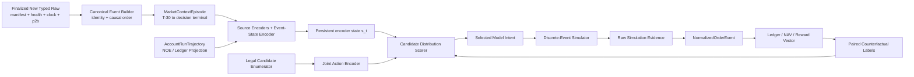

# 新采集数据唯一训练源核心训练框架

事项编号：`rebuild-core-new-data-only`

状态：`基础准备技术设计；StrategyActionSurface=BUY_ONLY；FinalDatasetBoundaryStatus=DEFERRED_TO_OBSERVED_COLLECTION；CollectionStartReadinessStatus=SCHEMA_V3_DEPLOYED_AND_VERIFIED；全部 Training Stage T0-T6 未授权`

对应需求：`/home/chillchill/btc-updown-marketmaker/demand/rebuild-core-new-data-only-demand.md`

对应执行计划：`/home/chillchill/btc-updown-marketmaker/plan/rebuild-core-new-data-only-plan.md`

对应 changelog：`/home/chillchill/btc-updown-marketmaker/changelog/rebuild-core-new-data-only-changelog.md`

## 1. 技术结论

本项目 v1 共享策略与训练框架确定为：

> `ESAR-v1 = Event-State Encoder + Joint Candidate-Action Ranker + Discrete-Event Simulator`

标准 GRU 只保留为可部署基线，不是预定主模型。当前不冻结参数量、层数或 hidden size 上限；具体容量档位和序列骨干候选必须在正式训练前另行分析、预注册并取得用户批准。

其策略身份冻结为“现金担保、双 outcome、BUY-only 的配对获取、库存调节与持有至结算策略”。本方主动订单只能是BUY；不保留自有SELL的deferred/research/feature-flag/占位实现。外部orderbook的bid/ask与trade side仍是完整市场输入，其中ask是本方BUY的直接成交价格，不属于本方动作。

它不是旧 MPV2 的改名版本，也不是先训练 alpha 再用固定规则下单。其核心语义是：

1. 新采集事件按 collector receive time 因果回放；
2. 市场状态从 T-30 开始、按 market ID 持续更新；
3. `StateUpdateContract` 先更新状态；每个有效模型可见事件都由 `DecisionTriggerContract` 触发一次 stateful encoder step 与 intent 评估；
4. 模型一次比较多个完整、合法的 BUY-only Model Intent candidate；BUY是系统常量，模型只决定outcome、单腿/双腿、价格、数量、TTL和BUY订单管理；
5. 只在预注册、与收益无关的 decision-state 子集上，为有限 candidate 使用相同未来 tape 和随机数做昂贵反事实 rollout；runtime 仍逐有效事件评估；
6. 模型学习完整回报分布、执行风险和 joint action ranking；
7. simulator raw evidence 经 NOE 和 ledger 形成 reward，模型不得读取 simulator 私有真值。

必须同时保留三类对照：

- 最低容量基线：逻辑回归/小 MLP 的 causal snapshot predictor；
- 非神经策略基线：XGBoost grouped action ranker；
- 序列结构 challenger：causal TCN。

Transformer/TLOB、Mamba/SSM、Neural CDE、CQL/IQL、Decision Transformer、PPO/SAC 均不是 v1 主路径。

## 2. 为什么选择这个框架

### 2.1 数据实际能支持什么

新 `data-collect` 提供市场证据，而不是交易行为数据。当前训练准备需同时补齐 Gamma 日级 `priceToBeat/finalPrice` 和 Binance aggTrade `T` 边界证据，因此以下能力以 `PriceToBeatAuthorityContract`、`BinanceBoundaryReferenceContract` 和数据准入通过为前提：

- 因果 market representation；
- UP/DOWN outcome 与 probability calibration；
- 多 horizon 价格、波动、spread/depth 和 adverse-move proxy；
- 以真实市场轨迹驱动 simulator；
- 由 simulator 生成的反事实候选动作标签和完整 trajectory。

它不能直接支持：

- observed behavior cloning；
- 真实 `(state, action, reward, next_state, done)` offline-RL transitions；
- 真实 action-return trajectory 上的 Decision Transformer；
- 本账户真实 FIFO queue position、BUY fill、cancel race、batch逐项结果或pUSD admission标签。

因此，直接上 IQL/CQL/DT 会把 simulator 或规则 teacher 的偏差误称为真实行为分布；直接上 PPO/SAC 则容易在尚未校准的 simulator 中搜索漏洞。先做 supervised representation 与 counterfactual ranking，假设更少、可审计性更强。

### 2.2 为什么保留标准 stateful GRU 基线

保留 GRU 基线不是因为旧项目用过 RNN，而是因为当前合同要求：

- 输入是变长、非均匀间隔事件；
- hidden state 必须从 T-30 持续到 market terminal；
- 在线每个事件只携带固定大小状态；
- 候选必须在目标 live 硬件上满足持续事件吞吐和尾延迟门；
- 训练 unroll 和在线 single-step 必须共用同一 cell；
- ONNX/Rust consumer 需要成熟算子和明确 hidden I/O。

[ONNX GRU](https://onnx.ai/onnx/operators/onnx__GRU.html) 已定义标准 hidden-state 输入输出。若候选使用 GRU，则采用标准 GRU，加 delta-time/freshness/mask/multi-scale inputs，不使用自定义 time-decay cell，因此该导出依据成立。这只证明 GRU 是可部署基线，不构成容量上限或主模型结论。不同骨干使用相同因果输入、动作、simulator和经济评估合同，并通过同一生产吞吐/延迟门；不要求参数量相等。

### 2.3 为什么不照搬 DeepLOB 或 Transformer

[DeepLOB](https://arxiv.org/abs/1808.03668) 说明 CNN 可提取 LOB 空间结构、LSTM 可提取时间依赖，因此 ESAR-v1 只借用 book spatial encoder 思想，不照搬其固定股票 LOB 输入和完整网络。

[TLOB](https://arxiv.org/abs/2502.15757) 一方面报告 Transformer LOB 模型的收益，另一方面也报告简单 MLP 可超过既有复杂模型，且加入 spread 成本后预测表现明显恶化。这正说明“更复杂的方向预测网络”不等于“更好的可交易策略”。当正式 cohort 只覆盖少量独立 UTC 日时，先用小模型和强基线更稳妥。

[TCN 的系统比较](https://arxiv.org/abs/1803.01271) 表明简单 causal convolution 在多类序列任务上可成为强起点，因此 TCN 是强制 challenger，而不是可有可无的附加实验。

### 2.4 BUY-only 的平台经济边界

UP与DOWN是同一market的两个outcome，不是本方订单的BUY/SELL两侧。模型必须同时读取两个outcome的完整bid/ask/depth/trade；本方可以提交UP BUY、DOWN BUY或二者的两项batch。[V2 Exchange](https://github.com/Polymarket/ctf-exchange-v2#order-lifecycle)所示撮合既可能让本方BUY与同outcome的外部ask直接成交，也可能通过互补outcome订单形成完整集；[Positions & Tokens](https://docs.polymarket.com/concepts/positions-tokens)说明完整集的UP与DOWN共同对应collateral。simulator只复现相应成交与账本结果，不把平台内部MINT暴露为本方split/merge动作。

两条经济路径为：

1. 异步取得UP与DOWN，只有confirmed持仓的`paired_inventory_confirmed=min(q_up_confirmed,q_down_confirmed)`相对common baseline的增量，其all-in成本小于终局完整集价值时才形成配对利润；initial fixture、provisional/failed fill、意图、挂单或静态价格和小于1都不是盈利事实。
2. 买入互补outcome降低净方向暴露，或在临近结算且证据充分时增加更可能获胜outcome的持仓。互补BUY会消耗pUSD并增加gross inventory，只能合成终局净暴露变化，不能称为主动卖出、减仓或释放资本。

配对数量与all-in edge是由ledger成交增量和成本派生的审计指标，不建立FIFO配对血缘，也不作为额外reward bonus；经济权威仍是账户NAV与终局settled NAV。

因此该策略能在UP/DOWN两个outcome提供BUY-side流动性；当前[Liquidity Rewards](https://docs.polymarket.com/market-makers/liquidity-rewards)与[Maker Rebates](https://docs.polymarket.com/market-makers/maker-rebates)规则可作为实现时重新冻结的资格依据，但它不是传统bid/ask均可主动下单的完整双向做市商。模型架构只提供可学习决策能力，不构成盈利证明；盈利性必须由真实执行假设下的time-forward评估、paper和后续独立授权验证。

## 3. 总体架构



图中的训练闭环是 simulator authority。future paper/live 只替换平台 authority，不允许替换 Model Intent、NOE、ledger 和 consumer contract。

## 4. Canonical event 与状态表示

### 4.1 原子事件

exact identity 下的 `CanonicalMarketEvent` 至少包含：

- `canonical_event_id`
- `transport_message_id`
- `connection_epoch`
- source-local `event_seq`
- collector-wide `global_ingress_seq`
- `child_index/child_count`
- `source_kind/event_type`
- causal-ingress `timestamp_received`
- `source_timestamp` 与语义类型
- `market_id/condition_id/token_id`
- `collector/schema/config_regime`
- `clock_status`
- `source_gap/freshness/reconnect_status`
- payload typed fields 与 source row locator
- price-to-beat authority/version reference（对 market metadata/state event）

exact mode 在官方SDK typed event进入共享causal queue的单一allocator内原子分配`timestamp_received + collector_run_id + global_ingress_seq`，并要求同run timestamp随seq非递减。offline/live均按`(timestamp_received, global_ingress_seq)`，global seq只作同time tie-break；source-local event_seq与transport child ordinal只验证局部顺序。Parquet物理row order、source timestamp、更早source-task receive time和connection-local seq都不是跨source因果权威。

一个 Polymarket frame 的所有 child change 必须先原子应用，再对每个受影响 active market 产生一次 model-visible event。

approximate schema 不伪造不存在的 `global_ingress_seq/event_seq/child_index`。source内batch key为`source_kind + timestamp_received_ms + collector_run_id + connection_scope_if_available`；不同source同receive-ms再组成`CrossSourceTieGroup`。组内只用稳定row locator列举成员并视为simultaneous，原子应用后对每个受影响active market各触发一次，prefetched只更新persistent encoder state/cache。该模式可能合并多个真实frame，默认只支持`representation_only/non-promotable`。

### 4.2 两层 episode 与状态

训练和会计分为两个 authority 不同的层：

1. `MarketContextEpisode/MarketEventState`，按 market ID 隔离：
   - Up/Down Polymarket L2 book、best bid/ask、spread、depth、last trade；
   - Binance L2 checkpoint + continuous updates；
   - Binance aggTrade flow；
   - Chainlink BTC/USD；
   - Polymarket `priceToBeat`及其 precision、first-available/maturity/provenance；
   - Binance aggTrade 的 market-start/market-end venue-local boundary reference 及边界偏差；
   - market metadata、phase、time-to-expiry；
   - source freshness、missing/gap/reconnect masks；
   - 从 T-30 起的累计与多尺度统计；
   - persistent encoder state/cache。
2. `AccountRunTrajectory/AccountExecutionState`，由 NOE/ledger 投影并跨连续 market 持续：
   - confirmed/provisional/free/reserved pUSD与conservative account NAV；
   - 每个market的confirmed/provisional UP/DOWN positions；
   - open/pending BUY orders、remaining size、order age；
   - pending BUY submit/cancel/unknown outcome；
   - `paired_inventory_confirmed=min(q_up_confirmed,q_down_confirmed)`、signed `net_directional_qty=q_up_confirmed-q_down_confirmed`与gross inventory；
   - realized/unrealized PnL、unpaired exposure、capital usage；
   - resolution、resolved-but-uncredited、`platform_settlement_credit_observed`、非负`unmatched_settlement_credit_suspense`与collateral重新可用状态。

pUSD allowance、wallet权限和`PermissionVerdict`不进入模型AccountExecutionState，只进入candidate legality/preflight与audit。`unmatched_settlement_credit_suspense`属于ledger/valuation/audit closure，不新增模型输入、动作或风险模式；模型继续读取普通free/reserved/provisional cash状态。两个连续market在T-30重叠时必须同时维护两个`MarketEventState`；不得用“切换市场时clear一个全局sequence”破坏next market warmup。账户轨迹仍是共享经济事实，late BUY fill、pending cancel和settlement可跨market。

必须区分 `market_decision_done`、`market_settlement_done` 和 `account_run_done`。MarketContextEpisode 可以结束 intent，但经济 closure 只以 AccountRunTrajectory 为权威；per-market PnL 只是带 residual/external-flow bridge 的派生 attribution。

### 4.3 两类边界价格与状态重建

`PriceToBeatAuthorityContract` 仅围绕 Polymarket 平台字段保存：slug/market boundary、`polymarket_price_to_beat`、`polymarket_final_price`、无精度损失的十进制字符串、fetch time、HTTP/缺失状态、`gamma_http_attempt_count`、source URL、`price-to-beat-gamma-v2` schema 和整体 artifact hash。D+1 UTC 02:00 对昨天 D 的每个目标 slug 发起 Gamma `GET /events/slug/{slug}`；只有 `priceToBeat` 和 `finalPrice` 同时存在才记为该 market 回填成功。`closed`、`acceptingOrders`、`umaResolutionStatus`、winner one-hot 或结果交叉验证都不是准入门，不得使整日流程停止。瞬时传输错误有界重试，HTTP 响应已到达但字段缺失时不重试；已有 D 文件只重请瞬时失败 rows。不设 D+2。这是用户已批准的 Gamma 日级冷路径 SDK 缺口例外，不扩展为生产热路径的 raw REST 旁路。

未来 paper/live 热路径 handoff 合同必须显式传输可空的 `price_to_beat` 和 `final_price`，但不因缺失而阻断传输。冷路径回填值与热路径当时可见值必须保留各自的 available/receive time：`final_price` 和市场结束后才回填的 `price_to_beat` 只是 label/evaluation 证据，不得泄漏到更早的模型状态。

`BinanceBoundaryReferenceContract` 是独立的 venue-local 参考，不冒充 Polymarket/Chainlink 结算价：对 market start/end UTC 边界，分别选取 `trade_time (T) <= boundary` 的最后一笔 aggTrade；同一 `T` 有多笔时取 aggregate trade ID 最大者。产物保存 boundary UTC、选中的 `T`、aggregate trade ID、price、`boundary-T` 偏差、source row locator 和 schema/version。`binance_label_up = end_price >= start_price`，`polymarket_label_up = polymarket_final_price >= polymarket_price_to_beat`；两者不一致时保留 disagreement，不把 Binance label 改写成平台 reward/settlement authority。

模型可见 sequence 只从 T-30 开始，但 Binance L2 的 `state_reconstruction_lookback` 必须回溯到最近有效 snapshot/checkpoint并连续应用 updates。T-30之前证据只生成 checkpoint，不进入30秒模型序列。split边界没有完全属于本 split 的重建链时，丢弃边界 market 直到新 checkpoint 可用。

### 4.4 不规则时间与多尺度状态

每个 event 输入显式包含：

- `log1p(delta_t_global_ms)`；
- `log1p(delta_t_same_source_ms)`；
- 每个 source 的 age/freshness；
- missing/gap/reconnect masks；
- event/source embedding；
- time-to-start/time-to-expiry；
- event density 与 burst statistics。

v1 允许在真实事件到达时更新固定多尺度衰减统计，初始预注册尺度为：`250ms、1s、5s、30s、120s、T-30累计`。这些是 feature state，不是 decision tick；最终保留哪些尺度由 development folds 的 ablation 决定，不能使用 final holdout 选择。

### 4.5 StateUpdate、DecisionTrigger 与并发

- `StateUpdateContract` 对全部 canonical events 严格有序更新 source/market/account state。
- `DecisionTriggerContract` 定义有效模型可见事件；每个有效 transport/microbatch、NOE、TTL due或market/account事件都必须触发一次intent评估，不能以material-change、固定频率或计算预算跳过。
- global Binance/RTDS event 确定性fan-out到active和prefetched market；prefetched只更新persistent encoder state/cache，active market各自评估。
- NOE/account event 路由到owning market并触发当前active market风险评估，使上一market late fill能影响当前决策。
- 每个market的persistent encoder state/cache由single-writer actor更新。事件一到入口即分配global monotonic`ingress_seq`，路由后只推进`relevant_pending_watermark[market_id]`；account-domain事件再fan-out到受影响active markets。推理绑定`market_id + state_version + causal_cutoff + relevant_pending_watermark[market_id]`。完成时只要该domain有更高relevant ingress已到达，即使尚在队列，旧结果也stale不得执行；仅更新另一个prefetched market且不影响共享账户的event不能使当前active intent无故stale。每个会使某active market stale的relevant event都必须触发该market重评。
- bounded queue过载时进入permission层fail-closed/no-new-submit并追赶state，不丢事件、不临时合批、不切固定tick。无法满足持续burst吞吐即模型配置FAIL。

## 5. ESAR-v1 模型结构

### 5.1 输入编码器

1. Polymarket book encoder：Up/Down token 分别取训练合同冻结的 top-K levels，以相对 mid/tick 的 price distance、`log1p(size)`、`book_side`、level mask 编码；共享 level MLP 或 1D causal/spatial CNN 后做 pooling。`book_side`只描述外部bid/ask，不进入自有订单动作schema。
2. Binance book encoder：使用从 snapshot 连续重建的 top-K bid/ask 与 imbalance、microprice、spread、depth slope；结构与 Polymarket 分开，不能共享未验证的尺度。
3. Trade/RTDS encoder：aggTrade direction/size/burst、BTC/Chainlink returns、Binance start-reference drift、freshness 和 source divergence 进入小 MLP；market-end Binance reference 只用于 label/evaluation，不作为早期输入。
4. Metadata/time encoder：仅读取当时已可见的 Polymarket `priceToBeat` 及其 freshness/maturity、market phase、time-to-expiry、tick/min size、fee/reward eligibility 的已知 mask；`finalPrice` 只用于成熟 label/evaluation。
5. Account/order encoder：只读取 NOE/ledger 投影，不读取 simulator 私有 queue/future 状态。

top-K 初版只在 `K ∈ {10, 20}` 中预注册比较；最终值在 development fold 冻结。没有证据时不把全深度直接塞入网络。

### 5.2 序列骨干与容量状态

共享骨干合同：

```text
source encoders + event/time/mask embeddings
                 ↓
        fused event vector x_t
                 ↓
 versioned stateful sequence encoder
                 ↓
       persistent market state s_t
```

约束：

- 当前不设置 trainable parameter、层数或 hidden size 硬上限，也不把任一容量写成预定冠军；
- 标准 GRU 是接口、因果状态与部署 parity 基线；具体容量档位和其他序列候选须在正式训练前另行分析、预注册并取得用户批准；
- 所有候选使用相同数据可见性、动作、simulator、reward与生产吞吐/延迟门；参数量、FLOPs、缓存和峰值内存作为成本分别报告，不以参数量相等代替公平性；
- 先在单张 5090 上 profile；
- persistent encoder state/cache在physical chunk之间carry，并且只在明确market lifecycle terminal/reset receipt后清除；
- recurrent candidate的TBPTT contract必须冻结chunk length、no-grad burn-in和loss window，detach不等于解决长程学习；随机chunk必须从前序事件no-grad burn-in重建hidden；
- recurrent candidate的抽样market必须做full-unroll/no-detach对照、早期T-30 event干预对后期输出测试，以及remove-hidden/remove-multiscale ablation；其他candidate必须定义等价的context/cache完整性和消融测试；
- 相同 event/state 的 training unroll、ONNX single-step 和 Rust runtime state/cache输出必须数值对账。

TCN challenger使用完全相同的因果输入、动作、simulator与经济评估合同，并必须单独报告实际wall-clock receptive-field coverage、streaming cache、参数量、峰值内存和同一生产吞吐/延迟门；只匹配参数量而忽略cache/覆盖范围不算公平对照。

### 5.3 监督辅助 heads

辅助 heads 用于学习因果 market representation，不直接下单：

- terminal UP/DOWN probability；
- 多 horizon Polymarket/BTC return quantiles；
- volatility、spread/depth transition；
- adverse-move proxy；
- source gap/freshness/regime；
- representation uncertainty（仅在完成校准并由 risk selector消费时部署，否则保留 training/audit-only或删除）。

分类用 class-balanced BCE/交叉熵作为优化项，同时报告 Brier、ECE 和 reliability diagram。概率校准至少使用 temperature scaling 基线；[现代神经网络校准研究](https://proceedings.mlr.press/v70/guo17a.html) 表明 temperature scaling 是简单且有效的起点。

辅助 loss 必须有 mask 和 maturity；未成熟 target 不写零。多任务权重只在 development folds 冻结，不能根据 final holdout 调整。每个 head 的 loss、calibration 和 consumer 写入 `ModelOutputConsumerMatrix`。

## 6. Joint Candidate-Action Scorer

### 6.1 完整 candidate，不再独立拼 heads

一个 candidate 是完整、可执行的 Model Intent，而不是独立 quote/offset/size logits 的笛卡尔拼接。其逻辑结构为：

```text
CandidateIntent {
  intent_type: hold_existing_buys | submit_buy | cancel_buy |
               cancel_all_buys,
  buy_orders: [
    {outcome: UP | DOWN, price_offset_ticks, size_bucket,
     order_type, post_only, ttl_or_expiration}
  ],
  target_buy_order_ref?,
  candidate_contract_version
}
```

`hold_existing_buys`表示本次不新增、不取消并保留现有BUY订单；不再保留语义重复的`no_op/no_submit`。`buy_orders`只在`submit_buy`存在且长度为`1..2`；`target_buy_order_ref`只在`cancel_buy`存在。hold、单笔/双腿submit、cancel指定订单和cancel-all是互斥的判别类型。

`BUY`由系统和官方SDK adapter固定，不进入candidate字段、模型输出或可切换enum。adapter可使用官方`Side::Buy`构造订单，但该SDK协议类型不进入`book_side/market_side/trade_side`命名空间。本项目自研的新核心模型、ONNX接口、Rust解码、simulator enabled capability与测试fixture均不得表达自有SELL，也不得保留deferred/research/feature-flag路径。

v1 candidate budget固定上界：每个评估state不超过`32` candidates；submit candidate只含`1..2`个BUY order specs、每个outcome最多一个价格档、batch最多两项。cancel与submit不在同一candidate混合。固定离散grid生成超过上限时配置必须fail closed，不能先用模型score或隐藏启发式粗筛，否则enumerator会变成影子策略。

[Create Order](https://docs.polymarket.com/trading/orders/create)当前说明平台batch request可包含更多订单，且BUY admission依赖pUSD allowance与扣除既有open-order reservation后的可用余额；v1上限两项是本框架主动选择的复杂度边界，不得误写成平台上限。实现时仍需通过官方Rust SDK重新冻结返回结构和逐项结果语义。

初版 candidate templates 可以包括：

- `hold_existing_buys`；
- 单 outcome BUY；
- Up/Down 双 outcome 联合BUY；
- cancel指定BUY订单；
- cancel-all-buys。

每个candidate内含完整outcome、单腿/双腿presence、offset、size、TTL和目标BUY订单引用，不允许runtime再用固定常数补成另一套策略。单outcome BUY必须保持合法，供异步配对与库存调节使用；不得按动作来源增加“纯赌博”类别惩罚。

v1不提供replace、pause或cancel-only candidate。模型先发出`cancel_buy`，其accepted/rejected/unknown/late-fill NOE更新ledger并触发新评估；只有新的`submit_buy` candidate才能决定是否挂新BUY，不能自动续提、固定缩量或固定改买另一outcome。这样每个candidate只有一次submit request或一次cancel request；两项batch仍必须逐项产生accepted/rejected/unknown、partial fill和补偿事件。持久`PermissionVerdict::{NO_SUBMIT,CANCEL_ONLY}`只属于系统硬边界，不由模型输出。

### 6.2 Candidate enumerator 的边界

enumerator 只负责：

- 当前官方平台支持的 order type；
- tick/min-size/post-only/expiration 合法性；
- free/reserved/provisional pUSD、BUY open-order上限；
- pUSD allowance/wallet permission只作为不进模型的hard preflight；
- user-approved hard risk limits；
- 去除重复或语义等价 candidate。

`CapitalBudgetContract`在训练前冻结account/单market最大投入、最低free-cash reserve、异步第二腿资金预留和batch资金预留语义。enumerator只执行这些已批准的现金硬约束；不得用隐藏规则替模型选择第一腿、第二腿或报价。

本地ledger、平台回报与链上状态不要求瞬时相等。延迟或不一致必须进入confirmed/provisional/unknown生命周期；只能保守阻止证据不足的相关BUY submit，不能暂停整个模型、BUY cancel能力或无关market。真实reject作为NOE回流并由下一次完整candidate评分处理，不允许固定缩量或固定改买另一outcome的fallback。

enumerator 不负责：

- 决定方向；
- 选择“更好”的 offset/size/TTL；
- 根据 alpha 隐式强制下单；
- 在模型后加固定 threshold 或 fallback 策略；
- 把非法 candidate 变形成另一笔合法订单。

### 6.3 Scorer 与输出

每个 ragged candidate 经共享 action encoder 编码，再与 `s_t`、账户状态拼接：

```text
z_j = ActionEncoder(candidate_j)
u_j = Scorer(s_t, account_state_t, z_j)

u_j -> return quantiles q05/q25/q50/q75/q95
     -> fill probability
     -> partial-fill probability conditioned on fill
     -> adverse-selection quantiles
     -> reject/lifecycle outcome probabilities
     -> capital/inventory/drawdown projections
```

模型选择器使用版本化 risk profile 对同一 candidate 的分布输出计算 utility；它不得重新生成策略。

`ModelOutputConsumerMatrix` 必须逐字段标记：

| 输出 | 训练 consumer | runtime consumer | bundle规则 |
|---|---|---|---|
| outcome/dynamics heads | representation loss、calibration、audit | 默认无 | 不得宣传为下单控制 |
| representation uncertainty | calibration/audit | 仅当risk selector明确影响candidate utility并可选择`hold_existing_buys` | 无明确消费则从部署输出移除 |
| return quantiles/expected-shortfall | quantile/tail loss | risk utility 与 candidate排序 | 必须部署并 parity |
| fill/partial/adverse/reject heads | masked simulator auxiliary loss与诊断 | 只有被 risk utility/validity规则明确消费的字段 | training-only字段不进入runtime接口 |
| capital/inventory/drawdown | supervised risk losses | risk utility/hard risk audit | 单位与归一化冻结 |

逐维 perturbation 必须改变对应 Model Intent/simulator command；training-only auxiliary head 不需要改变 action，但必须有明确训练/审计 consumer且不得伪装成runtime能力。

### 6.4 Ranking loss

每个 `decision_state_id` 是一个 group，group 内是同一 state 的不同 candidate。主训练目标由三部分组成：

1. paired ranking loss：比较 common-random-number rollout 下的风险效用；
2. quantile pinball loss：学习完整经济回报分布；
3. masked execution auxiliary losses：fill、partial fill、adverse selection、reject/lifecycle。

对每个共同 seed/scenario 先计算 paired difference `ΔJ = J_a - J_b`。只有 `ΔJ` 的 paired interval 完全落入预注册 equivalence band 才标记 tie；边际区间重叠或“尚不确定”不等于已证明等价。

XGBoost 基线使用同一 `decision_state_id` 作为 query group；[XGBoost Learning to Rank 官方文档](https://xgboost.readthedocs.io/en/stable/tutorials/learning_to_rank.html) 支持 query-grouped pairwise/LambdaMART 目标。

## 7. 离散事件模拟平台

### 7.1 simulator 的权威位置

simulator 接收 causal market events 与 Model Intent，输出平台 raw simulation evidence，再走共享 NOE 和 ledger：

```text
market event / Model Intent
          ↓
discrete-event platform simulator
          ↓
raw accepted/rejected/fill/cancel/settlement evidence
          ↓
NormalizedOrderEvent
          ↓
ledger / conservative account NAV / reward vector
```

不允许 simulator 直接从私有真实 queue 或未来路径写 reward。通用模拟器可提供设计思想，但不能替代本项目平台语义。例如 [ABIDES](https://arxiv.org/abs/1904.12066) 可借鉴离散事件 kernel、消息和延迟结构；[Queue-Reactive 模型](https://arxiv.org/abs/1312.0563) 可借鉴 book-state-dependent intensity，但 Polymarket 聚合 L2 不能识别本账户真实 FIFO 位置。

### 7.2 平台规则与状态机

先冻结`SimulatorCapabilityMatrix`。v1只实现已冻结BUY-only candidate surface实际使用的order types、lifecycle和会计路径；unsupported capability fail closed，不为追求“全平台模拟”先造第二套SDK/NOE/ledger。对每个enabled capability至少覆盖其相关项：

- BUY create/sign/post/ack/user-channel/cancel的分阶段延迟；
- BUY accepted、rejected、unknown submit outcome；
- candidate实际启用的 GTC/GTD/FAK/FOK 与 post-only；
- current tick/min-size、pUSD balance/allowance preflight与reservation；
- full/partial fill 与 remaining quantity；
- queue proxy/fill hazard；
- cancel race、matched-cancel、late fill；
- 单笔BUY与最多两项的UP/DOWN BUY batch；batch逐项accepted/rejected/unknown与partial fill，不能假定原子成功；
- cancel NOE触发重新评分；simulator不提供replace或cancel后自动续提能力；
- 本方BUY与同outcome外部ask的直接成交，以及与互补outcome订单形成完整集的撮合账本语义；
- 与当前候选相关的 restart/rate-limit/reconnect stress；
- provisional match、confirmed/failed 与 compensating events；
- resolution、resolved-but-uncredited、`platform_settlement_credit_observed`与pUSD重新可用；
- fee、maker/taker、rebate/reward eligibility。

自有SELL以及split/merge/redeem不属于新系统能力域，不得作为disabled/deferred capability保留；平台内部为了撮合互补BUY发生的MINT只体现为外部撮合结果，不成为本方动作。只有目标新cohort中的外部市场SELL/ask可作为market evidence进入replay；旧本账户执行artifact继续受用户单独批准门约束，只能校准simulator且不得作为模型输入。

当前官方订单语义必须在实现时重新冻结：[Polymarket Order Lifecycle](https://docs.polymarket.com/concepts/order-lifecycle) 明确 post-only crossing 会拒绝、partial fill 后只能取消未成交部分，且订单/交易存在不同 lifecycle；[Market Channel](https://docs.polymarket.com/market-data/websocket/market-channel) 显示一个 `price_change` message 可以包含多个 child changes。实现不能把当前网页数值永久写死为平台真理。

### 7.3 参数 provenance 与情景

每个参数标记：

- `observed_new_data`
- `official_rule`
- `approved_external_execution_artifact`
- `assumed`
- `stress`

最少运行：

- conservative execution；
- base/provisional execution；
- high-latency；
- tail-latency/cancel-race；
- adverse fill；
- rule-regime stress。

新市场数据能测量特定 collector host/region/SDK/clock boundary 下的 `collector_visibility_delay` 与市场路径，不能测量 wire ingress、future live 主机端到端延迟或本账户 fill/cancel。只依赖 `assumed/stress` 的 policy 可用于研究性训练，但状态必须是 `non-promotable`。

### 7.4 Counterfactual rollout 与计算预算

不是对每个 runtime state 生成全候选标签。全事件 causal state update 和逐有效事件 intent evaluation 保持不变；昂贵 rollout 只针对 `CounterfactualLabelStateSet`。该集合按 event type、market phase、state novelty、inventory/open-order状态分层，从 development数据中按 outcome/PnL不可见的规则抽样。

对每个被选中的 state：

```text
(state_i, candidate_1, future_path_i, seed_k)
(state_i, candidate_2, future_path_i, seed_k)
...
```

所有candidate使用相同未来market tape、同一simulator regime和common random numbers。单candidate label包含版本化continuation policy，运行到`candidate_effect_terminal`，或达到branch hard limit后按censored/residual规则结束；不能只计算一次submit的即时spread。每条label保存`continuation_policy_hash + aggregation_iteration`；不同continuation policy的labels不得混成同一无条件真值，必须分层或显式条件化。只有完整policy evaluation trajectory运行到AccountRunTrajectory terminal。

`CounterfactualRolloutBudgetContract` 在全量生成前必须冻结：每 market ranking groups、每 group candidates、scenario/seeds、总 branches、最大 wall-time/disk、每branch `max_events/max_wall_duration/max_market_transitions/max_pending_tail`、inclusion probability、training weight和resume策略。candidate上限同时受第6节 `32` 的硬上界约束，纵向切片实测后只能按预算进一步减小或经用户批准扩大。future tape只解码一次并由branch共享；完整逐事件策略 replay用于最终行为验证，不为每个event重新生成全后缀标签。

每个ranking group同时运行一个common-baseline branch，并使用同一causal cutoff。`candidate_effect_terminal`不是简单的owning-market结束，而是group内所有纳入比较的branch相对common baseline产生的差异订单、reservation、UP/DOWN仓位、cash、settlement suspense和continuation-policy下游经济状态均已闭合，只剩可比较的pUSD/NAV差异时的共同终点。若重叠market因资金占用产生差异动作或仓位，也属于branch-differential effect；达到group hard limit仍未闭合或仍有branch-differential suspense的branch必须censor，并按ConservativeAccountNavValuationContract保存residual lower/upper bound。涉及censored branch的pairwise label必须排除或使用预注册bounds判定，不能让不同candidate按不同horizon比较，也不能把截断NAV冒充成熟终局。

candidate label与完整账户回报分开：

```text
G_candidate
  = branch_NAV_at_effect_terminal
  - common_baseline_NAV_at_same_cutoff
  - branch_differential_external_cash_flow

G_account
  = terminal_settled_NAV
  - starting_NAV
  - external_cash_flow_adjustments
```

`G_candidate`只用于同group的ranker label；`G_account`只用于完整policy evaluation和AccountRunTrajectory最终闭合。二者不得共用名称或把candidate cutoff冒充account terminal。

### 7.5 CounterfactualMarketImpactContract

复用 observed future tape 只在 `small_agent_exogenous_market_path` 假设下有效。v1 必须：

- 按可见可成交深度、近期成交量和预注册 participation/impact上限约束 candidate size；
- 在每个branch维护 own resting order、own fill和own liquidity consumption overlay；
- 定义 observed后续 L2 update 与branch overlay的确定性reconciliation；
- 对marketable/大size action运行impact stress；
- 把超过有效容量的candidate排除或标记non-promotable，不得把固定future path结果称为真实市场冲击模拟。

continuation policy初始为版本化、简单、可审计baseline；模型稳定后再在更小的预注册state subset加入当前policy做simulator dataset aggregation。初始轨迹混合`hold_existing_buys`、规则baseline、分层随机合法动作和当前policy，防止只在teacher状态上训练。[DAgger](https://proceedings.mlr.press/v15/ross11a.html)说明顺序决策中状态分布依赖先前动作，普通IID imitation会累积误差；此处只借鉴dataset aggregation思想，不把simulator行为称为真实demonstration。

## 8. Reward 与奖惩办法

经济authority是`AccountRunTrajectory`，不是单个MarketContextEpisode。每个split从独立冻结的cash-only fixture开始：只有固定starting pUSD，UP/DOWN positions、open/pending orders、reservation和resolved claim均为零；随后按时间carry cash/position/order/settlement，所有成本基础由本split confirmed fills产生。训练产生的账户状态不能流入calibration/holdout。

### 8.1 先保存经济分量，再生成 risk utility

每个 rollout 永久保存：

```text
realized_pnl
unrealized_pnl
conservative_account_nav
fees
eligible_realized_rebates_or_rewards
actual_paired_quantity_and_all_in_edge
unpaired_exposure_time
gross_inventory
inventory_exposure_integral
max_drawdown
downside_return_distribution
buy_fill_count_and_size
adverse_selection
submit_cancel_counts_by_authority
reject_late_stale_counts
capital_usage_time
cash_exhaustion_and_second_leg_capacity
time_to_pair
settlement_result
censoring_and_maturity
```

禁止只保存一个不可解释 scalar。

### 8.2 经济 reward

先冻结`ConservativeAccountNavValuationContract`：

- free/reserved/provisional pUSD与external cash flow；
- open/pending/unknown BUY submit及其资金预留；
- confirmed/provisional/unsettled UP/DOWN positions；
- paired quantity、net directional quantity与gross inventory；
- one-sided/stale/missing book的只读conservative mark；
- fee/slippage/impact haircut；
- terminal winning/losing payout；
- resolved-but-uncredited winning token与`platform_settlement_credit_observed`；
- 非负`unmatched_settlement_credit_suspense`的contra估值与reconciliation状态；
- valuation timestamp、source freshness和fallback顺序。

`ledger_pUSD_total`由互斥的free/reserved/provisional cash状态组成。估值断言固定为`conservative_account_NAV = ledger_pUSD_total + valued_token_claim_and_provisional_assets - unmatched_settlement_credit_suspense - other_liabilities`；suspense amount必须`>=0`并只扣一次，不减少平台confirmed free cash、不进入external cash flow或capital-at-work。中间mark只用于会计、风险和censored residual bounds，不表示策略可以按该价格主动清算，也不能变成candidate可用现金。实际终局settled NAV仍是唯一不依赖中间mark的经济权威。

初始→首决策、决策→决策、末决策→terminal、zero-decision market 四类 interval 都必须生成。相邻 interval：

```text
r_economic(t)
  = conservative_account_NAV(t_next)
  - conservative_account_NAV(t)
  - external_cash_flow(t, t_next)
```

AccountRunTrajectory终局：

```text
G_account
  = terminal_settled_NAV
  - starting_NAV
  - external_cash_flow_adjustments
```

`sum(r_economic)`与`G_account`必须在会计容差内闭合。分别记录exactly-one`market_decision_done`、`market_settlement_done`、`account_run_done`。fees、slippage、rebate/reward一旦进入ledger，不能在reward中重复处理。per-market attribution必须加总到account-run总额并显式列出residual/external-flow bridge。

用户指定的平台约十分钟自动兑回行为建模为模型外`platform_settlement_credit_observed`事件，不是本方redeem action。官方[Redeem Tokens](https://docs.polymarket.com/trading/ctf/redeem)只保证resolved后可执行redeem，因此在取得当前账户级自动回款分布前，该延迟只能是`assumed/stress`且artifact保持non-promotable；事件未观察到时winning claim保持resolved-but-uncredited、pUSD不可复用，达到tail上限则censor并保存residual bounds，禁止按固定十分钟伪造回款。该事件固定`flow_class=internal_settlement`，是winning claim到pUSD的账户内部资产转换；`external_cash_flow`只包含真实入金、出金等账户边界变化，两个回报公式都不得扣除内部结算回款。

`SettlementLedgerTransition`必须exactly-once且幂等，并持久保存market terminal outcome。权威resolution把当时已confirmed的losing token资产原子归零、确认realized loss且不增加pUSD；winning token原子转为`resolved_winning_claim`。任何provisional/late fill在resolution后才转为confirmed时，必须在同一transition中直接转成losing realized loss或winning claim，不能先生成无法闭合的unsettled token。

收到`platform_settlement_credit_observed`且已有对应claim时，使用稳定event key原子减少claim并增加等额pUSD，`external_cash_flow=0`。如果平台回款证据先于本地claim，既不能丢弃或拒绝，也不能伪造claim或全局暂停：实际观察到的pUSD与等额`unmatched_settlement_credit_suspense`同时入账，suspense是内部结算contra、不是external cash flow或新的现金冻结。平台现金/allowance/admission已经确认可用时，本地归因延迟不得阻止其提交BUY；claim后到时原子注销claim与匹配suspense，不再次增加cash。partial/aggregate credit的matched amount不得超过outstanding claim，未归因部分保留suspense；tail超限时，受影响candidate label/per-market attribution以及包含该缺口的`G_account/account_run_done`必须censor或保留显式residual bridge，不能冒充成熟终局，但runtime、其他market和BUY cancel继续。完整pair、single winner、single loser、partial pair、no-credit tail和全部合法事件排列都必须满足token/claim/suspense/cash不双计；只有已完成对账的成熟trajectory才断言`sum(delta NAV)=G_account`，未回款或未归因tail保留censored residual。

资金语义必须互斥：`order_reserved_pusd`是真实open/pending BUY ledger reservation；`provisionally_committed_pusd`是尚未最终确认且不再计入order reservation的承诺；`unsettled_position_cost_basis`是已离开cash的未结算仓位成本；`second_leg_headroom`只是candidate admission预算，不修改ledger cash或NAV。`capital_at_work=order_reserved_pusd+provisionally_committed_pusd+unsettled_position_cost_basis`，每个pUSD单位只能归属一个桶；settlement suspense不属于capital-at-work。权威resolution后，losing部分立即转为realized loss并退出capital-at-work；winning claim继续占用到`platform_settlement_credit_observed`。credit先于claim且无法即时归因时，对应capital release time改存lower/upper bound并标记censored，不能继续输出伪精确的locked-capital积分；匹配后才完成per-market准确归因。losing-only账户不等待不存在的credit即可economic closure。`capital_usage_time=integral(capital_at_work dt)`不进入NAV haircut。

配对审计仅使用confirmed状态：`paired_inventory_confirmed(t)=min(q_up_confirmed,q_down_confirmed)`；累计量只在confirmed fill使该值正向增加时更新，排除initial fixture、provisional/failed fill，并在结算归零后保留累计器。candidate指标报告相对common baseline的增量。成本使用冻结的order-invariant pooled-average confirmed cost basis；只计confirmed fill price与实际fee，rebate仅在实际入账且可归因时计入，eligible但未入账rebate单列。该指标只作审计/归因，不进入pair bonus。

### 8.3 风险惩罚与选择效用

初版 risk profile 使用：

```text
J_candidate
  = E[G_candidate]
  - lambda_inventory * E[delta_inventory_exposure_integral]
  - lambda_drawdown * E[delta_max_drawdown]
  - lambda_tail * expected_shortfall_loss
```

定义：

- 每个branch先计算非负`inventory_exposure_integral=integral(abs(q_up_confirmed-q_down_confirmed) dt)`，UP-heavy与DOWN-heavy镜像状态同罚；signed net quantity只作方向状态/诊断，paired quantity不重复计为方向风险，gross inventory与capital usage另行报告；candidate使用branch相对common baseline的risk delta，完整policy evaluation使用总量；
- `expected_shortfall_loss >= 0`，candidate选择时从`G_candidate`分布估算，完整policy评估时从`G_account`分布估算；必须使用足够的empirical rollout lower tail、密集lower-tail quantiles或独立expected-shortfall head，单个`q05`不是CVaR；
- `capital_usage_time`、gross inventory、cash exhaustion和settlement wait必须始终保存并作为晋级指标；在现金约束的跨market trajectory仍无法体现机会成本时，candidate只能加入版本化`lambda_capital * E[delta_capital_usage_time]`，其中`delta=branch-common_baseline`；完整policy evaluation才使用总`capital_usage_time`。该规则必须在development阶段决定、在final holdout前冻结并做敏感性分析；
- lambda、tail alpha、capital normalization 和 practical-equivalence threshold 必须在 final holdout 前冻结并做敏感性分析；
- scorer 同时预测原始经济分布和风险分量，risk profile 可版本化，不需要重写历史标签。

reject、late、stale、submit count、cancel count和fill count只作lifecycle gate与诊断，不按事件次数或动作类别进入scalar。其实际费用、错失成交、adverse selection、暴露时间和资金占用已经通过ledger/NAV或上述风险分量体现，不得再建立第二套运营打分。

### 8.4 明确禁止的 reward 做法

- 固定 idle/Hold penalty；
- 每个 event 都累加与时间无关的 penalty；
- 固定 `reward_clip=1` 或其他破坏 terminal signal 的裁剪；
- 把全市场 terminal PnL 重复写到每个 event；
- 把 unresolved/censored 写成零；
- 把 guard、market-end、stale-data、operator cancel 计作 model churn；
- 已经进入 ledger 的 fee/slippage/adverse effect 再扣一次；
- 用任意巨大负数代替 legal candidate filtering；
- 用成交次数、quote count、pair bonus、free-roll bonus或AUC代替经济回报；
- 按single/paired、动作来源或“从空仓单边买入”等类别添加固定奖励/惩罚；
- 用FIFO配对血缘、固定reject penalty或热路径pnl-floor改变同一经济状态的得分。

`hold_existing_buys`的经济reward可为零，但它仍与其他candidate的完整counterfactual`J_candidate`比较。不得为了避免全hold人为强迫下单。

## 9. Training Stage T0-T6（全部未授权）

本节的 `T0...T6` 只描述未来训练流水线，避免与主计划当前“阶段 0 文档准备”混淆。唯一执行顺序是：先 simulator/NOE/ledger/reward 合同与非训练纵向切片，再监督 representation，再 counterfactual labels 和 ranker。

| Training Stage | 内容 | 主计划映射 |
|---|---|---|
| T0 | 冻结 cohort/canonical/split和纵切所需draft contracts；不训练 | 阶段 3 |
| T1 | 正式纵切、全量canonical、simulator pilot并冻结最终contracts | 阶段 4-6 |
| T2 | baselines 与监督 causal representation | 阶段 7.1-7.2 |
| T3 | 预算化 counterfactual candidate dataset | 阶段 7.3 |
| T4 | joint action ranking | 阶段 7.4 |
| T5 | 预算化 simulator dataset aggregation | 阶段 8.1 |
| T6 | 完整 event-trigger trajectory 与 frozen holdout | 阶段 8.2-8.4 |

### Training Stage T0：边界和合同冻结

- 先依实际累计数据的完整性和 schema regime 提交候选 cohort，再由用户冻结 final boundary；冻结前不生成 final split；
- 冻结 canonical events、p2b、features、splits和account fixtures；冻结candidate/output-consumer、simulator、market-impact、rollout-budget、valuation/reward的draft schema、接口和fail-closed边界，供纵向切片验证；
- 不运行模型训练或leaderboard。

### Training Stage T1：simulator 正式纵向切片

- 选取与收益无关、跨波动/流动性/coverage regime 的少量完整 market；
- 验证event order、BUY submit/fill/cancel/settlement、UP/DOWN双腿batch逐项mixed result、异步单腿、第二腿现金不足、cancel NOE后重新评分且不自动续提、NOE、AccountRunTrajectory、ledger和reward closure；
- 运行 conservative/base/stress 参数与market-impact边界；
- property-based 守恒、确定性 replay和预算profile通过后，才冻结SimulatorCapability/Calibration、MarketImpact、RolloutBudget、Valuation与Reward contracts的最终版本并扩量。

### Training Stage T2：baselines 与监督 causal representation

- 建立outcome常数/逻辑回归、小MLP、`hold_existing_buys`、naive directional BUY和简单paired-BUY/hold-to-settlement规则基线；
- 从T-30 unroll，训练 outcome、return quantiles、volatility、spread/depth和freshness heads；
- 比较snapshot MLP、经用户批准并预注册的stateful encoder candidates与causal TCN；
- development folds选择，dedicated calibration单独冻结概率校准；
- T2只证明表示能力，不能授权下单。

### Training Stage T3：预算化 counterfactual candidate dataset

- 只对 `CounterfactualLabelStateSet` 枚举 ragged legal candidates；
- 按RolloutBudget/MarketImpact contracts和common random numbers批量rollout；
- 保存inclusion probability、training weight、distribution、risk vector、maturity、continuation-policy hash、simulator provenance和group ID；
- paired equivalence与uncertainty分开，不强造确定排名。

### Training Stage T4：joint action ranking

- 先训练 XGBoost grouped ranker；
- 再训练经用户批准并预注册的 ESAR-v1 stateful encoder candidates + joint action scorer；
- 用同数据、同 seeds、同动作/simulator/经济评估和生产吞吐/延迟门比较 TCN challenger；
- action-surface/output-consumer audit 先于 PnL ranking。

### Training Stage T5：预算化 simulator dataset aggregation

- 在更小的预注册 subset 加入当前 policy 会访问的 inventory/open-order/cancel 状态；
- 仍保留`hold_existing_buys`、规则和分层随机coverage；
- 监控 action support、sampling weight 与 simulator exploitation；
- 每轮固定 dataset/simulator/continuation-policy hash，不把不同policy labels混成同一真值。

### Training Stage T6：完整 trajectory 与 frozen holdout

- 对每个有效模型可见事件执行一次model intent评估，但不在每个event生成全候选counterfactual labels；
- final holdout 只运行一次正式验收；
- 评估calibration、settled net EV、expected-shortfall/downside、drawdown、actual paired all-in edge、unpaired exposure-time、gross inventory、capital-usage time、time-to-pair、cash exhaustion、settlement closure、action support、regime、simulator sensitivity、market-impact capability和inference latency；
- 输出 training/evaluation candidate，不自动进入 paper/live。

## 10. Split 与统计设计

当前不固定起止日、UTC 日数或名义 market 数。用户将在 schema v3 重新部署后，根据实际累计数据的完整性、gap、clock 和 schema regime 选择 final cohort。旧方案 B 只作历史记录，不得回流为默认配置。

final cohort 冻结后，按完整 UTC 日从早到晚编号 `D1...DN`。标准 split 至少需要 `N >= 9`：最后两个完整 UTC 日作 frozen final holdout、其前一个完整 UTC 日作 dedicated calibration，更早日期作 model development，从而保留至少 5 日初始 train 和 1 日前推 validation。若 eligible 日不足，则扩大采集区间或由用户重新冻结 split，不通过缩减 holdout 或随机切分规避。

model-development 内使用 anchored expanding folds：默认最少 5 个完整 eligible 日作为初始 train，下一完整 calendar 日作 validation，随后逐日扩展。不能因为某天结果难看而跳过；coverage 不足只会使对应 gate 失败或 capability 降级。

每个 split 必须：

- 以 market 为最小 group；
- 同 market 的 source、T-30、label、candidate 和 simulator replicas 同 split；
- 一个AccountRunTrajectory不跨split；每个split使用独立冻结的cash-only fixture：固定starting pUSD，positions/open-orders/pending/reservation/resolved-claim全为零；
- split末尾延伸maturity tail直到open/pending/unsettled闭合，或隔离相关market；train policy产生的账户状态不进入calibration/holdout；
- state reconstruction chain必须完全属于该split，或属于该split独占且已从相邻split purge、从不作为训练example的reconstruction-only prefix；prefix范围/rows/hash写入split manifest。否则丢弃边界market；
- purge/embargo 覆盖最大 dependency horizon；
- normalization 仅 fit train；
- final holdout 的 market、label、指标和 simulator outcomes 不用于架构、阈值、risk weight 或规则调参。

如果 final cohort 仅包含少量 UTC 日，独立 regime 数仍会很少。final 仅有两个 UTC day clusters 时，不能宣称可靠 day-level bootstrap/cluster CI；必须逐日报告，使用预注册的 contiguous-market block 和 paired-market intervals 作条件性不确定性，regime 稳定性主要来自 development folds。数亿 rows 不得当 IID 样本。

final holdout 一旦被观察，后续若修复改变 dataset/split/simulator/reward/model contract，原 holdout 只能降为 diagnostic，不能再次称为 pristine holdout；重新正式验收需要新的未来未读 holdout 和用户批准。

## 11. Action-surface 与 consumer 硬测试

候选模型进入经济评估前必须通过：

1. raw logits/quantiles、decoded intent、simulator command 和 ledger effect 对账；
2. 每个 action 维度非零梯度和非退化 support；
3. outcome、single/paired leg presence、offset、size、TTL、target-BUY-order逐维perturbation；
4. alpha/account/order state zero、shuffle、scale intervention；
5. `hold_existing_buys`、规则action、negative/control candidate separation；
6. action temperature/risk-profile sweep；
7. 全`hold_existing_buys`、全BUY submit、全cancel和所有candidate decoded相同检测；
8. ONNX/PyTorch/Rust single-step 与 persistent encoder state/cache carry parity；
9. market overlap、switch、restart replay 和 reset receipt；
10. StateUpdate/DecisionTrigger single-writer、state_version/causal_cutoff、stale intent拒绝和burst overload；
11. ModelOutputConsumerMatrix 与实际 consumer 一致，不得覆盖或忽略runtime字段；
12. candidate schema没有order-side输出，ONNX/Rust解码把BUY固定为系统常量，simulator capability不含自有SELL；
13. `hold_existing_buys`、UP BUY、DOWN BUY、单腿/双腿BUY、最多两项batch逐项结果、BUY cancel/cancel-all、cancel后新评估、resolved-but-uncredited和`platform_settlement_credit_observed`均有正例；构造自有SELL、replace、pause、cancel-only或redeem intent/command必须失败；另验证`0.98`完整集成本→`1.00`内部结算回款→`G=+0.02`，single winner/loser、完整/partial pair、no-credit tail、重复/partial/aggregate credit、confirm→resolution→credit、resolution→confirm→credit、resolution→credit→delayed-confirm、claim/suspense/cash不双计和capital结束条件；断言NAV只减一次非负suspense且suspense不进capital-at-work。所有可归因排列必须收敛；非零suspense使受影响candidate/account closure保持censored，但不全局暂停。

全`hold_existing_buys`不自动等于bug；只有当counterfactual标签也支持不交易且intervention正常时，才可能是合理结果。所有candidate decoded相同、输出无consumer或系统PermissionVerdict未被runtime执行则必定是失败。

## 12. mistake-log 失败闭环

| 历史失败 | ESAR-v1 的阻断机制 | 不能自动解决的剩余风险 |
|---|---|---|
| 只看极短片段/固定 seq_len | T-30 persistent encoder state/cache；candidate-specific burn-in/context完整性与早期event干预 | 长程state/cache漂移仍需 ablation/replay |
| 固定 decision tick | 业务 event/NOE/TTL due 触发；physical chunk 不触发 | 高事件密度下仍需满足 CPU 预算 |
| market switch 清空 sequence | per-market persistent encoder state/cache并存、lineage/reset receipt | 进程重启需从事件重建 |
| alpha AUC 高但 selected EV 负 | alpha 只作辅助；joint candidate 按 ledger 净经济分布排序 | simulator 偏差仍会污染 EV |
| IQL 100% Hold | 不直接使用缺动作的offline RL；paired counterfactual ranking；`hold_existing_buys`单独审计 | 真实无edge时合理hold仍可能占主导 |
| MPV2 全 enabled/动作相同 | 完整 candidate 共同评分、action support 与 control separation 先于 PnL | candidate enumerator 设计仍可能限制 support |
| offset/size/risk head 未消费 | 每个维度进入完整 Model Intent，逐维 consumer perturbation | runtime parity 必须持续验证 |
| risk head 随机或被覆盖 | risk distribution 参与 loss；risk profile 版本化并直接选 candidate | risk 权重仍需用户/证据冻结 |
| reward 按 tick累积、settlement clip | AccountRunTrajectory、ValuationContract、真实delta_t风险积分、无固定clip | 中间account mark仍有模型风险，终局以settled NAV闭合 |
| churn 把 guard cancel 算进模型 | authority-tagged cancel；默认运营指标不进 scalar | 平台隐性成本可能尚不可见 |
| per-file/random split 泄漏 | market/account-run group、time-forward、purge/embargo、frozen holdout | 短日期范围的统计能力仍弱 |
| full-range 被误作泛化 | final 两个 calendar 日只验收一次；全部 selection history 留痕 | 单次 holdout 仍不覆盖长期 regime |
| simulator 过度乐观 | provenance + capability/impact contracts + conservative/base/stress + non-promotable | 私有规则、真实 queue与市场冲击仍不可识别 |
| 订单/账本闭环错误 | raw evidence → NOE → ledger；property tests；reward closure | 程序 bug 只能靠实现测试发现 |
| 本地账本持仓大于平台当时可卖量，反复最大SELL失败 | 新核心动作schema、ONNX/Rust consumer与simulator均不可表达自有SELL；不保留sellability overlay或递减重试路径 | BUY-only不能主动减仓或释放资金，必须用互补BUY或等待平台结算回款 |

结论是：该框架针对已知失败机制建立了可验证阻断门，但模型结构本身不能“解决”短日期覆盖、真实执行不可观察、平台潜规则或程序正确性。缺少这些证据时，正确结果是保持 non-promotable，而不是提高模型复杂度。

## 13. 被否决或后置的路线

| 路线 | v1 判断 | 未来重新评估前提 |
|---|---|---|
| Behavior Cloning/AWBC | 无真实 behavior action，不作为主线 | 足够真实、可审计、非单一策略 demonstrations |
| IQL/CQL | 无真实 transition；历史已有 Hold collapse | 累积真实 paper/live action support、成熟 reward 和 OOD gate；[CQL](https://proceedings.neurips.cc/paper/2020/hash/0d2b2061826a5df3221116a5085a6052-Abstract.html)、[IQL](https://openreview.net/forum?id=68n2s9ZJWF8) |
| Decision Transformer | 无真实 action-return trajectory | 足够多样化、成熟的真实 trajectory；[Decision Transformer](https://papers.nips.cc/paper/2021/hash/7f489f642a0ddb10272b5c31057f0663-Abstract.html) |
| PPO/SAC | 会在未校准 simulator 中找漏洞；hybrid action复杂 | simulator reality gate、强 baselines、资源和 exploit tests 通过 |
| Transformer/TLOB | 数据日少、事件序列极长、在线状态复杂 | 在相同因果数据、动作、simulator和经济评估下稳定超过基线，且生产吞吐/延迟/memory通过 |
| Mamba/SSM | 当前没有项目收益证据，导出/runtime链更复杂 | 数据扩大、ONNX/Rust consumer成熟、明确长程收益 |
| Neural CDE/Hawkes | solver/likelihood复杂，不能解决 action/reward | 不规则时间基线失败且有稳定增益证据 |
| 完整 ABIDES/JAX-LOB 移植 | 交易所、二元 payoff、NOE/ledger语义不同 | 仅在可复用 kernel 明显降低总复杂度时局部借鉴 |

## 14. 工具、资源与产物

### 14.1 成熟工具边界

- PyArrow Dataset/Parquet：bounded、predicate-pushdown、streaming scan；
- PyTorch：ESAR-v1/TCN/MLP 训练；
- XGBoost：grouped learning-to-rank baseline；
- ONNX：明确candidate所需的persistent state/cache single-step导出；
- Rust runtime：future consumer、NOE、ledger 与 simulator hot path；
- property-based testing：订单、现金、仓位、settlement 守恒；
- 现有 repo experiment/trial ledger：记录全部成功与失败 run。

不因有多张 GPU 就默认上分布式训练。先用单 5090 profiling；数据加载、simulator rollout 或 model compute 哪一项成为实证瓶颈，再针对该瓶颈扩展。

### 14.2 Bundle 合同

```text
bundle/
  dataset_boundary_manifest.json
  split_manifest.json
  canonical_event_contract.json
  price_to_beat_authority_contract.json
  feature_schema.json
  state_update_contract.json
  decision_trigger_contract.json
  candidate_contract.json
  model_output_consumer_matrix.json
  counterfactual_rollout_budget_contract.json
  counterfactual_market_impact_contract.json
  simulator_capability_matrix.json
  simulator_calibration_manifest.json
  capital_budget_contract.json
  settlement_ledger_transition.json
  conservative_account_nav_valuation_contract.json
  account_run_contract.json
  reward_risk_profile.json
  model.onnx
  model.sha256
  normalizer.json
  training_run_manifest.json
  trial_ledger.jsonl
  action_surface_report.json
  evaluation_report.json
  runtime_parity_report.json
```

bundle 存在不等于通过。每个 manifest 必须互相引用 hash，任何输入、schema、simulator、risk profile 或 consumer 变化都使原验收失效。

## 15. 成功、失败与状态机

### 15.1 Training Stage 成功

- representation：严格前推下优于常数/简单 baseline，且 probability/quantile calibration 可解释；
- simulator：lifecycle/economic closure、determinism、property tests 和参数 provenance 通过；
- ranker：BUY-only action-surface有分离、相对基线有paired net-EV/downside改善，且capital-usage与cash exhaustion未被隐藏；
- runtime：ONNX/Rust parity、event-to-intent latency 和 memory 通过；
- evaluation：多 seed、多 regime、多 simulator scenarios 稳定，不靠单一乐观参数盈利。

### 15.2 必须失败

- 日期边界未确认却生成 final split；
- 读取任何 old-datasets/旧 bundle；
- 缺失合格p2b authority却猜测或继续policy训练；
- 把 source timestamp 当 receive time；
- 依赖 `validated_markets` 的裁剪/物理顺序；
- child row 重复触发模型；
- 反事实rollout没有预算/抽样权重或超出market-impact能力；
- unresolved/censored 写成零；
- action 输出无 consumer 或被 runtime 覆盖；
- candidate/ONNX/Rust/simulator能够表达自有SELL，或保留自有SELL的deferred/research/feature-flag路径；
- 把外部book ask/trade side误删，或把它们混入自有动作schema；
- AccountRunTrajectory reward 与 ledger 不闭合；
- final holdout 被重复调参；
- 只有 assumed simulator 参数却宣称可 promotion；
- 单一 AUC/PnL/exit 0 被解释为成功。

### 15.3 本事项当前终点

当前终点是完成基础准备文档对齐，完成 Binance aggTrade schema v3 立即部署和 D+1 昨日归档链路修正。目标 cohort 尚未形成，`FinalDatasetBoundaryGate` 必须等待实际数据质量后由用户重新冻结，全部 Training Stage T0-T6 都没有开始。
