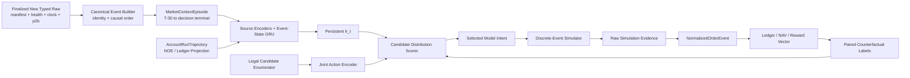

# 新采集数据唯一训练源核心训练框架

事项编号：`rebuild-core-new-data-only`

状态：`基础准备技术设计；FinalDatasetBoundaryStatus=DEFERRED_TO_OBSERVED_COLLECTION；BinanceAggTradeSchemaStatus=V3_AUTHORIZED_FOR_IMMEDIATE_DEPLOY；全部 Training Stage T0-T6 未授权`

对应需求：`/home/chillchill/btc-updown-marketmaker/demand/rebuild-core-new-data-only-demand.md`

对应执行计划：`/home/chillchill/btc-updown-marketmaker/plan/rebuild-core-new-data-only-plan.md`

对应 changelog：`/home/chillchill/btc-updown-marketmaker/changelog/rebuild-core-new-data-only-changelog.md`

## 1. 技术结论

本项目 v1 主框架确定为：

> `ESAR-v1 = Event-State GRU + Joint Candidate-Action Ranker + Discrete-Event Simulator`

它不是旧 MPV2 的改名版本，也不是先训练 alpha 再用固定规则下单。其核心语义是：

1. 新采集事件按 collector receive time 因果回放；
2. 市场状态从 T-30 开始、按 market ID 持续更新；
3. `StateUpdateContract` 先更新状态；每个有效模型可见事件都由 `DecisionTriggerContract` 触发一次 stateful cell 与 intent 评估；
4. 模型一次比较多个完整、合法的 Model Intent candidate；
5. 只在预注册、与收益无关的 decision-state 子集上，为有限 candidate 使用相同未来 tape 和随机数做昂贵反事实 rollout；runtime 仍逐有效事件评估；
6. 模型学习完整回报分布、执行风险和 joint action ranking；
7. simulator raw evidence 经 NOE 和 ledger 形成 reward，模型不得读取 simulator 私有真值。

必须同时保留三类对照：

- 最低容量基线：逻辑回归/小 MLP 的 causal snapshot predictor；
- 非神经策略基线：XGBoost grouped action ranker；
- 同预算序列 challenger：causal TCN。

Transformer/TLOB、Mamba/SSM、Neural CDE、CQL/IQL、Decision Transformer、PPO/SAC 均不是 v1 主路径。

## 2. 为什么选择这个框架

### 2.1 数据实际能支持什么

新 `data-collect` 提供市场证据，而不是交易行为数据。当前训练准备需同时补齐 Gamma 日级 `priceToBeat/finalPrice` 和 Binance aggTrade `T` 边界证据，因此以下能力以 `PriceToBeatAuthorityContract`、`BinanceBoundaryReferenceContract` 和数据准入通过为前提：

- 因果 market representation；
- UP/DOWN outcome 与 probability calibration；
- 多 horizon 价格、波动、spread/depth 和 adverse-move proxy；
- 以真实市场轨迹驱动 simulator；
- 由 simulator 生成的反事实候选动作标签和完整 trajectory。

它不能直接支持：

- observed behavior cloning；
- 真实 `(state, action, reward, next_state, done)` offline-RL transitions；
- 真实 action-return trajectory 上的 Decision Transformer；
- 本账户真实 FIFO queue position、fill、cancel race 或 sellable maturity 标签。

因此，直接上 IQL/CQL/DT 会把 simulator 或规则 teacher 的偏差误称为真实行为分布；直接上 PPO/SAC 则容易在尚未校准的 simulator 中搜索漏洞。先做 supervised representation 与 counterfactual ranking，假设更少、可审计性更强。

### 2.2 为什么主干选择小型 stateful GRU

选择 GRU 不是因为旧项目用过 RNN，而是因为当前合同要求：

- 输入是变长、非均匀间隔事件；
- hidden state 必须从 T-30 持续到 market terminal；
- 在线每个事件只携带固定大小状态；
- 目标 live 主机只有约 2 vCPU/1.9 GiB；
- 训练 unroll 和在线 single-step 必须共用同一 cell；
- ONNX/Rust consumer 需要成熟算子和明确 hidden I/O。

[ONNX GRU](https://onnx.ai/onnx/operators/onnx__GRU.html) 已定义标准 hidden-state 输入输出。ESAR-v1 明确使用标准 GRU，加 delta-time/freshness/mask/multi-scale inputs，不使用自定义 time-decay cell，因此该导出依据成立。GRU 仍需由同输入、同参数上限、同 live p99预算的 TCN 证伪；架构名本身不构成成功证据。

### 2.3 为什么不照搬 DeepLOB 或 Transformer

[DeepLOB](https://arxiv.org/abs/1808.03668) 说明 CNN 可提取 LOB 空间结构、LSTM 可提取时间依赖，因此 ESAR-v1 只借用“小型 book spatial encoder”思想，不照搬其固定股票 LOB 输入和完整网络。

[TLOB](https://arxiv.org/abs/2502.15757) 一方面报告 Transformer LOB 模型的收益，另一方面也报告简单 MLP 可超过既有复杂模型，且加入 spread 成本后预测表现明显恶化。这正说明“更复杂的方向预测网络”不等于“更好的可交易策略”。当正式 cohort 只覆盖少量独立 UTC 日时，先用小模型和强基线更稳妥。

[TCN 的系统比较](https://arxiv.org/abs/1803.01271) 表明简单 causal convolution 在多类序列任务上可成为强起点，因此 TCN 是强制 challenger，而不是可有可无的附加实验。

## 3. 总体架构



图中的训练闭环是 simulator authority。future paper/live 只替换平台 authority，不允许替换 Model Intent、NOE、ledger 和 consumer contract。

## 4. Canonical event 与状态表示

### 4.1 原子事件

exact identity 下的 `CanonicalMarketEvent` 至少包含：

- `canonical_event_id`
- `transport_message_id`
- `connection_epoch`
- source-local `event_seq`
- collector-wide `global_ingress_seq`
- `child_index/child_count`
- `source_kind/event_type`
- causal-ingress `timestamp_received`
- `source_timestamp` 与语义类型
- `market_id/condition_id/token_id`
- `collector/schema/config_regime`
- `clock_status`
- `source_gap/freshness/reconnect_status`
- payload typed fields 与 source row locator
- price-to-beat authority/version reference（对 market metadata/state event）

exact mode 在官方SDK typed event进入共享causal queue的单一allocator内原子分配`timestamp_received + collector_run_id + global_ingress_seq`，并要求同run timestamp随seq非递减。offline/live均按`(timestamp_received, global_ingress_seq)`，global seq只作同time tie-break；source-local event_seq与transport child ordinal只验证局部顺序。Parquet物理row order、source timestamp、更早source-task receive time和connection-local seq都不是跨source因果权威。

一个 Polymarket frame 的所有 child change 必须先原子应用，再对每个受影响 active market 产生一次 model-visible event。

approximate schema 不伪造不存在的 `global_ingress_seq/event_seq/child_index`。source内batch key为`source_kind + timestamp_received_ms + collector_run_id + connection_scope_if_available`；不同source同receive-ms再组成`CrossSourceTieGroup`。组内只用稳定row locator列举成员并视为simultaneous，原子应用后对每个受影响active market各触发一次，prefetched只更新hidden。该模式可能合并多个真实frame，默认只支持`representation_only/non-promotable`。

### 4.2 两层 episode 与状态

训练和会计分为两个 authority 不同的层：

1. `MarketContextEpisode/MarketEventState`，按 market ID 隔离：
   - Up/Down Polymarket L2 book、best bid/ask、spread、depth、last trade；
   - Binance L2 checkpoint + continuous updates；
   - Binance aggTrade flow；
   - Chainlink BTC/USD；
   - Polymarket `priceToBeat`及其 precision、first-available/maturity/provenance；
   - Binance aggTrade 的 market-start/market-end venue-local boundary reference 及边界偏差；
   - market metadata、phase、time-to-expiry；
   - source freshness、missing/gap/reconnect masks；
   - 从 T-30 起的累计与多尺度统计；
   - GRU hidden。
2. `AccountRunTrajectory/AccountExecutionState`，由 NOE/ledger 投影并跨连续 market 持续：
   - cash、positions、conservative NAV；
   - open/pending orders、remaining size、order age；
   - pending submit/cancel/unknown outcome；
   - sellable balance、reserved amount；
   - realized/unrealized PnL 与 risk exposure。

allowance、wallet权限和 `PermissionVerdict` 不进入模型 AccountExecutionState，只进入 candidate legality/preflight 与 audit。两个连续 market 在 T-30 重叠时必须同时维护两个 `MarketEventState`；不得用“切换市场时 clear 一个全局 sequence”破坏 next market warmup。账户轨迹仍是共享经济事实，late fill/pending cancel/sellable maturity 可跨 market。

必须区分 `market_decision_done`、`market_settlement_done` 和 `account_run_done`。MarketContextEpisode 可以结束 intent，但经济 closure 只以 AccountRunTrajectory 为权威；per-market PnL 只是带 residual/external-flow bridge 的派生 attribution。

### 4.3 两类边界价格与状态重建

`PriceToBeatAuthorityContract` 仅围绕 Polymarket 平台字段保存：slug/market boundary、`polymarket_price_to_beat`、`polymarket_final_price`、无精度损失的十进制字符串、fetch time、HTTP/缺失状态、source URL、schema version 和整体 artifact hash。D+1 UTC 02:00 对昨天 D 的每个目标 slug 调用一次 Gamma `GET /events/slug/{slug}`；只有 `priceToBeat` 和 `finalPrice` 同时存在才记为该 market 回填成功。`closed`、`acceptingOrders`、`umaResolutionStatus`、winner one-hot 或结果交叉验证都不是准入门，不得使整日流程停止。D 的完整 288-slug 文件已存在时原样复用且不再请求；不设 D+2，不做语义重试。这是用户已批准的 Gamma 日级冷路径 SDK 缺口例外，不扩展为生产热路径的 raw REST 旁路。

未来 paper/live 热路径 handoff 合同必须显式传输可空的 `price_to_beat` 和 `final_price`，但不因缺失而阻断传输。冷路径回填值与热路径当时可见值必须保留各自的 available/receive time：`final_price` 和市场结束后才回填的 `price_to_beat` 只是 label/evaluation 证据，不得泄漏到更早的模型状态。

`BinanceBoundaryReferenceContract` 是独立的 venue-local 参考，不冒充 Polymarket/Chainlink 结算价：对 market start/end UTC 边界，分别选取 `trade_time (T) <= boundary` 的最后一笔 aggTrade；同一 `T` 有多笔时取 aggregate trade ID 最大者。产物保存 boundary UTC、选中的 `T`、aggregate trade ID、price、`boundary-T` 偏差、source row locator 和 schema/version。`binance_label_up = end_price >= start_price`，`polymarket_label_up = polymarket_final_price >= polymarket_price_to_beat`；两者不一致时保留 disagreement，不把 Binance label 改写成平台 reward/settlement authority。

模型可见 sequence 只从 T-30 开始，但 Binance L2 的 `state_reconstruction_lookback` 必须回溯到最近有效 snapshot/checkpoint并连续应用 updates。T-30之前证据只生成 checkpoint，不进入30秒模型序列。split边界没有完全属于本 split 的重建链时，丢弃边界 market 直到新 checkpoint 可用。

### 4.4 不规则时间与多尺度状态

每个 event 输入显式包含：

- `log1p(delta_t_global_ms)`；
- `log1p(delta_t_same_source_ms)`；
- 每个 source 的 age/freshness；
- missing/gap/reconnect masks；
- event/source embedding；
- time-to-start/time-to-expiry；
- event density 与 burst statistics。

v1 允许在真实事件到达时更新固定多尺度衰减统计，初始预注册尺度为：`250ms、1s、5s、30s、120s、T-30累计`。这些是 feature state，不是 decision tick；最终保留哪些尺度由 development folds 的 ablation 决定，不能使用 final holdout 选择。

### 4.5 StateUpdate、DecisionTrigger 与并发

- `StateUpdateContract` 对全部 canonical events 严格有序更新 source/market/account state。
- `DecisionTriggerContract` 定义有效模型可见事件；每个有效 transport/microbatch、NOE、TTL due或market/account事件都必须触发一次intent评估，不能以material-change、固定频率或计算预算跳过。
- global Binance/RTDS event 确定性fan-out到active和prefetched market；prefetched只更新hidden，active market各自评估。
- NOE/account event 路由到owning market并触发当前active market风险评估，使上一market late fill能影响当前决策。
- 每个market hidden由single-writer actor更新。事件一到入口即分配global monotonic`ingress_seq`，路由后只推进`relevant_pending_watermark[market_id]`；account-domain事件再fan-out到受影响active markets。推理绑定`market_id + state_version + causal_cutoff + relevant_pending_watermark[market_id]`。完成时只要该domain有更高relevant ingress已到达，即使尚在队列，旧结果也stale不得执行；仅更新另一个prefetched market且不影响共享账户的event不能使当前active intent无故stale。每个会使某active market stale的relevant event都必须触发该market重评。
- bounded queue过载时进入permission层fail-closed/no-new-submit并追赶state，不丢事件、不临时合批、不切固定tick。无法满足持续burst吞吐即模型配置FAIL。

## 5. ESAR-v1 模型结构

### 5.1 输入编码器

1. Polymarket book encoder：Up/Down token 分别取训练合同冻结的 top-K levels，以相对 mid/tick 的 price distance、`log1p(size)`、side、level mask 编码；小型共享 level MLP 或 1D causal/spatial CNN 后做 pooling。
2. Binance book encoder：使用从 snapshot 连续重建的 top-K bid/ask 与 imbalance、microprice、spread、depth slope；结构与 Polymarket 分开，不能共享未验证的尺度。
3. Trade/RTDS encoder：aggTrade direction/size/burst、BTC/Chainlink returns、Binance start-reference drift、freshness 和 source divergence 进入小 MLP；market-end Binance reference 只用于 label/evaluation，不作为早期输入。
4. Metadata/time encoder：仅读取当时已可见的 Polymarket `priceToBeat` 及其 freshness/maturity、market phase、time-to-expiry、tick/min size、fee/reward eligibility 的已知 mask；`finalPrice` 只用于成熟 label/evaluation。
5. Account/order encoder：只读取 NOE/ledger 投影，不读取 simulator 私有 queue/future 状态。

top-K 初版只在 `K ∈ {10, 20}` 中预注册比较；最终值在 development fold 冻结。没有证据时不把全深度直接塞入网络。

### 5.2 主干

v1 primary config：

```text
source encoders + event/time/mask embeddings
                 ↓
        fused event vector x_t
                 ↓
  1-layer standard GRU, hidden_size=128
                 ↓
       persistent market state h_t
```

约束：

- 初始总 trainable parameters 不超过约 2M；
- 只允许预注册的 `hidden_size ∈ {64,128}` 与 `layers ∈ {1,2}` 小网格；
- 先在单张 5090 上 profile；
- hidden 在 physical chunk 之间 carry；TBPTT contract 必须冻结 chunk length、no-grad burn-in 和 loss window，detach不等于解决长程学习；
- hidden 只在明确 market lifecycle terminal/reset receipt 后清除；
- 抽样 market 必须做 full-unroll/no-detach 对照、早期 T-30 event干预对后期输出测试，以及 remove-hidden/remove-multiscale ablation；
- 随机 chunk 必须从前序事件 no-grad burn-in 重建 hidden；
- 相同 event/state 的 training unroll、ONNX single-step 和 Rust runtime 输出必须数值对账。

TCN challenger使用完全相同输入和参数上限，并必须单独报告实际wall-clock receptive-field coverage、streaming cache、峰值内存和同一live p99预算；只匹配参数量而忽略cache/覆盖范围不算公平对照。

### 5.3 监督辅助 heads

辅助 heads 用于学习因果 market representation，不直接下单：

- terminal UP/DOWN probability；
- 多 horizon Polymarket/BTC return quantiles；
- volatility、spread/depth transition；
- adverse-move proxy；
- source gap/freshness/regime；
- representation uncertainty（仅在完成校准并由 risk selector消费时部署，否则保留 training/audit-only或删除）。

分类用 class-balanced BCE/交叉熵作为优化项，同时报告 Brier、ECE 和 reliability diagram。概率校准至少使用 temperature scaling 基线；[现代神经网络校准研究](https://proceedings.mlr.press/v70/guo17a.html) 表明 temperature scaling 是简单且有效的起点。

辅助 loss 必须有 mask 和 maturity；未成熟 target 不写零。多任务权重只在 development folds 冻结，不能根据 final holdout 调整。每个 head 的 loss、calibration 和 consumer 写入 `ModelOutputConsumerMatrix`。

## 6. Joint Candidate-Action Scorer

### 6.1 完整 candidate，不再独立拼 heads

一个 candidate 是完整、可执行的 Model Intent，而不是独立 quote/offset/size logits 的笛卡尔拼接。其逻辑结构为：

```text
CandidateIntent {
  intent_type: no_op | no_submit | submit | cancel | replace |
               cancel_all | cancel_only | pause,
  operations: [
    {token, side, price_offset_ticks, size_bucket,
     order_type, post_only, ttl_or_expiration, target_order_ref}
  ],
  risk_intent,
  candidate_contract_version
}
```

`no_op` 表示保留现有订单；`no_submit` 表示本次不新增订单；`cancel` 与 `pause` 具有不同 lifecycle 语义，不能合并为 Hold。

v1 candidate budget 固定上界：每个评估 state 不超过 `32` candidates；每 candidate 不超过 `2` 个 logical quote legs 和 `4` 个按确定顺序执行的 atomic platform operations。固定离散 grid 生成超过上限时配置必须 fail closed，不能先用模型 score 或隐藏启发式粗筛，否则 enumerator 会变成影子策略。

初版 candidate templates 可以包括：

- 保留现有订单；
- 不新增但不撤单；
- 单 outcome 报价；
- Up/Down 双 outcome 联合报价；
- replace 一个或多个现有订单；
- cancel 指定订单；
- cancel-all/cancel-only；
- pause/abstain。

每个 candidate 内含完整 side/offset/size/TTL，不允许 runtime 再用固定常数补成另一套策略。

`ModelRiskMode::{Pause,CancelOnly}` 是持久 model-bundle 状态转换，必须带 `effective_from`、market/account作用域、expiry/退出条件、resume event和重启恢复；它与权限层 `PermissionVerdict::{NO_SUBMIT,CANCEL_ONLY}` 使用不同命名空间。多操作 candidate 必须定义执行顺序、per-item accepted/rejected、部分失败与补偿事件。

### 6.2 Candidate enumerator 的边界

enumerator 只负责：

- 当前官方平台支持的 order type；
- tick/min-size/post-only/expiration 合法性；
- sellable balance、reserved balance 和 open-order 上限；
- allowance/wallet permission 只作为不进模型的 hard preflight；
- user-approved hard risk limits；
- 去除重复或语义等价 candidate。

enumerator 不负责：

- 决定方向；
- 选择“更好”的 offset/size/TTL；
- 根据 alpha 隐式强制下单；
- 在模型后加固定 threshold 或 fallback 策略；
- 把非法 candidate 变形成另一笔合法订单。

### 6.3 Scorer 与输出

每个 ragged candidate 经共享 action encoder 编码，再与 `h_t`、账户状态拼接：

```text
z_j = ActionEncoder(candidate_j)
u_j = Scorer(h_t, account_state_t, z_j)

u_j -> return quantiles q05/q25/q50/q75/q95
     -> fill probability
     -> partial-fill probability conditioned on fill
     -> adverse-selection quantiles
     -> reject/lifecycle outcome probabilities
     -> capital/inventory/drawdown projections
```

模型选择器使用版本化 risk profile 对同一 candidate 的分布输出计算 utility；它不得重新生成策略。

`ModelOutputConsumerMatrix` 必须逐字段标记：

| 输出 | 训练 consumer | runtime consumer | bundle规则 |
|---|---|---|---|
| outcome/dynamics heads | representation loss、calibration、audit | 默认无 | 不得宣传为下单控制 |
| representation uncertainty | calibration/audit | 仅当 risk selector 明确映射到 no-submit/pause | 无明确消费则从部署输出移除 |
| return quantiles/expected-shortfall | quantile/tail loss | risk utility 与 candidate排序 | 必须部署并 parity |
| fill/partial/adverse/reject heads | masked simulator auxiliary loss与诊断 | 只有被 risk utility/validity规则明确消费的字段 | training-only字段不进入runtime接口 |
| capital/inventory/drawdown | supervised risk losses | risk utility/hard risk audit | 单位与归一化冻结 |
| selected risk intent | joint ranking/state-machine loss | ModelRiskStateMachine | 不得被runtime覆盖 |

逐维 perturbation 必须改变对应 Model Intent/simulator command；training-only auxiliary head 不需要改变 action，但必须有明确训练/审计 consumer且不得伪装成runtime能力。

### 6.4 Ranking loss

每个 `decision_state_id` 是一个 group，group 内是同一 state 的不同 candidate。主训练目标由三部分组成：

1. paired ranking loss：比较 common-random-number rollout 下的风险效用；
2. quantile pinball loss：学习完整经济回报分布；
3. masked execution auxiliary losses：fill、partial fill、adverse selection、reject/lifecycle。

对每个共同 seed/scenario 先计算 paired difference `ΔJ = J_a - J_b`。只有 `ΔJ` 的 paired interval 完全落入预注册 equivalence band 才标记 tie；边际区间重叠或“尚不确定”不等于已证明等价。

XGBoost 基线使用同一 `decision_state_id` 作为 query group；[XGBoost Learning to Rank 官方文档](https://xgboost.readthedocs.io/en/stable/tutorials/learning_to_rank.html) 支持 query-grouped pairwise/LambdaMART 目标。

## 7. 离散事件模拟平台

### 7.1 simulator 的权威位置

simulator 接收 causal market events 与 Model Intent，输出平台 raw simulation evidence，再走共享 NOE 和 ledger：

```text
market event / Model Intent
          ↓
discrete-event platform simulator
          ↓
raw accepted/rejected/fill/cancel/settlement evidence
          ↓
NormalizedOrderEvent
          ↓
ledger / conservative NAV / reward vector
```

不允许 simulator 直接从私有真实 queue 或未来路径写 reward。通用模拟器可提供设计思想，但不能替代本项目平台语义。例如 [ABIDES](https://arxiv.org/abs/1904.12066) 可借鉴离散事件 kernel、消息和延迟结构；[Queue-Reactive 模型](https://arxiv.org/abs/1312.0563) 可借鉴 book-state-dependent intensity，但 Polymarket 聚合 L2 不能识别本账户真实 FIFO 位置。

### 7.2 平台规则与状态机

先冻结 `SimulatorCapabilityMatrix`。v1 只实现已冻结 candidate surface 实际使用的 order types、lifecycle和会计路径；unsupported capability fail closed，不为追求“全平台模拟”先造第二套SDK/NOE/ledger。对每个 enabled capability 至少覆盖其相关项：

- create/sign/post/ack/user-channel/cancel 的分阶段延迟；
- accepted、rejected、unknown submit outcome；
- candidate实际启用的 GTC/GTD/FAK/FOK 与 post-only；
- current tick/min-size、balance/permission preflight/reservation；
- full/partial fill 与 remaining quantity；
- queue proxy/fill hazard；
- cancel race、matched-cancel、late fill；
- 与当前候选相关的 restart/rate-limit/reconnect stress；
- provisional match、confirmed/failed 与 compensating events；
- sellable maturity、resolution、settlement；
- fee、maker/taker、rebate/reward eligibility。

merge/redeem等不影响v1候选和 AccountRunTrajectory closure 的路径可列为 unsupported/后置；不能因为未实现就伪造成功。

当前官方订单语义必须在实现时重新冻结：[Polymarket Order Lifecycle](https://docs.polymarket.com/concepts/order-lifecycle) 明确 post-only crossing 会拒绝、partial fill 后只能取消未成交部分，且订单/交易存在不同 lifecycle；[Market Channel](https://docs.polymarket.com/market-data/websocket/market-channel) 显示一个 `price_change` message 可以包含多个 child changes。实现不能把当前网页数值永久写死为平台真理。

### 7.3 参数 provenance 与情景

每个参数标记：

- `observed_new_data`
- `official_rule`
- `approved_external_execution_artifact`
- `assumed`
- `stress`

最少运行：

- conservative execution；
- base/provisional execution；
- high-latency；
- tail-latency/cancel-race；
- adverse fill；
- rule-regime stress。

新市场数据能测量特定 collector host/region/SDK/clock boundary 下的 `collector_visibility_delay` 与市场路径，不能测量 wire ingress、future live 主机端到端延迟或本账户 fill/cancel。只依赖 `assumed/stress` 的 policy 可用于研究性训练，但状态必须是 `non-promotable`。

### 7.4 Counterfactual rollout 与计算预算

不是对每个 runtime state 生成全候选标签。全事件 causal state update 和逐有效事件 intent evaluation 保持不变；昂贵 rollout 只针对 `CounterfactualLabelStateSet`。该集合按 event type、market phase、state novelty、inventory/open-order状态分层，从 development数据中按 outcome/PnL不可见的规则抽样。

对每个被选中的 state：

```text
(state_i, candidate_1, future_path_i, seed_k)
(state_i, candidate_2, future_path_i, seed_k)
...
```

所有 candidate 使用相同未来 market tape、同一 simulator regime 和 common random numbers。单candidate label包含版本化continuation policy，但只运行到`candidate_effect_terminal`，或达到branch hard limit后按censored/residual规则结束；不能只计算一次submit的即时spread，也不能无界跑到跨market AccountRunTrajectory terminal。每条label保存`continuation_policy_hash + aggregation_iteration`；不同continuation policy的labels不得混成同一无条件真值，必须分层或显式条件化。只有完整policy evaluation trajectory运行到AccountRunTrajectory terminal。

`CounterfactualRolloutBudgetContract` 在全量生成前必须冻结：每 market ranking groups、每 group candidates、scenario/seeds、总 branches、最大 wall-time/disk、每branch `max_events/max_wall_duration/max_market_transitions/max_pending_tail`、inclusion probability、training weight和resume策略。candidate上限同时受第6节 `32` 的硬上界约束，纵向切片实测后只能按预算进一步减小或经用户批准扩大。future tape只解码一次并由branch共享；完整逐事件策略 replay用于最终行为验证，不为每个event重新生成全后缀标签。

每branch定义`candidate_effect_terminal`：candidate-originated订单、成交、仓位和直接经济效果在owning market settlement/tail中闭合。达到硬上限仍有pending/unsettled effect时，label必须censored；只能按ConservativeNavValuationContract保存residual lower/upper bound或排除ranking，不能把截断NAV冒充成熟终局。跨连续market的AccountRunTrajectory用于完整policy评估，不使单candidate label无界延长。

### 7.5 CounterfactualMarketImpactContract

复用 observed future tape 只在 `small_agent_exogenous_market_path` 假设下有效。v1 必须：

- 按可见可成交深度、近期成交量和预注册 participation/impact上限约束 candidate size；
- 在每个branch维护 own resting order、own fill和own liquidity consumption overlay；
- 定义 observed后续 L2 update 与branch overlay的确定性reconciliation；
- 对marketable/大size action运行impact stress；
- 把超过有效容量的candidate排除或标记non-promotable，不得把固定future path结果称为真实市场冲击模拟。

continuation policy 初始为版本化、简单、可审计 baseline；模型稳定后再在更小的预注册 state subset 加入当前 policy 做 simulator dataset aggregation。初始轨迹混合 no-action、规则 baseline、分层随机合法动作和当前 policy，防止只在 teacher 状态上训练。[DAgger](https://proceedings.mlr.press/v15/ross11a.html) 说明顺序决策中状态分布依赖先前动作，普通 IID imitation 会累积误差；此处只借鉴 dataset aggregation 思想，不把 simulator 行为称为真实 demonstration。

## 8. Reward 与奖惩办法

经济 authority 是 `AccountRunTrajectory`，不是单个 MarketContextEpisode。每个 split 从独立冻结的 account fixture 开始，按时间 carry cash/position/order/settlement；训练产生的账户状态不能流入 calibration/holdout。

### 8.1 先保存经济分量，再生成 risk utility

每个 rollout 永久保存：

```text
realized_pnl
unrealized_pnl
conservative_liquidation_nav
fees
eligible_realized_rebates_or_rewards
inventory_exposure_integral
max_drawdown
downside_return_distribution
fill_count_and_size
adverse_selection
submit_cancel_replace_counts_by_authority
reject_late_stale_counts
capital_usage
settlement_result
censoring_and_maturity
```

禁止只保存一个不可解释 scalar。

### 8.2 经济 reward

先冻结 `ConservativeNavValuationContract`：

- cash 与 external cash flow；
- reserved cash 与 open/pending/unknown submit；
- sellable、immature、unsettled shares；
- one-sided/stale/missing book；
- 按可执行深度而不是默认 mid 的 liquidation price；
- fee/slippage/impact haircut；
- terminal winning/losing payout；
- valuation timestamp、source freshness和fallback顺序。

初始→首决策、决策→决策、末决策→terminal、zero-decision market 四类 interval 都必须生成。相邻 interval：

```text
r_economic(t)
  = conservative_NAV(t_next)
  - conservative_NAV(t)
  - external_cash_flow(t, t_next)
```

AccountRunTrajectory 终局：

```text
G_economic
  = terminal_settled_NAV
  - starting_NAV
  - external_cash_flow_adjustments
```

`sum(r_economic)` 与 `G_economic` 必须在会计容差内闭合。分别记录 exactly-one `market_decision_done`、`market_settlement_done`、`account_run_done`。fees、slippage、rebate/reward 一旦进入 ledger，不能在 reward 中重复处理。per-market attribution必须加总到account-run总额并显式列出residual/external-flow bridge。

### 8.3 风险惩罚与选择效用

初版 risk profile 使用：

```text
J(candidate)
  = E[G_economic]
  - lambda_inventory * E[inventory_exposure_integral]
  - lambda_drawdown * E[max_drawdown]
  - lambda_tail * expected_shortfall_loss
```

定义：

- inventory exposure 按真实事件间 `delta_t` 积分，不按 event/tick 数量累计；
- `expected_shortfall_loss >= 0`，由足够的 empirical rollout lower tail、密集lower-tail quantiles或独立expected-shortfall head估算；单个 `q05` 不是CVaR；
- lambda、tail alpha、capital normalization 和 practical-equivalence threshold 必须在 final holdout 前冻结并做敏感性分析；
- scorer 同时预测原始经济分布和风险分量，risk profile 可版本化，不需要重写历史标签。

默认不进入 scalar 的运营指标：reject、late、stale、submit count、cancel count。它们先作为硬 gate 和诊断；只有证明某项存在独立经济成本且不与 NAV 重复后，才能以新版本加入 utility。

### 8.4 明确禁止的 reward 做法

- 固定 idle/Hold penalty；
- 每个 event 都累加与时间无关的 penalty；
- 固定 `reward_clip=1` 或其他破坏 terminal signal 的裁剪；
- 把全市场 terminal PnL 重复写到每个 event；
- 把 unresolved/censored 写成零；
- 把 guard、market-end、stale-data、operator cancel 计作 model churn；
- 已经进入 ledger 的 fee/slippage/adverse effect 再扣一次；
- 用任意巨大负数代替 legal candidate filtering；
- 用成交次数、quote count 或 AUC 代替经济回报。

no-action 的经济 reward 可为零，但它仍与其他 candidate 的完整 counterfactual `J` 比较。不得为了避免全 no-action 人为强迫下单。

## 9. Training Stage T0-T6（全部未授权）

本节的 `T0...T6` 只描述未来训练流水线，避免与主计划当前“阶段 0 文档准备”混淆。唯一执行顺序是：先 simulator/NOE/ledger/reward 合同与非训练纵向切片，再监督 representation，再 counterfactual labels 和 ranker。

| Training Stage | 内容 | 主计划映射 |
|---|---|---|
| T0 | 冻结 cohort/canonical/split和纵切所需draft contracts；不训练 | 阶段 3 |
| T1 | 正式纵切、全量canonical、simulator pilot并冻结最终contracts | 阶段 4-6 |
| T2 | baselines 与监督 causal representation | 阶段 7.1-7.2 |
| T3 | 预算化 counterfactual candidate dataset | 阶段 7.3 |
| T4 | joint action ranking | 阶段 7.4 |
| T5 | 预算化 simulator dataset aggregation | 阶段 8.1 |
| T6 | 完整 event-trigger trajectory 与 frozen holdout | 阶段 8.2-8.4 |

### Training Stage T0：边界和合同冻结

- 先依实际累计数据的完整性和 schema regime 提交候选 cohort，再由用户冻结 final boundary；冻结前不生成 final split；
- 冻结 canonical events、p2b、features、splits和account fixtures；冻结candidate/output-consumer、simulator、market-impact、rollout-budget、valuation/reward的draft schema、接口和fail-closed边界，供纵向切片验证；
- 不运行模型训练或leaderboard。

### Training Stage T1：simulator 正式纵向切片

- 选取与收益无关、跨波动/流动性/coverage regime 的少量完整 market；
- 验证 event order、submit/fill/cancel/settlement、NOE、AccountRunTrajectory、ledger 和 reward closure；
- 运行 conservative/base/stress 参数与market-impact边界；
- property-based 守恒、确定性 replay和预算profile通过后，才冻结SimulatorCapability/Calibration、MarketImpact、RolloutBudget、Valuation与Reward contracts的最终版本并扩量。

### Training Stage T2：baselines 与监督 causal representation

- 建立 outcome常数/逻辑回归、小MLP、no-action、naive directional和简单规则maker基线；
- 从T-30 unroll，训练 outcome、return quantiles、volatility、spread/depth和freshness heads；
- 比较snapshot MLP、标准GRU与同输入/预算TCN；
- development folds选择，dedicated calibration单独冻结概率校准；
- T2只证明表示能力，不能授权下单。

### Training Stage T3：预算化 counterfactual candidate dataset

- 只对 `CounterfactualLabelStateSet` 枚举 ragged legal candidates；
- 按RolloutBudget/MarketImpact contracts和common random numbers批量rollout；
- 保存inclusion probability、training weight、distribution、risk vector、maturity、continuation-policy hash、simulator provenance和group ID；
- paired equivalence与uncertainty分开，不强造确定排名。

### Training Stage T4：joint action ranking

- 先训练 XGBoost grouped ranker；
- 再训练 ESAR-v1 GRU state + joint action scorer；
- 用同数据、同 seeds、同参数/live延迟预算比较 TCN challenger；
- action-surface/output-consumer audit 先于 PnL ranking。

### Training Stage T5：预算化 simulator dataset aggregation

- 在更小的预注册 subset 加入当前 policy 会访问的 inventory/open-order/cancel 状态；
- 仍保留 no-action、规则和分层随机 coverage；
- 监控 action support、sampling weight 与 simulator exploitation；
- 每轮固定 dataset/simulator/continuation-policy hash，不把不同policy labels混成同一真值。

### Training Stage T6：完整 trajectory 与 frozen holdout

- 对每个有效模型可见事件执行一次model intent评估，但不在每个event生成全候选counterfactual labels；
- final holdout 只运行一次正式验收；
- 评估 calibration、net EV、expected-shortfall/downside、drawdown、inventory、action support、regime、simulator sensitivity、market-impact capability 和 inference latency；
- 输出 training/evaluation candidate，不自动进入 paper/live。

## 10. Split 与统计设计

当前不固定起止日、UTC 日数或名义 market 数。用户将在 schema v3 重新部署后，根据实际累计数据的完整性、gap、clock 和 schema regime 选择 final cohort。旧方案 B 只作历史记录，不得回流为默认配置。

final cohort 冻结后，按完整 UTC 日从早到晚编号 `D1...DN`。标准 split 至少需要 `N >= 9`：最后两个完整 UTC 日作 frozen final holdout、其前一个完整 UTC 日作 dedicated calibration，更早日期作 model development，从而保留至少 5 日初始 train 和 1 日前推 validation。若 eligible 日不足，则扩大采集区间或由用户重新冻结 split，不通过缩减 holdout 或随机切分规避。

model-development 内使用 anchored expanding folds：默认最少 5 个完整 eligible 日作为初始 train，下一完整 calendar 日作 validation，随后逐日扩展。不能因为某天结果难看而跳过；coverage 不足只会使对应 gate 失败或 capability 降级。

每个 split 必须：

- 以 market 为最小 group；
- 同 market 的 source、T-30、label、candidate 和 simulator replicas 同 split；
- 一个 AccountRunTrajectory 不跨 split；每个 split 使用独立冻结的 starting cash/positions/open-orders/pending状态 fixture；
- split末尾延伸maturity tail直到open/pending/unsettled闭合，或隔离相关market；train policy产生的账户状态不进入calibration/holdout；
- state reconstruction chain必须完全属于该split，或属于该split独占且已从相邻split purge、从不作为训练example的reconstruction-only prefix；prefix范围/rows/hash写入split manifest。否则丢弃边界market；
- purge/embargo 覆盖最大 dependency horizon；
- normalization 仅 fit train；
- final holdout 的 market、label、指标和 simulator outcomes 不用于架构、阈值、risk weight 或规则调参。

如果 final cohort 仅包含少量 UTC 日，独立 regime 数仍会很少。final 仅有两个 UTC day clusters 时，不能宣称可靠 day-level bootstrap/cluster CI；必须逐日报告，使用预注册的 contiguous-market block 和 paired-market intervals 作条件性不确定性，regime 稳定性主要来自 development folds。数亿 rows 不得当 IID 样本。

final holdout 一旦被观察，后续若修复改变 dataset/split/simulator/reward/model contract，原 holdout 只能降为 diagnostic，不能再次称为 pristine holdout；重新正式验收需要新的未来未读 holdout 和用户批准。

## 11. Action-surface 与 consumer 硬测试

候选模型进入经济评估前必须通过：

1. raw logits/quantiles、decoded intent、simulator command 和 ledger effect 对账；
2. 每个 action 维度非零梯度和非退化 support；
3. side、offset、size、TTL、target-order、risk intent 逐维 perturbation；
4. alpha/account/order state zero、shuffle、scale intervention；
5. no-action、规则 action、negative/control candidate separation；
6. action temperature/risk-profile sweep；
7. 全 no-action、全 submit、全 cancel 和所有 candidate decoded 相同检测；
8. ONNX/PyTorch/Rust single-step 与 hidden carry parity；
9. market overlap、switch、restart replay 和 reset receipt；
10. StateUpdate/DecisionTrigger single-writer、state_version/causal_cutoff、stale intent拒绝和burst overload；
11. ModelOutputConsumerMatrix 与实际 consumer 一致，不得覆盖或忽略runtime字段。

全 no-action 不自动等于 bug；只有当 counterfactual 标签也支持不交易且 intervention 正常时，才可能是合理结果。所有 candidate decoded 相同、输出无 consumer 或 risk state 无影响则必定是失败。

## 12. mistake-log 失败闭环

| 历史失败 | ESAR-v1 的阻断机制 | 不能自动解决的剩余风险 |
|---|---|---|
| 只看极短片段/固定 seq_len | T-30 persistent state；TBPTT burn-in/full-unroll与早期event干预 | hidden 长程漂移仍需 ablation/replay |
| 固定 decision tick | 业务 event/NOE/TTL due 触发；physical chunk 不触发 | 高事件密度下仍需满足 CPU 预算 |
| market switch 清空 sequence | per-market hidden 并存、lineage/reset receipt | 进程重启需从事件重建 |
| alpha AUC 高但 selected EV 负 | alpha 只作辅助；joint candidate 按 ledger 净经济分布排序 | simulator 偏差仍会污染 EV |
| IQL 100% Hold | 不直接使用缺动作的 offline RL；paired counterfactual ranking；no-action 单独审计 | 真实无 edge 时合理 no-action 仍可能占主导 |
| MPV2 全 enabled/动作相同 | 完整 candidate 共同评分、action support 与 control separation 先于 PnL | candidate enumerator 设计仍可能限制 support |
| offset/size/risk head 未消费 | 每个维度进入完整 Model Intent，逐维 consumer perturbation | runtime parity 必须持续验证 |
| risk head 随机或被覆盖 | risk distribution 参与 loss；risk profile 版本化并直接选 candidate | risk 权重仍需用户/证据冻结 |
| reward 按 tick累积、settlement clip | AccountRunTrajectory、ValuationContract、真实 delta_t 风险积分、无固定 clip | conservative liquidation仍依赖可执行深度质量 |
| churn 把 guard cancel 算进模型 | authority-tagged cancel；默认运营指标不进 scalar | 平台隐性成本可能尚不可见 |
| per-file/random split 泄漏 | market/account-run group、time-forward、purge/embargo、frozen holdout | 短日期范围的统计能力仍弱 |
| full-range 被误作泛化 | final 两个 calendar 日只验收一次；全部 selection history 留痕 | 单次 holdout 仍不覆盖长期 regime |
| simulator 过度乐观 | provenance + capability/impact contracts + conservative/base/stress + non-promotable | 私有规则、真实 queue与市场冲击仍不可识别 |
| 订单/账本闭环错误 | raw evidence → NOE → ledger；property tests；reward closure | 程序 bug 只能靠实现测试发现 |

结论是：该框架针对已知失败机制建立了可验证阻断门，但模型结构本身不能“解决”短日期覆盖、真实执行不可观察、平台潜规则或程序正确性。缺少这些证据时，正确结果是保持 non-promotable，而不是提高模型复杂度。

## 13. 被否决或后置的路线

| 路线 | v1 判断 | 未来重新评估前提 |
|---|---|---|
| Behavior Cloning/AWBC | 无真实 behavior action，不作为主线 | 足够真实、可审计、非单一策略 demonstrations |
| IQL/CQL | 无真实 transition；历史已有 Hold collapse | 累积真实 paper/live action support、成熟 reward 和 OOD gate；[CQL](https://proceedings.neurips.cc/paper/2020/hash/0d2b2061826a5df3221116a5085a6052-Abstract.html)、[IQL](https://openreview.net/forum?id=68n2s9ZJWF8) |
| Decision Transformer | 无真实 action-return trajectory | 足够多样化、成熟的真实 trajectory；[Decision Transformer](https://papers.nips.cc/paper/2021/hash/7f489f642a0ddb10272b5c31057f0663-Abstract.html) |
| PPO/SAC | 会在未校准 simulator 中找漏洞；hybrid action复杂 | simulator reality gate、强 baselines、资源和 exploit tests 通过 |
| Transformer/TLOB | 数据日少、事件序列极长、在线状态复杂 | 同预算下稳定超过 GRU/TCN 且 live latency/memory通过 |
| Mamba/SSM | 当前没有项目收益证据，导出/runtime链更复杂 | 数据扩大、ONNX/Rust consumer成熟、明确长程收益 |
| Neural CDE/Hawkes | solver/likelihood复杂，不能解决 action/reward | 不规则时间基线失败且有稳定增益证据 |
| 完整 ABIDES/JAX-LOB 移植 | 交易所、二元 payoff、NOE/ledger语义不同 | 仅在可复用 kernel 明显降低总复杂度时局部借鉴 |

## 14. 工具、资源与产物

### 14.1 成熟工具边界

- PyArrow Dataset/Parquet：bounded、predicate-pushdown、streaming scan；
- PyTorch：ESAR-v1/TCN/MLP 训练；
- XGBoost：grouped learning-to-rank baseline；
- ONNX：明确 hidden-state single-step 导出；
- Rust runtime：future consumer、NOE、ledger 与 simulator hot path；
- property-based testing：订单、现金、仓位、settlement 守恒；
- 现有 repo experiment/trial ledger：记录全部成功与失败 run。

不因有多张 GPU 就默认上分布式训练。先用单 5090 profiling；数据加载、simulator rollout 或 model compute 哪一项成为实证瓶颈，再针对该瓶颈扩展。

### 14.2 Bundle 合同

```text
bundle/
  dataset_boundary_manifest.json
  split_manifest.json
  canonical_event_contract.json
  price_to_beat_authority_contract.json
  feature_schema.json
  state_update_contract.json
  decision_trigger_contract.json
  candidate_contract.json
  model_output_consumer_matrix.json
  counterfactual_rollout_budget_contract.json
  counterfactual_market_impact_contract.json
  simulator_capability_matrix.json
  simulator_calibration_manifest.json
  conservative_nav_valuation_contract.json
  account_run_contract.json
  reward_risk_profile.json
  model.onnx
  model.sha256
  normalizer.json
  training_run_manifest.json
  trial_ledger.jsonl
  action_surface_report.json
  evaluation_report.json
  runtime_parity_report.json
```

bundle 存在不等于通过。每个 manifest 必须互相引用 hash，任何输入、schema、simulator、risk profile 或 consumer 变化都使原验收失效。

## 15. 成功、失败与状态机

### 15.1 Training Stage 成功

- representation：严格前推下优于常数/简单 baseline，且 probability/quantile calibration 可解释；
- simulator：lifecycle/economic closure、determinism、property tests 和参数 provenance 通过；
- ranker：action-surface 有分离、相对基线有 paired net-EV/downside 改善；
- runtime：ONNX/Rust parity、event-to-intent latency 和 memory 通过；
- evaluation：多 seed、多 regime、多 simulator scenarios 稳定，不靠单一乐观参数盈利。

### 15.2 必须失败

- 日期边界未确认却生成 final split；
- 读取任何 old-datasets/旧 bundle；
- 缺失合格p2b authority却猜测或继续policy训练；
- 把 source timestamp 当 receive time；
- 依赖 `validated_markets` 的裁剪/物理顺序；
- child row 重复触发模型；
- 反事实rollout没有预算/抽样权重或超出market-impact能力；
- unresolved/censored 写成零；
- action 输出无 consumer 或被 runtime 覆盖；
- AccountRunTrajectory reward 与 ledger 不闭合；
- final holdout 被重复调参；
- 只有 assumed simulator 参数却宣称可 promotion；
- 单一 AUC/PnL/exit 0 被解释为成功。

### 15.3 本事项当前终点

当前终点是完成基础准备文档对齐，完成 Binance aggTrade schema v3 立即部署和 D+1 昨日归档链路修正。目标 cohort 尚未形成，`FinalDatasetBoundaryGate` 必须等待实际数据质量后由用户重新冻结，全部 Training Stage T0-T6 都没有开始。
