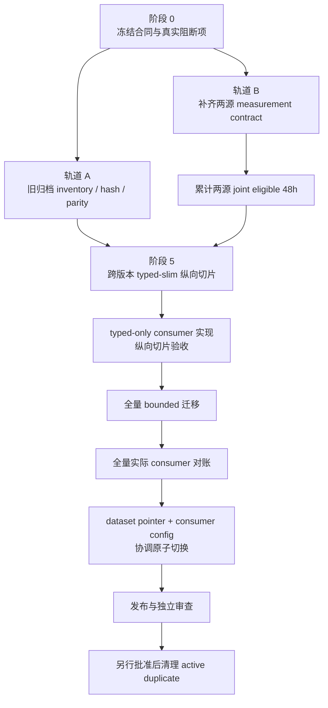

# 旧数据集 typed-slim 转换、模拟接收时间与 raw_json 精简处理计划

事项编号：`rebuild-core-old-data-only`

专项计划编号：`rebuild-core-old-data-only/dataset-processing`

状态：`草案，待用户审查；本文不授权修改 data-collect、远端转换、训练、删除归档或部署`

对应需求文档：`/home/chillchill/btc-updown-marketmaker/demand/rebuild-core-old-data-only-demand.md`

对应主计划：`/home/chillchill/btc-updown-marketmaker/plan/rebuild-core-old-data-only-plan.md`

对应 changelog：`/home/chillchill/btc-updown-marketmaker/changelog/rebuild-core-old-data-only-changelog.md`

历史参考文档：`/home/chillchill/btc-updown-marketmaker/demand/rebuild-core-demand.md`

## 1. 目标与执行边界

本专项计划只处理以下问题：

1. 盘点和冻结 5090 `/root/autodl-tmp/` 中历史日期数据与 `data-v1` 至 `data-v5`；
2. 验证旧 typed Parquet 是否完整承载训练所需的 `raw_json` 业务语义；
3. 在原证据归档保留 `raw_json` 的前提下，生成不含 `raw_json` 的 typed-slim 派生训练层；
4. 使用新采集的 `polymarket_market` 和 `binance_aggtrade` 两源合格 48 小时延迟证据，为旧 Polymarket 盘口和回填 Binance aggTrades 生成模拟接收时间；
5. 为后续事件驱动训练、模拟平台和 causal replay 提供可审计、bounded、可恢复的数据产物。

本文不授权：

- 修改、重启或部署 data-collect；
- 立即开始 48 小时正式计时；
- 原地删除旧 Parquet 的 `raw_json`；
- 删除、重打包或覆盖 5090 历史归档；
- 执行全量转换或训练；
- 将新数据中的价格、盘口、成交、标签或轨迹加入训练；
- 将模拟时间描述为历史真实接收时间；
- commit、push、paper、live、部署或资金操作。

## 2. 已核实判断

### 2.1 用户判断的结论

| 用户判断 | 结论 | 关键原因 |
|---|---|---|
| 旧 Binance aggTrades 是回填数据，也需要模拟接收时间 | 正确 | 旧 `timestamp_ms` 来自 Binance REST aggTrades 的 `T` trade time，只有批量下载作业时间，没有逐事件采集器接收时间 |
| 等新数据累计 48 小时后校准 Polymarket 与 aggTrade | 方向正确，但当前不能直接开始计时 | 48 小时 joint coverage 必须按 `intersection(union(PM eligible intervals), union(agg eligible intervals))` 计算；当前还缺 Binance `T` 同边界字段、Polymarket transport identity 和连续 clock evidence |
| `raw_json` 使旧 Parquet 过大 | 正确 | 本地 2026-06-30 全日 312 个 Parquet 中，`raw_json` 压缩 column chunk 约占 Parquet 文件总字节的 52.44% |
| typed 转换正确后，训练 Parquet 不再保留 `raw_json` | 条件成立 | 可以删除派生训练层的 `raw_json`；不能删除唯一证据层的 `raw_json`，且当前 consumer 与等价 gate 尚未就绪 |

### 2.2 本地空间证据

本地 `/home/chillchill/old-datasets/parquet-data-20260630` 的只读统计：

- Parquet 文件：`312`；
- Parquet rows：`49,543,942`；
- Parquet 文件合计：`5.825 GiB`；
- `raw_json` compressed column chunks：`3.054 GiB`；
- `raw_json` 占 Parquet 文件字节：`52.44%`；
- `/home/chillchill/old-datasets` 总占用约 `12G`，还包含 `6,109,241,264` bytes 的 `parquet-data-20260630.tar.gz`，因此压缩归档和解包目录同时存在。

用户指定的 4 小时窗口共有 `52` 个 Parquet、`1.053 GiB`，其中 `raw_json` compressed column chunks 为 `594,042,272` bytes，占 `52.526%`。该数字证明问题真实存在，但不能直接外推全部 5090 历史版本；全量 inventory 必须重新统计。

### 2.3 当前 typed/raw_json 审查证据

- Binance orderbook：全量 `14,400` 行 typed 对账、parsed-object 重建和 JSON parse 均为 `0 mismatch`；
- RTDS Chainlink：全量 `14,074` 行为 `0 mismatch`；
- Polymarket：覆盖指定窗口全部 `48` 个文件、`152` 个 row group 的分层样本，包含全部 `140` 条 `tick_size_change` 和 `48` 条 `market_resolved`，共 `1,549` 行为 `0 mismatch`；
- 以上只能证明当前已检查 schema/data 范围，没有证明全部日期、`data-v1` 至 `data-v5` 和未知事件均可删除 `raw_json`；
- Polymarket 的部分 resolution/tick-change 字段当前只在 `extra_json`，因此 `extra_json` 不得随 `raw_json` 一起删除；
- 当前 `raw_json` 是 `json.loads` 后由 sorted-key compact JSON 重写的解析语义镜像，不是原始 WebSocket frame bytes；
- 旧采集器已经过滤的 `new_market` 等事件无法由 typed 或 `raw_json` 恢复，必须记为历史能力缺口。

### 2.4 当前删除门仍关闭

现有删除门不能通过，原因包括：

1. Python data pipeline、Rust replay 和 recording/export 仍直接读取 `raw_json`；
2. 现有 coverage validator 只核对文件集合和 row count，不验证字段值、类型、顺序、extra 或 consumer parity；
3. typed 转换会合并 absent/null/empty，并改变部分 known 字段的原始 JSON 类型；
4. JSON malformed 行会被跳过而不是 fail closed；
5. aggTrades CSV boolean 对非 `true` 文本会归为 false，缺少非法枚举 gate；
6. 当前 `_migration_report.json` 没有 source/output sha256、schema fingerprint 或 row locator；
7. 抽查旧 Parquet 权限仍为 owner/group 可写，文件系统没有 immutable 标志，不能仅凭文字称为不可变归档。

## 3. 目标数据分层

```text
L0 Historical Evidence Archive
  旧 Parquet / 压缩归档
  保留 raw_json
  file sha256 + schema + row count + row locator
  写保护或版本化备份

L1 Typed-Slim Canonical Dataset
  只含 approved typed fields + 必要 extra/provenance
  不含 raw_json
  可通过 source file hash + row ordinal 回到 L0

L2 Arrival-Availability Overlay
  collector_recorded_time_ms（仅旧 recv_time_utc 合格来源）
  collector_recorded_topology_version + compatibility status
  simulated_received_time_ms（Polymarket 与回填 aggTrades）
  event_available_time_ms + provenance

L3 Training / Replay Artifacts
  features / labels / trajectories / split
  不读取新数据 market rows
  不读取 L0 raw_json
```

L0 与 L1 不能合并：L0 负责证据恢复，L1 负责训练效率。删除 L1 的 `raw_json` 不等于删除 L0 证据。

## 4. 总体顺序



阶段 0 后，旧归档盘点/typed parity 与新数据 48 小时采集可以并行；二者必须在纵向切片前汇合。这样既不空等 48 小时，也不会在 measurement boundary 错误时积累无效数据。

---

## 阶段 0：冻结 measurement、证据与删除合同

- [ ] 任务 0.1：冻结本专项文档权威
  - [ ] 步骤 0.1.1：记录 demand、主计划、专项计划、changelog 和原核心需求 sha256。
    - 验证：原 `demand/rebuild-core-demand.md` hash 与本事项开始基线一致；当前工作树其他用户改动不被覆盖。
  - [ ] 步骤 0.1.2：冻结“L0 永久保留 raw_json，L1 typed-slim 不含 raw_json”的分层。
    - 验证：任何脚本不得对 L0 执行 drop column、rewrite、delete 或 in-place compaction。

- [ ] 任务 0.2：解决 Binance aggTrade `T`/`E` measurement boundary
  - [ ] 步骤 0.2.1：登记旧 aggTrades `timestamp_ms = T`、新 `binance_aggtrade_v2.event_time = E` 的事实冲突。
    - 验证：代码和真实 Parquet schema 双重证明；不得用“通常接近”替代证据。
  - [ ] 步骤 0.2.2：未来 approved 校准数据必须通过 typed 列或只含校准字段的 sidecar，逐事件持久化 Binance `trade_time=T`。
    - 验证：同一行同时具有 `timestamp_received`、`E`、`T`、aggregate trade id、connection epoch 和 provenance；不修改旧行语义。
  - [ ] 步骤 0.2.3：把 `E-T` 仅作为诊断统计，不设为 approved transfer 备用分支。
    - 验证：未逐事件持久化 `T` 时，LatencyCalibration48hGate 始终 blocked；不得在后续实现中偷用 `timestamp_received-E`。

- [ ] 任务 0.3：解决 Polymarket transport identity 与 clock evidence
  - [ ] 步骤 0.3.1：在官方 SDK 提供的最早 transport message 接收边界、业务解析和 typed child-row fan-out 前，生成 transport event identity，并绑定 connection epoch、connection-local frame ordinal/source sequence、SDK envelope 或 payload digest/reference、child index/count 和共享 receive time。
    - 验证：不引入 raw REST、manual WebSocket 或影子 SDK；一个 SDK transport message 只贡献一个 latency observation，所有 child 可回到同一 transport reference，无法识别的 child row 数为零才可 approved。
  - [ ] 步骤 0.3.2：定义连续 collector clock evidence 和预冻结阈值。
    - 验证：每个 eligible hour 有 clock provider、offset/dispersion/leap/jump 样本和 artifact hash；事后单次 `chronyc` 快照不能补证过去区间。
  - [ ] 步骤 0.3.3：定义 source/writer supervision receipt。
    - 验证：source task、writer、channel、parser、drop、timeout、reconnect 和 process restart 分别可审计；segment `Complete` 不代替运行健康。

- [ ] 任务 0.4：分离 recorded-time 有效性与目标拓扑可比性
  - [ ] 步骤 0.4.1：盘点旧 Binance orderbook 与 RTDS Chainlink 的 collector host、region、clock evidence、采集代码和 measurement boundary。
    - 验证：每个可用 `recv_time_utc` 版本族都有 `collector_recorded_topology_version`；无法证明时显式记为 unknown，不凭路径或同一日期猜测。
  - [ ] 步骤 0.4.2：定义 `RecordedTimeValidityGate`。
    - 验证：采集代码、source timestamp、clock 和字段语义合格时，`event_available_time_ms = collector_recorded_time_ms` 可用于 historical-as-recorded replay；目标拓扑 unknown 不得反向使该值失效。
  - [ ] 步骤 0.4.3：定义 `TargetTopologyComparabilityGate`。
    - 验证：只有 compatible 才能把 recorded 与 simulated availability 描述为同一 target runtime 的 causal timeline；unknown/incompatible 仍可做明确标记的 mixed-boundary exploratory replay，但只能 provisional/non-promotable；明确要求 target-topology counterfactual causal fidelity 的任务须 blocked，除非有 approved topology-transfer artifact。

### 阶段 0 完成门

- Binance `T` 边界已有批准方案；
- Polymarket transport identity、source timestamp provenance 和 clock evidence 合同冻结；
- `RecordedTimeValidityGate` 与 `TargetTopologyComparabilityGate` 分别冻结；
- L0/L1 分层和 raw_json 删除边界冻结；
- 未经用户单独批准，不执行 data-collect schema/deployment 变化；
- 独立审查通过后，正式 48 小时计时才允许开始。

---

## 阶段 1：冻结 L0 历史证据归档

- [ ] 任务 1.1：建立 5090 全量 inventory
  - [ ] 步骤 1.1.1：只读枚举 `/root/autodl-tmp/` 历史日期归档、目录数据和 `data-v1` 至 `data-v5`。
    - 验证：记录相对路径、文件类型、大小、mtime、可读性、archive integrity、重复和损坏状态。
  - [ ] 步骤 1.1.2：按 source kind、schema fingerprint、dataset version、日期和平台 regime 建立版本族。
    - 验证：不能用文件名或目录名假设 schema 相同；未知 schema fail closed to quarantine。
  - [ ] 步骤 1.1.3：逐文件统计 row count、row group、column compressed bytes、`raw_json`/`extra_json` 占比。
    - 验证：输出全量和分 source/version 报告；空间收益使用 Parquet compressed column chunk，不用解压 JSON 长度估算。

- [ ] 任务 1.2：发布 HistoricalEvidenceManifest
  - [ ] 步骤 1.2.1：为每个源文件记录 archive id、relative path、sha256、bytes、schema fingerprint、row count 和 row-group layout。
    - 验证：manifest 自身有 sha256；重新扫描得到完全相同结果。
  - [ ] 步骤 1.2.2：定义最小 row locator 为 source file sha256 + source row ordinal。
    - 验证：抽样 ordinal 可稳定定位到 row group/row offset 并取回相同 `raw_json`；不默认写每行 hex hash。
  - [ ] 步骤 1.2.3：建立不可变控制。
    - 验证：同时具备 file-hash manifest、active copy 只读或 immutable、至少一个独立可恢复的 versioned copy/只读快照/对象存储副本，以及实际恢复演练；仅 `chmod` 单副本不能通过，恢复演练成功前不得删除 active evidence copy。

### 阶段 1 完成门

- 全部旧数据版本族和能力边界可追溯；
- L0 manifest、hash、row locator 和恢复路径闭合；
- 损坏、重复、未知 schema 单独 quarantine；
- 原始归档没有被修改。

---

## 阶段 2：冻结 typed-slim schema 与语义等价 gate

- [ ] 任务 2.1：定义逐 source normalization contract
  - [ ] 步骤 2.1.1：枚举 Polymarket、Binance orderbook、Binance aggTrades、RTDS Chainlink 和 metadata 的所有实际 event/schema 变体。
    - 验证：known、unknown、filtered-at-collection、unsupported 分开报告；采集缺失不能归咎于 typed 转换。
  - [ ] 步骤 2.1.2：定义允许的类型归一化和禁止损失。
    - 验证：明确 number/string、absent/null/empty、float precision、array order/arity 和字段 presence 的比较规则；未批准归一化为 mismatch。
  - [ ] 步骤 2.1.3：把所有训练和 replay 必需的 `extra_json` 字段提升为显式 typed 列。
    - 验证：tick-size、resolution/winner 等消费者字段不依赖解析 opaque JSON；未知扩展仍可保留小型 extra 以便审计。

- [ ] 任务 2.2：设计独立 streaming parity validator
  - [ ] 步骤 2.2.1：从 L0 evidence 独立生成 source-specific canonical event，不复用 converter 输出对象自证。
    - 验证：对 L0 已保存的 canonical JSON semantic mirror 支持精确数值策略、malformed quarantine 和稳定 ordered semantic digest；历史 duplicate key/wire bytes 已不可恢复，不得宣称可检测。
  - [ ] 步骤 2.2.2：从 typed + extra 独立重建同一 canonical event并逐路径比较。
    - 验证：输出 semantic/presence/type/numeric/order mismatch counts，以及文件、row ordinal、JSON path 样例。
  - [ ] 步骤 2.2.3：加入负向测试。
    - 验证：至少覆盖 absent/null/empty、numeric string、长十进制、synthetic duplicate-key 输入、nested unknown、不同 level pair 长度、非 object message/payload、非法 CSV boolean、额外 CSV 列、行删除/重复/换序、stale output 和 typed/raw 故意冲突；synthetic 测试不得被写成历史 duplicate-key 证明。

- [ ] 任务 2.3：执行代表性与风险定向 parity audit
  - [ ] 步骤 2.3.1：对每个 schema family、稀有 event、边界类型和已知高风险版本执行代表性逐行 semantic gate。
    - 验证：样本矩阵、选择规则和风险覆盖预冻结；所有 required semantic mismatch 为零，允许归一化有预冻结规则和计数。全库逐行 gate 留到阶段 7 与每个 shard 的实际转换同遍执行，避免 schema 修订导致重复全库扫描。
  - [ ] 步骤 2.3.2：记录 L0 证据精度边界。
    - 验证：typed-slim 不承诺恢复 wire bytes、frame wrapper、空白、key order 或 duplicate keys；locator 只能恢复 L0 中已保存的 canonical semantic-mirror row 和对应文件 bytes，不能恢复旧采集时已丢失的原始 frame。

### 阶段 2 完成门

- typed-slim schema、normalization version 和 parity validator 冻结；
- 所有 source/schema/event family 已有代表性/风险定向 PASS 或明确 quarantine；
- `extra_json` 的保留/提升字段边界明确；
- 尚未切换 consumer，也尚未删除任何 `raw_json`。

---

## 阶段 3：开始并累计两源 eligible 48 小时

- [ ] 任务 3.1：打开 Calibration48hStartGate
  - [ ] 步骤 3.1.1：确认阶段 0 的逐事件 `T`、Polymarket transport identity、Polymarket source-timestamp provenance、clock 和 supervision 合同已部署并通过短时验证。
    - 验证：记录合同生效 UTC、commit、binary sha256、schema version、config digest 和启动 receipt；此前数据不得拼入 approved 48 小时。
  - [ ] 步骤 3.1.2：冻结 eligible interval 计数规则。
    - 验证：全部 interval 使用半开区间 `[start_ms,end_ms)`；合并去重后的毫秒 duration sum 是唯一 gate 计数权威，完整 UTC hour/full-hour count 只是派生审计视图。partial hour 只有 clock/runtime-health evidence 覆盖精确边界时才按实际毫秒计入，不能整小时补齐；事故、gap、reconnect warmup、source/writer 退出或 schema/measurement 变化关闭当前 interval。

- [ ] 任务 3.2：持续累计 coverage
  - [ ] 步骤 3.2.1：分别计算 Polymarket 和 aggTrade 的 wall span、candidate duration、eligible duration/full hours、最长连续区间和 excluded intervals。
    - 验证：wall span 只报告，不作为 gate。
  - [ ] 步骤 3.2.2：计算两源 joint eligible interval 交集。
    - 验证：两源各自 cumulative eligible duration ≥ `172800000ms` 且 joint eligible duration ≥ `172800000ms`；如排除后不足，继续采集而不是放宽规则。
  - [ ] 步骤 3.2.3：按连接/健康区间冻结 block boundary。
    - 验证：后续 bootstrap 不跨事故或 reconnect boundary；最长 block 不超过真实连续健康区间。

- [ ] 任务 3.3：发布 CalibrationCoverageManifest
  - [ ] 步骤 3.3.1：记录每源 artifact、health、clock、timestamp、transport 和 coverage 统计。
    - 验证：manifest 与全部输入 sha256 对账；blocking reasons 为空才可 approved。
  - [ ] 步骤 3.3.2：输出 current verdict。
    - 验证：`approved/provisional/quarantined` 三值统一；segment Complete 不自动升级 calibration quality。

### 阶段 3 完成门

- Polymarket cumulative eligible healthy duration ≥ 48 小时；
- Binance aggTrade cumulative eligible healthy duration ≥ 48 小时；
- joint eligible healthy duration ≥ 48 小时；
- Binance calibration 使用与旧 `T` 相容的 measurement boundary；
- Polymarket unidentified transport child count 为 0；
- clock、source/writer health、incident exclusion 全部通过。

---

## 阶段 4：构建冻结的两源延迟校准 artifact

- [ ] 任务 4.1：生成 source-specific observations
  - [ ] 步骤 4.1.1：Polymarket 按 transport event 计算 `timestamp_received - platform_timestamp`。
    - 验证：每个 transport event 只计一次，child rows 不重复加权；collector-generated control/fallback timestamp 被排除。
  - [ ] 步骤 4.1.2：Binance aggTrade 按 `timestamp_received - T` 生成适配旧回填行的 observation。
    - 验证：同时报告 `E-T`，但不把 E/T 混成一个 source timestamp；aggregate trade id 重复和乱序单独检查。

- [ ] 任务 4.2：生成 baseline 和 stress distributions
  - [ ] 步骤 4.2.1：按 source、event/connection regime、必要 payload/burst bucket 构建 empirical distribution。
    - 验证：不从 p50/p85/p90/p95/pMAX 五点离散抽签；样本量不足的条件桶明确回退或 blocked。
  - [ ] 步骤 4.2.2：验证自相关和 burst。
    - 验证：需要时使用 block bootstrap/regime model；pMAX 只用于诊断或 tail stress。
  - [ ] 步骤 4.2.3：冻结 baseline/high/tail scenario。
    - 验证：每个 artifact 记录 input manifest hash、代码版本、seed contract、reference topology、适用 source 和 quality。

- [ ] 任务 4.3：验证确定性采样
  - [ ] 步骤 4.3.1：按 calibration hash、scenario、dataset seed、stable event id 和 replica id 派生随机键。
    - 验证：worker、shard、resume 顺序不改变结果；不同 seed 不改变基础事件和 split。
  - [ ] 步骤 4.3.2：保持 transport/source order 与 late arrival。
    - 验证：同 connection 不逆序；同 transport child 共享模拟时间；超过 market end 的事件不向前 clamp。

### 阶段 4 完成门

- 两源各有独立、冻结、可复算 calibration artifact；
- measurement boundary 与旧数据 source time 匹配；
- 分布、尾部、自相关、异常和 seed 验证通过；
- 新数据业务内容没有进入训练样本或模型特征。

---

## 阶段 5：跨版本 typed-slim + simulated-time 纵向切片

- [ ] 任务 5.1：冻结代表性样本矩阵
  - [ ] 步骤 5.1.1：覆盖 `data-v1` 至 `data-v5`、日期归档、CLOB/platform regime、全部 source/schema/event family 和缺失能力。
    - 验证：样本不只选最干净窗口；路径、hash、expected capability 固定。

- [ ] 任务 5.2：生成 typed-slim 候选
  - [ ] 步骤 5.2.1：从 L0 读取 typed/extra，写入新根目录，禁止复制 `raw_json`。
    - 验证：output schema 中 `raw_json` 列数为 0；typed/extra parity、row count、ordered digest 和 locator 全部通过。
  - [ ] 步骤 5.2.2：记录 L0 lineage。
    - 验证：每个 output shard 可通过 archive id、relative path、file hash 和 row ordinal 抽样回源。

- [ ] 任务 5.3：生成接收/可见时间
  - [ ] 步骤 5.3.1：Polymarket 历史盘口使用 Polymarket calibration 生成 `simulated_received_time_ms`。
    - 验证：source/platform timestamp 原样保留；不生成 collector-recorded 时间。
  - [ ] 步骤 5.3.2：回填 Binance aggTrades 使用基于 `T` 的 aggTrade calibration 生成模拟接收时间。
    - 验证：download started/finished time、E-based distribution 和其他 source 分布均不得替代 `T` 边界。
  - [ ] 步骤 5.3.3：Binance orderbook 与 RTDS Chainlink 只在旧 `recv_time_utc` 语义/clock 合格时映射为 collector-recorded time。
    - 验证：通过 `RecordedTimeValidityGate` 时 historical-as-recorded 的 `event_available_time_ms = collector_recorded_time_ms`，并记录 `collector_recorded_topology_version`；不合格或缺失行进入明确状态，不静默改用其他 source 分布。
  - [ ] 步骤 5.3.4：生成 `event_available_time_ms` 和 provenance。
    - 验证：物理兼容字段若命名为 `timestamp_received`，必须同时携带 `collector_recorded/simulated` provenance；`TargetTopologyComparabilityGate` 只控制目标拓扑声明和 capability。unknown/incompatible 仍可保留为 mixed-boundary exploratory replay，但只能 provisional/non-promotable；target-topology counterfactual 任务 blocked。

- [ ] 任务 5.4：执行 causal replay 纵向验证
  - [ ] 步骤 5.4.1：比较 L0 legacy path 与 L1 typed-only path 的 event envelope、顺序和状态。
    - 验证：无 cutoff 后可见、无事件无决策、同 seed 结果一致。
  - [ ] 步骤 5.4.2：量化实际空间和吞吐收益。
    - 验证：报告 raw_json、extra、locator 和新增 provenance 的净变化，不以理论 column size 冒充最终文件收益。

### 阶段 5 完成门

- 跨版本纵向切片 semantic mismatch 为 0 或已批准 normalization；
- typed-slim 无 `raw_json` 且可以回源；
- 两源模拟时间正确使用 source-specific calibration；
- causal replay、空间和资源验证通过。

---

## 阶段 6：实现并在纵向切片上验收 typed-only consumer

本阶段只完成 consumer 代码、配置合同和跨版本纵向切片验收。完整 L1 尚未生成，因此 active dataset pointer 必须继续指向 legacy；本阶段不得宣称已完成正式生产激活。

- [ ] 任务 6.1：迁移 Python data pipeline
  - [ ] 步骤 6.1.1：让 Polymarket、orderbook、Chainlink 和 metadata reader 消费 typed columns，不解析 `raw_json`。
    - 验证：schema 缺字段 fail closed；不存在 silent fallback to raw_json。
  - [ ] 步骤 6.1.2：对比 legacy/raw_json 与 typed-only 的 validation、labels、tables、features 和 ordered event digests。
    - 验证：预冻结等价规则内完全一致。

- [ ] 任务 6.2：迁移 Rust replay 和 recording/export
  - [ ] 步骤 6.2.1：实现同一 canonical event contract 的 typed reader。
    - 验证：Rust tests 不再仅构造 raw_json-only Parquet；typed/raw 冲突负例必须失败。
  - [ ] 步骤 6.2.2：比较 replay event trace、state transitions、labels 和 reports。
    - 验证：同一 seed/scenario 结果满足预冻结等价阈值；不通过则保持 legacy consumer。

- [ ] 任务 6.3：封闭影子依赖
  - [ ] 步骤 6.3.1：扫描训练配置、代码和测试中的 `raw_json` consumer。
    - 验证：typed-only candidate 路径命中数为 0；L0 legacy/audit 工具暂时保留命中并有明确边界，不允许 typed reader silent fallback。
  - [ ] 步骤 6.3.2：发布纵向切片 consumer 兼容 manifest。
    - 验证：`ConsumerCompatibilityManifest(scope=vertical_slice)` 为 PASS，覆盖全部已知 source/schema/event family；active dataset pointer 仍为 legacy。

### 阶段 6 完成门

- 所有正式训练/replay consumer 已有 typed-only 实现；
- 纵向切片 legacy 与 typed-only parity 通过；
- typed-only candidate 不读取 L0 raw_json，legacy active path 尚未切换；
- 独立阶段审查通过后才允许全量迁移。

---

## 阶段 7：全量 bounded 迁移与发布

- [ ] 任务 7.0：通过逐 filesystem 峰值磁盘容量门
  - [ ] 步骤 7.0.1：按真实纵向切片压缩率，对 source/staging/temp/checkpoint/candidate/final 所在的每个 filesystem 分别估算 L1、L2、归档解包或流式缓存、source staging、临时/失败/quarantine shard、checkpoint、manifest、并发增长、atomic publish 双版本窗口和恢复安全余量。
    - 验证：每个 filesystem 都满足 `free_bytes_at_start >= estimated_peak_additional_bytes + reserved_watermark_bytes`；容量不足时 fail closed，不得删除或覆盖 L0 腾空间。
  - [ ] 步骤 7.0.2：设置运行中低水位和停止策略。
    - 验证：每个 shard 启动前重新计算各 filesystem 的空闲空间并计入其他并发任务；触及低水位时停止新 shard、完成或回滚当前 atomic unit，不产生 partial publish，也不自动清理证据层。

- [ ] 任务 7.1：按 archive/day/source/market 分 shard 转换
  - [ ] 步骤 7.1.1：实现 bounded streaming、checkpoint、resume 和幂等输出。
    - 验证：峰值 RSS 不随总数据量线性增长；中断恢复不重复、不丢失。
  - [ ] 步骤 7.1.2：在转换同遍对每个 shard 全量逐行执行 schema、typed/extra semantic parity、row count、ordered digest、event identity、locator 和 simulated-time validation。
    - 验证：所有 required semantic mismatch 为零；失败 shard 进入 quarantine 且不污染 candidate 集合，也不以阶段 2 抽样替代本 gate。若发现新 schema/event family，必须回到阶段 2 和阶段 6，不能永久 quarantine 后继续宣称完成。

- [ ] 任务 7.2：冻结 quarantine、coverage 与 split 影响
  - [ ] 步骤 7.2.1：区分 required shard 与明确不进入正式训练 boundary 的 diagnostic/non-required shard。
    - 验证：正式 L1 发布默认 `required_shard_quarantine_count = 0`；required 的定义在查看失败结果前冻结。
  - [ ] 步骤 7.2.2：对每个非 required quarantine 生成 capability、日期、regime、source coverage、split 和 holdout 影响报告。
    - 验证：任何改变正式训练市场集合、时间边界、split 或 holdout 的排除都阻断发布，重新冻结受影响 boundary/split 并取得用户批准。

- [ ] 任务 7.3：发布 inactive 全量 candidate 与 manifests
  - [ ] 步骤 7.3.1：生成 boundary、typed-slim、calibration、split manifests，并引用阶段 6 的 vertical-slice consumer receipt；此时不得提前生成 full-dataset PASS。
    - 验证：新数据路径只出现在 calibration provenance；训练 market lineage 只指向旧数据；full-dataset consumer status 保持 pending。
  - [ ] 步骤 7.3.2：atomic publish 新版本根目录。
    - 验证：消费者看不到 partial output；candidate root 保持 inactive，old active pointer 不切换。

- [ ] 任务 7.4：执行全量实际 consumer compatibility gate
  - [ ] 步骤 7.4.1：让实际 Python、Rust replay 和 recording/export typed reader 对每个 shard 生成 ordered canonical-event digest，并与 L0 legacy audit reader 对账。
    - 验证：全部 shard/source/schema/event family 的 event-envelope count、content 和 order 一致；converter/reconstructor 不能替代实际 consumer。
  - [ ] 步骤 7.4.2：执行风险分层的深层 consumer 对比。
    - 验证：稀有事件、高风险 schema、边界日期和各 platform regime 的 validation、labels、tables、features、replay state/report 满足预冻结等价合同；抽样矩阵和阈值在运行前冻结。
  - [ ] 步骤 7.4.3：发布全量 consumer 兼容 manifest。
    - 验证：`ConsumerCompatibilityManifest(scope=full_dataset)` 为 PASS；typed active 配置无 `raw_json` 路径或 silent fallback。

- [ ] 任务 7.5：执行恢复、资源与 lineage 审计
  - [ ] 步骤 7.5.1：随机和风险分层抽样回到 L0 raw_json。
    - 验证：locator/hash 100% 成功；模拟字段不污染 L0。
  - [ ] 步骤 7.5.2：复算总空间、吞吐和资源收益。
    - 验证：报告按 source/version/filesystem 分解，列出全部 quarantine 和经批准的 boundary/split 影响。

- [ ] 任务 7.6：协调原子激活 dataset 与 consumer config
  - [ ] 步骤 7.6.1：把 versioned dataset pointer 与匹配的 typed-only consumer config 作为同一 activation receipt 切换。
    - 验证：preflight 同时校验 dataset/schema/consumer manifest hash；任一不匹配不切换，消费者看不到 dataset/config 半切换状态。
  - [ ] 步骤 7.6.2：执行激活后 smoke 和 rollback 演练。
    - 验证：失败时恢复旧 dataset pointer 与 legacy config；成功时 active path 只读 typed-slim，L0 `raw_json` 只用于独立审计/恢复。

### 阶段 7 完成门

- 全量 typed-slim 可恢复、可追溯、bounded；
- 峰值磁盘容量和运行中保留水位 gate 全程通过；
- `required_shard_quarantine_count = 0`；任何获批排除都已先重新冻结 boundary/split 并从 required 集合中显式移除，而不是带着 required quarantine 发布；
- `ConsumerCompatibilityManifest(scope=full_dataset)`、全量 consumer parity 与 causal validation 通过；
- dataset pointer 与 consumer config 已协调原子激活，并有 rollback receipt；
- L0、L1、L2、L3 权威边界清晰；
- 独立审查通过并形成范围明确的 commit/push 后，才可申请训练阶段。

---

## 阶段 8：active 存储精简与冷证据保留

- [ ] 任务 8.1：验证冷证据恢复
  - [ ] 步骤 8.1.1：从独立归档恢复若干完整文件，并用 manifest hash 验证。
    - 验证：恢复文件 sha256、schema、row count 和抽样 raw_json 与 L0 manifest 一致。
  - [ ] 步骤 8.1.2：确认 typed-slim 的所有 locator 可指向可恢复证据。
    - 验证：不存在只指向即将删除 active 路径的悬空引用。

- [ ] 任务 8.2：提交删除/归档决策单
  - [ ] 步骤 8.2.1：列出拟释放 active duplicate、保留副本、预计空间和 rollback。
    - 验证：删除范围不包含唯一证据、正式 typed-slim、calibration artifact 或 frozen holdout。
  - [ ] 步骤 8.2.2：向用户单独申请 destructive cleanup 授权。
    - 验证：未获得明确批准时不删除任何旧 Parquet、tar、cloud backup 或 raw_json-bearing evidence。

### 阶段 8 完成门

- 冷证据具备独立、可恢复、hash 一致的副本；
- active 训练路径只读取 typed-slim；
- destructive cleanup 有用户明确批准和审计 receipt；
- 清理后重新执行全量 boundary/locator/consumer 验证。

## 5. 最终验收标准

1. 旧数据仍是唯一训练 market source；新数据只贡献两源 latency calibration artifact。
2. Polymarket 历史盘口和回填 Binance aggTrades 均没有伪造 collector-recorded time；模拟时间 provenance 完整。
3. Binance aggTrade calibration 与旧 `T` trade-time measurement boundary 相容。
4. Polymarket 和 Binance aggTrade 各自 cumulative eligible healthy duration ≥ 48 小时，joint eligible duration ≥ 48 小时；wall span、事故和证据不完整区间未被误计。
5. Polymarket transport child rows 不重复加权；clock/source/writer health 证据完整。
6. recorded-time 有效性与目标 topology comparability 分别可审计；可信 recorded fact 不因目标拓扑 unknown 而丢失，不兼容或未知的混合时间线不被宣称为同一 runtime 的真实 causal order，也不得 promotion。
7. L0 证据层保留 `raw_json`，有 file hash、schema、row count、row locator 和可验证不可变控制。
8. L1 typed-slim 不含 `raw_json`，但保留全部 required typed/extra/provenance 和回源 locator。
9. 所有 source/version/event family 的 full semantic parity gate 在全量转换同遍通过；正式 boundary 默认 `required_shard_quarantine_count = 0`，任何改变 boundary/split 的排除都已重新冻结并获用户批准。
10. Python、Rust replay 和 recording/export 对全部 shard 完成实际 typed reader event-envelope 对账及风险分层深层验证；active 正式路径全部 typed-only，无 raw_json silent fallback。
11. legacy 与 typed-only 的 event、label、feature、replay 和 ordered digest 满足预冻结等价合同。
12. 全量转换 bounded/sharded/checkpointable，资源、吞吐、峰值磁盘空间和 artifact hash 证据完整。
13. 没有原地修改或删除旧归档；任何 active duplicate cleanup 都经过独立恢复验证和用户单独批准。

## 6. 为什么按此顺序

1. **先修 measurement contract，再等 48 小时**：错误的 E/T 边界、重复 child-row 权重或缺 clock 证据不会因为等待更久自动变正确。
2. **归档/parity 与采集并行**：等待 48 小时期间完成旧数据 inventory、schema 和 consumer 审查，减少总工期。
3. **先冻结 L0，再删 L1 的 raw_json**：typed-only 出错时仍能按 hash/locator 回源，不把空间优化变成不可逆证据丢失。
4. **先纵向切片，再全量迁移**：用少量跨版本样本发现 schema、类型、extra、consumer 和 causal 问题，避免在数百 GiB 数据上返工。
5. **先实现并验收 consumer，再全量生成、全量对账并协调激活**：纵向切片先消除 reader 返工风险；完整 L1 和 full-dataset consumer gate 通过前不切 active pointer，避免无完整数据可读或 dataset/config 半切换。
6. **最后才清理 active duplicate**：只有完整恢复演练、hash 对账和用户批准后，空间释放才不会破坏审计与回滚能力。

## 7. 阶段审查与推进规则

1. 每个任务完成后做自审：diff、需求一致性、测试证据、边界、资源和剩余风险。
2. 每个阶段完成后由独立审查者检查正确性、数据丢失、影子 fallback、过度设计和文档同步。
3. Critical/High/可执行 Medium 必须修复并复审；现实与本文冲突时记录 changelog 并请求用户决策。
4. 阶段通过后才创建范围明确的 commit/push；不得混入当前工作树其他用户改动。
5. 任何 data-collect schema/deployment、远端全量转换、训练或 destructive cleanup 都需要用户另行授权。
